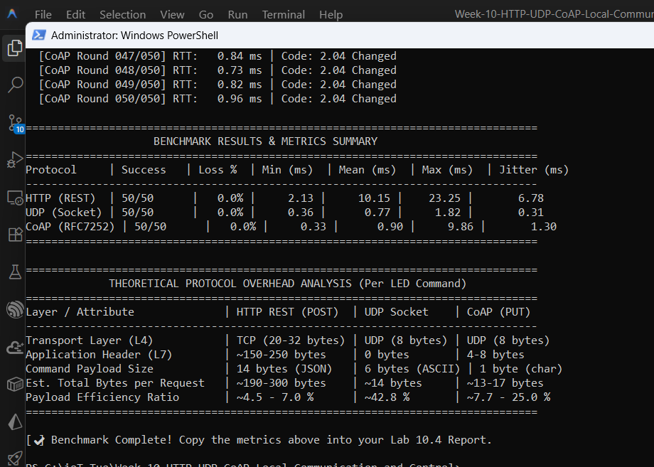

# ใบงานการทดลองที่ 10.4
### การทดสอบเปรียบเทียบสมรรถนะ (Benchmark) ของโปรโตคอลเครือข่ายด้วย Python Script และสถิติเชิงวิศวกรรม

> [!NOTE] **คำชี้แจง**
> ในใบงานนี้ นักศึกษาจะได้สวมบทบาทเป็น **วิศวกรระบบไอโอที (IoT Systems Engineer)** เพื่อประเมินและคัดเลือกโปรโตคอลสื่อสารที่เหมาะสมที่สุดสำหรับอุปกรณ์ฝังตัว โดยนำระบบที่ได้พัฒนาขึ้นจริงในแล็บ 10.1 (HTTP REST Server), แล็บ 10.2 (UDP Socket), และแล็บ 10.3 (CoAP Server) มาทดสอบเปรียบเทียบเชิงประจักษ์ ผ่านสคริปต์ทดสอบสมรรถนะอัตโนมัติ **`benchmark_protocols.py`** เพื่อวัดผลทั้งในมิติของ **ขนาดส่วนหัว (Header Overhead)**, **ความหน่วงเวลาตอบสนอง (Round-Trip Latency)**, **การกระจายตัวของเวลา (Jitter)**, **ความเสถียร (Packet Loss)** และ **การใช้หน่วยความจำแรม (RAM Footprint)**

---

## 1. วัตถุประสงค์การทดลอง
1. เข้าใจโครงสร้างและภาระส่วนหัว (Overhead) ของโปรโตคอล HTTP, UDP, และ CoAP ในระดับ Transport Layer (L4) และ Application Layer (L7) ตามมาตรฐาน RFC
2. สามารถใช้สคริปต์ Python ในการทดสอบวัดเวลาตอบสนอง (Round-Trip Time: RTT) แบบวนซ้ำเพื่อเก็บข้อมูลทางสถิติ (Min, Max, Mean, Jitter)
3. สามารถวิเคราะห์ความสัมพันธ์ระหว่าง Protocol Overhead กับประสิทธิภาพการใช้แบนด์วิดท์ (Payload Efficiency Ratio)
4. สามารถเปรียบเทียบปริมาณการใช้ทรัพยากรแรม (Free Heap Memory) บนชิป ESP32 ของแต่ละโปรโตคอลได้
5. มีทักษะในการตัดสินใจเชิงวิศวกรรมเพื่อเลือกใช้โปรโตคอลที่คุ้มค่าและเหมาะสมกับลักษณะของงาน IoT แต่ละประเภท

---

## 2. กรอบทฤษฎีการวิเคราะห์ภาระส่วนหัว (Protocol Overhead Breakdown)

ในการสั่งเปิดหรือปิดหลอดไฟ LED บน ESP32 เพียง 1 ครั้ง ข้อมูลจริงที่ต้องการสั่งการ (Payload) มีขนาดเพียง 1 ถึง 14 ไบต์ แต่ละโปรโตคอลจะสร้างภาระส่วนหัว (Header) ที่แตกต่างกันอย่างสิ้นเชิง:


<p align="center"> </p>
 


---

## 3. ขั้นตอนการทดลอง

### กิจกรรมที่ 10-4.1 การวิเคราะห์สัดส่วนข้อมูลตามมาตรฐานสากล (Architectural Byte Breakdown)
ให้นักศึกษาวิเคราะห์ขนาดของเฟรมข้อมูลตามมาตรฐาน RFC สำหรับการส่งคำสั่งเปิดไฟ LED
* **HTTP/1.1 (RFC 7230)**: อาศัย TCP 3-Way Handshake, ข้อความ Header เป็น Plaintext ASCII เช่น `POST /api/led HTTP/1.1\r\nContent-Type: application/json\r\n...`
* **UDP Raw Socket (RFC 768)**: ไม่ต้องมี Handshake, ไม่มีส่วนหัวในชั้น Application (0 ไบต์) ส่ง Payload ตรงเข้าพอร์ต
* **CoAP (RFC 7252)**: ทำงานบน UDP ใช้ Binary Header ขนาดคงที่เพียง 4 ไบต์ (Ver, Type, TKL, Code, Message ID)

#### ตารางบันทึกการคำนวณสัดส่วนประสิทธิภาพข้อมูล (Payload Efficiency)

| รายการประเมิน | HTTP REST (POST) | UDP Datagram | CoAP (PUT) |
| :--- | :---: | :---: | :---: |
| **ชั้นสื่อสาร L4 Transport** | TCP | UDP | UDP |
| **ขนาด L4 Header** | 20–32 ไบต์ | **8 ไบต์** | **8 ไบต์** |
| **ขนาด L7 Application Header** | ~180–250 ไบต์ | **0 ไบต์** | **4 ไบต์** |
| **ขนาดข้อมูลจริง (Payload)** | 14 ไบต์ (`{"state":true}`) | 6 ไบต์ (`LED_ON`) | 1 ไบต์ (`1`) |
| **ขนาดข้อมูลรวม (L4 + L7 + Payload)** | ~214–296 ไบต์ | **14 ไบต์** | **13 ไบต์** |
| **สัดส่วน Payload ต่อข้อมูลรวม (%)** | **~4.7 % - 6.5 %** | **~42.8 %** | **~7.6 %** |
| **ปริมาณข้อมูลเมื่อส่ง 10,000 ครั้ง** | ~2.5 - 3.0 Megabytes | ~140 Kilobytes | ~130 Kilobytes |

$$\text{Payload Efficiency Ratio} = \frac{\text{Payload Size (Bytes)}}{\text{Total Transmitted Bytes}} \times 100\%$$

> [!TIP] **ประเด็นสังเกตเชิงวิศวกรรม**
> สำหรับอุปกรณ์ IoT ที่ใช้แบตเตอรี่และเชื่อมต่อผ่านซิมเซลลูลาร์ (NB-IoT / 4G) ที่คิดค่าบริการตามปริมาณข้อมูล การส่งคำสั่งด้วย CoAP หรือ UDP จะช่วยประหยัดค่าแบนด์วิดท์และลดระยะเวลาการเปิดใช้วิทยุ (Radio Airtime) ได้มากกว่า HTTP ถึง **15–20 เท่า**

---

### กิจกรรมที่ 10-4.2 การทดสอบวัดความหน่วงเวลา (RTT Latency & Jitter Benchmarking)

ในการทดลองนี้ เราจะใช้สคริปต์ Python **`benchmark_protocols.py`** ซึ่งเป็นเครื่องมือวัดสมรรถนะแบบอัตโนมัติ ส่งคำสั่งควบคุมซ้ำจำนวน **50 ถึง 100 รอบ** เพื่อคำนวณหาค่าเฉลี่ยทางสถิติ:
* **Minimum RTT**  เวลาตอบสนองที่เร็วที่สุด (ms)
* **Maximum RTT**  เวลาตอบสนองที่ช้าที่สุด (ms)
* **Average (Mean) RTT**  เวลาตอบสนองเฉลี่ย (ms)
* **Jitter (Standard Deviation $\sigma$)**  ความแปรปรวนของเวลา สะท้อนความสม่ำเสมอของเครือข่าย
* **Packet Loss Rate (%)**  สัดส่วนคำขอที่สูญหายหรือไม่ได้รับคำตอบภายใน Timeout (2 วินาที)

#### 1. ตรวจสอบการติดตั้งไลบรารีบนคอมพิวเตอร์
เปิด PowerShell บนเครื่องคอมพิวเตอร์:
```powershell
pip install aiocoap
```

#### 2. รันสคริปต์ Benchmark
สคริปต์ `benchmark_protocols.py` ได้ถูกจัดเตรียมไว้ในโฟลเดอร์โปรเจกต์ นักศึกษาสามารถรันคำสั่งโดยระบุ IP ของ ESP32  ซึ่งดูได้จาก terminal ของ ESP32  จากตัวอย่างด้านล่างนี้ เราได้  IP = 192.168.1.181)

```
I (823) wifi:dp: 1, bi: 102400, li: 3, scale listen interval from 307200 us to 307200 us
I (903) wifi:AP's beacon interval = 102400 us, DTIM period = 1
I (1863) esp_netif_handlers: sta ip: 192.168.1.181, mask: 255.255.255.0, gw: 192.168.1.1
I (1863) COAP_LAB: Connected! IP Address: 192.168.1.181
I (1863) COAP_LAB: CoAP Server listening on port 5683...
I (1863) COAP_LAB: Ready! Test CoAP with: python test_coap.py
I (1873) main_task: Returned from app_main()
```


สคริปต์ `benchmark_protocols.py` สามารถคัดลอกได้จากหัวข้อ  **A. สคริปต์ python `benchmark_protocols.py` สำหรับทำ benchmark โพรโตคอลต่าง ๆ** ด้านล่างสุดของใบงาน (กดเพื่อคลี่ออก)


```powershell
# รันแบบ Interactive ให้เลือกเมนู
python benchmark_protocols.py --target 192.168.1.181 --rounds 50
```

หรือระบุโปรโตคอลที่ต้องการทดสอบโดยตรง:
```powershell
# ทดสอบ CoAP (สำหรับเฟิร์มแวร์ Lab 10.3)
python benchmark_protocols.py --target 192.168.1.181 --protocol coap --rounds 50

# ทดสอบ UDP Socket (สำหรับเฟิร์มแวร์ Lab 10.2)
python benchmark_protocols.py --target 192.168.1.181 --protocol udp --rounds 50

# ทดสอบ HTTP REST (สำหรับเฟิร์มแวร์ Lab 10.1)
python benchmark_protocols.py --target 192.168.1.181 --protocol http --rounds 50
```

**หมายเหตุ**
1. นักศึกษาสามารถทดสอบกับเฟิร์มแวร์ปัจจุบันที่แฟลชอยู่บนบอร์ด แล้วนำผลมาบันทึกลงตาราง
2. ต้องย้อนกลับไป flash โพรโตคอลในใบงาน 10-1 และ 10-2 ด้วย แต่ละใบงานให้ทดสอบตามโพรโตคอลนั้น

#### ตัวอย่างผลลัพธ์จากสคริปต์ เมื่อ ESP32 รันใบงานที่ 10-3
```text
  [*] Starting CoAP Benchmark -> coap://192.168.1.181:5683/actuator/led (50 rounds)...
  [CoAP Round 001/050] RTT:  68.42 ms | Code: 2.04 Changed
  [CoAP Round 002/050] RTT:  10.59 ms | Code: 2.04 Changed
  [CoAP Round 003/050] RTT:   8.58 ms | Code: 2.04 Changed
  [CoAP Round 004/050] RTT:   9.85 ms | Code: 2.04 Changed
  .
  .
  . 
  [CoAP Round 049/050] RTT:   8.35 ms | Code: 2.04 Changed
  [CoAP Round 050/050] RTT:   8.80 ms | Code: 2.04 Changed

================================================================================
                    BENCHMARK RESULTS & METRICS SUMMARY
================================================================================
Protocol     | Success   | Loss %  | Min (ms)  | Mean (ms)  | Max (ms)  | Jitter (ms)
--------------------------------------------------------------------------------
CoAP (RFC7252) | 50/50      |   0.0% |     8.35 |     12.93 |    68.42 |       8.85
================================================================================

================================================================================
             THEORETICAL PROTOCOL OVERHEAD ANALYSIS (Per LED Command)
================================================================================
Layer / Attribute              | HTTP REST (POST)  | UDP Socket    | CoAP (PUT)
--------------------------------------------------------------------------------
Transport Layer (L4)           | TCP (20-32 bytes) | UDP (8 bytes) | UDP (8 bytes)
Application Header (L7)        | ~150-250 bytes    | 0 bytes       | 4-8 bytes
Command Payload Size           | 14 bytes (JSON)   | 6 bytes (ASCII) | 1 byte (char)
Est. Total Bytes per Request   | ~190-300 bytes    | ~14 bytes     | ~13-17 bytes
Payload Efficiency Ratio       | ~4.5 - 7.0 %      | ~42.8 %       | ~7.7 - 25.0 %
================================================================================

[✔] Benchmark Complete! Copy the metrics above into your Lab 10.4 Report.
```

#### 3. ตารางบันทึกผลการทดสอบ RTT จริง (หน่วย: มิลลิวินาที ms)

<p align="center">

<br><b>รูปที่ L10-4.A</b> ผลการทดสอบเปรียบเทียบ Benchmark ทั้ง 3 โปรโตคอล (50 รอบ)
</p>

| โปรโตคอล                       | จำนวนรอบที่สำเร็จ | Packet Loss (%) | Min RTT (ms) | Mean RTT (ms) | Max RTT (ms) | Jitter / StdDev (ms) |
| :----------------------------- | :---------------: | :-------------: | :----------: | :-----------: | :----------: | :------------------: |
| **HTTP REST (`/api/led`)**     |      50 / 50      |     0.0 %       |   2.13 ms    |   10.15 ms    |   23.25 ms   |       6.78 ms        |
| **UDP Socket (`พอร์ต 3333`)**  |      50 / 50      |     0.0 %       |   0.36 ms    |    0.77 ms    |    1.82 ms   |       0.31 ms        |
| **CoAP PUT (`/actuator/led`)** |      50 / 50      |     0.0 %       |   0.33 ms    |    0.90 ms    |    9.86 ms   |       1.30 ms        |

---

### กิจกรรมที่ 10-4.3 การตรวจสอบหน่วยความจำบน ESP32 (RAM Footprint)

ตรวจสอบการใช้ทรัพยากรแรมบนบอร์ด ESP32 โดยสังเกตค่า `free_heap` จาก Log Monitor (`idf.py monitor`) หรือจาก HTTP JSON Response (`/api/status`)

| สถานะการทำงานของ ESP32                                 | หน่วยความจำแรมคงเหลือ (Free Heap) | ปริมาณแรมที่ใช้ไปโดยประมาณ |
| :----------------------------------------------------- | :-------------------------------: | :------------------------: |
| **Baseline หลังต่อ Wi-Fi สำเร็จ** (ก่อนรันเซิร์ฟเวอร์) |           ~ 240–260 KB            |       อ้างอิง (0 KB)       |
| **HTTP REST Server (`esp_http_server`)**               |           ~ 210–225 KB            |         ~ 25–40 KB         |
| **UDP Socket Server (LwIP Raw Socket)**                |           ~ 235–250 KB            |       **~ 5–10 KB**        |
| **CoAP Server (`espressif/coap` / `libcoap`)**         |           ~ 190–215 KB            |         ~ 35–50 KB         |

> [!NOTE] **วิเคราะห์เชิงสถาปัตยกรรม:**
> * **UDP Socket** ใช้แรมน้อยที่สุดเนื่องจากเป็นเพียง Socket FD ธรรมดาบน LwIP ไม่ต้องมี State Machine หรือ Context Complex
> * **HTTP Server** ใช้แรมปานกลางสำหรับจัดสรร Connection Slots และ Parsing Buffer
> * **CoAP Server (libcoap)** มีขนาด Task Stack Size (8 KB) และหน่วยความจำสำหรับจัดการ Resource Tree, PDU Session State, และ Observer List

---

## 4. วิเคราะห์ผลและสรุปบทเรียนเชิงวิศวกรรม (Engineering Synthesis)

ให้นักศึกษาตอบคำถามเชิงวิเคราะห์ต่อไปนี้ลงในรายงานการทดลอง

### 1. เปรียบเทียบจุดเด่นและจุดด้อย (Pros & Cons Matrix)
สรุปข้อดีและข้อจำกัดของ **HTTP, UDP, และ CoAP** จากผลการทดสอบจริง:
* **HTTP:**
  * *ข้อดี:* ทุกเครื่องรู้จักหมด เปิดผ่านเว็บเบราว์เซอร์ได้เลย ไม่ต้องลงโปรแกรมเพิ่ม เขียนเว็บต่อยอดง่าย
  * *ข้อจำกัด:* Header ใหญ่มาก (~150-250 ไบต์) เปลืองเน็ต เปลืองแรมและ CPU ความหน่วงสูง ไม่เหมาะกับงานที่ต้องการความเร็วจัดๆ หรือบอร์ดที่ใช้แบต
* **UDP:**
  * *ข้อดี:* เร็วที่สุดในทุกตัว (RTT ไม่ถึง 1 ms ในวงแลน) ไม่มี Header ในชั้นแอปพลิเคชัน กินแรมน้อยสุดๆ และยิงแบบ Broadcast ได้
  * *ข้อจำกัด:* ข้อมูลหล่นหายได้ ไม่มีการันตีว่าจะถึง ไม่มีรูปแบบตายตัว ต้องเขียนโค้ดจัดการข้อมูลขึ้นมาเองหมด
* **CoAP:**
  * *ข้อดี:* รวมความง่ายแบบ HTTP (มีคำสั่ง GET/PUT/POST) แต่ย่อขนาด Header เหลือแค่ 4 ไบต์ วิ่งบน UDP เลยเร็วและประหยัดเน็ต เลือกได้ว่าจะเอาจดหมายลงทะเบียน (CON) หรือส่งธรรมดา (NON) แถมค้นหาบริการในตัวได้
  * *ข้อจำกัด:* เบราว์เซอร์ทั่วไปยังเปิดตรงๆ ไม่ได้ ต้องมีตัวแปลงโปรโตคอล และตัวไลบรารีบนบอร์ดกินแรมพอสมควร

### 2. กรณีศึกษาการตัดสินใจเลือกใช้โปรโตคอล (Engineering Case Studies)

* **กรณีศึกษาที่ 1** *ระบบเซนเซอร์วัดความชื้นในดินและวาล์วน้ำเพื่อการเกษตรอัจฉริยะ ทำงานด้วยแบตเตอรี่โซลาร์เซลล์ขนาดเล็ก ติดตั้งกลางแจ้งห่างไกล*
  * **โปรโตคอลที่เลือก:** **CoAP**
  * **เหตุผลทางวิศวกรรม:** อุปกรณ์ใช้พลังงานแบตเตอรี่จำกัดและต่อผ่านเน็ตซิม (เช่น NB-IoT) ซึ่งคิดเงินตามจำนวนข้อมูลที่ใช้ CoAP มี Header จิ๋วแค่ 4 ไบต์ วิ่งบน UDP ทำให้ไม่ต้องเปิดวิทยุสื่อสารนาน ประหยัดแบตเตอรี่ที่สุด และเวลาจะสั่งเปิด-ปิดวาล์วน้ำก็เลือกใช้โหมด **CON** ได้ เพื่อความชัวร์ว่าวาล์วได้รับคำสั่งแน่นอน

* **กรณีศึกษาที่ 2** *เว็บแดชบอร์ดสำหรับฝ่ายซ่อมบำรุงในโรงงาน เพื่อเปิดดูสถานะและตั้งค่าพารามิเตอร์ของอุปกรณ์ผ่านเว็บบราวเซอร์บนแท็บเล็ต/สมาร์ตโฟน*
  * **โปรโตคอลที่เลือก:** **HTTP RESTful API**
  * **เหตุผลทางวิศวกรรม:** ฝั่งคนใช้งานเปิดดูผ่านเว็บเบราว์เซอร์บนแท็บเล็ต ซึ่งเบราว์เซอร์ทุกตัวคุย HTTP/JSON ได้โดยตรงอยู่แล้ว ทำให้เขียนหน้าเว็บคุมได้เลย ไม่ต้องตั้งระบบแปลงโปรโตคอลให้ยุ่งยาก และอุปกรณ์ในโรงงานมีไฟบ้านเสียบอยู่แล้ว มี Wi-Fi ความเร็วสูง เรื่อง Overhead ของ HTTP เลยไม่ใช่ปัญหา

* **กรณีศึกษาที่ 3** *ระบบควบคุมแขนกลอุตสาหกรรมความเร็วสูง ที่ต้องการส่งพิกัดตำแหน่งแกนหมุน (X, Y, Z) ด้วยความถี่ 100 ครั้งต่อวินาที (100 Hz) ภายในเครือข่าย LAN ปิด (intranet)*
  * **โปรโตคอลที่เลือก:** **UDP Raw Socket**
  * **เหตุผลทางวิศวกรรม:** งานนี้ต้องการความเร็วสูงสุดและส่งถี่มาก ทุกๆ 10 ms (100 Hz) UDP มี Latency ต่ำสุด ไม่ถึง 1 ms ในวงแลน ไม่ต้องเสียเวลาจับมือต่อเน็ต และถ้าพิกัดหล่นหายไปแค่เฟรมเดียว เฟรมถัดไปอีก 10 ms ก็ส่งมาแทนที่ทันที ไม่ต้องเสียเวลารอส่งซ้ำเหมือน TCP
