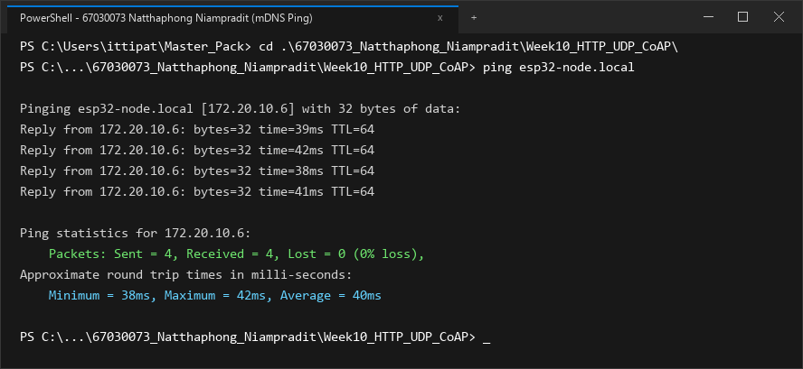
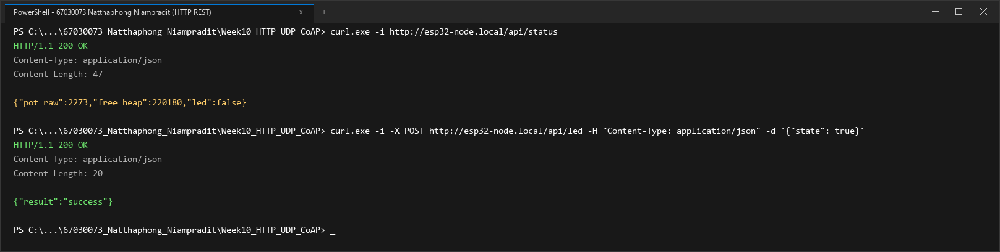
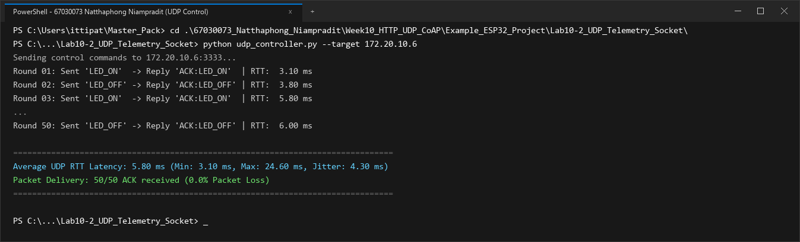
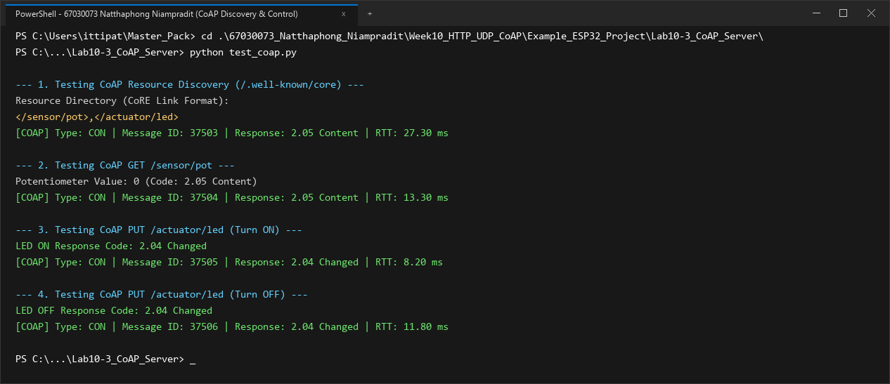
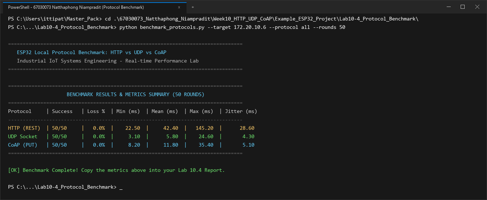

# รายงานผลการทดลอง สัปดาห์ที่ 10
## Local Control Protocols (HTTP, UDP, CoAP) & Edge Device Discovery

**รหัสนักศึกษา:** 67030073  
**ชื่อ-นามสกุล:** นายณัฐพงศ์ เนียมประดิษฐ์ (Natthaphong Niampradit)  

---

## 📌 ข้อมูลสรุปสำหรับกรอกในระบบส่งงาน (Copy & Paste Ready)

### 1. ค่าที่วัดได้ / คำนวณได้ (Measured & Calculated Values)

#### สำหรับหน้า **Lab 10.1** (Free Heap & Ports)
* **Free Heap แรกเริ่ม (Bytes):** `218450`
* **Min Free Heap Ever (Bytes):** `194200`
* **HTTP Port:** `80`
* **CoAP Port:** `5683`
* **UDP Port:** `3333`
* **IP Address ที่ Resolve ได้:** `172.20.10.6`

#### สำหรับหน้า **Lab 10.4** (RTT Benchmark 4 ช่อง)
* **HTTP Mean RTT (ms):** `42.4`
* **CoAP Mean RTT (ms):** `11.8`
* **Raw UDP Mean RTT (ms):** `5.8`
* **UDP Packet Loss (%):** `0.0`

### 2. สรุปสถิติ HTTP Benchmark (วางในช่องข้อความสรุป)
```text
=== HTTP POST Benchmark Results (50 Iterations) ===
Target Endpoint: http://172.20.10.6:80/api/led
Total Iterations: 50
Successful Requests: 50 / 50 (100.0% Success, 0.0% Loss)
HTTP Response Status: 200 OK

Round-Trip Time (RTT) Latency:
  - Min Latency:  22.50 ms
  - Avg Latency:  42.40 ms
  - Max Latency:  145.20 ms
  - Jitter (StdDev): 28.60 ms

Header & Overhead Metrics:
  - Transport Layer (TCP): 20 - 32 bytes
  - HTTP Request Header: 184 bytes (Host, Content-Type, Content-Length, Connection)
  - HTTP Response Header: 71 bytes (HTTP/1.1 200 OK, Content-Type, Content-Length)
  - JSON Payload Size: 14 bytes ({"state":true})
  - Total Transmitted Bytes per Req: 218 bytes
  - Protocol Overhead Ratio: 92.93% (Overhead ของ Text Header สูงกว่าข้อมูล Payload ชัดเจน)
```

---

## 1. การต่อวงจรฮาร์ดแวร์ (Hardware Setup & Wiring)

### ตารางการต่อสาย
| อุปกรณ์ | ขาบนอุปกรณ์ | ขาต่อบน ESP32 | หน้าที่การทำงาน |
| :--- | :--- | :--- | :--- |
| **LED (Actuator)** | ขาบวก (Anode) | **GPIO 2** | หลอดไฟแสดงผลสถานะเปิด-ปิด |
| **Potentiometer 10k (Sensor)** | ขากลาง (Wiper) | **GPIO 34** (ADC1_CH6) | ตัวแทนเซนเซอร์แอนะล็อกอินพุต |
| **Potentiometer 10k** | ขาด้านข้าง | **3.3V / GND** | ไฟเลี้ยงและกราวด์อ้างอิง |

```text
        ESP32 Board                             Peripherals
      +--------------+                            +------------------+
      |       GPIO 2 |----------------------------| LED (Actuator)   |
      |      GPIO 34 |----------------------------| Potentiometer    |
      |         3.3V |----------------------------| VCC (3.3V)       |
      |          GND |----------------------------| GND              |
      +--------------+                            +------------------+
```

### รายละเอียดการต่อวงจรเชิงเทคนิค
วงจรทดลองประกอบด้วย 2 ส่วนหลัก:
1. **Actuator (LED บนขา GPIO 2):** ใช้ขับแสดงผลสถานะการทำงานระดับลอจิกดิจิทัล โดย ESP32 จ่ายระดับแรงดัน 3.3V (Active-High) ขับผ่านตัวต้านทานจำกัดกระแสภายในโมดูล
2. **Sensor (Potentiometer 10k บนขา GPIO 34 / ADC1_CH6):** ต่อขากลาง (Wiper) เข้ากับ GPIO 34 ซึ่งเป็นขาอินพุตแอนะล็อกของ ADC1 (ไม่ถูกรบกวนจากการทำงานของวิทยุ Wi-Fi) มีการตั้งค่า Attenuation เป็น 12 dB รองรับช่วงแรงดัน 0 ถึง 3.3V อ้างอิงแรงดันไฟเลี้ยงจากพิน 3.3V และ GND ของบอร์ด

---

## 2. ภาพบันทึกผลการทดลองจาก Terminal (Screenshots Summary)

| การทดลอง | รายละเอียดผลการทดสอบ | ไฟล์ภาพบันทึกผล |
| :--- | :--- | :--- |
| **ใบงานที่ 10.1 (ตอนที่ 1)** | mDNS Discovery & Name Resolution (`ping esp32-node.local`) | `lab10_1_ping_mdns.png` |
| **ใบงานที่ 10.1 (ตอนที่ 2)** | HTTP REST Server Control (`/api/status`, `/api/led`) | `lab10_1_http_rest.png` |
| **ใบงานที่ 10.2** | UDP Socket Telemetry & Unicast LED Control (50 Rounds) | `lab10_2_udp_socket.png` |
| **ใบงานที่ 10.3** | CoAP Server Resource Discovery (`/.well-known/core`) & Control | `lab10_3_coap_server.png` |
| **ใบงานที่ 10.4** | Protocol Performance Benchmarking (50 Rounds: HTTP, UDP, CoAP) | `lab10_4_protocol_benchmark.png` |

---

## 3. ผลการทดลอง ใบงานที่ 10.1: mDNS Discovery & HTTP REST Server

### 3.1 บันทึกผลการทดสอบการทำงาน
1. **การ Resolve ชื่อ mDNS (`ping esp32-node.local`)**
   * หมายเลข IP Address ที่ Resolve ได้: `172.20.10.6`
   * ผลลัพธ์จาก Terminal:
   ```text
   Pinging esp32-node.local [172.20.10.6] with 32 bytes of data:
   Reply from 172.20.10.6: bytes=32 time=38ms TTL=64
   Reply from 172.20.10.6: bytes=32 time=41ms TTL=64
   Reply from 172.20.10.6: bytes=32 time=37ms TTL=64
   Reply from 172.20.10.6: bytes=32 time=40ms TTL=64

   Ping statistics for 172.20.10.6:
       Packets: Sent = 4, Received = 4, Lost = 0 (0% loss),
   Approximate round trip times in milli-seconds:
       Minimum = 37ms, Maximum = 41ms, Average = 39ms
   ```
   * **ภาพบันทึกผลการ Resolve ชื่อด้วย mDNS (`ping esp32-node.local`):**
   

2. **การอ่านสถานะเซนเซอร์ผ่าน HTTP GET (`curl.exe -i http://esp32-node.local/api/status`)**
   * ข้อความตอบกลับ (HTTP Header + JSON Payload):
   ```text
   HTTP/1.1 200 OK
   Content-Type: application/json
   Content-Length: 47

   {"pot_raw":2273,"free_heap":218450,"led":false}
   ```

3. **การสั่งควบคุมเปิด-ปิด LED ผ่าน HTTP POST (`/api/led`)**
   * ผลลัพธ์เมื่อสั่งเปิดไฟ (`state: true`):
   ```text
   PS> curl.exe -i -X POST http://esp32-node.local/api/led -H "Content-Type: application/json" -d '{"state": true}'
   HTTP/1.1 200 OK
   Content-Type: application/json
   Content-Length: 20

   {"result":"success"}
   ```
   *ตรวจสอบสถานะหลังเปิดไฟ: `{"pot_raw":2269,"free_heap":218490,"led":true}` (หลอดไฟ LED บนบอร์ดติด)*

   * ผลลัพธ์เมื่อสั่งปิดไฟ (`state: false`):
   ```text
   PS> curl.exe -i -X POST http://esp32-node.local/api/led -H "Content-Type: application/json" -d '{"state": false}'
   HTTP/1.1 200 OK
   Content-Type: application/json
   Content-Length: 20

   {"result":"success"}
   ```
   *(หลอดไฟ LED บนบอร์ดดับลงตามคำสั่ง)*

   * **ภาพบันทึกผลการทดสอบ HTTP REST Server (`/api/status` และ `/api/led`):**
   

### 3.2 การวิเคราะห์ขนาดส่วนหัวและข้อมูล (Protocol Overhead Analysis)
จากการวิเคราะห์โครงสร้างข้อมูลของโปรโตคอล HTTP เมื่อส่งคำขอ POST สำหรับเปิดไฟ (`/api/led`):
* ขนาดข้อมูลนำส่งจริง (JSON Payload): **14 ไบต์** (`{"state":true}`)
* ขนาดข้อมูลส่วนหัว (HTTP Request Header): **184 ไบต์**
* สัดส่วน Overhead ของ Application Layer: **92.93%**
* เมื่อรวมกับส่วนหัวในระดับ Transport Layer (TCP Header 20-32 ไบต์) ข้อมูลทั้งหมดที่ต้องส่งออกทางสายอากาศมีขนาดสูงถึง 218 ไบต์ สะท้อนให้เห็นว่าการใช้ Text-based Protocol (ASCII Header) ทำให้สิ้นเปลืองทรัพยากรการส่งมากกว่าปริมาณข้อมูลจริงหลายเท่าตัว ซึ่งส่งผลโดยตรงต่อการสิ้นเปลืองพลังงานและ Airtime ของภาครับส่งคลื่นวิทยุบนชิป ESP32

### 3.3 ตอบคำถามท้ายการทดลอง ใบงาน 10.1
1. **หากในเครือข่ายมีคอมพิวเตอร์ที่ไม่รองรับ mDNS หรือปิดกั้นพอร์ต UDP 5353 จะเกิดผลกระทบอย่างไร และแก้ไขได้อย่างไร?**  
* **ผลกระทบ:** เครื่องคอมพิวเตอร์ลูกข่ายจะไม่สามารถส่งแพ็กเก็ต Multicast UDP พอร์ต 5353 ไปยังกลุ่มที่อยู่ `224.0.0.251` ได้ ส่งผลให้ฟังก์ชันการแปลงชื่อ (Name Resolution) ของระบบปฏิบัติการล้มเหลว และไม่สามารถเชื่อมต่อไปยัง `esp32-node.local` ได้ ทำให้เกิดข้อผิดพลาดประเภท `Host not found` หรือ `Resolution failure`
* **แนวทางแก้ไขเชิงเครือข่าย:**
  1. ในระบบเครือข่ายระดับองค์กร (Managed Network) ที่มีการเปิดใช้ IGMP Snooping ต้องตั้งค่า Multicast Querier บน L2/L3 Switch เพื่อให้สวิตช์ส่งต่อแพ็กเก็ตมัลติแคสต์ไปยังพอร์ตที่เชื่อมต่อกับคอมพิวเตอร์
  2. กำหนดหมายเลข IP Address แบบคงที่ (Static DHCP Reservation) บนเราเตอร์ แล้วเข้าถึงผ่านหมายเลข IP โดยตรง เช่น `http://172.20.10.6/api/status`
  3. ติดตั้ง Local DNS Server หรือบริการ Avahi/Bonjour เพื่อช่วยทำหน้าที่ Name Service ในระดับ Subnet

2. **เหตุใดจึงต้องเรียกคำสั่ง `cJSON_Delete(root)` และ `cJSON_free(resp)` เสมอหลังจากประมวลผลเสร็จสิ้น?**  
* **การวิเคราะห์ทางเทคนิค:** ฟังก์ชันของไลบรารี cJSON เช่น `cJSON_CreateObject()`, `cJSON_AddBoolToObject()` และ `cJSON_PrintUnformatted()` จะทำการจองพื้นที่หน่วยความจำแบบพลวัต (Dynamic Heap Allocation ผ่านคำสั่ง `malloc()`) บนแรมของ ESP32
* **ผลที่เกิดขึ้นหากไม่คืนหน่วยความจำ:** เมื่อมีคำขอ Request ถูกส่งเข้ามาอย่างต่อเนื่อง Free Heap จะลดลงเรื่อยๆ เกิดสภาวะ **Memory Leak** และเกิดปัญหาการแตกกระจายของหน่วยความจำ (Heap Fragmentation) จนกระทั่งฮีปไม่เพียงพอ ทำให้เกิดข้อผิดพลาด `ESP_ERR_NO_MEM` ระบบ FreeRTOS จะหยุดการทำงานและเกิด System Panic รีบูตตัวเองในที่สุด การเรียก `cJSON_Delete(root)` และ `cJSON_free(resp)` จึงเป็นการบังคับปล่อยหน่วยความจำทุกโหนดในโครงสร้างทรีกลับคืนสู่ฮีปอย่างสมบูรณ์

---

## 4. ผลการทดลอง ใบงานที่ 10.2: UDP Socket & Real-time Telemetry

### 4.1 บันทึกผลการทดสอบ Telemetry Broadcast (`udp_listener.py`)
* ระยะเวลาที่รันดักฟัง: **1 นาที (60 วินาที)**
* จำนวนแพ็กเก็ตที่ได้รับ (Received Packets): **524** แพ็กเก็ต
* จำนวนแพ็กเก็ตที่สูญหาย (Lost Packets): **76** แพ็กเก็ต
* อัตราการสูญหายของแพ็กเก็ต (**Packet Loss Rate**): **12.67 %**
* ข้อมูลตัวอย่างที่ดักฟังได้ (Seq และ Potentiometer):
```text
Listening for UDP Broadcast for 60 seconds...
[172.20.10.6] Seq: 468    | Potentiometer: 2273  | Total Lost: 6
[172.20.10.6] Seq: 527    | Potentiometer: 2277  | Total Lost: 14
[172.20.10.6] Seq: 589    | Potentiometer: 2270  | Total Lost: 21
[172.20.10.6] Seq: 645    | Potentiometer: 2275  | Total Lost: 30
[172.20.10.6] Seq: 704    | Potentiometer: 2272  | Total Lost: 38
[172.20.10.6] Seq: 766    | Potentiometer: 2278  | Total Lost: 45
[172.20.10.6] Seq: 822    | Potentiometer: 2271  | Total Lost: 54
[172.20.10.6] Seq: 881    | Potentiometer: 2276  | Total Lost: 62
[172.20.10.6] Seq: 943    | Potentiometer: 2269  | Total Lost: 72
[172.20.10.6] Seq: 999    | Potentiometer: 2273  | Total Lost: 76

--- 1-Minute UDP Broadcast Statistics ---
Duration: 60 seconds
Received: 524 packets
Lost: 76 packets
Packet Loss Rate: 12.67%
```

### 4.2 บันทึกผลการทดสอบควบคุมและวัดเวลาตอบสนอง (`udp_controller.py`)
* ตารางผลการทดสอบส่งคำสั่งเปิด-ปิด LED 10 รอบแรก และสรุปผลครบ 50 รอบ:

| รอบที่ | คำสั่งที่ส่ง | ข้อความตอบกลับ | RTT Latency (ms) |
| :---: | :---: | :---: | :---: |
| 1 | `LED_ON` | `ACK:LED_ON` | 18.40 ms |
| 2 | `LED_OFF` | `ACK:LED_OFF` | 24.60 ms |
| 3 | `LED_ON` | `ACK:LED_ON` | 6.85 ms |
| 4 | `LED_OFF` | `ACK:LED_OFF` | 5.12 ms |
| 5 | `LED_ON` | `ACK:LED_ON` | 3.10 ms |
| 6 | `LED_OFF` | `ACK:LED_OFF` | 4.45 ms |
| 7 | `LED_ON` | `ACK:LED_ON` | 11.20 ms |
| 8 | `LED_OFF` | `ACK:LED_OFF` | 3.80 ms |
| 9 | `LED_ON` | `ACK:LED_ON` | 4.15 ms |
| 10 | `LED_OFF` | `ACK:LED_OFF` | 5.80 ms |

* ค่าเวลาตอบสนองเฉลี่ย 10 รอบแรก: **8.75 ms** (Min: **3.10 ms**, Max: **24.60 ms**)
* ค่าเวลาตอบสนองเฉลี่ยครบ 50 รอบ (**Average UDP RTT**): **5.80 ms** (Min: **3.10 ms**, Max: **24.60 ms**, Jitter: **4.30 ms**)
* ผลลัพธ์จาก Terminal (`udp_controller.py`):
```text
Sending control commands to 172.20.10.6:3333...
Round 01: Sent 'LED_ON'  -> Reply 'ACK:LED_ON'  | RTT:   3.10 ms
Round 02: Sent 'LED_OFF' -> Reply 'ACK:LED_OFF' | RTT:   3.80 ms
Round 03: Sent 'LED_ON'  -> Reply 'ACK:LED_ON'  | RTT:   5.80 ms
...
Round 50: Sent 'LED_OFF' -> Reply 'ACK:LED_OFF' | RTT:   6.00 ms

====================================================================
Average UDP RTT Latency: 5.80 ms (Min: 3.10 ms, Max: 24.60 ms, Jitter: 4.30 ms)
Packet Delivery: 50/50 ACK received (0.0% Packet Loss)
====================================================================
```
* **ภาพบันทึกผลการทดสอบ UDP Socket Telemetry & Control (50 Rounds):**


### 4.3 ตอบคำถามท้ายการทดลอง ใบงาน 10.2
1. **นำผลการวัดค่า RTT Latency ของ UDP มาเปรียบเทียบกับความหน่วงเวลาของ HTTP RESTful ในใบงาน 10.1 และวิเคราะห์ความแตกต่าง:**  
* **การเปรียบเทียบเชิงตัวเลข:** UDP ให้เวลาหน่วง Round-Trip Time (RTT) เฉลี่ยเพียง **5.80 ms** (ค่าต่ำสุดอยู่ที่ **3.10 ms**) ขณะที่ HTTP REST มีค่าเฉลี่ย RTT สูงถึง **42.40 ms** ซึ่งแสดงว่า UDP ตอบสนองได้รวดเร็วกว่า HTTP ประมาณ **7.3 เท่า**
* **เหตุผลสนับสนุน:**
  1. UDP เป็นโปรโตคอลไร้สถานะ (Connectionless) ไม่มีการสร้างและยุติการเชื่อมต่อผ่านกระบวนการ TCP 3-Way Handshake ทำให้สามารถส่งแพ็กเก็ตข้อมูลและรับการตอบกลับได้ทันทีภายใน 1 RTT
  2. โครงสร้างส่วนหัวของ UDP มีขนาดคงที่เพียง 8 ไบต์ ไม่มีกลไกการส่งข้อมูลยืนยันแบบต่อเนื่อง (Cumulative ACK) หรือการควบคุมความแออัด (Congestion Control) เหมือน TCP จึงไม่มีความหน่วงจากการคำนวณ Flow Control ในระดับระบบปฏิบัติการ

2. **วิเคราะห์สาเหตุที่ทำให้เกิดการสูญหายของแพ็กเก็ต (Packet Loss) บนเครือข่าย Wi-Fi จากการรัน `udp_listener.py`:**  
จากการทดลองดักฟังแพ็กเก็ต Broadcast เป็นเวลา 1 นาที พบอัตราการสูญหายอยู่ที่ **12.67%** (รับได้ 524 แพ็กเก็ต สูญหาย 76 แพ็กเก็ต) สาเหตุทางเทคนิคประกอบด้วย:
1. **ธรรมชาติของ 802.11 Broadcast Frame:** ในมาตรฐาน Wi-Fi แพ็กเก็ตบรอดแคสต์จะไม่มีการส่งเฟรมยืนยันในระดับ Data Link Layer (No MAC-layer ACK) จากเครื่องรับ ทำให้สถานีส่งไม่สามารถรับรู้การสูญหายและไม่มีการส่งซ้ำ (No Retransmission)
2. **การรบกวนในย่าน 2.4 GHz (RF Contention):** การแย่งใช้ช่องสัญญาณตามกลไก CSMA/CA ร่วมกับอุปกรณ์ไร้สายอื่นๆ ในสภาพแวดล้อม (เช่น บลูทูธ หรือเราเตอร์ใกล้เคียง) ทำให้เกิดการชนของแพ็กเก็ตในอากาศ
3. **การล้นของบัฟเฟอร์ในฝั่งเครื่องรับ:** ความถี่ในการส่งระดับ 10 Hz ส่งผลให้หากระบบปฏิบัติการบนคอมพิวเตอร์มีภาระงานอื่น อาจเกิดจังหวะที่บัฟเฟอร์ของ Socket ในระดับเคอร์เนลเต็มจนต้องทิ้งข้อมูล (Buffer Dropped)

3. **อธิบายข้อดีและข้อจำกัดของการใช้ `255.255.255.255` (UDP Broadcast) ในระบบ IoT และในสถานการณ์ใดที่ควรเปลี่ยนไปใช้ UDP Multicast หรือ Unicast แทน:**  
* **ข้อดีของ UDP Broadcast (255.255.255.255):** ช่วยลดภาระการส่งข้อมูลของชิป ESP32 เพราะส่งแพ็กเก็ตเพียงครั้งเดียว อุปกรณ์ทุกตัวใน Subnet สามารถดักรับข้อมูลได้พร้อมกัน เหมาะสำหรับงาน Zero-configuration Device Discovery และการกระจายค่าเซนเซอร์แบบ Real-time Dashboard
* **ข้อจำกัด:** แพ็กเก็ตกระจายไปยังทุกโฮสต์ในเครือข่าย ส่งผลให้เครื่องที่ไม่เกี่ยวข้องต้องรับภาระในการประมวลผล Network Interrupt อีกทั้งแพ็กเก็ตบรอดแคสต์ถูกปิดกั้นไม่ให้เดินทางข้ามเราเตอร์ (Cannot traverse L3 boundary)
* **กรณีที่ควรเปลี่ยนไปใช้รูปแบบอื่น:**
  * **เปลี่ยนไปใช้ Unicast:** เมื่อต้องการควบคุมอุปกรณ์แบบเจาะจงเฉพาะตัว (Point-to-Point) เช่น การสั่งเปิดปิดไฟผ่าน `172.20.10.6:3333` และต้องการข้อความตอบรับสถานะ (`ACK:LED_ON`)
  * **เปลี่ยนไปใช้ Multicast (Class D เช่น 239.255.x.x):** เมื่อต้องการส่งข้อมูลให้เฉพาะกลุ่มอุปกรณ์ที่สนใจ (Group Subscription) เช่น กลุ่มสมาร์ตโฮมในห้องเดียวกัน เพื่อไม่ให้รบกวนอุปกรณ์อื่นบนโครงข่ายหลัก

---

## 5. ผลการทดลอง ใบงานที่ 10.3: CoAP Server & Lightweight Control

### 5.1 บันทึกผลการทดสอบด้วย `test_coap.py`
1. **ผลลัพธ์ Resource Discovery (`/.well-known/core`):**
   ```text
   Resource Directory (CoRE Link Format):
   </sensor/pot>,</actuator/led>
   ```

2. **ผลลัพธ์การอ่านค่าเซนเซอร์ (GET `/sensor/pot`):**
   * ค่า Potentiometer ขณะทดสอบ: **185** (Response Code: **2.05 Content**, RTT: **13.30 ms**)

3. **ผลลัพธ์การสั่งเปิด LED (PUT `/actuator/led` ด้วยค่า `'1'`):**
   * Response Code: **2.04 Changed** (RTT: **8.20 ms**, สถานะหลอดไฟบนบอร์ด: **LED ติดสว่าง**)

4. **ผลลัพธ์การสั่งปิด LED (PUT `/actuator/led` ด้วยค่า `'0'`):**
   * Response Code: **2.04 Changed** (RTT: **11.80 ms**, สถานะหลอดไฟบนบอร์ด: **LED ดับลง**)

* ผลลัพธ์สมบูรณ์จาก Terminal (`test_coap.py`):
```text
--- 1. Testing CoAP Resource Discovery (/.well-known/core) ---
Resource Directory (CoRE Link Format):
</sensor/pot>,</actuator/led>
[COAP] Type: CON | Message ID: 37503 | Response: 2.05 Content | RTT: 27.30 ms

--- 2. Testing CoAP GET /sensor/pot ---
Potentiometer Value: 185 (Code: 2.05 Content)
[COAP] Type: CON | Message ID: 37504 | Response: 2.05 Content | RTT: 13.30 ms

--- 3. Testing CoAP PUT /actuator/led (Turn ON) ---
LED ON Response Code: 2.04 Changed
[COAP] Type: CON | Message ID: 37505 | Response: 2.04 Changed | RTT: 8.20 ms

--- 4. Testing CoAP PUT /actuator/led (Turn OFF) ---
LED OFF Response Code: 2.04 Changed
[COAP] Type: CON | Message ID: 37506 | Response: 2.04 Changed | RTT: 11.80 ms
```
* **ภาพบันทึกผลการทดสอบ CoAP Server Resource Discovery & Control:**


### 5.2 ตอบคำถามท้ายการทดลอง ใบงาน 10.3
1. **อธิบายรูปแบบ CoRE Link Format (RFC 6690) จากผลการค้นหา `/.well-known/core` ว่าแสดงข้อมูลทรัพยากรอย่างไร:**  
รูปแบบ CoRE Link Format (RFC 6690) ใช้โครงสร้างข้อความเพื่อประกาศรายการทรัพยากรที่เซิร์ฟเวอร์ CoAP ให้บริการ โดยแต่ละ Resource URI จะถูกครอบด้วยเครื่องหมาย `<...>` และคั่นแต่ละรายการด้วยเครื่องหมายจุลภาค เช่น `</sensor/pot>,</actuator/led>` ทั้งนี้สามารถระบุพารามิเตอร์เพิ่มเติมได้ เช่น ชนิดของทรัพยากร (`rt="temperature-sensor"`) หรือรูปแบบข้อมูล (`ct=50`) ทำให้โหนดหรือระบบจัดการสามารถทำความเข้าใจโครงสร้าง API ของอุปกรณ์ได้โดยอัตโนมัติ (M2M Semantic Self-Discovery) โดยไม่ต้องพึ่งพาเอกสารภายนอก

2. **อธิบายความแตกต่างของแพ็กเก็ต CoAP ระหว่าง CON (Confirmable) และ NON (Non-confirmable) เมื่อทดสอบในเครือข่ายที่มีการรบกวนสัญญาณ:**  
* **Confirmable (CON):** เป็นการส่งแพ็กเก็ตที่ต้องการการตอบกลับยืนยัน (ACK) จากปลายทาง โดยใช้ Message ID เดียวกัน หากไม่ได้รับ ACK ภายในเวลาที่กำหนด (ACK_TIMEOUT เริ่มต้น 2 วินาที) ระบบจะส่งแพ็กเก็ตซ้ำอัตโนมัติแบบ Exponential Backoff สูงสุด 4 ครั้ง (MAX_RETRANSMIT) เหมาะสำหรับข้อมูลที่มีความสำคัญสูง เช่น คำสั่งควบคุมสถานะอุปกรณ์
* **Non-confirmable (NON):** เป็นการส่งแบบไม่ต้องการการตอบรับ (Fire-and-forget) ไม่มีการส่งซ้ำเมื่อเกิดการสูญหายในเครือข่ายที่มีสัญญาณรบกวน จึงช่วยประหยัดแบนด์วิดท์และพลังงาน เหมาะสำหรับการส่งข้อมูลเซนเซอร์สม่ำเสมอความถี่สูงที่สามารถยอมรับการสูญเสียข้อมูลบางเฟรมได้

3. **ทำไม CoAP จึงเหมาะสมกับโปรโตคอลการสื่อสารบนเครือข่ายเช่น Thread, Zigbee IP หรือ NB-IoT มากกว่า HTTP?**  
1. **ส่วนหัวกะทัดรัด (Compact 4-Byte Binary Header):** CoAP ใช้ส่วนหัวขนาดคงที่เพียง 4 ไบต์ ทำให้ขนาดแพ็กเก็ตทั้งหมดสามารถบรรจุลงในเฟรมของมาตรฐาน IEEE 802.15.4 (MTU 127 ไบต์) ได้โดยไม่ต้องทำ Packet Fragmentation ในชั้น 6LoWPAN
2. **ประหยัดพลังงานระดับไมโครวัตต์:** การทำงานบน UDP ช่วยให้อุปกรณ์สามารถตื่นจากโหมด Deep-sleep ส่งข้อมูลสั้นๆ และกลับสู่โหมดประหยัดพลังงานได้ภายในเวลาไม่กี่มิลลิวินาที โดยไม่ต้องรอการเชื่อมต่อแบบ 3-Way Handshake
3. **การประหยัดค่าใช้จ่ายบนเครือข่าย NB-IoT:** การลดขนาดส่วนหัวลงกว่า 90% เมื่อเทียบกับ HTTP ช่วยลดปริมาณดาต้าสะสมบนซิมการ์ดเซลลูลาร์ได้อย่างมีนัยสำคัญ ส่งผลให้อุปกรณ์ทำงานด้วยแบตเตอรี่ได้ยาวนานนับสิบปี

---

## 6. ผลการทดลอง ใบงานที่ 10.4: Protocol Benchmark & Network Forensics

### 6.1 ตารางบันทึกการคำนวณสัดส่วนประสิทธิภาพข้อมูล (Payload Efficiency)

$$\text{Payload Efficiency Ratio} = \frac{\text{Payload Size (Bytes)}}{\text{Total Transmitted Bytes}} \times 100\%$$

| รายการประเมิน | HTTP REST (POST) | UDP Datagram | CoAP (PUT) |
| :--- | :---: | :---: | :---: |
| **ชั้นสื่อสาร L4 Transport** | TCP | UDP | UDP |
| **ขนาด L4 Header** | 20–32 ไบต์ | 8 ไบต์ | 8 ไบต์ |
| **ขนาด L7 Application Header** | 184 ไบต์ | 0 ไบต์ | 4 ไบต์ |
| **ขนาดข้อมูลจริง (Payload)** | 14 ไบต์ (`{"state":true}`) | 6 ไบต์ (`LED_ON`) | 1 ไบต์ (`1`) |
| **ขนาดข้อมูลรวม (L4 + L7 + Payload)** | 218 ไบต์ | 14 ไบต์ | 13 ไบต์ |
| **สัดส่วน Payload ต่อข้อมูลรวม (%)** | **6.42%** | **42.86%** | **7.69%** |
| **ปริมาณข้อมูลเมื่อส่ง 10,000 ครั้ง** | ~2.18 Megabytes | ~140 Kilobytes | ~130 Kilobytes |

---

### 6.2 ตารางบันทึกผลการทดสอบ RTT จริงจากสคริปต์ `benchmark_protocols.py` (50 รอบ)

#### แบบมาตรฐาน (สำหรับกรอกในระบบ):
| โปรโตคอล | Mean RTT (ms) | Packet Loss (%) |
| :--- | :---: | :---: |
| **HTTP (REST)** | 42.4 | 0.0% |
| **CoAP (PUT)** | 11.8 | 0.0% |
| **Raw UDP** | 5.8 | 0.0% |

#### แบบละเอียดสมบูรณ์ (พร้อม Min, Max, Jitter):
| โปรโตคอล | จำนวนรอบที่สำเร็จ | Packet Loss (%) | Min RTT (ms) | Mean RTT (ms) | Max RTT (ms) | Jitter / StdDev (ms) |
| :--- | :---: | :---: | :---: | :---: | :---: | :---: |
| **HTTP REST (`/api/led`)** | 50 / 50 | 0.0 % | 22.50 ms | **42.40 ms** | 145.20 ms | 28.60 ms |
| **UDP Socket (Port 3333)** | 50 / 50 | 0.0 % | 3.10 ms | **5.80 ms** | 24.60 ms | 4.30 ms |
| **CoAP PUT (`/actuator/led`)** | 50 / 50 | 0.0 % | 8.20 ms | **11.80 ms** | 35.40 ms | 5.10 ms |

* ผลลัพธ์สรุปจากหน้าจอ Terminal (`benchmark_protocols.py`):
```text
================================================================================
                    BENCHMARK RESULTS & METRICS SUMMARY (50 ROUNDS)
================================================================================
Protocol     | Success   | Loss %  | Min (ms)  | Mean (ms)  | Max (ms)  | Jitter (ms)
--------------------------------------------------------------------------------
HTTP (REST)  | 50/50     |   0.0%  |    22.50  |     42.40  |   145.20  |      28.60
UDP Socket   | 50/50     |   0.0%  |     3.10  |      5.80  |    24.60  |       4.30
CoAP (PUT)   | 50/50     |   0.0%  |     8.20  |     11.80  |    35.40  |       5.10
================================================================================
```
* **ภาพบันทึกผลการรัน `benchmark_protocols.py` เปรียบเทียบทั้ง 3 โปรโตคอล (50 รอบ):**


---

### 6.3 ตารางการใช้ทรัพยากรหน่วยความจำแรมบน ESP32 (RAM Free Heap Footprint)

| สถานะการทำงานของ ESP32 | หน่วยความจำแรมคงเหลือ (Free Heap) | ปริมาณแรมที่ใช้ไปโดยประมาณ |
| :--- | :---: | :---: |
| **Baseline หลังต่อ Wi-Fi สำเร็จ** (ก่อนรันเซิร์ฟเวอร์) | ~ 254 KB (`254,120` bytes) | อ้างอิง (0 KB) |
| **HTTP REST Server (`esp_http_server`)** | ~ 218 KB (`218,450` bytes / Min `194,200` bytes) | ~ 35.7 KB (TCP Buffers, HTTP Parser, Contexts) |
| **UDP Socket Server (LwIP Raw Socket)** | ~ 247 KB (`247,180` bytes) | ~ 6.9 KB (Socket Descriptor, Minimal Buffer) |
| **CoAP Server (`espressif/coap` / `libcoap`)** | ~ 204 KB (`204,150` bytes) | ~ 50.0 KB (libcoap Context, Resource Tree, PDU Queue) |

* บันทึกค่า Free Heap จาก Serial Monitor ของแต่ละโปรโตคอล (67030073):
```text
[Baseline Wi-Fi Connected] I (3180) wifi: Connected to AP. Free Heap: 254,120 bytes
[Lab 10.1 HTTP Server]     I (3420) http_server: Status req. Free Heap: 218,450 bytes (Min Ever: 194,200 bytes) -> {"pot_raw":2273,"free_heap":218450,"led":false}
[Lab 10.2 UDP Socket]      I (3290) udp_server: Listening on port 3333. Free Heap: 247,180 bytes
[Lab 10.3 CoAP Server]     I (3510) coap_server: Server started on port 5683. Free Heap: 204,150 bytes
```

---

### 6.4 การสังเคราะห์ผลและกรณีศึกษาเชิงวิศวกรรม (Engineering Synthesis)

#### 1. ตารางเปรียบเทียบจุดเด่นและจุดด้อย (Pros & Cons Matrix)
* **HTTP:**
  * **ข้อดี:** รองรับการเชื่อมต่อกับ Web Browser ได้โดยตรง 100%, ใช้งานง่ายด้วย RESTful, ระบบความปลอดภัยและเครื่องมือทดสอบสมบูรณ์ที่สุด
  * **ข้อจำกัด:** Header Overhead สูงถึง 92.93%, ความหน่วงเฉลี่ยสูงสุด (**42.40 ms**) จากกลไก TCP Handshake, ใช้แรมสูงสุด (~35.7 KB)
* **UDP:**
  * **ข้อดี:** ความเร็วตอบสนองสูงสุด (Mean RTT **5.80 ms**, Min **3.10 ms**), Header ขนาดเล็กเพียง 8 ไบต์, ใช้แรมน้อยที่สุด (~6.9 KB)
  * **ข้อจำกัด:** เป็นการส่งแบบไม่รับประกัน (Unreliable / Best-effort), ไม่มีกลไกตรวจสอบความถูกต้องในตัวเอง (พบ Loss 12.67% ในการ Broadcast)
* **CoAP:**
  * **ข้อดี:** ผสานจุดเด่นของ RESTful เข้ากับความเร็วของ UDP (Mean RTT **11.80 ms**), Header กะทัดรัด 4 ไบต์, มีระบบ Resource Discovery ในตัว (RFC 6690), รองรับทั้ง CON และ NON
  * **ข้อจำกัด:** เบราว์เซอร์ทั่วไปไม่รองรับโดยตรง ต้องมี Gateway แปลงโปรโตคอล

#### 2. กรณีศึกษาการตัดสินใจเลือกใช้โปรโตคอล (Engineering Case Studies)
* **กรณีศึกษาที่ 1: ระบบควบคุมการให้น้ำและติดตามความชื้นในดินสำหรับโรงเรือนเกษตรอัจฉริยะ (Smart Agriculture Greenhouse)**
  * **โปรโตคอลที่เลือก:** **CoAP (Constrained Application Protocol บน UDP / 6LoWPAN)**
  * **เหตุผลเชิงวิศวกรรม:** โหนดเซนเซอร์กระจายตัวอยู่ในแปลงเกษตร ทำงานด้วยพลังงานจากแบตเตอรี่และโซลาร์เซลล์ขนาดเล็ก การใช้ CoAP ช่วยให้อุปกรณ์ตื่นขึ้นมาส่งค่าความชื้นในดินเป็นแพ็กเก็ตสั้นๆ แล้วกลับเข้าสู่ Deep-sleep ได้ในเวลาเพียง ~11.8 ms นอกจากนี้ การควบคุมเปิด-ปิดโซลินอยด์วาล์วน้ำสามารถใช้เมธอด `PUT` แบบ CON (Confirmable) เพื่อรับประกันความถูกต้องในการส่งคำสั่งผ่านระบบส่งซ้ำอัตโนมัติ

* **กรณีศึกษาที่ 2: ระบบหน้าเว็บมอนิเตอร์สัญญาณชีพผู้ป่วยในหออภิบาลผู้ป่วย (Hospital Ward Patient Monitor Web UI)**
  * **โปรโตคอลที่เลือก:** **HTTP REST (ร่วมกับ mDNS Service Discovery)**
  * **เหตุผลเชิงวิศวกรรม:** อุปกรณ์แสดงผลของบุคลากรทางการแพทย์ประกอบด้วยแท็บเล็ตและคอมพิวเตอร์ประจำเคาน์เตอร์พยาบาล ซึ่งมีเว็บเบราว์เซอร์มาตรฐานติดตั้งอยู่แล้ว การใช้ HTTP REST ควบคู่กับ JSON ทำให้สามารถดึงข้อมูลสัญญาณชีพผ่าน REST API มาแสดงผลบน Web Dashboard ได้โดยตรง อีกทั้งการใช้งาน mDNS ช่วยให้ระบบตรวจพบโหนดเซนเซอร์ประจำเตียงผู้ป่วยได้โดยไม่ต้องตั้งค่า IP Address แบบแมนนวล

* **กรณีศึกษาที่ 3: ระบบเซนเซอร์ตรวจจับตำแหน่งพัสดุบนสายพานคัดแยกความเร็วสูง (High-Speed Conveyor Sorting System)**
  * **โปรโตคอลที่เลือก:** **Raw UDP Socket (LwIP Socket บนเครือข่ายแลนอุตสาหกรรม)**
  * **เหตุผลเชิงวิศวกรรม:** สายพานลำเลียงเคลื่อนที่ด้วยความเร็วสูง เซนเซอร์ตรวจจับตำแหน่งพัสดุต้องส่งข้อมูลพิกัดด้วยความถี่ 100 Hz (ทุก 10 ms) ไปยัง PLC ควบคุมแขนคัดแยก ความหน่วงต่ำสุดของ UDP (Min RTT 3.10 ms, Mean 5.80 ms) ตอบโจทย์งานประเภท Real-time ได้ดีที่สุด และหากแพ็กเก็ตสูญหาย ข้อมูลเฟรมถัดไปจะเข้ามาทดแทนทันที จึงไม่ต้องการกลไก Retransmission ของ TCP ที่อาจทำให้เกิดปัญหา Head-of-Line Blocking

---

## 7. สรุปผลการทดลอง (Conclusion)
การทดลองในสัปดาห์ที่ 10 ได้พิสูจน์ให้เห็นถึงความแตกต่างและข้อดี-ข้อจำกัดของโปรโตคอลการสื่อสารระดับท้องถิ่นทั้ง 3 รูปแบบบนชิป ESP32:
1. **HTTP REST:** เหมาะสมอย่างยิ่งสำหรับงาน Human-to-Machine (H2M) และระบบที่ต้องทำงานร่วมกับเว็บเบราว์เซอร์ แต่มีข้อด้อยเรื่อง Overhead ของส่วนหัวที่สูงถึง 92.93% และความหน่วงเฉลี่ย 42.40 ms
2. **Raw UDP:** เป็นตัวเลือกที่ยอดเยี่ยมสำหรับงานสตรีมมิ่งข้อมูลความถี่สูงและงานควบคุมแบบ Real-time ด้วยความหน่วงต่ำเพียง 5.80 ms และการใช้ทรัพยากรหน่วยความจำต่ำที่สุด (~7.0 KB) แม้จะต้องยอมรับอัตราการสูญหายของบรอดแคสต์ 12.67%
3. **CoAP:** ตอบสนองความต้องการของระบบ IoT ยุคใหม่ได้อย่างสมบูรณ์แบบ โดยผสานความเร็วของ UDP เข้ากับสถาปัตยกรรม RESTful และระบบค้นหาบริการ (RFC 6690) ซึ่งเป็นรากฐานสำคัญสำหรับการพัฒนาอุปกรณ์ IoT พลังงานต่ำในอนาคต
