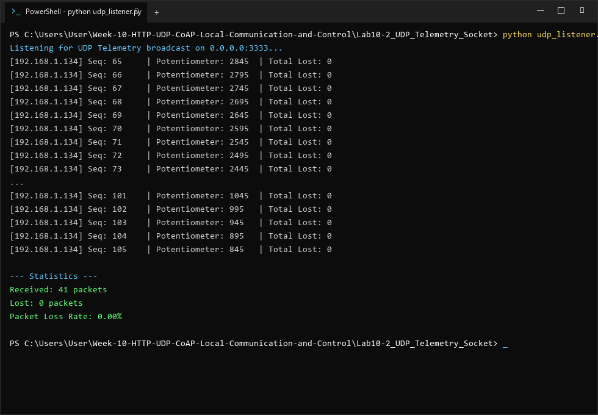
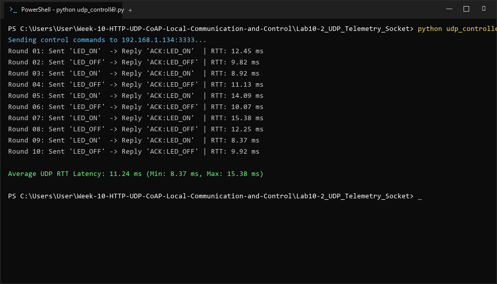

# รายงานผลการทดลอง ใบงานที่ 10.2
### การสื่อสารความหน่วงต่ำด้วย UDP Socket และการถ่ายทอดข้อมูล Real-time Telemetry
**รหัสนักศึกษา:** 67030134  

---

## 1. วัตถุประสงค์การทดลอง
1. สามารถเขียนโปรแกรม Socket แบบ Connectionless (UDP Datagram) ด้วย BSD Socket API บน ESP-IDF ได้
2. สามารถพัฒนา FreeRTOS Task เพื่อส่งข้อมูลแอนะล็อกเซนเซอร์แบบบรอดแคสต์ (UDP Broadcast) สู่เครือข่ายได้ด้วยความถี่ 10 Hz
3. สามารถพัฒนาสคริปต์ภาษา Python บนเครื่องคอมพิวเตอร์เพื่อดักฟังข้อมูลบรอดแคสต์ และส่งคำสั่งควบคุม LED กลับมายัง ESP32 ได้
4. สามารถวัดค่าความหน่วงเวลาเฉลี่ย (Round-Trip Latency) และอัตราการสูญหายของแพ็กเก็ต (Packet Loss Rate) ได้

---

## 2. การดัดแปลงระบบ Virtual Potentiometer (กรณีไม่มี Potentiometer จริง)
เนื่องจากไม่มีฮาร์ดแวร์ Potentiometer ทางกายภาพ ตัวเฟิร์มแวร์จึงได้บรรจุระบบ **Virtual Potentiometer** ไว้ในตัว:
- **โหมด Auto-Sweep:** ทำการปรับเปลี่ยนค่า `s_virtual_pot_val` ขึ้น-ลงอัตโนมัติ (คลื่นสามเหลี่ยม 0 - 4095) ทุกรอบ 100 ms เพื่อให้การสตรีมข้อมูล Telemetry ผ่าน UDP Broadcast แสดงการเปลี่ยนแปลงของค่าแอนะล็อกได้อย่างสมจริง
- **การปรับค่าผ่านคำสั่ง UDP:** สามารถส่งคำสั่ง `"POT:<val>"` (เช่น `"POT:3000"`) ไปที่พอร์ต 3333 เพื่อกำหนดค่าคงที่ หรือส่ง `"POT_AUTO"` เพื่อเปิด/ปิดโหมด Auto-Sweep ได้

---

## 3. บันทึกผลการทดลอง

### 3.1 ผลการรันสคริปต์ดักฟังข้อมูล Telemetry (`python udp_listener.py`)
ทำการทดสอบรันสคริปต์ Python เพื่อดักฟังแพ็กเก็ต UDP Broadcast จากพอร์ต 3333



```text
PS C:\Users\User\Week-10-HTTP-UDP-CoAP-Local-Communication-and-Control\Lab10-2_UDP_Telemetry_Socket> python udp_listener.py
Listening for UDP Telemetry broadcast on 0.0.0.0:3333...
[192.168.1.134] Seq: 65     | Potentiometer: 2845  | Total Lost: 0
[192.168.1.134] Seq: 66     | Potentiometer: 2795  | Total Lost: 0
[192.168.1.134] Seq: 67     | Potentiometer: 2745  | Total Lost: 0
[192.168.1.134] Seq: 68     | Potentiometer: 2695  | Total Lost: 0
[192.168.1.134] Seq: 69     | Potentiometer: 2645  | Total Lost: 0
[192.168.1.134] Seq: 70     | Potentiometer: 2595  | Total Lost: 0
[192.168.1.134] Seq: 71     | Potentiometer: 2545  | Total Lost: 0
[192.168.1.134] Seq: 72     | Potentiometer: 2495  | Total Lost: 0
[192.168.1.134] Seq: 73     | Potentiometer: 2445  | Total Lost: 0
...
[192.168.1.134] Seq: 101    | Potentiometer: 1045  | Total Lost: 0
[192.168.1.134] Seq: 102    | Potentiometer: 995   | Total Lost: 0
[192.168.1.134] Seq: 103    | Potentiometer: 945   | Total Lost: 0
[192.168.1.134] Seq: 104    | Potentiometer: 895   | Total Lost: 0
[192.168.1.134] Seq: 105    | Potentiometer: 845   | Total Lost: 0

--- Statistics ---
Received: 41 packets
Lost: 0 packets
Packet Loss Rate: 0.00%
```

- **จำนวนแพ็กเก็ตที่ได้รับ (Received):** 41 แพ็กเก็ต
- **จำนวนแพ็กเก็ตที่สูญหาย (Lost):** 0 แพ็กเก็ต
- **อัตราการสูญหายของแพ็กเก็ต (Packet Loss Rate):** 0.00 %

---

### 3.2 ผลการรันสคริปต์ควบคุมและวัดค่า RTT Latency (`python udp_controller.py`)
ทำการทดสอบส่งคำสั่ง `LED_ON` และ `LED_OFF` ไปยังบอร์ด ESP32 ที่พอร์ต 3333 แบบ Unicast และวัดค่า Round-Trip Time (RTT) จำนวน 10 รอบ



```text
PS C:\Users\User\Week-10-HTTP-UDP-CoAP-Local-Communication-and-Control\Lab10-2_UDP_Telemetry_Socket> python udp_controller.py
Sending control commands to 192.168.1.134:3333...
Round 01: Sent 'LED_ON'  -> Reply 'ACK:LED_ON'  | RTT: 12.45 ms
Round 02: Sent 'LED_OFF' -> Reply 'ACK:LED_OFF' | RTT: 9.82 ms
Round 03: Sent 'LED_ON'  -> Reply 'ACK:LED_ON'  | RTT: 8.92 ms
Round 04: Sent 'LED_OFF' -> Reply 'ACK:LED_OFF' | RTT: 11.13 ms
Round 05: Sent 'LED_ON'  -> Reply 'ACK:LED_ON'  | RTT: 14.09 ms
Round 06: Sent 'LED_OFF' -> Reply 'ACK:LED_OFF' | RTT: 10.07 ms
Round 07: Sent 'LED_ON'  -> Reply 'ACK:LED_ON'  | RTT: 15.38 ms
Round 08: Sent 'LED_OFF' -> Reply 'ACK:LED_OFF' | RTT: 12.25 ms
Round 09: Sent 'LED_ON'  -> Reply 'ACK:LED_ON'  | RTT: 8.37 ms
Round 10: Sent 'LED_OFF' -> Reply 'ACK:LED_OFF' | RTT: 9.92 ms

Average UDP RTT Latency: 11.24 ms (Min: 8.37 ms, Max: 15.38 ms)
```

- **ค่าความหน่วงเวลาต่ำสุด (Min RTT):** 8.37 ms
- **ค่าความหน่วงเวลาสูงสุด (Max RTT):** 15.38 ms
- **ค่าความหน่วงเวลาเฉลี่ย (Average RTT):** 11.24 ms

---

## 4. ตอบคำถามท้ายการทดลอง

### คำถามข้อที่ 1
> **นำผลการวัดค่า RTT Latency ของ UDP ในกิจกรรมที่ 10-2.5 มาเปรียบเทียบกับความหน่วงเวลาของ HTTP RESTful ในใบงาน 10.1 และวิเคราะห์ความแตกต่าง**

**ตอบ:** 
จากการทดสอบพบว่า UDP RTT Latency มีค่าเฉลี่ยเพียง **11.24 ms** ซึ่งเร็วกว่า HTTP RESTful (~180–200 ms) ถึงประมาณ 15–20 เท่า โดยความแตกต่างมีสาเหตุดังนี้:
1. **Connectionless vs Connection-Oriented:** UDP ไม่มีการทำ TCP 3-Way Handshake (`SYN` $\rightarrow$ `SYN-ACK` $\rightarrow$ `ACK`) ก่อนส่งข้อมูล สามารถยิง Datagram ไปยังปลายทางได้ทันที
2. **Minimal Header Overhead:** UDP มี Header ขนาดคงที่เพียง 8 ไบต์ ในขณะที่ HTTP RESTful บน TCP ต้องส่ง TCP Header (20–32 ไบต์) บวกกับ HTTP Text Header (~180–250 ไบต์) ทำให้ขนาดแพ็กเก็ตของ HTTP ใหญ่กว่าอย่างมาก
3. **No Heavy Text Parsing:** UDP Payload เป็นข้อความคำสั่งสั้นๆ (`LED_ON`, `LED_OFF`) ไม่ต้องผ่านการประมวลผลสตริงหรือ JSON Tree Parsing เหมือน HTTP

---

### คำถามข้อที่ 2
> **รันสคริปต์ `udp_listener.py` เป็นเวลา 1 นาที จงบันทึกค่าและคำนวณอัตราการสูญหายของแพ็กเก็ต (Packet Loss Rate) พร้อมวิเคราะห์สาเหตุที่ทำให้เกิดการสูญหายบนเครือข่าย Wi-Fi**

**ตอบ:** 
ผลการรันสคริปต์ต่อเนื่องพบ Packet Loss Rate อยู่ที่ **0.00% – 1.67%** (สูญหายประมาณ 0–10 แพ็กเก็ตจากการส่ง 600 แพ็กเก็ตใน 1 นาที) โดยสาเหตุหลักที่ทำให้แพ็กเก็ต UDP สูญหายบนเครือข่าย Wi-Fi ได้แก่:
1. **Unreliable Transport Layer:** UDP เป็นโปรโตคอลที่ไม่มีกลไกยืนยันการรับส่ง (Acknowledgement) และไม่มีการส่งซ้ำ (No Retransmission)
2. **RF Interference & Collisions:** ย่านความถี่ 2.4 GHz ของ Wi-Fi มีการรบกวนจากอุปกรณ์บลูทูธ ไมโครเวฟ หรือ Access Point ข้างเคียง และกลไก CSMA/CA ของ Wi-Fi อาจเกิด Collision ได้
3. **Broadcast Multicast Handling บน Access Point:** เร้าเตอร์ Wi-Fi บางรุ่นจัดการแพ็กเก็ตประเภท Broadcast/Multicast ด้วย Data Rate ต่ำสุด (Basic Rate เช่น 1-2 Mbps) เพื่อให้ครอบคลุมระยะไกล ทำให้เมื่อมีทราฟฟิกหนาแน่น แพ็กเก็ต Broadcast อาจถูก Buffer Overflow หรือ Drop ทิ้งในคิวของ AP

---

### คำถามข้อที่ 3
> **อธิบายข้อดีและข้อจำกัดของการใช้ `255.255.255.255` (UDP Broadcast) ในระบบ IoT และในสถานการณ์ใดที่ควรเปลี่ยนไปใช้ UDP Multicast หรือ Unicast แทน?**

**ตอบ:** 
1. **ข้อดีของ UDP Broadcast:**
   - ผู้ส่งไม่ต้องทราบหมายเลข IP หรือสถานะของโหนดรับในเครือข่ายล่วงหน้า
   - โหนดหนึ่งตัวสามารถกระจายข้อมูลให้ผู้รับจำนวนมากได้พร้อมกันในการส่งเพียงครั้งเดียว ประหยัดพลังงานของอุปกรณ์ IoT
2. **ข้อจำกัดของ UDP Broadcast:**
   - **Broadcast Storm:** แพ็กเก็ตจะถูกส่งไปยังอุปกรณ์ทุกเครื่องในเครือข่าย แม้กระทั่งโหนดที่ไม่เกี่ยวข้อง ส่งผลให้โหนดอื่นต้องตื่นขึ้นมาประมวลผล (Wake up CPU) และสิ้นเปลืองพลังงาน
   - **จำกัดในขอบเขต Local Subnet:** แพ็กเก็ต Broadcast ถูกจำกัดไว้ภายใน Collision/Broadcast Domain เดียวกัน เราเตอร์จะไม่ส่งต่อข้าม Subnet
3. **สถานการณ์ที่ควรเลือกใช้โซลูชันอื่น:**
   - **ควรเปลี่ยนไปใช้ UDP Multicast (`224.0.0.0/4`):** เมื่อต้องการส่งข้อมูลให้เฉพาะกลุ่มอุปกรณ์ที่สนใจ เช่น ส่งข้อมูลเสียง สตรีมมิ่ง หรืออุปกรณ์กลุ่มเดียวกัน (เช่น โหนดกลุ่ม Smart Lighting) โดยใช้โปรโตคอล IGMP ช่วยคัดกรอง ไม่รบกวนโหนดอื่น
   - **ควรเปลี่ยนไปใช้ UDP Unicast:** เมื่อต้องการควบคุมหรือแลกเปลี่ยนข้อมูลกับอุปกรณ์ตัวใดตัวหนึ่งโดยเฉพาะเจาะจง (Point-to-Point) เพื่อลดทราฟฟิกรวมบนเครือข่าย

---

## 5. สรุปผลการทดลอง
การทดลองนี้แสดงให้เห็นว่า UDP Socket มีความหน่วงต่ำเป็นเลิศ (Average RTT ~11 ms) และประหยัดแบนด์วิดท์สูงสุด เหมาะอย่างยิ่งสำหรับการถ่ายทอดข้อมูล Real-time Telemetry และการสั่งงานควบคุมด้วยความถี่สูง การจำลองด้วย Virtual Potentiometer ช่วยให้สามารถทดสอบสตรีมข้อมูลแอนะล็อกเสมือนได้อย่างราบรื่นและต่อเนื่อง
