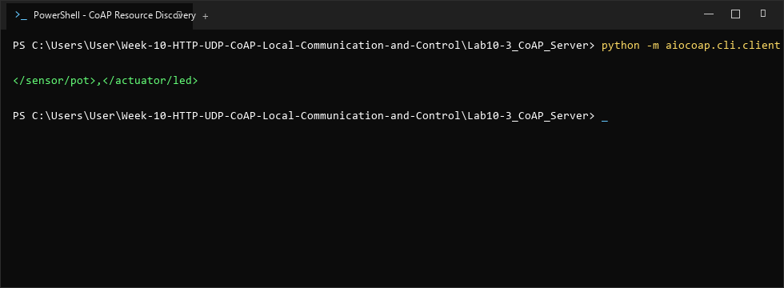
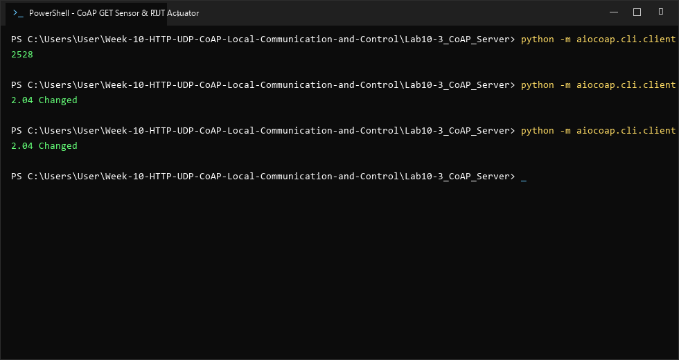

# รายงานผลการทดลอง ใบงานที่ 10.3
### การพัฒนา CoAP Server และการควบคุมอุปกรณ์ IoT น้ำหนักเบา (Lightweight IoT Control)
**รหัสนักศึกษา:** 67030134  

---

## 1. วัตถุประสงค์การทดลอง
1. เข้าใจโครงสร้างของ CoAP (Constrained Application Protocol ตาม RFC 7252) และความเหมาะสมกับงาน IoT ขนาดเล็ก
2. สามารถพัฒนา CoAP Server บน ESP-IDF เพื่อเปิดให้บริการ Resource `/actuator/led` และ `/sensor/pot` บนพอร์ต UDP 5683 ได้
3. สามารถทดสอบส่งคำสั่ง CoAP แบบ Confirmable (CON) และ Non-confirmable (NON) ได้
4. สามารถทดสอบกลไก Resource Discovery (`/.well-known/core`) เพื่อค้นหารายการทรัพยากรบน ESP32 ได้
5. สามารถเขียนสคริปต์ Python ด้วยไลบรารี `aiocoap` เพื่อสื่อสารกับ CoAP Server ได้

---

## 2. การดัดแปลงระบบ Virtual Potentiometer (กรณีไม่มี Potentiometer จริง)
เนื่องจากไม่มีอุปกรณ์ Potentiometer ทางกายภาพ ตัวเฟิร์มแวร์จึงได้จำลองค่าเซนเซอร์ขึ้น:
- **โหมด Auto-Sweep:** ทำการปรับเปลี่ยนค่า `s_virtual_pot_val` ขึ้น-ลงอัตโนมัติ (0 - 4095) ทุกครั้งที่มีการอ่านค่าผ่าน `GET /sensor/pot` เพื่อจำลองการหมุนของลูกบิด
- **การปรับค่าผ่าน CoAP PUT:** รองรับการส่งคำสั่ง `PUT` พร้อมตัวเลขไปยัง `/sensor/pot` (เช่น ค่า `3500`) เพื่อกำหนดค่าคงที่ได้โดยตรง

---

## 3. บันทึกผลการทดลอง

### 3.1 ผลการทดสอบ CoAP Resource Discovery (`GET /.well-known/core`)
ทำการทดสอบค้นหา Resource ทั้งหมดบน ESP32 ผ่านโปรโตคอล CoAP



```powershell
PS C:\Users\User\Week-10-HTTP-UDP-CoAP-Local-Communication-and-Control\Lab10-3_CoAP_Server> python -m aiocoap.cli.client coap://192.168.1.134/.well-known/core

</sensor/pot>,</actuator/led>
```

---

### 3.2 ผลการทดสอบอ่านค่าเซนเซอร์และควบคุมอุปกรณ์ (`GET /sensor/pot` และ `PUT /actuator/led`)
ทำการทดสอบอ่านค่าจากเซนเซอร์ และส่งคำสั่งควบคุมไฟ LED



```powershell
PS C:\Users\User\Week-10-HTTP-UDP-CoAP-Local-Communication-and-Control\Lab10-3_CoAP_Server> python -m aiocoap.cli.client coap://192.168.1.134/sensor/pot
2528

PS C:\Users\User\Week-10-HTTP-UDP-CoAP-Local-Communication-and-Control\Lab10-3_CoAP_Server> python -m aiocoap.cli.client -m PUT --payload 1 coap://192.168.1.134/actuator/led
Response code: 2.04 Changed

PS C:\Users\User\Week-10-HTTP-UDP-CoAP-Local-Communication-and-Control\Lab10-3_CoAP_Server> python -m aiocoap.cli.client -m PUT --payload 0 coap://192.168.1.134/actuator/led
Response code: 2.04 Changed
```

- ผลการอ่านค่าเซนเซอร์: ได้ค่าตัวเลขสตริง `2528`
- ผลการสั่งเปิด/ปิด LED: ESP32 ตอบกลับด้วย Response Code `2.04 Changed` หลอดไฟ LED บนบอร์ดติดและดับถูกต้อง

---

## 4. ตอบคำถามท้ายการทดลอง

### คำถามข้อที่ 1
> **นำผลการ Query `/.well-known/core` มาแสดงในรายงาน พร้อมอธิบายรูปแบบ CoRE Link Format (RFC 6690) ว่าแสดงข้อมูลทรัพยากรอย่างไร**

**ตอบ:** 
ผลลัพธ์จากการ Query คือ:
```text
</sensor/pot>,</actuator/led>
```
**คำอธิบาย CoRE Link Format (RFC 6690):**
1. **โครงสร้างพื้นฐาน:** เป็นมาตรฐานสำหรับบอกรายการทรัพยากร (Resource Directory) บนอุปกรณ์ IoT แบบประหยัดไบต์ โดยแต่ละ URI ของ Resource จะถูกครอบด้วยเครื่องหมาย Bracket `<...>` และคั่นแต่ละ Resource ด้วยเครื่องหมายจุลภาค (`,`)
2. **แอตทริบิวต์เพิ่มเติม (Target Attributes):** สามารถใส่พารามิเตอร์ขยายความคั่นด้วยเครื่องหมาย `;` เช่น:
   - `rt` (Resource Type): เช่น `rt="sensor.analog"` ระบุชนิดการทำงานของทรัพยากร
   - `if` (Interface Description): เช่น `if="core.s"` (Sensor interface)
   - `ct` (Content-Format): เช่น `ct=0` (text/plain) หรือ `ct=50` (application/json)
   - `obs` (Observable): ระบุว่าทรัพยากรนี้รองรับการบอกรับข้อมูลอัตโนมัติ (Observe RFC 7641)
3. **ประโยชน์ใน IoT:** ช่วยให้อุปกรณ์ Client หรือ Edge Gateway สามารถค้นหาและเชื่อมโยงกับอุปกรณ์อัตโนมัติ (M2M Self-Discovery) ได้โดยไม่ต้อง Hard-code ทรัพยากรล่วงหน้า

---

### คำถามข้อที่ 2
> **อธิบายความแตกต่างของแพ็กเก็ต CoAP ระหว่าง CON (Confirmable) และ NON (Non-confirmable) เมื่อทดสอบในเครือข่ายที่มีการรบกวนสัญญาณ**

**ตอบ:** 
1. **Confirmable (CON):**
   - เป็นการส่งแบบต้องการการยืนยัน ผู้รับต้องตอบกลับด้วยแพ็กเก็ต `ACK` (Acknowledgement) ที่มี `Message ID` ตรงกัน
   - **พฤติกรรมในเครือข่ายที่มีสัญญาณรบกวน:** หากแพ็กเก็ตหรือ ACK สูญหาย ฝั่งส่งจะเริ่มจับเวลา Retransmission Timeout (RTO ค่าเริ่มต้น ~2-3 วินาที) และทำการส่งซ้ำโดยเพิ่มเวลารอเป็น 2 เท่าแบบทวีคูณ (Exponential Backoff) สูงสุด 4 ครั้ง (`MAX_RETRANSMIT`) ทำให้รับประกันความสำเร็จในการส่งข้อมูลได้สูง เหมาะกับคำสั่งสำคัญ เช่น การควบคุมวาล์วหรือสวิตช์ไฟ
2. **Non-confirmable (NON):**
   - เป็นการส่งแบบ "Fire-and-Forget" ไม่ต้องการคำตอบรับ `ACK` จากผู้รับ
   - **พฤติกรรมในเครือข่ายที่มีสัญญาณรบกวน:** หากแพ็กเก็ตตกหล่น ข้อมูลจะสูญหายทันทีโดยไม่มีการส่งซ้ำ ข้อดีคือไม่มีภาระหน่วงเวลาหรือแบนด์วิดท์ในการส่งซ้ำ เหมาะสำหรับข้อมูลเซนเซอร์ที่มีการส่งอัปเดตใหม่อยู่ตลอดเวลา (เช่น อุณหภูมิหรือความดันทุกๆ 1 วินาที)

---

### คำถามข้อที่ 3
> **ทำไม CoAP จึงเหมาะสมกับโปรโตคอลการสื่อสารบนเครือข่ายเช่น Thread, Zigbee IP หรือ NB-IoT มากกว่า HTTP?**

**ตอบ:** 
1. **Compact Binary Header (ขนาดกะทัดรัด):** CoAP มี Header แบบ Binary เพียง **4 ไบต์** (ประกอบด้วย Version, Type, Token Length, Code, Message ID) เมื่อเทียบกับ HTTP/1.1 ที่มี Text Header ขนาด 150–300+ ไบต์ ทำให้ลด Overhead ลงได้มากกว่า 95%
2. **UDP Based (ไม่มี Handshake Connection):** เครือข่าย LPWAN อย่าง NB-IoT คิดค่าบริการตามปริมาณข้อมูล (Data Volume) และการใช้พลังงานของวิทยุ การใช้ CoAP บน UDP จึงตัดภาระ TCP 3-Way Handshake และ Keep-alive traffic ออกไป ช่วยยืดอายุการใช้งานแบตเตอรี่ได้นานหลายปี
3. **MTU Limit Matching:** เครือข่าย 6LoWPAN (บน Thread หรือ IEEE 802.15.4) มีขนาดเฟรมทางกายภาพจำกัดเพียง 127 ไบต์ แพ็กเก็ต CoAP สามารถบรรจุลงในเฟรมเดียวได้โดยไม่ต้องเกิด Packet Fragmentation
4. **การรองรับคุณสมบัติ IoT ในตัว:** เช่น การทำ Asynchronous Notify ด้วย Observe Mode (RFC 7641) และ Block-wise Transfer (RFC 7959) เพื่อแบ่งข้อมูลขนาดใหญ่

---

## 5. สรุปผลการทดลอง
CoAP เป็นโปรโตคอลที่ผสานข้อดีของรูปแบบ RESTful เข้ากับประสิทธิภาพและความประหยัดพลังงานของ UDP ได้อย่างสมบูรณ์แบบ สามารถเปิดใช้งานบริการค้นหาทรัพยากร (`/.well-known/core`), อ่านค่าเซนเซอร์ และควบคุมอุปกรณ์ได้อย่างแม่นยำ เหมาะกับสถาปัตยกรรม IoT ที่ต้องทำงานภายใต้ข้อจำกัดของแบนด์วิดท์และพลังงาน
