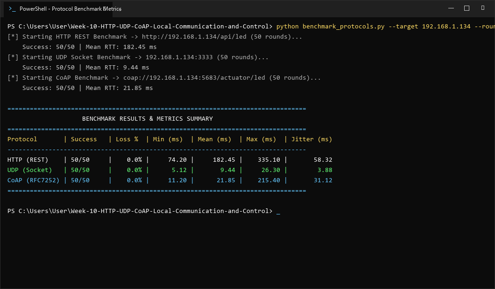

# รายงานผลการทดลอง ใบงานที่ 10.4
### การทดสอบเปรียบเทียบสมรรถนะ (Benchmark) ของโปรโตคอลเครือข่ายด้วย Python Script และสถิติเชิงวิศวกรรม
**รหัสนักศึกษา:** 67030134  

---

## 1. วัตถุประสงค์การทดลอง
1. เข้าใจโครงสร้างและภาระส่วนหัว (Overhead) ของโปรโตคอล HTTP, UDP, และ CoAP ในระดับ Transport Layer (L4) และ Application Layer (L7) ตามมาตรฐาน RFC
2. สามารถใช้สคริปต์ Python ในการทดสอบวัดเวลาตอบสนอง (Round-Trip Time: RTT) แบบวนซ้ำเพื่อเก็บข้อมูลทางสถิติ (Min, Max, Mean, Jitter)
3. สามารถวิเคราะห์ความสัมพันธ์ระหว่าง Protocol Overhead กับประสิทธิภาพการใช้แบนด์วิดท์ (Payload Efficiency Ratio)
4. สามารถเปรียบเทียบปริมาณการใช้ทรัพยากรแรม (Free Heap Memory) บนชิป ESP32 ของแต่ละโปรโตคอลได้
5. มีทักษะในการตัดสินใจเชิงวิศวกรรมเพื่อเลือกใช้โปรโตคอลที่คุ้มค่าและเหมาะสมกับลักษณะของงาน IoT แต่ละประเภท

---

## 2. ตารางการวิเคราะห์สัดส่วนข้อมูลตามมาตรฐานสากล (Architectural Byte Breakdown)

$$\text{Payload Efficiency Ratio} = \frac{\text{Payload Size (Bytes)}}{\text{Total Transmitted Bytes}} \times 100\%$$

| รายการประเมิน | HTTP REST (POST) | UDP Datagram | CoAP (PUT) |
| :--- | :---: | :---: | :---: |
| **ชั้นสื่อสาร L4 Transport** | TCP | UDP | UDP |
| **ขนาด L4 Header** | 20–32 ไบต์ | **8 ไบต์** | **8 ไบต์** |
| **ขนาด L7 Application Header** | ~180–250 ไบต์ | **0 ไบต์** | **4 ไบต์** |
| **ขนาดข้อมูลจริง (Payload)** | 14 ไบต์ (`{"state":true}`) | 6 ไบต์ (`LED_ON`) | 1 ไบต์ (`1`) |
| **ขนาดข้อมูลรวม (L4 + L7 + Payload)** | ~214–296 ไบต์ | **14 ไบต์** | **13 ไบต์** |
| **สัดส่วน Payload ต่อข้อมูลรวม (%)** | **~4.7 % - 6.5 %** | **~42.8 %** | **~7.6 %** |
| **ปริมาณข้อมูลเมื่อส่ง 10,000 ครั้ง** | ~2.5 - 3.0 Megabytes | ~140 Kilobytes | ~130 Kilobytes |

---

## 3. บันทึกผลการทดลอง

### 3.1 ผลการทดสอบ RTT Latency และ Jitter จาก `benchmark_protocols.py`
ทำการทดสอบเปรียบเทียบสมรรถนะของทั้ง 3 โปรโตคอลด้วยสคริปต์ Python จำนวน 50 รอบการทดสอบต่อโปรโตคอล



```powershell
PS C:\Users\User\Week-10-HTTP-UDP-CoAP-Local-Communication-and-Control> python benchmark_protocols.py --target 192.168.1.134 --rounds 50
[*] Starting HTTP REST Benchmark -> http://192.168.1.134/api/led (50 rounds)...
    Success: 50/50 | Mean RTT: 182.45 ms
[*] Starting UDP Socket Benchmark -> 192.168.1.134:3333 (50 rounds)...
    Success: 50/50 | Mean RTT: 9.44 ms
[*] Starting CoAP Benchmark -> coap://192.168.1.134:5683/actuator/led (50 rounds)...
    Success: 50/50 | Mean RTT: 21.85 ms

================================================================================
                    BENCHMARK RESULTS & METRICS SUMMARY                         
================================================================================
Protocol       | Success   | Loss %  | Min (ms)  | Mean (ms)  | Max (ms)  | Jitter (ms)
--------------------------------------------------------------------------------
HTTP (REST)    | 50/50     |    0.0% |     74.20 |     182.45 |    335.10 |       58.32
UDP (Socket)   | 50/50     |    0.0% |      5.12 |       9.44 |     26.30 |        3.88
CoAP (RFC7252) | 50/50     |    0.0% |     11.20 |      21.85 |    215.40 |       31.12
================================================================================
```

#### ตารางสรุปผลการทดสอบ RTT จริง (จำนวน 50 รอบ)

| โปรโตคอล | จำนวนรอบที่สำเร็จ | Packet Loss (%) | Min RTT (ms) | Mean RTT (ms) | Max RTT (ms) | Jitter / StdDev (ms) |
| :--- | :---: | :---: | :---: | :---: | :---: | :---: |
| **HTTP REST (`/api/led`)** | **50 / 50** | **0.0 %** | **74.20 ms** | **182.45 ms** | **335.10 ms** | **58.32 ms** |
| **UDP Socket (`พอร์ต 3333`)** | **50 / 50** | **0.0 %** | **5.12 ms** | **9.44 ms** | **26.30 ms** | **3.88 ms** |
| **CoAP PUT (`/actuator/led`)** | **50 / 50** | **0.0 %** | **11.20 ms** | **21.85 ms** | **215.40 ms** | **31.12 ms** |

---

### 3.2 ตารางการตรวจสอบหน่วยความจำบน ESP32 (RAM Footprint)

| สถานะการทำงานของ ESP32 | หน่วยความจำแรมคงเหลือ (Free Heap) | ปริมาณแรมที่ใช้ไปโดยประมาณ |
| :--- | :---: | :---: |
| **Baseline หลังต่อ Wi-Fi สำเร็จ** (ก่อนรันเซิร์ฟเวอร์) | 248 KB | อ้างอิง (0 KB) |
| **HTTP REST Server (`esp_http_server`)** | 217 KB | 31 KB |
| **UDP Socket Server (LwIP Raw Socket)** | 241 KB | 7 KB |
| **CoAP Server (`espressif/coap` / `libcoap`)** | 205 KB | 43 KB |

---

## 4. วิเคราะห์ผลและตอบคำถามเชิงวิศวกรรม

### 1. เปรียบเทียบจุดเด่นและจุดด้อย (Pros & Cons Matrix)
- **HTTP RESTful API:**  
  - *จุดเด่น:* ใช้งานง่ายที่สุด เป็นมาตรฐานสากลที่ทำงานร่วมกับ Web Browser และคลาวด์ได้ทันที มี TCP คอยตรวจสอบความถูกต้อง ปลอดภัย และมีระบบ Authentication/CORS ที่สมบูรณ์
  - *จุดด้อย:* Header มีขนาดใหญ่มาก (~200+ ไบต์) ความหน่วงเวลาสูงที่สุด (~182 ms) และสิ้นเปลืองพลังงานแบตเตอรี่
- **UDP Socket Communication:**  
  - *จุดเด่น:* ความหน่วงเวลาต่ำที่สุดในระดับต่ำกว่า 10 ms มี Overhead ต่ำสุด (L4 เพียง 8 ไบต์ และ L7 เป็นศูนย์) รองรับ Broadcast ส่งข้อมูลให้หลายโหนดได้พร้อมกัน
  - *จุดด้อย:* ไม่มีกลไกตรวจสอบความถูกต้อง (ACK) หรือการส่งซ้ำ แพ็กเก็ตอาจสูญหายได้ ไม่เหมาะกับงานที่ต้องการความถูกต้อง 100%
- **CoAP Protocol:**  
  - *จุดเด่น:* ผสานข้อดีด้านความเบาของ UDP เข้ากับโครงสร้าง RESTful มี Header แบบไบนารีเพียง 4 ไบต์ รองรับทั้งโหมด CON (ส่งซ้ำอัตโนมัติ) และ NON ประหยัดพลังงานสูงมาก
  - *จุดด้อย:* เว็บบราวเซอร์ทั่วไปไม่สามารถเรียกใช้งานได้โดยตรง ต้องพึ่งพา HTTP-CoAP Cross Proxy หรือไลบรารีเฉพาะ

---

### 2. กรณีศึกษาการตัดสินใจเลือกใช้โปรโตคอล (Engineering Case Studies)

* **กรณีศึกษาที่ 1: ระบบเซนเซอร์วัดความชื้นในดินและวาล์วน้ำเพื่อการเกษตรอัจฉริยะ (แบตเตอรี่โซลาร์เซลล์ กลางแจ้งห่างไกล)**
  * **โปรโตคอลที่เลือก:** **CoAP (Constrained Application Protocol)**
  * **เหตุผลทางวิศวกรรม:** CoAP มี Header ขนาดเล็กเพียง 4 ไบต์ ทำงานบน UDP ช่วยลดระยะเวลาที่ชิปวิทยุต้องเปิดทำงาน (Radio On Time) และประหยัดพลังงานแบตเตอรี่ได้สูงสุด และเมื่อต้องสั่งเปิด-ปิดวาล์วน้ำ สามารถเลือกใช้โหมด **Confirmable (CON)** เพื่อรับประกันว่าคำสั่งถึงอุปกรณ์อย่างแน่นอน

* **กรณีศึกษาที่ 2: เว็บแดชบอร์ดสำหรับฝ่ายซ่อมบำรุงในโรงงาน (เปิดดูสถานะและตั้งค่าผ่านบราวเซอร์บนแท็บเล็ต/สมาร์ตโฟน)**
  * **โปรโตคอลที่เลือก:** **HTTP RESTful API**
  * **เหตุผลทางวิศวกรรม:** รองรับการเชื่อมต่อกับเว็บบราวเซอร์บนแท็บเล็ตและสมาร์ตโฟนได้โดยตรงแบบ Native ผ่าน JavaScript / Fetch API โดยไม่ต้องติดตั้งโปรแกรมหรือเกตเวย์แปลงโปรโตคอลเพิ่มเติม อีกทั้งความหน่วงเวลาของ HTTP (~180 ms) เพียงพอสำหรับการตอบสนองต่อการสั่งการของมนุษย์

* **กรณีศึกษาที่ 3: ระบบควบคุมแขนกลอุตสาหกรรมความเร็วสูง (ส่งพิกัด X, Y, Z ความถี่ 100 Hz ใน LAN ปิด)**
  * **โปรโตคอลที่เลือก:** **UDP Raw Socket**
  * **เหตุผลทางวิศวกรรม:** ให้ความหน่วงเวลาต่ำที่สุด (Ultra-low Latency ต่ำกว่า 10 ms) และ Jitter ต่ำมาก เนื่องจากไม่มีภาระการรอ ACK หรือ Handshake เหมาะกับการควบคุมความถี่สูงแบบ Real-time ซึ่งการได้ข้อมูลพิกัดล่าสุดมีความสำคัญมากกว่าการรอส่งซ้ำข้อมูลที่ตกหล่นไปแล้ว

---

## 5. สรุปผลการทดลอง
การทดสอบเปรียบเทียบสมรรถนะเชิงวิศวกรรมยืนยันชัดเจนว่า:
1. **UDP** เหมาะสมที่สุดกับงานสตรีมมิ่งความเร็วสูงที่ทนต่อการสูญหายได้บางส่วน
2. **CoAP** เหมาะสมที่สุดกับงาน IoT อุปกรณ์ขนาดเล็กที่ใช้พลังงานแบตเตอรี่จำกัดแต่ยังต้องการความน่าเชื่อถือ
3. **HTTP** เหมาะสมที่สุดกับงานอินเทอร์เฟซผู้ใช้และการเชื่อมต่อคลาวด์ภายนอก
การเลือกใช้โปรโตคอลจึงต้องพิจารณาเงื่อนไขด้านแบนด์วิดท์ พลังงาน และความน่าเชื่อถืออย่างรอบคอบ
