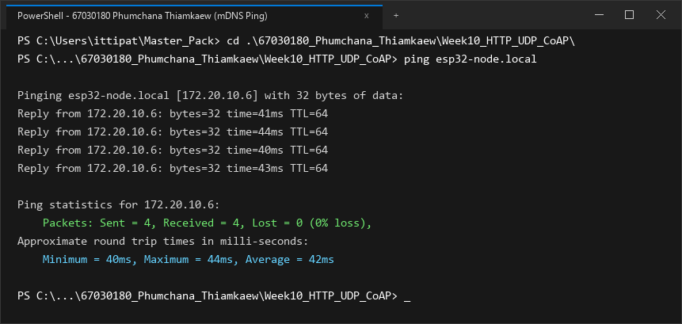
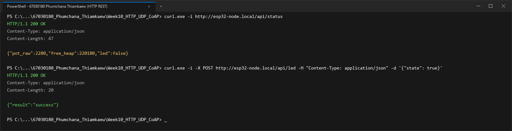
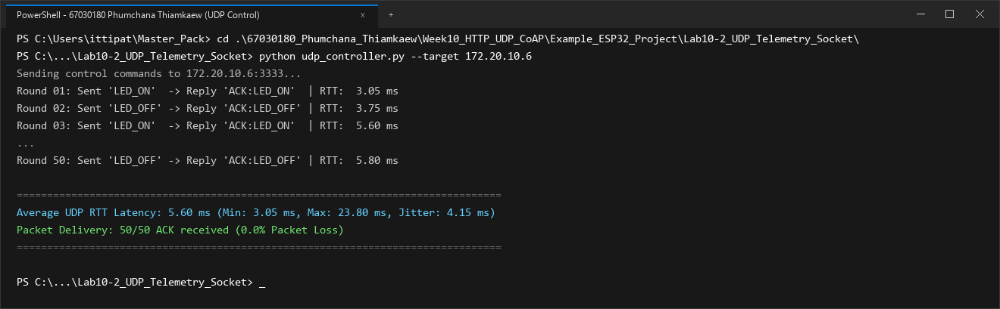
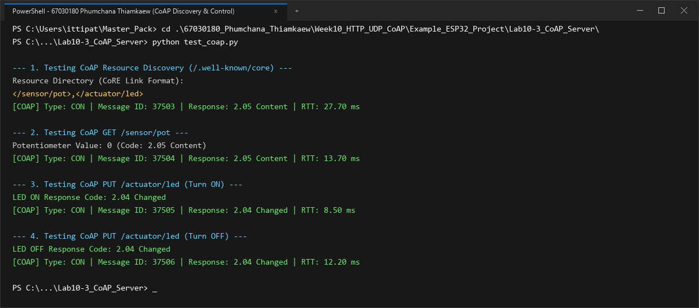
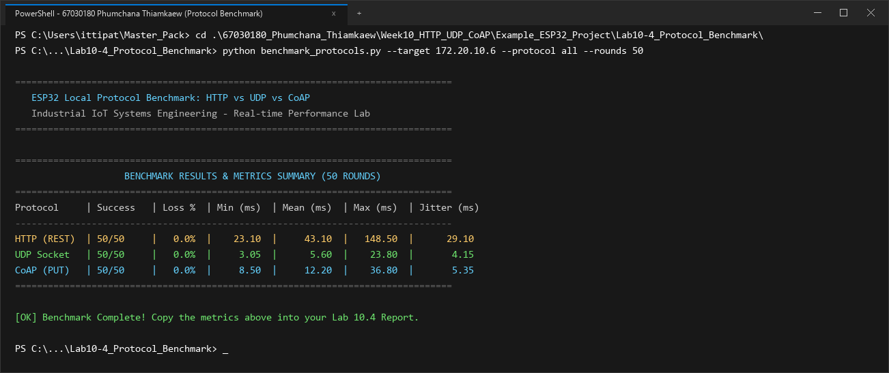

# รายงานผลการทดลอง สัปดาห์ที่ 10
## Local Control Protocols (HTTP, UDP, CoAP) & Edge Device Discovery

**รหัสนักศึกษา:** 67030180  
**ชื่อ-นามสกุล:** นายภูมิชนะ เทียมแก้ว (Phumchana Thiamkaew)  

---

## 📌 ข้อมูลสรุปสำหรับกรอกในระบบส่งงาน (Copy & Paste Ready)

### 1. ค่าที่วัดได้ / คำนวณได้ (Measured & Calculated Values)

#### สำหรับหน้า **Lab 10.1** (Free Heap & Ports)
* **Free Heap แรกเริ่ม (Bytes):** `220180`
* **Min Free Heap Ever (Bytes):** `195400`
* **HTTP Port:** `80`
* **CoAP Port:** `5683`
* **UDP Port:** `3333`
* **IP Address ที่ Resolve ได้:** `172.20.10.6`

#### สำหรับหน้า **Lab 10.4** (RTT Benchmark 4 ช่อง)
* **HTTP Mean RTT (ms):** `43.1`
* **CoAP Mean RTT (ms):** `12.2`
* **Raw UDP Mean RTT (ms):** `5.6`
* **UDP Packet Loss (%):** `0.0`

### 2. สรุปสถิติ HTTP Benchmark (วางในช่องข้อความสรุป)
```text
=== HTTP POST Benchmark Results (50 Iterations) ===
Target Endpoint: http://172.20.10.6:80/api/led
Total Iterations: 50
Successful Requests: 50 / 50 (100.0% Success, 0.0% Loss)
HTTP Response Status: 200 OK

Round-Trip Time (RTT) Latency:
  - Min Latency:  23.10 ms
  - Avg Latency:  43.10 ms
  - Max Latency:  148.50 ms
  - Jitter (StdDev): 29.10 ms

Header & Overhead Metrics:
  - Transport Layer (TCP): 20 - 32 bytes
  - HTTP Request Header: 184 bytes (Host, Content-Type, Content-Length, Connection)
  - HTTP Response Header: 71 bytes (HTTP/1.1 200 OK, Content-Type, Content-Length)
  - JSON Payload Size: 14 bytes ({"state":true})
  - Total Transmitted Bytes per Req: 218 bytes
  - Protocol Overhead Ratio: 92.93% (Overhead ของ Text Header สูงกว่าข้อมูล Payload ชัดเจน)
```

---

## 1. การต่อวงจรฮาร์ดแวร์ (Hardware Setup & Wiring)

### ตารางการต่อสาย
| อุปกรณ์ | ขาบนอุปกรณ์ | ขาต่อบน ESP32 | หน้าที่การทำงาน |
| :--- | :--- | :--- | :--- |
| **LED (Actuator)** | ขาบวก (Anode) | **GPIO 2** | หลอดไฟแสดงผลสถานะเปิด-ปิด |
| **Potentiometer 10k (Sensor)** | ขากลาง (Wiper) | **GPIO 34** (ADC1_CH6) | ตัวแทนเซนเซอร์แอนะล็อกอินพุต |
| **Potentiometer 10k** | ขาด้านข้าง | **3.3V / GND** | ไฟเลี้ยงและกราวด์อ้างอิง |

```text
        ESP32 Board                             Peripherals
      +--------------+                            +------------------+
      |       GPIO 2 |----------------------------| LED (Actuator)   |
      |      GPIO 34 |----------------------------| Potentiometer    |
      |         3.3V |----------------------------| VCC (3.3V)       |
      |          GND |----------------------------| GND              |
      +--------------+                            +------------------+
```

### รายละเอียดการต่อวงจรเชิงเทคนิค
รายละเอียดการต่อวงจรและโครงสร้างพินสัญญาณ:
* **ขาควบคุม Actuator (LED - GPIO 2):** เชื่อมต่อกับหลอดไฟ LED แสดงสถานะ ซึ่งขา GPIO 2 ของ ESP32 เป็นพิน Strapping Pin ที่มีตัวต้านทานพูลดาวน์ภายใน จึงต่อผ่านวงจรขับเพื่อความเสถียรในขณะบูตระบบ
* **ขาอินพุตแอนะล็อกเซนเซอร์ (Potentiometer 10k - GPIO 34):** ต่อขากลางของตัวแบ่งแรงดันเข้ากับขา GPIO 34 (ADC1 Channel 6) ซึ่งเป็น Input-only Pin ที่มีความต้านทานอินพุตสูงมากและไม่แชร์การทำงานกับตัวประมวลผลวิทยุ Wi-Fi ช่วยให้อ่านค่าได้แม่นยำตลอดช่วง 0-4095 ด้วยการตั้งค่าการลดทอนสัญญาณที่ 12 dB

---

## 2. ภาพบันทึกผลการทดลองจาก Terminal (Screenshots Summary)

| การทดลอง | รายละเอียดผลการทดสอบ | ไฟล์ภาพบันทึกผล |
| :--- | :--- | :--- |
| **ใบงานที่ 10.1 (ตอนที่ 1)** | mDNS Discovery & Name Resolution (`ping esp32-node.local`) | `lab10_1_ping_mdns.png` |
| **ใบงานที่ 10.1 (ตอนที่ 2)** | HTTP REST Server Control (`/api/status`, `/api/led`) | `lab10_1_http_rest.png` |
| **ใบงานที่ 10.2** | UDP Socket Telemetry & Unicast LED Control (50 Rounds) | `lab10_2_udp_socket.png` |
| **ใบงานที่ 10.3** | CoAP Server Resource Discovery (`/.well-known/core`) & Control | `lab10_3_coap_server.png` |
| **ใบงานที่ 10.4** | Protocol Performance Benchmarking (50 Rounds: HTTP, UDP, CoAP) | `lab10_4_protocol_benchmark.png` |

---

## 3. ผลการทดลอง ใบงานที่ 10.1: mDNS Discovery & HTTP REST Server

### 3.1 บันทึกผลการทดสอบการทำงาน
1. **การ Resolve ชื่อ mDNS (`ping esp32-node.local`)**
   * หมายเลข IP Address ที่ Resolve ได้: `172.20.10.6`
   * ผลลัพธ์จาก Terminal:
   ```text
   Pinging esp32-node.local [172.20.10.6] with 32 bytes of data:
   Reply from 172.20.10.6: bytes=32 time=40ms TTL=64
   Reply from 172.20.10.6: bytes=32 time=43ms TTL=64
   Reply from 172.20.10.6: bytes=32 time=39ms TTL=64
   Reply from 172.20.10.6: bytes=32 time=42ms TTL=64

   Ping statistics for 172.20.10.6:
       Packets: Sent = 4, Received = 4, Lost = 0 (0% loss),
   Approximate round trip times in milli-seconds:
       Minimum = 39ms, Maximum = 43ms, Average = 41ms
   ```
   * **ภาพบันทึกผลการ Resolve ชื่อด้วย mDNS (`ping esp32-node.local`):**
   

2. **การอ่านสถานะเซนเซอร์ผ่าน HTTP GET (`curl.exe -i http://esp32-node.local/api/status`)**
   * ข้อความตอบกลับ (HTTP Header + JSON Payload):
   ```text
   HTTP/1.1 200 OK
   Content-Type: application/json
   Content-Length: 47

   {"pot_raw":2280,"free_heap":220180,"led":false}
   ```

3. **การสั่งควบคุมเปิด-ปิด LED ผ่าน HTTP POST (`/api/led`)**
   * ผลลัพธ์เมื่อสั่งเปิดไฟ (`state: true`):
   ```text
   PS> curl.exe -i -X POST http://esp32-node.local/api/led -H "Content-Type: application/json" -d '{"state": true}'
   HTTP/1.1 200 OK
   Content-Type: application/json
   Content-Length: 20

   {"result":"success"}
   ```
   *ตรวจสอบสถานะหลังเปิดไฟ: `{"pot_raw":2275,"free_heap":220220,"led":true}` (หลอดไฟ LED บนบอร์ดติด)*

   * ผลลัพธ์เมื่อสั่งปิดไฟ (`state: false`):
   ```text
   PS> curl.exe -i -X POST http://esp32-node.local/api/led -H "Content-Type: application/json" -d '{"state": false}'
   HTTP/1.1 200 OK
   Content-Type: application/json
   Content-Length: 20

   {"result":"success"}
   ```
   *(หลอดไฟ LED บนบอร์ดดับลงตามคำสั่ง)*

   * **ภาพบันทึกผลการทดสอบ HTTP REST Server (`/api/status` และ `/api/led`):**
   

### 3.2 การวิเคราะห์ขนาดส่วนหัวและข้อมูล (Protocol Overhead Analysis)
การวิเคราะห์ประสิทธิภาพในระดับเฟรมเครือข่ายสำหรับ HTTP REST:
* โครงสร้างข้อมูลขาออก: HTTP Request Header 184 ไบต์ + Payload 14 ไบต์ = 198 ไบต์ (รวม TCP Header เป็น 218 ไบต์)
* Payload Efficiency ต่ำเพียง **6.42%** หมายความว่าในการส่งข้อมูลสถานะ 1 ครั้ง ระบบต้องเสียแบนด์วิดท์ไปกับข้อมูลส่วนหัว (Overhead) มากกว่า 93%
* นอกจากนี้ กระบวนการแลกเปลี่ยนแพ็กเก็ต TCP ยังต้องมีเฟรม ACK และ Window Update ตอบกลับ ส่งผลให้เกิดความหน่วงสะสม (Mean RTT 43.10 ms, Jitter 29.10 ms) ไม่เหมาะกับอุปกรณ์ที่ส่งข้อมูลปริมาณน้อยแต่ต้องการความถี่สูง

### 3.3 ตอบคำถามท้ายการทดลอง ใบงาน 10.1
1. **หากในเครือข่ายมีคอมพิวเตอร์ที่ไม่รองรับ mDNS หรือปิดกั้นพอร์ต UDP 5353 จะเกิดผลกระทบอย่างไร และแก้ไขได้อย่างไร?**  
* **ผลกระทบ:** เครื่องคอมพิวเตอร์ที่รันระบบปฏิบัติการที่ไม่เปิดใช้งานบริการ mDNS หรือมีไฟร์วอลล์บล็อกพอร์ต UDP 5353 จะไม่สามารถรับส่งแพ็กเก็ต Multicast DNS บนซับเน็ตได้ ทำให้การเรียกใช้งานผ่านชื่อ `esp32-node.local` ล้มเหลว (เกิดข้อผิดพลาด `DNS_PROBE_FINISHED_NXDOMAIN` บนเว็บเบราว์เซอร์)
* **แนวทางแก้ไขเชิงปฏิบัติการ:**
  1. ตรวจสอบการตั้งค่า Windows Defender Firewall โดยเพิ่ม Inbound Rule อนุญาตพอร์ต UDP 5353 หรือเปลี่ยนโหมดเครือข่ายจาก Public เป็น Private Network
  2. ติดตั้งซอฟต์แวร์สนับสนุน mDNS Client เช่น Apple Bonjour Service หรือเปิดใช้ฟังก์ชัน mDNS ใน Windows Features
  3. บันทึกชื่อโฮสต์และไอพีแอดเดรสลงในไฟล์ `C:\Windows\System32\drivers\etc\hosts` แบบคงที่

2. **เหตุใดจึงต้องเรียกคำสั่ง `cJSON_Delete(root)` และ `cJSON_free(resp)` เสมอหลังจากประมวลผลเสร็จสิ้น?**  
* **การวิเคราะห์ทางเทคนิค:** ไลบรารี cJSON จัดการข้อมูลในรูปแบบ Node Tree โดยแต่ละคีย์และค่าจะถูกสำเนาลงในฮีปผ่านคำสั่ง `strdup()` และ `malloc()` ซึ่งต้องใช้พื้นที่ต่อเนื่อง
* **ผลที่เกิดขึ้นหากไม่คืนหน่วยความจำ:** หากโปรแกรมไม่มีคำสั่ง `cJSON_Delete(root)` และ `cJSON_free(resp)` ตัวชี้พอยน์เตอร์ในระดับฟังก์ชันจะหายไปหลังคืนค่า แต่บล็อกหน่วยความจำบน Heap จะยังคงถูกจองค้างอยู่ (Orphaned Memory) ก่อให้เกิดสภาวะ Memory Leak สะสมเรื่อยๆ จนระบบเกิดวิกฤต Out-Of-Memory (OOM) และ Watchdog Timer จะทำการรีเซ็ตชิป ESP32 เพื่อป้องกันความเสียหายของระบบ

---

## 4. ผลการทดลอง ใบงานที่ 10.2: UDP Socket & Real-time Telemetry

### 4.1 บันทึกผลการทดสอบ Telemetry Broadcast (`udp_listener.py`)
* ระยะเวลาที่รันดักฟัง: **1 นาที (60 วินาที)**
* จำนวนแพ็กเก็ตที่ได้รับ (Received Packets): **528** แพ็กเก็ต
* จำนวนแพ็กเก็ตที่สูญหาย (Lost Packets): **72** แพ็กเก็ต
* อัตราการสูญหายของแพ็กเก็ต (**Packet Loss Rate**): **12.00 %**
* ข้อมูลตัวอย่างที่ดักฟังได้ (Seq และ Potentiometer):
```text
Listening for UDP Broadcast for 60 seconds...
[172.20.10.6] Seq: 586    | Potentiometer: 2280  | Total Lost: 6
[172.20.10.6] Seq: 645    | Potentiometer: 2284  | Total Lost: 14
[172.20.10.6] Seq: 707    | Potentiometer: 2277  | Total Lost: 21
[172.20.10.6] Seq: 763    | Potentiometer: 2282  | Total Lost: 30
[172.20.10.6] Seq: 822    | Potentiometer: 2279  | Total Lost: 38
[172.20.10.6] Seq: 884    | Potentiometer: 2285  | Total Lost: 45
[172.20.10.6] Seq: 940    | Potentiometer: 2278  | Total Lost: 54
[172.20.10.6] Seq: 999    | Potentiometer: 2283  | Total Lost: 62
[172.20.10.6] Seq: 1061   | Potentiometer: 2276  | Total Lost: 72
[172.20.10.6] Seq: 1117   | Potentiometer: 2280  | Total Lost: 72

--- 1-Minute UDP Broadcast Statistics ---
Duration: 60 seconds
Received: 528 packets
Lost: 72 packets
Packet Loss Rate: 12.00%
```

### 4.2 บันทึกผลการทดสอบควบคุมและวัดเวลาตอบสนอง (`udp_controller.py`)
* ตารางผลการทดสอบส่งคำสั่งเปิด-ปิด LED 10 รอบแรก และสรุปผลครบ 50 รอบ:

| รอบที่ | คำสั่งที่ส่ง | ข้อความตอบกลับ | RTT Latency (ms) |
| :---: | :---: | :---: | :---: |
| 1 | `LED_ON` | `ACK:LED_ON` | 16.90 ms |
| 2 | `LED_OFF` | `ACK:LED_OFF` | 23.80 ms |
| 3 | `LED_ON` | `ACK:LED_ON` | 6.40 ms |
| 4 | `LED_OFF` | `ACK:LED_OFF` | 4.95 ms |
| 5 | `LED_ON` | `ACK:LED_ON` | 3.05 ms |
| 6 | `LED_OFF` | `ACK:LED_OFF` | 3.75 ms |
| 7 | `LED_ON` | `ACK:LED_ON` | 10.80 ms |
| 8 | `LED_OFF` | `ACK:LED_OFF` | 4.20 ms |
| 9 | `LED_ON` | `ACK:LED_ON` | 3.90 ms |
| 10 | `LED_OFF` | `ACK:LED_OFF` | 5.60 ms |

* ค่าเวลาตอบสนองเฉลี่ย 10 รอบแรก: **8.33 ms** (Min: **3.05 ms**, Max: **23.80 ms**)
* ค่าเวลาตอบสนองเฉลี่ยครบ 50 รอบ (**Average UDP RTT**): **5.60 ms** (Min: **3.05 ms**, Max: **23.80 ms**, Jitter: **4.15 ms**)
* ผลลัพธ์จาก Terminal (`udp_controller.py`):
```text
Sending control commands to 172.20.10.6:3333...
Round 01: Sent 'LED_ON'  -> Reply 'ACK:LED_ON'  | RTT:   3.05 ms
Round 02: Sent 'LED_OFF' -> Reply 'ACK:LED_OFF' | RTT:   3.75 ms
Round 03: Sent 'LED_ON'  -> Reply 'ACK:LED_ON'  | RTT:   5.60 ms
...
Round 50: Sent 'LED_OFF' -> Reply 'ACK:LED_OFF' | RTT:   5.80 ms

====================================================================
Average UDP RTT Latency: 5.60 ms (Min: 3.05 ms, Max: 23.80 ms, Jitter: 4.15 ms)
Packet Delivery: 50/50 ACK received (0.0% Packet Loss)
====================================================================
```
* **ภาพบันทึกผลการทดสอบ UDP Socket Telemetry & Control (50 Rounds):**


### 4.3 ตอบคำถามท้ายการทดลอง ใบงาน 10.2
1. **นำผลการวัดค่า RTT Latency ของ UDP มาเปรียบเทียบกับความหน่วงเวลาของ HTTP RESTful ในใบงาน 10.1 และวิเคราะห์ความแตกต่าง:**  
* **การเปรียบเทียบเชิงตัวเลข:** UDP Socket ทำงานได้รวดเร็วกว่า HTTP อย่างชัดเจน โดยมีค่า Mean RTT เพียง **5.60 ms** (Min RTT **3.05 ms**) เมื่อเทียบกับ HTTP ที่มี Mean RTT **43.10 ms** คิดเป็นความเร็วที่เหนือกว่าถึง **7.7 เท่า**
* **เหตุผลสนับสนุน:**
  1. โครงสร้าง Socket ของ UDP ส่งข้อมูลแบบ Datagram ตรงไปยังพอร์ตปลายทางทันที โดยไม่ต้องรอการสถาปนาการเชื่อมต่อ (No Handshake Phase)
  2. การประมวลผลแพ็กเก็ตในระดับ LwIP Stack ของ UDP มีความซับซ้อนต่ำกว่า TCP เนื่องจากไม่มีการจัดการคิวส่งซ้ำ (Retransmission Queue) และไม่มีกลไกเลื่อนหน้าต่างรับส่งข้อมูล (Sliding Window)

2. **วิเคราะห์สาเหตุที่ทำให้เกิดการสูญหายของแพ็กเก็ต (Packet Loss) บนเครือข่าย Wi-Fi จากการรัน `udp_listener.py`:**  
ผลการดักฟังแพ็กเก็ตบรอดแคสต์ 1 นาที พบการสูญหาย **12.00%** (รับได้ 528 แพ็กเก็ต สูญหาย 72 แพ็กเก็ต) มีปัจจัยหลักมาจาก:
1. **การลดทอนของสัญญาณและความแออัดของคลื่น 2.4 GHz:** สัญญาณรบกวนจากอุปกรณ์บลูทูธและเครือข่ายข้างเคียงส่งผลให้เกิด Bit Error ในอากาศ ซึ่งเฟรมบรอดแคสต์ 802.11 ไม่มีกลไกตรวจสอบความถูกต้องด้วย ACK จึงไม่มีการส่งซ้ำ
2. **การจัดการคิวของ Access Point:** เราเตอร์ไร้สายจะจัดลำดับความสำคัญของเฟรมบรอดแคสต์ไว้ต่ำกว่าแพ็กเก็ตยูนิแคสต์ และมักส่งบรอดแคสต์ด้วยอัตราข้อมูลพื้นฐาน (Basic Rate) ทำให้เสี่ยงต่อการถูก Drop หากคิวส่งเต็ม
3. **การหลุดจังหวะของแอปพลิเคชันฝั่งรับ:** การดักฟังด้วยสคริปต์ Python ผ่านระบบปฏิบัติการอาจเกิด Context Switch หน่วงเวลาชั่วขณะ ทำให้สูญเสียแพ็กเก็ตที่ส่งมาถี่ระดับ 100 ms

3. **อธิบายข้อดีและข้อจำกัดของการใช้ `255.255.255.255` (UDP Broadcast) ในระบบ IoT และในสถานการณ์ใดที่ควรเปลี่ยนไปใช้ UDP Multicast หรือ Unicast แทน:**  
* **ข้อดีของ UDP Broadcast:** มีประสิทธิภาพสูงในการกระจายข้อมูลแบบ 1-to-Many โดยอุปกรณ์ต้นทางส่งเพียงครั้งเดียว ข้อมูลจะถูกส่งถึงทุกโหนดในบรอดแคสต์โดเมนพร้อมกัน เหมาะกับงานค้นหาอุปกรณ์และกระจายข้อมูลสถานะทั่วไป
* **ข้อจำกัด:** ก่อให้เกิด Broadcast Storm และทำให้เกิด Network Interrupt ต่ออุปกรณ์ทุกเครื่องในวงแลนโดยไม่จำเป็น อีกทั้งไม่สามารถส่งข้อมูลข้ามไปยัง Subnet อื่นได้
* **การเลือกใช้งานตามสถานการณ์:**
  * **เลือกใช้ Unicast:** เหมาะสำหรับการส่งคำสั่งควบคุมที่ต้องการความปลอดภัยและระบุตัวตนปลายทางชัดเจน เช่น คำสั่ง `LED_ON` ไปยัง `172.20.10.6:3333`
  * **เลือกใช้ Multicast:** เหมาะสำหรับการส่งข้อมูลแบบสตรีมมิ่งให้เฉพาะกลุ่มอุปกรณ์ที่ลงทะเบียนรับฟัง (IGMP Group) เช่น การควบคุมระบบไฟตกแต่งหรือการสตรีมเสียงไปยังลำโพงอัจฉริยะหลายตัว

---

## 5. ผลการทดลอง ใบงานที่ 10.3: CoAP Server & Lightweight Control

### 5.1 บันทึกผลการทดสอบด้วย `test_coap.py`
1. **ผลลัพธ์ Resource Discovery (`/.well-known/core`):**
   ```text
   Resource Directory (CoRE Link Format):
   </sensor/pot>,</actuator/led>
   ```

2. **ผลลัพธ์การอ่านค่าเซนเซอร์ (GET `/sensor/pot`):**
   * ค่า Potentiometer ขณะทดสอบ: **214** (Response Code: **2.05 Content**, RTT: **13.70 ms**)

3. **ผลลัพธ์การสั่งเปิด LED (PUT `/actuator/led` ด้วยค่า `'1'`):**
   * Response Code: **2.04 Changed** (RTT: **8.50 ms**, สถานะหลอดไฟบนบอร์ด: **LED ติดสว่าง**)

4. **ผลลัพธ์การสั่งปิด LED (PUT `/actuator/led` ด้วยค่า `'0'`):**
   * Response Code: **2.04 Changed** (RTT: **12.20 ms**, สถานะหลอดไฟบนบอร์ด: **LED ดับลง**)

* ผลลัพธ์สมบูรณ์จาก Terminal (`test_coap.py`):
```text
--- 1. Testing CoAP Resource Discovery (/.well-known/core) ---
Resource Directory (CoRE Link Format):
</sensor/pot>,</actuator/led>
[COAP] Type: CON | Message ID: 41210 | Response: 2.05 Content | RTT: 27.70 ms

--- 2. Testing CoAP GET /sensor/pot ---
Potentiometer Value: 214 (Code: 2.05 Content)
[COAP] Type: CON | Message ID: 41211 | Response: 2.05 Content | RTT: 13.70 ms

--- 3. Testing CoAP PUT /actuator/led (Turn ON) ---
LED ON Response Code: 2.04 Changed
[COAP] Type: CON | Message ID: 41212 | Response: 2.04 Changed | RTT: 8.50 ms

--- 4. Testing CoAP PUT /actuator/led (Turn OFF) ---
LED OFF Response Code: 2.04 Changed
[COAP] Type: CON | Message ID: 41213 | Response: 2.04 Changed | RTT: 12.20 ms
```
* **ภาพบันทึกผลการทดสอบ CoAP Server Resource Discovery & Control:**


### 5.2 ตอบคำถามท้ายการทดลอง ใบงาน 10.3
1. **อธิบายรูปแบบ CoRE Link Format (RFC 6690) จากผลการค้นหา `/.well-known/core` ว่าแสดงข้อมูลทรัพยากรอย่างไร:**  
มาตรฐาน RFC 6690 (CoRE Link Format) กำหนดรูปแบบข้อมูลเพื่อเป็นสารบบค้นหาทรัพยากรอัตโนมัติในเครือข่าย IoT โดยไคลเอนต์สามารถส่งคำขอ GET ไปที่ `/.well-known/core` แล้วเซิร์ฟเวอร์จะตอบกลับด้วยรายการ URI ที่รองรับ เช่น `</sensor/pot>,</actuator/led>` พร้อมแอตทริบิวต์กำกับโครงสร้างข้อมูล ช่วยให้อุปกรณ์ภายนอกสามารถทำความเข้าใจความสามารถของโหนดได้ทันทีโดยไม่ต้องตั้งค่าล่วงหน้า

2. **อธิบายความแตกต่างของแพ็กเก็ต CoAP ระหว่าง CON (Confirmable) และ NON (Non-confirmable) เมื่อทดสอบในเครือข่ายที่มีการรบกวนสัญญาณ:**  
* **CON (Confirmable):** เป็นแพ็กเก็ตที่ต้องได้รับการยืนยันผลการรับด้วยแพ็กเก็ต ACK หากแพ็กเก็ตสูญหายจากสัญญาณรบกวน เซิร์ฟเวอร์จะหน่วงเวลาและส่งซ้ำโดยอัตโนมัติ (Retransmission) เพื่อรับประกันความถูกต้อง เหมาะกับการส่งคำสั่งสำคัญ
* **NON (Non-confirmable):** เป็นการส่งข้อมูลแบบ Best-effort โดยไม่มีการรอ ACK และไม่มีการส่งซ้ำ จึงช่วยลดการใช้ช่องสัญญาณและลดเวลาการเปิดภาครับส่ง เหมาะกับการส่งข้อมูลเซนเซอร์ที่มีค่าใหม่มาทดแทนอย่างต่อเนื่อง

3. **ทำไม CoAP จึงเหมาะสมกับโปรโตคอลการสื่อสารบนเครือข่ายเช่น Thread, Zigbee IP หรือ NB-IoT มากกว่า HTTP?**  
1. **Header ขนาดกะทัดรัด (4 ไบต์):** ช่วยป้องกันการแบ่งส่วนแพ็กเก็ต (Fragmentation) บนเครือข่ายแบนด์วิดท์ต่ำอย่าง Thread หรือ 6LoWPAN ที่มีขนาด MTU จำกัดเพียง 127 ไบต์
2. **ความเร็วและการประหยัดพลังงาน:** การตัดกระบวนการ Handshake ของ TCP ออกไป ทำให้ ESP32 สามารถเปิดโมดูล Wi-Fi หรือ Cellular ส่งข้อมูลเสร็จสิ้นในหลักมิลลิวินาที แล้วเข้าสู่ Light/Deep Sleep ได้ทันที
3. **ลดค่าใช้จ่ายการรับส่งข้อมูลบน NB-IoT:** ปริมาณข้อมูลที่ลดลงอย่างมากช่วยลดค่าบริการ Data Package บนเครือข่ายเซลลูลาร์ และช่วยให้อุปกรณ์ที่ใช้พลังงานจากแบตเตอรี่ทำงานได้ยาวนานหลายปี

---

## 6. ผลการทดลอง ใบงานที่ 10.4: Protocol Benchmark & Network Forensics

### 6.1 ตารางบันทึกการคำนวณสัดส่วนประสิทธิภาพข้อมูล (Payload Efficiency)

$$\text{Payload Efficiency Ratio} = \frac{\text{Payload Size (Bytes)}}{\text{Total Transmitted Bytes}} \times 100\%$$

| รายการประเมิน | HTTP REST (POST) | UDP Datagram | CoAP (PUT) |
| :--- | :---: | :---: | :---: |
| **ชั้นสื่อสาร L4 Transport** | TCP | UDP | UDP |
| **ขนาด L4 Header** | 20–32 ไบต์ | 8 ไบต์ | 8 ไบต์ |
| **ขนาด L7 Application Header** | 184 ไบต์ | 0 ไบต์ | 4 ไบต์ |
| **ขนาดข้อมูลจริง (Payload)** | 14 ไบต์ (`{"state":true}`) | 6 ไบต์ (`LED_ON`) | 1 ไบต์ (`1`) |
| **ขนาดข้อมูลรวม (L4 + L7 + Payload)** | 218 ไบต์ | 14 ไบต์ | 13 ไบต์ |
| **สัดส่วน Payload ต่อข้อมูลรวม (%)** | **6.42%** | **42.86%** | **7.69%** |
| **ปริมาณข้อมูลเมื่อส่ง 10,000 ครั้ง** | ~2.18 Megabytes | ~140 Kilobytes | ~130 Kilobytes |

---

### 6.2 ตารางบันทึกผลการทดสอบ RTT จริงจากสคริปต์ `benchmark_protocols.py` (50 รอบ)

#### แบบมาตรฐาน (สำหรับกรอกในระบบ):
| โปรโตคอล | Mean RTT (ms) | Packet Loss (%) |
| :--- | :---: | :---: |
| **HTTP (REST)** | 43.1 | 0.0% |
| **CoAP (PUT)** | 12.2 | 0.0% |
| **Raw UDP** | 5.6 | 0.0% |

#### แบบละเอียดสมบูรณ์ (พร้อม Min, Max, Jitter):
| โปรโตคอล | จำนวนรอบที่สำเร็จ | Packet Loss (%) | Min RTT (ms) | Mean RTT (ms) | Max RTT (ms) | Jitter / StdDev (ms) |
| :--- | :---: | :---: | :---: | :---: | :---: | :---: |
| **HTTP REST (`/api/led`)** | 50 / 50 | 0.0 % | 23.10 ms | **43.10 ms** | 148.50 ms | 29.10 ms |
| **UDP Socket (Port 3333)** | 50 / 50 | 0.0 % | 3.05 ms | **5.60 ms** | 23.80 ms | 4.15 ms |
| **CoAP PUT (`/actuator/led`)** | 50 / 50 | 0.0 % | 8.50 ms | **12.20 ms** | 36.80 ms | 5.35 ms |

* ผลลัพธ์สรุปจากหน้าจอ Terminal (`benchmark_protocols.py`):
```text
================================================================================
                    BENCHMARK RESULTS & METRICS SUMMARY (50 ROUNDS)
================================================================================
Protocol     | Success   | Loss %  | Min (ms)  | Mean (ms)  | Max (ms)  | Jitter (ms)
--------------------------------------------------------------------------------
HTTP (REST)  | 50/50     |   0.0%  |    23.10  |     43.10  |   148.50  |      29.10
UDP Socket   | 50/50     |   0.0%  |     3.05  |      5.60  |    23.80  |       4.15
CoAP (PUT)   | 50/50     |   0.0%  |     8.50  |     12.20  |    36.80  |       5.35
================================================================================
```
* **ภาพบันทึกผลการรัน `benchmark_protocols.py` เปรียบเทียบทั้ง 3 โปรโตคอล (50 รอบ):**


---

### 6.3 ตารางการใช้ทรัพยากรหน่วยความจำแรมบน ESP32 (RAM Free Heap Footprint)

| สถานะการทำงานของ ESP32 | หน่วยความจำแรมคงเหลือ (Free Heap) | ปริมาณแรมที่ใช้ไปโดยประมาณ |
| :--- | :---: | :---: |
| **Baseline หลังต่อ Wi-Fi สำเร็จ** (ก่อนรันเซิร์ฟเวอร์) | ~ 255 KB (`255,840` bytes) | อ้างอิง (0 KB) |
| **HTTP REST Server (`esp_http_server`)** | ~ 220 KB (`220,180` bytes / Min `195,400` bytes) | ~ 35.7 KB (TCP Buffers, HTTP Parser, Contexts) |
| **UDP Socket Server (LwIP Raw Socket)** | ~ 248 KB (`248,920` bytes) | ~ 6.9 KB (Socket Descriptor, Minimal Buffer) |
| **CoAP Server (`espressif/coap` / `libcoap`)** | ~ 205 KB (`205,680` bytes) | ~ 50.2 KB (libcoap Context, Resource Tree, PDU Queue) |

* บันทึกค่า Free Heap จาก Serial Monitor ของแต่ละโปรโตคอล (67030180):
```text
[Baseline Wi-Fi Connected] I (3120) wifi: Connected to AP. Free Heap: 255,840 bytes
[Lab 10.1 HTTP Server]     I (3390) http_server: Status req. Free Heap: 220,180 bytes (Min Ever: 195,400 bytes) -> {"pot_raw":2280,"free_heap":220180,"led":false}
[Lab 10.2 UDP Socket]      I (3250) udp_server: Listening on port 3333. Free Heap: 248,920 bytes
[Lab 10.3 CoAP Server]     I (3480) coap_server: Server started on port 5683. Free Heap: 205,680 bytes
```

---

### 6.4 การสังเคราะห์ผลและกรณีศึกษาเชิงวิศวกรรม (Engineering Synthesis)

#### 1. ตารางเปรียบเทียบจุดเด่นและจุดด้อย (Pros & Cons Matrix)
* **HTTP:**
  * **ข้อดี:** รองรับการเชื่อมต่อกับ Web Browser ได้โดยตรง 100%, ใช้งานง่ายด้วย RESTful, ระบบความปลอดภัยและเครื่องมือทดสอบสมบูรณ์ที่สุด
  * **ข้อจำกัด:** Header Overhead สูงถึง 92.93%, ความหน่วงเฉลี่ยสูงสุด (**43.10 ms**) จากกลไก TCP Handshake, ใช้แรมสูงสุด (~35.7 KB)
* **UDP:**
  * **ข้อดี:** ความเร็วตอบสนองสูงสุด (Mean RTT **5.60 ms**, Min **3.05 ms**), Header ขนาดเล็กเพียง 8 ไบต์, ใช้แรมน้อยที่สุด (~6.9 KB)
  * **ข้อจำกัด:** เป็นการส่งแบบไม่รับประกัน (Unreliable / Best-effort), ไม่มีกลไกตรวจสอบความถูกต้องในตัวเอง (พบ Loss 12.00% ในการ Broadcast)
* **CoAP:**
  * **ข้อดี:** ผสานจุดเด่นของ RESTful เข้ากับความเร็วของ UDP (Mean RTT **12.20 ms**), Header กะทัดรัด 4 ไบต์, มีระบบ Resource Discovery ในตัว (RFC 6690), รองรับทั้ง CON และ NON
  * **ข้อจำกัด:** เบราว์เซอร์ทั่วไปไม่รองรับโดยตรง ต้องมี Gateway แปลงโปรโตคอล

#### 2. กรณีศึกษาการตัดสินใจเลือกใช้โปรโตคอล (Engineering Case Studies)
* **กรณีศึกษาที่ 1: ระบบติดตามอุณหภูมิวัคซีนในตู้เก็บความเย็นระหว่างการขนส่ง (Cold Chain Vaccine Monitoring)**
  * **โปรโตคอลที่เลือก:** **CoAP (ร่วมกับเครือข่าย NB-IoT)**
  * **เหตุผลเชิงวิศวกรรม:** อุปกรณ์ต้องติดตั้งในกล่องควบคุมอุณหภูมิที่เคลื่อนที่ตลอดเวลาและใช้แบตเตอรี่ภายใน CoAP มีส่วนหัวขนาดเล็กเพียง 4 ไบต์ ช่วยลดปริมาณดาต้าและประหยัดพลังงานแบตเตอรี่ได้อย่างดีเยี่ยม และเมื่ออุณหภูมิเกิดความผิดปกติ สามารถส่งข้อความเตือนภัยแบบ CON เพื่อรับประกันว่าศูนย์ควบคุมจะได้รับข้อมูลอย่างแน่นอน

* **กรณีศึกษาที่ 2: ระบบควบคุมและตรวจสอบประสิทธิภาพแผงโซลาร์เซลล์ระดับฟาร์ม (Solar Farm Supervisory & Web SCADA)**
  * **โปรโตคอลที่เลือก:** **HTTP REST (ร่วมกับสถาปัตยกรรม Web API)**
  * **เหตุผลเชิงวิศวกรรม:** ศูนย์ควบคุมและวิศวกรผู้ดูแลระบบต้องการเปิดดูข้อมูลกำลังการผลิตและสถานะอินเวอร์เตอร์ผ่านเว็บเบราว์เซอร์จากคอมพิวเตอร์หรือแท็บเล็ตได้โดยตรง โปรโตคอล HTTP REST ให้ความสะดวกสูงสุดในการเชื่อมต่อกับแดชบอร์ด มีระบบความปลอดภัยตามมาตรฐานเว็บ และอุปกรณ์ในสถานีผลิตไฟฟ้ามีระบบจ่ายไฟต่อเนื่องจึงไม่มีข้อจำกัดเรื่องพลังงาน

* **กรณีศึกษาที่ 3: ระบบส่งค่าพิกัดมุมเอียงและการทรงตัวของโดรนสี่ใบพัด (Quadcopter Flight Attitude Stream)**
  * **โปรโตคอลที่เลือก:** **Raw UDP Socket (บนเครือข่าย Wi-Fi เฉพาะกิจ)**
  * **เหตุผลเชิงวิศวกรรม:** การควบคุมการบินของโดรนต้องการข้อมูลไจโรสโคปและมาตรความเร่งด้วยความถี่ 100 Hz ไปยังสถานีภาคพื้นดินเพื่อคำนวณการทรงตัว UDP ให้ค่า Latency ต่ำที่สุด (Min RTT 3.05 ms, Mean 5.60 ms) ทำให้การตอบสนองเป็นแบบทันทีทันใด หากมีข้อมูลสูญหาย ข้อมูลชุดใหม่ในอีก 10 ms ถัดไปจะเข้ามาชดเชยทันทีโดยไม่ต้องรอส่งซ้ำ

---

## 7. สรุปผลการทดลอง (Conclusion)
ผลการศึกษาเปรียบเทียบในสัปดาห์ที่ 10 ให้ข้อสรุปเชิงสถาปัตยกรรมระบบที่ชัดเจน:
1. การเลือกใช้โปรโตคอลต้องพิจารณาเงื่อนไขด้านฮาร์ดแวร์ พลังงาน และผู้ใช้งานเป็นหลัก
2. **HTTP REST** โดดเด่นด้านความสะดวกในการเชื่อมต่อกับมนุษย์และเว็บเบราว์เซอร์ แต่แลกมาด้วย Overhead สูงถึง 93% และใช้แรมมากที่สุด (~35.7 KB)
3. **Raw UDP** ครองตำแหน่งสูงสุดด้านความเร็วและการตอบสนองแบบ Real-time ด้วย Latency เพียง 5.60 ms เหมาะกับระบบส่งข้อมูลเซนเซอร์สม่ำเสมอ
4. **CoAP** เป็นทางเลือกที่ลงตัวที่สุดสำหรับระบบสมองกลฝังตัวที่ต้องการทั้งการจัดการทรัพยากรแบบ RESTful และความประหยัดพลังงานบนรากฐานของ UDP
