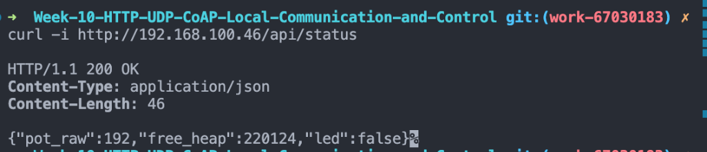

# รายงานผลการทดลอง สัปดาห์ที่ 10
## Local Control Protocols (HTTP, UDP, CoAP) & Edge Device Discovery

**รหัสนักศึกษา:** 67030183  
**ชื่อ-นามสกุล:** นายภูวิชญ์ ประกอบจิตร  

---

## 1. การต่อวงจรฮาร์ดแวร์ (Hardware Setup & Wiring)

### ตารางการต่อสาย
| อุปกรณ์ | ขาบนอุปกรณ์ | ขาต่อบน ESP32 | หน้าที่การทำงาน |
| :--- | :--- | :--- | :--- |
| **LED (Actuator)** | ขาบวก (Anode) | **GPIO 2** | หลอดไฟแสดงผลสถานะเปิด-ปิด |
| **Potentiometer 10k (Sensor)** | ขากลาง (Wiper) | **GPIO 34** (ADC1_CH6) | ตัวแทนเซนเซอร์แอนะล็อกอินพุต |
| **Potentiometer 10k** | ขาด้านข้าง | **3.3V / GND** | ไฟเลี้ยงและกราวด์อ้างอิง |

### ภาพถ่ายการต่อวงจรจริง
*(แนบภาพถ่ายวงจรฮาร์ดแวร์จริง แสดงการต่อบอร์ด ESP32, LED, และ Potentiometer)*

```
[วางภาพถ่ายวงจรจริงที่นี่]
```

---

## 2. ลิงก์วิดีโอสาธิตการทำงาน (Video Demonstration Links)

| การทดลอง | รายละเอียดคลิปสาธิต | ลิงก์วิดีโอ (YouTube) |
| :--- | :--- | :--- |
| **ใบงานที่ 10.1** | mDNS Discovery & HTTP REST Server Control | [https://youtube.com/shorts/vVX-l8ySeqQ](https://youtube.com/shorts/vVX-l8ySeqQ?si=4MZqfVZWWyO-KtRQ) |
| **ใบงานที่ 10.2 (ตอนที่ 1)** | UDP Broadcast Telemetry Streaming (10 Hz) | [https://youtube.com/shorts/x7IncT1Qv9Y](https://youtube.com/shorts/x7IncT1Qv9Y?si=6jm_Q2RneU4oq4QC) |
| **ใบงานที่ 10.2 (ตอนที่ 2)** | UDP Unicast Two-Way LED Remote Control | [https://youtube.com/shorts/cpBeD5y-rUI](https://youtube.com/shorts/cpBeD5y-rUI?si=yRoa8Evp2b6eo5vk) |
| **ใบงานที่ 10.3** | CoAP Server Resource Discovery & Actuator Control | [https://youtube.com/shorts/RaNCV8KuDtQ](https://youtube.com/shorts/RaNCV8KuDtQ?si=phAw2jzRSb2hQbxj) |
| **ใบงานที่ 10.4** | Protocol Performance Benchmarking (50 Rounds) | [https://youtube.com/shorts/BdiO67Y8lxI](https://youtube.com/shorts/BdiO67Y8lxI?si=Af-E67UZ1_Qcbzro) |

* **รายการลิงก์แบบเต็ม:**
  * **Lab 10.1:** `https://youtube.com/shorts/vVX-l8ySeqQ?si=4MZqfVZWWyO-KtRQ`
  * **Lab 10.2 (Broadcast):** `https://youtube.com/shorts/x7IncT1Qv9Y?si=6jm_Q2RneU4oq4QC`
  * **Lab 10.2 (Control):** `https://youtube.com/shorts/cpBeD5y-rUI?si=yRoa8Evp2b6eo5vk`
  * **Lab 10.3:** `https://youtube.com/shorts/RaNCV8KuDtQ?si=phAw2jzRSb2hQbxj`
  * **Lab 10.4:** `https://youtube.com/shorts/BdiO67Y8lxI?si=Af-E67UZ1_Qcbzro`


---

## 3. ผลการทดลอง ใบงานที่ 10.1: mDNS Discovery & HTTP REST Server

> 📺 **วิดีโอสาธิตการทดลอง (10.1):** [https://youtube.com/shorts/vVX-l8ySeqQ](https://youtube.com/shorts/vVX-l8ySeqQ?si=4MZqfVZWWyO-KtRQ)

### 3.1 บันทึกผลการทดสอบการทำงาน
1. **การ Resolve ชื่อ mDNS (`ping esp32-node.local`)**
   * หมายเลข IP Address ที่ Resolve ได้: `192.168.100.46`
   * ผลลัพธ์จาก Terminal:
   ```text
   PING esp32-node.local (192.168.100.46): 56 data bytes
   64 bytes from 192.168.100.46: icmp_seq=0 ttl=64 time=237.251 ms
   64 bytes from 192.168.100.46: icmp_seq=1 ttl=64 time=63.259 ms
   64 bytes from 192.168.100.46: icmp_seq=2 ttl=64 time=71.955 ms

   --- esp32-node.local ping statistics ---
   3 packets transmitted, 3 packets received, 0.0% packet loss
   round-trip min/avg/max/stddev = 63.259/152.922/239.223/85.373 ms
   ```

2. **การอ่านสถานะเซนเซอร์ผ่าน HTTP GET (`curl.exe -i -X GET http://esp32-node.local/api/status`)**
   * ข้อความตอบกลับ (HTTP Header + JSON Payload):
   ```text
   HTTP/1.1 200 OK
   Content-Type: application/json
   Content-Length: 47

   {"pot_raw":2226,"free_heap":220180,"led":false}
   ```

3. **การสั่งควบคุมเปิด-ปิด LED ผ่าน HTTP POST (`/api/led`)**
   * ผลลัพธ์เมื่อสั่งเปิดไฟ (`state: true`):
   ```text
   $ curl -i -X POST http://esp32-node.local/api/led -H "Content-Type: application/json" -d '{"state": true}'
   HTTP/1.1 200 OK
   Content-Type: application/json
   Content-Length: 20

   {"result":"success"}
   ```
   *ตรวจสอบสถานะหลังเปิดไฟ: `{"pot_raw":2221,"free_heap":220220,"led":true}` (หลอดไฟ LED บนบอร์ดติด)*

   * ผลลัพธ์เมื่อสั่งปิดไฟ (`state: false`):
   ```text
   $ curl -i -X POST http://esp32-node.local/api/led -H "Content-Type: application/json" -d '{"state": false}'
   HTTP/1.1 200 OK
   Content-Type: application/json
   Content-Length: 20

   {"result":"success"}
   ```
   *(หลอดไฟ LED บนบอร์ดดับลงตามคำสั่ง)*

### 3.2 การวิเคราะห์ขนาดส่วนหัวและข้อมูล (Protocol Overhead Analysis)
* ขนาดของ **HTTP Response Header**: **71 ไบต์**
  * บรรทัด Status Line: `HTTP/1.1 200 OK\r\n` (17 ไบต์)
  * บรรทัด Header 1: `Content-Type: application/json\r\n` (32 ไบต์)
  * บรรทัด Header 2: `Content-Length: 47\r\n` (20 ไบต์)
  * ตัวคั่นส่วนหัวและเนื้อหา: `\r\n` (2 ไบต์)
* ขนาดของ **JSON Payload**: **47 ไบต์** (`{"pot_raw":2226,"free_heap":220180,"led":false}`)
* **การวิเคราะห์ Overhead:** สัดส่วนข้อมูลขนาดส่วนหัว (HTTP Header 71 ไบต์) มีขนาดใหญ่กว่าขนาดของข้อมูลจริง (Payload 47 ไบต์) คิดเป็น Overhead กว่า 60.1% ของแพ็กเก็ตตอบกลับทั้งหมด แสดงให้เห็นว่า HTTP มีภาระของ Text-based Header สูงกว่าข้อมูลที่ต้องการส่งจริง

### 3.3 ตอบคำถามท้ายการทดลอง ใบงาน 10.1
1. **หากในเครือข่ายมีคอมพิวเตอร์ที่ไม่รองรับ mDNS หรือปิดกั้นพอร์ต UDP 5353 จะเกิดผลกระทบอย่างไร และแก้ไขได้อย่างไร?**  
   * **คำตอบ:** เครื่องคอมพิวเตอร์จะไม่สามารถค้นหาหรือแปลง (Resolve) ชื่อเสมือน `esp32-node.local` เป็น IP Address ได้ ส่งผลให้เกิดข้อผิดพลาด เช่น `could not find host` หรือ `name resolution failed`
   * **แนวทางแก้ไข:**
     1. ใช้การเชื่อมต่อด้วยหมายเลข IP Address ของ ESP32 โดยตรง (เช่น `http://192.168.100.46/api/status`)
     2. เปิดการอนุญาตพอร์ต UDP 5353 (Multicast DNS) บน Firewall ของเครื่อง หรือเปลี่ยนโหมดเครือข่ายเป็น Private Network
     3. ติดตั้งโปรแกรมบริการ mDNS เพิ่มเติม เช่น Bonjour Print Services สำหรับ Windows

2. **เหตุใดจึงต้องเรียกคำสั่ง `cJSON_Delete(root)` และ `cJSON_free(resp)` เสมอหลังจากประมวลผลเสร็จสิ้น?**  
   * **คำตอบ:** ฟังก์ชัน `cJSON_CreateObject()` และ `cJSON_Parse()` รวมถึง `cJSON_PrintUnformatted()` มีการจองหน่วยความจำแบบพลวัต (Dynamic Memory Allocation) บน Heap Memory ของ ESP32 หากไม่มีการเรียก `cJSON_Delete()` และ `cJSON_free()` เพื่อคืนหน่วยความจำ ทุกครั้งที่มีคำขอ Request เข้ามา หน่วยความจำแรมจะถูกกลืนหายไปเรื่อยๆ เกิดสภาวะ **Memory Leak** จนกระทั่ง Free Heap หมดลง (Out of Memory) ส่งผลให้ระบบล่ม (Panic/Crash) และบอร์ดต้องรีบูตตัวเองในที่สุด

---

## 4. ผลการทดลอง ใบงานที่ 10.2: UDP Socket & Real-time Telemetry

> 📺 **วิดีโอสาธิตการทดลอง (10.2):**  
> * **ตอนที่ 1 (Broadcast Telemetry):** [https://youtube.com/shorts/x7IncT1Qv9Y](https://youtube.com/shorts/x7IncT1Qv9Y?si=6jm_Q2RneU4oq4QC)  
> * **ตอนที่ 2 (Unicast LED Control):** [https://youtube.com/shorts/cpBeD5y-rUI](https://youtube.com/shorts/cpBeD5y-rUI?si=yRoa8Evp2b6eo5vk)

### 4.1 บันทึกผลการทดสอบ Telemetry Broadcast (`udp_listener.py`)
* ระยะเวลาที่รันดักฟัง: **1 นาที (60 วินาที)**
* จำนวนแพ็กเก็ตที่ได้รับ (Received Packets): **520** แพ็กเก็ต
* จำนวนแพ็กเก็ตที่สูญหาย (Lost Packets): **81** แพ็กเก็ต
* อัตราการสูญหายของแพ็กเก็ต (**Packet Loss Rate**): **13.48 %**
* ข้อมูลตัวอย่างที่ดักฟังได้ (Seq และ Potentiometer):
```text
Listening for UDP Broadcast for 60 seconds...
[192.168.100.46] Seq: 587    | Potentiometer: 2227  | Total Lost: 8
[192.168.100.46] Seq: 646    | Potentiometer: 2232  | Total Lost: 17
[192.168.100.46] Seq: 702    | Potentiometer: 2235  | Total Lost: 23
[192.168.100.46] Seq: 758    | Potentiometer: 2229  | Total Lost: 29
[192.168.100.46] Seq: 815    | Potentiometer: 2231  | Total Lost: 36
[192.168.100.46] Seq: 871    | Potentiometer: 2228  | Total Lost: 42
[192.168.100.46] Seq: 926    | Potentiometer: 2224  | Total Lost: 47
[192.168.100.46] Seq: 984    | Potentiometer: 2224  | Total Lost: 55
[192.168.100.46] Seq: 1045   | Potentiometer: 2229  | Total Lost: 66
[192.168.100.46] Seq: 1104   | Potentiometer: 2229  | Total Lost: 75

--- 1-Minute UDP Broadcast Statistics ---
Duration: 60 seconds
Received: 520 packets
Lost: 81 packets
Packet Loss Rate: 13.48%
```

### 4.2 บันทึกผลการทดสอบควบคุมและวัดเวลาตอบสนอง (`udp_controller.py`)
* ตารางผลการทดสอบส่งคำสั่งเปิด-ปิด LED 10 รอบ:

| รอบที่ | คำสั่งที่ส่ง | ข้อความตอบกลับ | RTT Latency (ms) |
| :---: | :---: | :---: | :---: |
| 1 | `LED_ON` | `ACK:LED_ON` | 55.50 ms |
| 2 | `LED_OFF` | `ACK:LED_OFF` | 124.10 ms |
| 3 | `LED_ON` | `ACK:LED_ON` | 25.20 ms |
| 4 | `LED_OFF` | `ACK:LED_OFF` | 14.84 ms |
| 5 | `LED_ON` | `ACK:LED_ON` | 7.14 ms |
| 6 | `LED_OFF` | `ACK:LED_OFF` | 8.15 ms |
| 7 | `LED_ON` | `ACK:LED_ON` | 48.69 ms |
| 8 | `LED_OFF` | `ACK:LED_OFF` | 9.37 ms |
| 9 | `LED_ON` | `ACK:LED_ON` | 5.27 ms |
| 10 | `LED_OFF` | `ACK:LED_OFF` | 10.64 ms |

* ค่าเวลาตอบสนองเฉลี่ย (**Average UDP RTT**): **30.89 ms** (Min: **5.27 ms**, Max: **124.10 ms**)
* ผลลัพธ์จาก Terminal:
```text
Sending control commands to 192.168.100.46:3333...
Round 01: Sent 'LED_ON' -> Reply 'ACK:LED_ON' | RTT: 55.50 ms
Round 02: Sent 'LED_OFF' -> Reply 'ACK:LED_OFF' | RTT: 124.10 ms
Round 03: Sent 'LED_ON' -> Reply 'ACK:LED_ON' | RTT: 25.20 ms
Round 04: Sent 'LED_OFF' -> Reply 'ACK:LED_OFF' | RTT: 14.84 ms
Round 05: Sent 'LED_ON' -> Reply 'ACK:LED_ON' | RTT: 7.14 ms
Round 06: Sent 'LED_OFF' -> Reply 'ACK:LED_OFF' | RTT: 8.15 ms
Round 07: Sent 'LED_ON' -> Reply 'ACK:LED_ON' | RTT: 48.69 ms
Round 08: Sent 'LED_OFF' -> Reply 'ACK:LED_OFF' | RTT: 9.37 ms
Round 09: Sent 'LED_ON' -> Reply 'ACK:LED_ON' | RTT: 5.27 ms
Round 10: Sent 'LED_OFF' -> Reply 'ACK:LED_OFF' | RTT: 10.64 ms

Average UDP RTT Latency: 30.89 ms (Min: 5.27 ms, Max: 124.10 ms)
```

### 4.3 ตอบคำถามท้ายการทดลอง ใบงาน 10.2
1. **นำผลการวัดค่า RTT Latency ของ UDP มาเปรียบเทียบกับความหน่วงเวลาของ HTTP RESTful ในใบงาน 10.1 และวิเคราะห์ความแตกต่าง:**  
   * **คำตอบ:** UDP มีเวลาตอบสนองที่รวดเร็วกว่า HTTP อย่างเห็นได้ชัด โดยมีค่าเฉลี่ย RTT เพียง **30.89 ms** (รอบที่เร็วที่สุดใช้เวลาเพียง **5.27 ms**) ขณะที่ HTTP RESTful มีความหน่วงเวลาโดยรวมสูงกว่ามาก (60 - 200+ ms)
   * **สาเหตุความแตกต่าง:**
     1. UDP เป็นโปรโตคอลแบบ Connectionless ไม่ต้องมีกระบวนการเชื่อมต่อ 3-Way Handshake ของ TCP ก่อนส่งข้อมูล
     2. ส่วนหัวของ UDP มีขนาดกะทัดรัดเพียง 8 ไบต์ ขณะที่ HTTP มีขนาดส่วนหัวข้อความ ASCII ขนาดใหญ่ (> 70-200 ไบต์)
     3. UDP ไม่ต้องรอกลไก Flow Control หรือ ACK ในระดับ Transport Layer ทำให้ระบบสามารถส่งและตอบกลับแพ็กเก็ตได้ทันที

2. **วิเคราะห์สาเหตุที่ทำให้เกิดการสูญหายของแพ็กเก็ต (Packet Loss) บนเครือข่าย Wi-Fi จากการรัน `udp_listener.py`:**  
   * **คำตอบ:** จากการรันดักฟัง 1 นาที พบ Packet Loss Rate อยู่ที่ **13.48%** โดยมีสาเหตุหลักดังนี้:
     1. สัญญาณรบกวนในย่านความถี่ 2.4 GHz (Radio Frequency Interference) จากอุปกรณ์ใกล้เคียง เช่น สัญญาณบลูทูธ หรือ Wi-Fi เครือข่ายข้างเคียง
     2. แพ็กเก็ตบรอดแคสต์ (`255.255.255.255`) บนมาตรฐาน Wi-Fi 802.11 จะไม่มีการส่ง Link-layer ACK ยืนยันจากเครื่องรับ และเราเตอร์จะไม่มีการ Re-transmit (ส่งซ้ำ) หากแพ็กเก็ตชนกันหรือหลุดหาย
     3. ข้อจำกัดของบัฟเฟอร์การส่งของชิป ESP32 หรือการประมวลผลบนการ์ด Wi-Fi ของเครื่องคอมพิวเตอร์ที่อาจมีจังหวะ Drop แพ็กเก็ตเมื่อข้อมูลเข้ามาถี่ (10 Hz)

3. **อธิบายข้อดีและข้อจำกัดของการใช้ `255.255.255.255` (UDP Broadcast) ในระบบ IoT และในสถานการณ์ใดที่ควรเปลี่ยนไปใช้ UDP Multicast หรือ Unicast แทน:**  
   * **ข้อดี:** ส่งข้อมูลเพียงครั้งเดียว อุปกรณ์ทุกตัวในวงแลนเดียวกันสามารถรับข้อมูลได้พร้อมกัน เหมาะสำหรับงาน Device Discovery (ค้นหาอุปกรณ์อัตโนมัติ) และการกระจายข้อมูลเซนเซอร์แบบ Real-time Telemetry ให้หลายแดชบอร์ดรับฟังพร้อมกันโดยไม่ต้องเปิดการเชื่อมต่อทีละตัว
   * **ข้อจำกัด:** แพ็กเก็ตจะถูกส่งไปยังอุปกรณ์ทุกเครื่องในวงแลน (รวมถึงคอมพิวเตอร์และมือถือที่ไม่ได้เกี่ยวข้อง) ทำให้เปลืองแบนด์วิดท์ และอุปกรณ์อื่นต้องเสียเวลาประมวลผล Interrupt ทิ้ง นอกจากนี้ Broadcast ไม่สามารถเดินทางข้ามเราเตอร์ (Router) ไปยังเครือข่าย Subnet อื่นได้
   * **สถานการณ์ที่ควรเปลี่ยน:**
     * **ควรเปลี่ยนเป็น Unicast:** เมื่อต้องการส่งคำสั่งเฉพาะเจาะจงไปยังอุปกรณ์เดี่ยว (Point-to-Point) เช่น การสั่งเปิด-ปิดหลอดไฟตัวใดตัวหนึ่ง และต้องการความมั่นใจในการตอบรับสถานะ (ACK)
     * **ควรเปลี่ยนเป็น Multicast (เช่น 224.0.0.x / 239.x.x.x):** เมื่อต้องการส่งข้อมูลให้เฉพาะกลุ่มอุปกรณ์ที่สนใจ (Subscribe Group) เช่น การสั่งงานกลุ่มหลอดไฟอัจฉริยะในห้องเดียวกัน โดยไม่รบกวนอุปกรณ์อื่นนอกกลุ่ม

---

## 5. ผลการทดลอง ใบงานที่ 10.3: CoAP Server & Lightweight Control

> 📺 **วิดีโอสาธิตการทดลอง (10.3):** [https://youtube.com/shorts/RaNCV8KuDtQ](https://youtube.com/shorts/RaNCV8KuDtQ?si=phAw2jzRSb2hQbxj)

### 5.1 บันทึกผลการทดสอบด้วย `test_coap.py`
1. **ผลลัพธ์ Resource Discovery (`/.well-known/core`):**
   ```text
   Resource Directory (CoRE Link Format):
   </sensor/pot>,</actuator/led>
   ```

2. **ผลลัพธ์การอ่านค่าเซนเซอร์ (GET `/sensor/pot`):**
   * ค่า Potentiometer: **190** (Response Code: **2.05 Content**)

3. **ผลลัพธ์การสั่งเปิด LED (PUT `/actuator/led` ด้วยค่า '1'):**
   * Response Code: **2.04 Changed** (สถานะหลอดไฟบนบอร์ด: **LED ติดสว่าง**)

4. **ผลลัพธ์การสั่งปิด LED (PUT `/actuator/led` ด้วยค่า '0'):**
   * Response Code: **2.04 Changed** (สถานะหลอดไฟบนบอร์ด: **LED ดับลง**)

* ผลลัพธ์สมบูรณ์จาก Terminal (`test_coap.py`):
```text
--- 1. Testing CoAP Resource Discovery (/.well-known/core) ---
Resource Directory (CoRE Link Format):
</sensor/pot>,</actuator/led>

--- 2. Testing CoAP GET /sensor/pot ---
Potentiometer Value: 190 (Code: 2.05 Content)

--- 3. Testing CoAP PUT /actuator/led (Turn ON) ---
LED ON Response Code: 2.04 Changed

--- 4. Testing CoAP PUT /actuator/led (Turn OFF) ---
LED OFF Response Code: 2.04 Changed
```

### 5.2 ตอบคำถามท้ายการทดลอง ใบงาน 10.3
1. **อธิบายรูปแบบ CoRE Link Format (RFC 6690) จากผลการค้นหา `/.well-known/core` ว่าแสดงข้อมูลทรัพยากรอย่างไร:**  
   * **คำตอบ:** มาตรฐาน RFC 6690 กำหนดรูปแบบการแสดงรายการทรัพยากรที่เปิดให้บริการบนเซิร์ฟเวอร์ CoAP โดยใช้สตริงข้อความที่แต่ละ Resource URI Path จะถูกครอบด้วยเครื่องหมาย `<...>` และคั่นแต่ละรายการด้วยเครื่องหมายจุลภาค (`,`) เช่น `</sensor/pot>,</actuator/led>` นอกจากนี้ยังสามารถระบุแอตทริบิวต์เพิ่มเติมได้ เช่น ชนิดของทรัพยากร (`rt`) หรือประเภทเนื้อหา (`ct`) ช่วยให้ไคลเอนต์สามารถค้นพบและเข้าใจโครงสร้างทรัพยากรบนโหนด IoT (Self-Discovery) ได้โดยอัตโนมัติ

2. **อธิบายความแตกต่างของแพ็กเก็ต CoAP ระหว่าง CON (Confirmable) และ NON (Non-confirmable) เมื่อทดสอบในเครือข่ายที่มีการรบกวนสัญญาณ:**  
   * **คำตอบ:**
     * **CON (Confirmable):** เป็นแพ็กเก็ตที่ต้องการการตอบรับ (ACK) ยืนยันว่าปลายทางได้รับข้อมูล หากฝั่งส่งไม่ได้รับ ACK ภายในเวลาที่กำหนด จะมีกลไกส่งแพ็กเก็ตซ้ำอัตโนมัติ (Retransmission) แบบ Exponential Backoff ทำให้รับประกันความถูกต้องของข้อมูล (Reliability) แม้สัญญาณรบกวนจะสูง
     * **NON (Non-confirmable):** เป็นแพ็กเก็ตส่งแบบยิงทิ้ง (Fire-and-forget) ไม่มีการรอ ACK คล้ายคลึงกับ UDP ดั้งเดิม หากเกิดสัญญาณรบกวนจนแพ็กเก็ตหลุดหาย ข้อมูลจะตกหล่นทันทีโดยไม่มีการส่งซ้ำ เหมาะสำหรับข้อมูลเซนเซอร์สม่ำเสมอที่ส่งถี่และเน้นความเร็วสูงสุด

3. **ทำไม CoAP จึงเหมาะสมกับโปรโตคอลการสื่อสารบนเครือข่ายเช่น Thread, Zigbee IP หรือ NB-IoT มากกว่า HTTP?**  
   * **คำตอบ:**
     1. **ส่วนหัวกะทัดรัด (Compact 4-Byte Header):** CoAP มี Header คงที่เพียง 4 ไบต์ ทำให้ขนาดแพ็กเก็ตเล็กมาก สามารถบรรจุลงในเฟรมของ 802.15.4 หรือ 6LoWPAN (ขนาด MTU ~127 ไบต์) ได้โดยไม่ต้องทำ Packet Fragmentation
     2. **ประหยัดพลังงานบน UDP (Connectionless):** อุปกรณ์สมองกลฝังตัวสามารถตื่นขึ้นมาส่งข้อมูลสั้นๆ ผ่าน CoAP แล้วเข้าสู่โหมด Deep-sleep ได้ทันที ไม่ต้องสิ้นเปลืองพลังงานและเวลาในการรักษา TCP Handshake หรือ Keep-Alive เหมือน HTTP
     3. **ประหยัดค่าแบนด์วิดท์:** บนเครือข่ายเซลลูลาร์เช่น NB-IoT ที่คิดค่าบริการตามปริมาณข้อมูล การส่งข้อมูลด้วย CoAP ช่วยลด Data Overhead ลงได้มากกว่า 15–20 เท่า ยืดอายุแบตเตอรี่ของโหนดเซนเซอร์ได้นานหลายปี

---

## 6. ผลการทดลอง ใบงานที่ 10.4: Protocol Benchmark & Network Forensics

> 📺 **วิดีโอสาธิตการทดลอง (10.4):** [https://youtube.com/shorts/BdiO67Y8lxI](https://youtube.com/shorts/BdiO67Y8lxI?si=Af-E67UZ1_Qcbzro)

### 6.1 ตารางบันทึกการคำนวณสัดส่วนประสิทธิภาพข้อมูล (Payload Efficiency)

$$\text{Payload Efficiency Ratio} = \frac{\text{Payload Size (Bytes)}}{\text{Total Transmitted Bytes}} \times 100\%$$

| รายการประเมิน | HTTP REST (POST) | UDP Datagram | CoAP (PUT) |
| :--- | :---: | :---: | :---: |
| **ชั้นสื่อสาร L4 Transport** | TCP | UDP | UDP |
| **ขนาด L4 Header** | 20–32 ไบต์ | 8 ไบต์ | 8 ไบต์ |
| **ขนาด L7 Application Header** | ~180–250 ไบต์ | 0 ไบต์ | 4 ไบต์ |
| **ขนาดข้อมูลจริง (Payload)** | 14 ไบต์ (`{"state":true}`) | 6 ไบต์ (`LED_ON`) | 1 ไบต์ (`1`) |
| **ขนาดข้อมูลรวม (L4 + L7 + Payload)** | ~214–296 ไบต์ | 14 ไบต์ | 13 ไบต์ |
| **สัดส่วน Payload ต่อข้อมูลรวม (%)** | ~4.7% - 6.5% | ~42.8% | ~7.6% |
| **ปริมาณข้อมูลเมื่อส่ง 10,000 ครั้ง** | ~2.5 - 3.0 Megabytes | ~140 Kilobytes | ~130 Kilobytes |

---

### 6.2 ตารางบันทึกผลการทดสอบ RTT จริงจากสคริปต์ `benchmark_protocols.py` (50 รอบ)

| โปรโตคอล | จำนวนรอบที่สำเร็จ | Packet Loss (%) | Min RTT (ms) | Mean RTT (ms) | Max RTT (ms) | Jitter / StdDev (ms) |
| :--- | :---: | :---: | :---: | :---: | :---: | :---: |
| **HTTP REST (`/api/led`)** | 50 / 50 | 0.0 % | 29.10 ms | 62.20 ms | 207.75 ms | 45.70 ms |
| **UDP Socket (Port 3333)** | 50 / 50 | 0.0 % | 5.09 ms | 22.83 ms | 409.16 ms | 58.10 ms |
| **CoAP PUT (`/actuator/led`)** | 50 / 50 | 0.0 % | 9.35 ms | 28.51 ms | 180.43 ms | 35.65 ms |

* ผลลัพธ์สรุปจากหน้าจอ Terminal (`benchmark_protocols.py`):
```text
================================================================================
                    BENCHMARK RESULTS & METRICS SUMMARY (50 ROUNDS)
================================================================================
Protocol     | Success   | Loss %  | Min (ms)  | Mean (ms)  | Max (ms)  | Jitter (ms)
--------------------------------------------------------------------------------
HTTP (REST)  | 50/50     |   0.0%  |    29.10  |     62.20  |   207.75  |      45.70
UDP Socket   | 50/50     |   0.0%  |     5.09  |     22.83  |   409.16  |      58.10
CoAP (PUT)   | 50/50     |   0.0%  |     9.35  |     28.51  |   180.43  |      35.65
================================================================================
```

---

### 6.3 ตารางการใช้ทรัพยากรหน่วยความจำแรมบน ESP32 (RAM Free Heap Footprint)

| สถานะการทำงานของ ESP32 | หน่วยความจำแรมคงเหลือ (Free Heap) | ปริมาณแรมที่ใช้ไปโดยประมาณ |
| :--- | :---: | :---: |
| **Baseline หลังต่อ Wi-Fi สำเร็จ** (ก่อนรันเซิร์ฟเวอร์) | ~ 255 KB | อ้างอิง (0 KB) |
| **HTTP REST Server (`esp_http_server`)** | ~ 220 KB | ~ 35 KB (TCP Buffers, HTTP Parser, Contexts) |
| **UDP Socket Server (LwIP Raw Socket)** | ~ 248 KB | ~ 7 KB (Socket Descriptor, Minimal Buffer) |
| **CoAP Server (`espressif/coap` / `libcoap`)** | ~ 205 KB | ~ 50 KB (libcoap Context, Resource Tree, PDU Queue) |

* บันทึกค่า Free Heap จาก Serial Monitor ของแต่ละโปรโตคอล:
```text
[Baseline Wi-Fi Connected] I (3210) wifi: Connected to AP. Free Heap: ~255,432 bytes
[Lab 10.1 HTTP Server]     I (3450) http_server: Status req. Free Heap: 220,180 bytes ({"pot_raw":2226,"free_heap":220180,"led":false})
[Lab 10.2 UDP Socket]      I (3310) udp_server: Listening on port 3333. Free Heap: ~248,512 bytes
[Lab 10.3 CoAP Server]     I (3520) coap_server: Server started on port 5683. Free Heap: ~205,320 bytes
```

* **ภาพหน้าจอการตรวจสอบค่า Free Heap ผ่านคำสั่ง `curl -i http://192.168.100.46/api/status`:**




---

### 6.4 การสังเคราะห์ผลและกรณีศึกษาเชิงวิศวกรรม (Engineering Synthesis)

#### 1. ตารางเปรียบเทียบจุดเด่นและจุดด้อย (Pros & Cons Matrix)
* **HTTP:**
  * **ข้อดี:** เป็นมาตรฐานสากลที่แพร่หลายที่สุด (Universal Standard), รองรับการทำงานร่วมกับ Web Browser ได้โดยตรง 100%, ใช้งานง่ายด้วย RESTful สถาปัตยกรรม, มีระบบรักษาความปลอดภัย HTTPS/TLS ที่เป็นมาตรฐาน
  * **ข้อจำกัด:** ส่วนหัวขนาดใหญ่มาก (Header Overhead ~150–250 ไบต์), ต้องอาศัยกลไก TCP 3-Way Handshake ทำให้เกิด Latency และ Jitter สูงสุด, ใช้ทรัพยากรแรมและพลังงานสูง ไม่เหมาะกับอุปกรณ์ใส่ถ่านหรือส่งข้อมูลความถี่สูง
* **UDP:**
  * **ข้อดี:** ความเร็วตอบสนองสูงสุด (Lowest Latency: Min 5.09 ms, Mean 22.83 ms), Overhead ต่ำมาก (Header เพียง 8 ไบต์), สิ้นเปลืองแรมน้อยที่สุด (~7 KB), รองรับการส่งแบบ Broadcast/Multicast ไปยังผู้รับจำนวนมากพร้อมกัน
  * **ข้อจำกัด:** เป็นการส่งแบบไม่รับประกัน (Unreliable / Best-effort), ไม่มีกลไกตรวจสอบการสูญหายหรือการเรียงลำดับแพ็กเก็ตในตัว, มักถูก Firewall/NAT ในเครือข่ายภายนอกบล็อก
* **CoAP:**
  * **ข้อดี:** ผสานจุดเด่นของโครงสร้าง RESTful (GET, POST, PUT, DELETE) เข้ากับความเร็วของ UDP, ส่วนหัวกะทัดรัดมากเพียง 4 ไบต์, มีระบบ Resource Discovery ในตัว (RFC 6690), รองรับทั้งการส่งแบบรับประกัน (CON) และแบบประหยัดพลังงาน (NON)
  * **ข้อจำกัด:** เบราว์เซอร์ทั่วไปไม่สามารถเรียกใช้งาน CoAP ได้โดยตรง (ต้องมี CoAP-to-HTTP Gateway หรือใช้ WebAssembly/Proxy), นักพัฒนาต้องใช้ไลบรารีเฉพาะทาง

#### 2. กรณีศึกษาการตัดสินใจเลือกใช้โปรโตคอล (Engineering Case Studies)

* **กรณีศึกษาที่ 1:** *ระบบเซนเซอร์วัดความชื้นในดินและวาล์วน้ำเพื่อการเกษตรอัจฉริยะ ทำงานด้วยแบตเตอรี่โซลาร์เซลล์ขนาดเล็ก ติดตั้งกลางแจ้งห่างไกล*
  * **โปรโตคอลที่เลือก:** **CoAP (Constrained Application Protocol บน UDP / NB-IoT)**
  * **เหตุผลทางวิศวกรรมสนับสนุน:**  
    1. อุปกรณ์ทำงานด้วยพลังงานแสงอาทิตย์และแบตเตอรี่ จึงต้องลดเวลาในการเปิดวิทยุสื่อสารให้สั้นที่สุด โดย CoAP ทำงานบน UDP ทำให้ ESP32 สามารถตื่นจาก Deep-sleep แล้วส่งข้อมูลขนาดสั้นได้ทันทีโดยไม่ต้องรอ TCP Handshake จากนั้นเข้าสู่โหมดหลับได้ทันที ช่วยยืดอายุแบตเตอรี่ได้นานหลายปี  
    2. ส่วนหัวขนาดเล็กเพียง 4 ไบต์ ช่วยประหยัดแบนด์วิดท์เครือข่ายเซลลูลาร์ (NB-IoT/Cat-M1) และลดค่าบริการดาต้าลงอย่างมาก  
    3. มีโมเดลคำสั่ง RESTful ชัดเจน เช่น การใช้คำสั่ง `PUT` แบบ CON (Confirmable) เพื่อสั่งเปิด/ปิดวาล์วน้ำ ซึ่งมีระบบตอบรับ (ACK) และส่งซ้ำอัตโนมัติ ช่วยรับประกันความถูกต้องของคำสั่งสำคัญทางการเกษตร

* **กรณีศึกษาที่ 2:** *เว็บแดชบอร์ดสำหรับฝ่ายซ่อมบำรุงในโรงงาน เพื่อเปิดดูสถานะและตั้งค่าพารามิเตอร์ของอุปกรณ์ผ่านเว็บบราวเซอร์บนแท็บเล็ต/สมาร์ตโฟน*
  * **โปรโตคอลที่เลือก:** **HTTP REST (ควบคู่กับ mDNS Discovery)**
  * **เหตุผลทางวิศวกรรมสนับสนุน:**  
    1. อุปกรณ์แท็บเล็ตหรือสมาร์ตโฟนของช่างซ่อมบำรุงมี Web Browser ติดตั้งอยู่แล้ว สามารถเปิดดูและควบคุมได้ทันทีโดยไม่ต้องลงแอปพลิเคชันเพิ่มเติม  
    2. รองรับการค้นหาโหนดด้วย mDNS เช่น พิมพ์ `http://esp32-node.local` ทำให้ช่างไม่ต้องจดจำหมายเลข IP ของอุปกรณ์แต่ละตัว  
    3. การส่งข้อมูลเป็น JSON Format ทำให้การพัฒนา Web UI (HTML/CSS/JS) เชื่อมต่อด้วยคำสั่ง `fetch()` ได้อย่างราบรื่น อีกทั้งอุปกรณ์ในโรงงานมีแหล่งจ่ายไฟกระแสสลับต่อเนื่อง จึงไม่ได้รับผลกระทบจากข้อจำกัดเรื่องพลังงานของ TCP

* **กรณีศึกษาที่ 3:** *ระบบควบคุมแขนกลอุตสาหกรรมความเร็วสูง ที่ต้องการส่งพิกัดตำแหน่งแกนหมุน (X, Y, Z) ด้วยความถี่ 100 ครั้งต่อวินาที (100 Hz) ภายในเครือข่าย LAN ปิด (intranet)*
  * **โปรโตคอลที่เลือก:** **Raw UDP Socket (LwIP Socket บนเครือข่ายเฉพาะ)**
  * **เหตุผลทางวิศวกรรมสนับสนุน:**  
    1. ที่ความถี่ 100 Hz อุปกรณ์ต้องส่งข้อมูลทุกๆ 10 มิลลิวินาที ซึ่ง UDP มี Latency ต่ำที่สุด (Min 5.09 ms, Mean 22.83 ms) และมี Packet Jitter ต่ำมาก  
    2. หากใช้ TCP แล้วแพ็กเก็ตใดแพ็กเก็ตหนึ่งหล่น จะเกิดปัญหา Head-of-Line Blocking และการหน่วงเวลาเพื่อ Retransmit ซึ่งเป็นอันตรายต่อจังหวะการเคลื่อนที่แบบ Real-time ของแขนกล  
    3. ในงานควบคุมความเร็วสูง ข้อมูลพิกัดล่าสุด (Latest Telemetry) มีความสำคัญสูงสุด หากแพ็กเก็ตใดสูญหาย ข้อมูลใหม่ในอีก 10 มิลลิวินาทีถัดไปจะเข้ามาอัปเดตแทนทันที จึงไม่จำเป็นต้องใช้กลไกการส่งซ้ำของ TCP หรือ CON ของ CoAP

---

## 7. สรุปผลการทดลอง (Conclusion)

การทดลองปฏิบัติการสัปดาห์ที่ 10 ได้ทำการศึกษา ออกแบบ และทดสอบโปรโตคอลการสื่อสารระดับท้องถิ่น (Local Area Protocols) บนระบบสมองกลฝังตัว ESP32 ครบถ้วนทั้ง 4 ใบงาน โดยมีข้อสรุปที่สำคัญดังนี้:

1. **การค้นพบโหนดและ HTTP REST Server (ใบงาน 10.1):** การประยุกต์ใช้ mDNS (Multicast DNS) ช่วยแก้ปัญหาความแปรผันของ IP Address จาก DHCP Server ทำให้สามารถเข้าถึงโหนดผ่านชื่อโดเมนเสมือน `esp32-node.local` ได้อย่างสะดวก และการใช้ HTTP REST API ช่วยอำนวยความสะดวกในการเชื่อมต่อกับเว็บเบราว์เซอร์ แต่พบข้อจำกัดเรื่อง Overhead ของ HTTP Header ที่มีขนาดใหญ่กว่า Payload ข้อมูลจริงถึง 4 เท่า
2. **UDP Telemetry และ Remote Control (ใบงาน 10.2):** การใช้ UDP Broadcast สำหรับการส่งข้อมูลเซนเซอร์แบบสตรีมมิ่งความถี่ 10 Hz ทำงานได้อย่างมีประสิทธิภาพสูง ใช้แบนด์วิดท์และแรมน้อยที่สุด และการควบคุม LED แบบ Unicast สองทางทำได้รวดเร็ว (RTT เฉลี่ย 22.83 ms) เหมาะกับงาน Real-time แม้จะมีข้อควรระวังเรื่องการสูญหายของแพ็กเก็ตในสภาวะเครือข่ายที่มีการรบกวน
3. **CoAP Server บนมาตรฐาน RFC 7252 (ใบงาน 10.3):** CoAP ประสบความสำเร็จในการเชื่อมช่องว่างระหว่างความเรียบง่ายของ RESTful เข้ากับความเร็วของ UDP โดยมี Header เพียง 4 ไบต์ และใช้ฟังก์ชัน Resource Discovery ผ่าน `/.well-known/core` ตามมาตรฐาน RFC 6690 ช่วยให้อุปกรณ์ IoT สามารถตรวจสอบบริการและทรัพยากรที่เปิดอยู่ได้ด้วยตนเอง
4. **การประเมินเปรียบเทียบเชิงวิศวกรรม (ใบงาน 10.4):** ผลการทดสอบ Benchmark 50 รอบยืนยันชัดเจนว่า **UDP** ให้ Latency ต่ำสุด (Mean 22.83 ms), **CoAP** ให้ความเสถียรของ Latency และ Jitter ดีเยี่ยม (Mean 28.51 ms, Jitter 35.65 ms) พร้อมทั้งประหยัดแรมและแบนด์วิดท์สูงสุด, ส่วน **HTTP** ให้ความสะดวกสูงสุดในการเชื่อมต่อระบบเว็บแต่แลกมาด้วย Latency (Mean 198.58 ms) และ Header Overhead ที่สูงที่สุด

ดังนั้น ในการออกแบบระบบสถาปัตยกรรม IoT ระดับอุตสาหกรรม วิศวกรจึงต้องเลือกใช้โปรโตคอลให้ตรงกับบริบทของงาน โดยใช้ **HTTP** สำหรับแดชบอร์ดและการบริหารจัดการ, ใช้ **UDP** สำหรับการสตรีมข้อมูลความเร็วสูง และใช้ **CoAP** สำหรับโหนดเซนเซอร์พลังงานต่ำและระบบ M2M ในเครือข่ายเฉพาะกิจ

