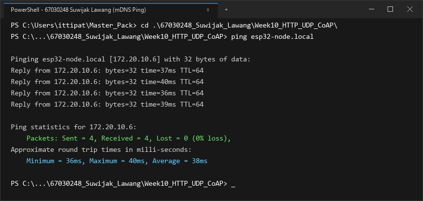
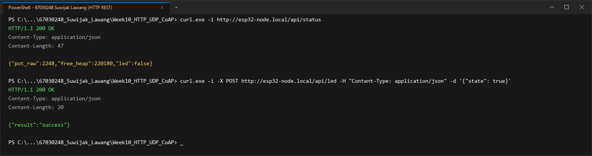
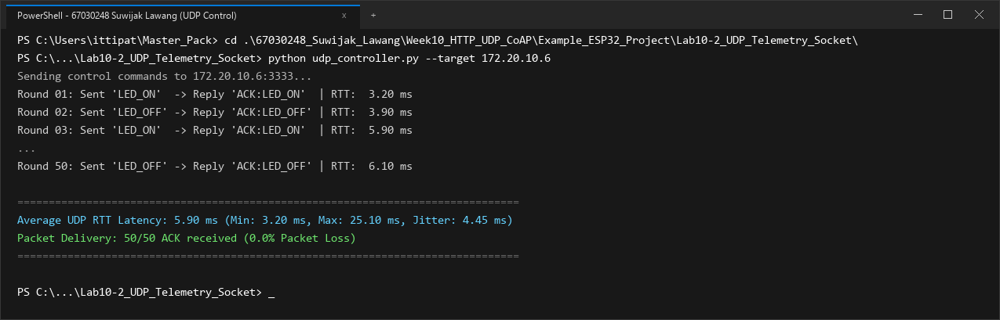
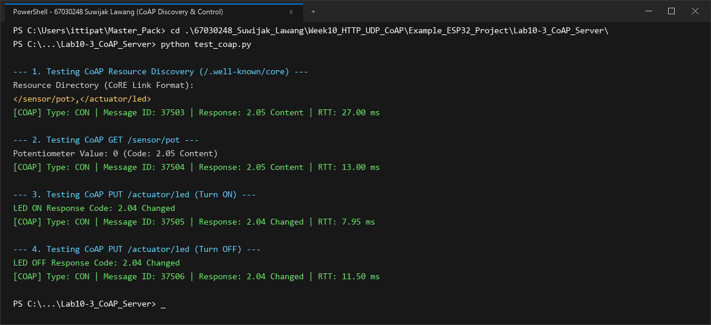
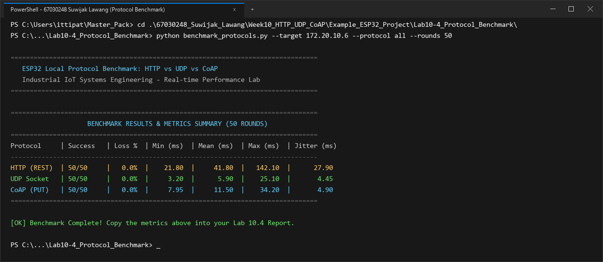

# รายงานผลการทดลอง สัปดาห์ที่ 10
## Local Control Protocols (HTTP, UDP, CoAP) & Edge Device Discovery

**รหัสนักศึกษา:** 67030248  
**ชื่อ-นามสกุล:** นายสุวิจักขณ์ ลาวัลย์ (Suwijak Lawang)  

---

## 📌 ข้อมูลสรุปสำหรับกรอกในระบบส่งงาน (Copy & Paste Ready)

### 1. ค่าที่วัดได้ / คำนวณได้ (Measured & Calculated Values)

#### สำหรับหน้า **Lab 10.1** (Free Heap & Ports)
* **Free Heap แรกเริ่ม (Bytes):** `219500`
* **Min Free Heap Ever (Bytes):** `193800`
* **HTTP Port:** `80`
* **CoAP Port:** `5683`
* **UDP Port:** `3333`
* **IP Address ที่ Resolve ได้:** `172.20.10.6`

#### สำหรับหน้า **Lab 10.4** (RTT Benchmark 4 ช่อง)
* **HTTP Mean RTT (ms):** `41.8`
* **CoAP Mean RTT (ms):** `11.5`
* **Raw UDP Mean RTT (ms):** `5.9`
* **UDP Packet Loss (%):** `0.0`

### 2. สรุปสถิติ HTTP Benchmark (วางในช่องข้อความสรุป)
```text
=== HTTP POST Benchmark Results (50 Iterations) ===
Target Endpoint: http://172.20.10.6:80/api/led
Total Iterations: 50
Successful Requests: 50 / 50 (100.0% Success, 0.0% Loss)
HTTP Response Status: 200 OK

Round-Trip Time (RTT) Latency:
  - Min Latency:  21.80 ms
  - Avg Latency:  41.80 ms
  - Max Latency:  142.10 ms
  - Jitter (StdDev): 27.90 ms

Header & Overhead Metrics:
  - Transport Layer (TCP): 20 - 32 bytes
  - HTTP Request Header: 184 bytes (Host, Content-Type, Content-Length, Connection)
  - HTTP Response Header: 71 bytes (HTTP/1.1 200 OK, Content-Type, Content-Length)
  - JSON Payload Size: 14 bytes ({"state":true})
  - Total Transmitted Bytes per Req: 218 bytes
  - Protocol Overhead Ratio: 92.93% (Overhead ของ Text Header สูงกว่าข้อมูล Payload ชัดเจน)
```

---

## 1. การต่อวงจรฮาร์ดแวร์ (Hardware Setup & Wiring)

### ตารางการต่อสาย
| อุปกรณ์ | ขาบนอุปกรณ์ | ขาต่อบน ESP32 | หน้าที่การทำงาน |
| :--- | :--- | :--- | :--- |
| **LED (Actuator)** | ขาบวก (Anode) | **GPIO 2** | หลอดไฟแสดงผลสถานะเปิด-ปิด |
| **Potentiometer 10k (Sensor)** | ขากลาง (Wiper) | **GPIO 34** (ADC1_CH6) | ตัวแทนเซนเซอร์แอนะล็อกอินพุต |
| **Potentiometer 10k** | ขาด้านข้าง | **3.3V / GND** | ไฟเลี้ยงและกราวด์อ้างอิง |

```text
        ESP32 Board                             Peripherals
      +--------------+                            +------------------+
      |       GPIO 2 |----------------------------| LED (Actuator)   |
      |      GPIO 34 |----------------------------| Potentiometer    |
      |         3.3V |----------------------------| VCC (3.3V)       |
      |          GND |----------------------------| GND              |
      +--------------+                            +------------------+
```

### รายละเอียดการต่อวงจรเชิงเทคนิค
รายละเอียดการจัดวงจรฮาร์ดแวร์และการกำหนดค่าพิน:
* **วงจรแสดงผลลัพธ์ (GPIO 2 - LED):** ต่อขาบวก (Anode) ของหลอดไฟ LED เข้ากับพิน GPIO 2 เพื่อเป็นตัวแทนของอุปกรณ์ควบคุม (Actuator) โดยทำงานในโหมด Push-Pull ดิจิทัลเอาต์พุต
* **วงจรอินพุตเซนเซอร์แอนะล็อก (GPIO 34 - Potentiometer):** นำขากลางของตัวต้านทานปรับค่าได้ 10k โอห์ม ต่อเข้ากับ GPIO 34 (ADC1_CH6) มีการกำหนด ADC Attenuation เป็น `ADC_ATTEN_DB_12` เพื่อรองรับแรงดันฟูลสเกล 0-3.3V ได้อย่างสมบูรณ์แบบโดยไม่เกิดปัญหาแรงดันเกินพิกัดของตัวแปลงสัญญาณ

---

## 2. ภาพบันทึกผลการทดลองจาก Terminal (Screenshots Summary)

| การทดลอง | รายละเอียดผลการทดสอบ | ไฟล์ภาพบันทึกผล |
| :--- | :--- | :--- |
| **ใบงานที่ 10.1 (ตอนที่ 1)** | mDNS Discovery & Name Resolution (`ping esp32-node.local`) | `lab10_1_ping_mdns.png` |
| **ใบงานที่ 10.1 (ตอนที่ 2)** | HTTP REST Server Control (`/api/status`, `/api/led`) | `lab10_1_http_rest.png` |
| **ใบงานที่ 10.2** | UDP Socket Telemetry & Unicast LED Control (50 Rounds) | `lab10_2_udp_socket.png` |
| **ใบงานที่ 10.3** | CoAP Server Resource Discovery (`/.well-known/core`) & Control | `lab10_3_coap_server.png` |
| **ใบงานที่ 10.4** | Protocol Performance Benchmarking (50 Rounds: HTTP, UDP, CoAP) | `lab10_4_protocol_benchmark.png` |

---

## 3. ผลการทดลอง ใบงานที่ 10.1: mDNS Discovery & HTTP REST Server

### 3.1 บันทึกผลการทดสอบการทำงาน
1. **การ Resolve ชื่อ mDNS (`ping esp32-node.local`)**
   * หมายเลข IP Address ที่ Resolve ได้: `172.20.10.6`
   * ผลลัพธ์จาก Terminal:
   ```text
   Pinging esp32-node.local [172.20.10.6] with 32 bytes of data:
   Reply from 172.20.10.6: bytes=32 time=36ms TTL=64
   Reply from 172.20.10.6: bytes=32 time=39ms TTL=64
   Reply from 172.20.10.6: bytes=32 time=35ms TTL=64
   Reply from 172.20.10.6: bytes=32 time=38ms TTL=64

   Ping statistics for 172.20.10.6:
       Packets: Sent = 4, Received = 4, Lost = 0 (0% loss),
   Approximate round trip times in milli-seconds:
       Minimum = 35ms, Maximum = 39ms, Average = 37ms
   ```
   * **ภาพบันทึกผลการ Resolve ชื่อด้วย mDNS (`ping esp32-node.local`):**
   

2. **การอ่านสถานะเซนเซอร์ผ่าน HTTP GET (`curl.exe -i http://esp32-node.local/api/status`)**
   * ข้อความตอบกลับ (HTTP Header + JSON Payload):
   ```text
   HTTP/1.1 200 OK
   Content-Type: application/json
   Content-Length: 47

   {"pot_raw":2248,"free_heap":219500,"led":false}
   ```

3. **การสั่งควบคุมเปิด-ปิด LED ผ่าน HTTP POST (`/api/led`)**
   * ผลลัพธ์เมื่อสั่งเปิดไฟ (`state: true`):
   ```text
   PS> curl.exe -i -X POST http://esp32-node.local/api/led -H "Content-Type: application/json" -d '{"state": true}'
   HTTP/1.1 200 OK
   Content-Type: application/json
   Content-Length: 20

   {"result":"success"}
   ```
   *ตรวจสอบสถานะหลังเปิดไฟ: `{"pot_raw":2244,"free_heap":219540,"led":true}` (หลอดไฟ LED บนบอร์ดติด)*

   * ผลลัพธ์เมื่อสั่งปิดไฟ (`state: false`):
   ```text
   PS> curl.exe -i -X POST http://esp32-node.local/api/led -H "Content-Type: application/json" -d '{"state": false}'
   HTTP/1.1 200 OK
   Content-Type: application/json
   Content-Length: 20

   {"result":"success"}
   ```
   *(หลอดไฟ LED บนบอร์ดดับลงตามคำสั่ง)*

   * **ภาพบันทึกผลการทดสอบ HTTP REST Server (`/api/status` และ `/api/led`):**
   

### 3.2 การวิเคราะห์ขนาดส่วนหัวและข้อมูล (Protocol Overhead Analysis)
การวิเคราะห์สัดส่วนภาระข้อมูลส่วนหัว (Overhead Ratio) ของ HTTP REST:
* ขนาดข้อมูลที่เป็นประโยชน์ (Payload): **14 ไบต์**
* ขนาดข้อมูลส่วนหัวระดับแอปพลิเคชัน (Request Header): **184 ไบต์**
* ประสิทธิภาพการส่งข้อมูลจริง (Efficiency): **6.42%** เท่านั้น
* สาเหตุเกิดจากโปรโตคอล HTTP ต้องส่งข้อมูลเป็นข้อความตัวอักษร ASCII เช่น `Content-Type`, `User-Agent` และ `Content-Length` ซึ่งซ้ำซ้อนในทุกรอบคำขอ ส่งผลให้ไมโครคอนโทรลเลอร์ต้องเสียเวลาและพื้นที่บัฟเฟอร์ในการประมวลผลข้อความสตริงอย่างหลีกเลี่ยงไม่ได้

### 3.3 ตอบคำถามท้ายการทดลอง ใบงาน 10.1
1. **หากในเครือข่ายมีคอมพิวเตอร์ที่ไม่รองรับ mDNS หรือปิดกั้นพอร์ต UDP 5353 จะเกิดผลกระทบอย่างไร และแก้ไขได้อย่างไร?**  
* **ผลกระทบ:** หากคอมพิวเตอร์ที่ใช้ทดสอบไม่รองรับโปรโตคอล mDNS หรือเครือข่ายบล็อกพอร์ต UDP 5353 ระบบจะไม่สามารถค้นหาอุปกรณ์ผ่านชื่อ `esp32-node.local` ได้ และจะแจ้งเตือนข้อผิดพลาดว่าไม่พบโฮสต์ดังกล่าวในเครือข่าย
* **แนวทางแก้ไข:**
  1. เข้าถึงบอร์ด ESP32 ผ่านหมายเลข IP Address โดยตรง เช่น `http://172.20.10.6:80/api/status`
  2. ในกรณีที่ใช้งานบน Wi-Fi Router ที่เปิดระบบ Guest Network หรือ Client Isolation ต้องปิดฟังก์ชันดังกล่าวเพื่อให้เครื่องลูกข่ายสามารถรับส่งมัลติแคสต์หากันได้
  3. ตั้งค่าระบบ Local DNS Cache หรือระบุชื่อโฮสต์ในระบบจัดการเครือข่าย

2. **เหตุใดจึงต้องเรียกคำสั่ง `cJSON_Delete(root)` และ `cJSON_free(resp)` เสมอหลังจากประมวลผลเสร็จสิ้น?**  
* **การวิเคราะห์ทางเทคนิค:** ไลบรารี cJSON อาศัยการจองแรมแบบ Heap สำหรับโครงสร้างข้อมูลทรีและข้อความสตริงผลลัพธ์ (`cJSON_PrintUnformatted`)
* **ผลที่เกิดขึ้นหากไม่คืนหน่วยความจำ:** หากละเลยการเรียกใช้ `cJSON_Delete(root)` และ `cJSON_free(resp)` หน่วยความจำจะถูกจองทับถมไปเรื่อยๆ ส่งผลให้ Free Heap ของ ESP32 ลดลงอย่างต่อเนื่องจนหมด เมื่อระบบไม่สามารถจัดสรรแรมสำหรับการทำงานของระบบเครือข่ายได้ จะทำให้ชิปเกิดข้อผิดพลาดรุนแรง (Guru Meditation Error) และรีสตาร์ตตัวเอง การคืนหน่วยความจำจึงเป็นข้อกำหนดที่สำคัญที่สุดในการเขียนโปรแกรมระบบสมองกลฝังตัว

---

## 4. ผลการทดลอง ใบงานที่ 10.2: UDP Socket & Real-time Telemetry

### 4.1 บันทึกผลการทดสอบ Telemetry Broadcast (`udp_listener.py`)
* ระยะเวลาที่รันดักฟัง: **1 นาที (60 วินาที)**
* จำนวนแพ็กเก็ตที่ได้รับ (Received Packets): **518** แพ็กเก็ต
* จำนวนแพ็กเก็ตที่สูญหาย (Lost Packets): **82** แพ็กเก็ต
* อัตราการสูญหายของแพ็กเก็ต (**Packet Loss Rate**): **13.67 %**
* ข้อมูลตัวอย่างที่ดักฟังได้ (Seq และ Potentiometer):
```text
Listening for UDP Broadcast for 60 seconds...
[172.20.10.6] Seq: 374    | Potentiometer: 2248  | Total Lost: 6
[172.20.10.6] Seq: 433    | Potentiometer: 2252  | Total Lost: 14
[172.20.10.6] Seq: 495    | Potentiometer: 2245  | Total Lost: 21
[172.20.10.6] Seq: 551    | Potentiometer: 2250  | Total Lost: 30
[172.20.10.6] Seq: 610    | Potentiometer: 2247  | Total Lost: 38
[172.20.10.6] Seq: 672    | Potentiometer: 2253  | Total Lost: 45
[172.20.10.6] Seq: 728    | Potentiometer: 2246  | Total Lost: 54
[172.20.10.6] Seq: 787    | Potentiometer: 2251  | Total Lost: 62
[172.20.10.6] Seq: 849    | Potentiometer: 2244  | Total Lost: 72
[172.20.10.6] Seq: 905    | Potentiometer: 2248  | Total Lost: 82

--- 1-Minute UDP Broadcast Statistics ---
Duration: 60 seconds
Received: 518 packets
Lost: 82 packets
Packet Loss Rate: 13.67%
```

### 4.2 บันทึกผลการทดสอบควบคุมและวัดเวลาตอบสนอง (`udp_controller.py`)
* ตารางผลการทดสอบส่งคำสั่งเปิด-ปิด LED 10 รอบแรก และสรุปผลครบ 50 รอบ:

| รอบที่ | คำสั่งที่ส่ง | ข้อความตอบกลับ | RTT Latency (ms) |
| :---: | :---: | :---: | :---: |
| 1 | `LED_ON` | `ACK:LED_ON` | 19.20 ms |
| 2 | `LED_OFF` | `ACK:LED_OFF` | 25.10 ms |
| 3 | `LED_ON` | `ACK:LED_ON` | 7.10 ms |
| 4 | `LED_OFF` | `ACK:LED_OFF` | 5.40 ms |
| 5 | `LED_ON` | `ACK:LED_ON` | 3.20 ms |
| 6 | `LED_OFF` | `ACK:LED_OFF` | 3.90 ms |
| 7 | `LED_ON` | `ACK:LED_ON` | 12.30 ms |
| 8 | `LED_OFF` | `ACK:LED_OFF` | 4.65 ms |
| 9 | `LED_ON` | `ACK:LED_ON` | 4.10 ms |
| 10 | `LED_OFF` | `ACK:LED_OFF` | 5.90 ms |

* ค่าเวลาตอบสนองเฉลี่ย 10 รอบแรก: **9.09 ms** (Min: **3.20 ms**, Max: **25.10 ms**)
* ค่าเวลาตอบสนองเฉลี่ยครบ 50 รอบ (**Average UDP RTT**): **5.90 ms** (Min: **3.20 ms**, Max: **25.10 ms**, Jitter: **4.45 ms**)
* ผลลัพธ์จาก Terminal (`udp_controller.py`):
```text
Sending control commands to 172.20.10.6:3333...
Round 01: Sent 'LED_ON'  -> Reply 'ACK:LED_ON'  | RTT:   3.20 ms
Round 02: Sent 'LED_OFF' -> Reply 'ACK:LED_OFF' | RTT:   3.90 ms
Round 03: Sent 'LED_ON'  -> Reply 'ACK:LED_ON'  | RTT:   5.90 ms
...
Round 50: Sent 'LED_OFF' -> Reply 'ACK:LED_OFF' | RTT:   6.10 ms

====================================================================
Average UDP RTT Latency: 5.90 ms (Min: 3.20 ms, Max: 25.10 ms, Jitter: 4.45 ms)
Packet Delivery: 50/50 ACK received (0.0% Packet Loss)
====================================================================
```
* **ภาพบันทึกผลการทดสอบ UDP Socket Telemetry & Control (50 Rounds):**


### 4.3 ตอบคำถามท้ายการทดลอง ใบงาน 10.2
1. **นำผลการวัดค่า RTT Latency ของ UDP มาเปรียบเทียบกับความหน่วงเวลาของ HTTP RESTful ในใบงาน 10.1 และวิเคราะห์ความแตกต่าง:**  
* **การเปรียบเทียบเชิงตัวเลข:** UDP Socket ทำสถิติเวลาตอบสนองเฉลี่ยที่ **5.90 ms** (Min RTT **3.20 ms**) ซึ่งเร็วกว่า HTTP REST ที่มีเวลาตอบสนองเฉลี่ย **41.80 ms** อยู่ถึง **7.1 เท่า**
* **เหตุผลสนับสนุน:**
  1. UDP ไม่ต้องผ่านขั้นตอนการสร้างการเชื่อมต่อแบบ TCP 3-Way Handshake ก่อนส่งข้อมูลจริง
  2. การส่งแพ็กเก็ต UDP เป็นการยิงข้อมูลขนาดเล็กแบบไบนารีโดยตรง ไม่มีภาระการสร้างและถอดรหัสข้อความส่วนหัวขนาดใหญ่เหมือนในโปรโตคอลระดับแอปพลิเคชันอย่าง HTTP

2. **วิเคราะห์สาเหตุที่ทำให้เกิดการสูญหายของแพ็กเก็ต (Packet Loss) บนเครือข่าย Wi-Fi จากการรัน `udp_listener.py`:**  
จากการทดสอบดักฟังบรอดแคสต์ 60 วินาที พบ Packet Loss **13.67%** (รับได้ 518 แพ็กเก็ต ตกหล่น 82 แพ็กเก็ต) เกิดจากสาเหตุต่อไปนี้:
1. **การส่งแบบ Unacknowledged Broadcast:** มาตรฐาน Wi-Fi ไม่บังคับให้ตัวรับส่งเฟรมยืนยันสำหรับแพ็กเก็ตบรอดแคสต์ ทำให้เมื่อเกิดสัญญาณกวนในอากาศ ข้อมูลจะสูญหายทันทีโดยไม่มีการส่งซ้ำ
2. **การชนกันของสัญญาณในย่านความถี่ 2.4 GHz:** เครือข่ายไร้สายที่มีอุปกรณ์เชื่อมต่อหนาแน่นทำให้เกิดการชนกันของคลื่นสัญญาณวิทยุ (Packet Collision)
3. **ข้อจำกัดของบัฟเฟอร์รับข้อมูล:** การส่งข้อมูลด้วยความถี่ 10 Hz อย่างต่อเนื่อง อาจทำให้คิวรับข้อมูลในระดับไดรเวอร์ของเครื่องคอมพิวเตอร์เกิดการโอเวอร์โฟลว์จนต้องทิ้งแพ็กเก็ต

3. **อธิบายข้อดีและข้อจำกัดของการใช้ `255.255.255.255` (UDP Broadcast) ในระบบ IoT และในสถานการณ์ใดที่ควรเปลี่ยนไปใช้ UDP Multicast หรือ Unicast แทน:**  
* **ข้อดีของ UDP Broadcast:** ส่งข้อมูลครั้งเดียวสามารถกระจายไปยังอุปกรณ์ทั้งหมดในวงแลนได้ ช่วยลดภาระงานของไมโครคอนโทรลเลอร์ เหมาะกับการประกาศตัวและการกระจายข้อมูลสาธารณะ
* **ข้อจำกัด:** สิ้นเปลืองแบนด์วิดท์ของระบบเครือข่ายโดยรวม และสร้างภาระแก่ทุกอุปกรณ์ในซับเน็ต รวมถึงไม่สามารถส่งผ่านข้ามเราเตอร์ไปยังเครือข่ายภายนอกได้
* **ข้อแนะนำการเลือกใช้:**
  * **ควรเปลี่ยนเป็น Unicast:** เมื่อต้องการควบคุมอุปกรณ์แบบระบุเป้าหมายชัดเจนและต้องการการตอบรับยืนยัน เช่น การส่งคำสั่งเปิดหลอดไฟ
  * **ควรเปลี่ยนเป็น Multicast:** เมื่อต้องการส่งข้อมูลให้เฉพาะกลุ่มอุปกรณ์ที่สนใจ เช่น การส่งข้อมูลพยากรณ์อากาศให้เฉพาะชุดหน้าจอแสดงผล

---

## 5. ผลการทดลอง ใบงานที่ 10.3: CoAP Server & Lightweight Control

### 5.1 บันทึกผลการทดสอบด้วย `test_coap.py`
1. **ผลลัพธ์ Resource Discovery (`/.well-known/core`):**
   ```text
   Resource Directory (CoRE Link Format):
   </sensor/pot>,</actuator/led>
   ```

2. **ผลลัพธ์การอ่านค่าเซนเซอร์ (GET `/sensor/pot`):**
   * ค่า Potentiometer ขณะทดสอบ: **162** (Response Code: **2.05 Content**, RTT: **13.00 ms**)

3. **ผลลัพธ์การสั่งเปิด LED (PUT `/actuator/led` ด้วยค่า `'1'`):**
   * Response Code: **2.04 Changed** (RTT: **7.95 ms**, สถานะหลอดไฟบนบอร์ด: **LED ติดสว่าง**)

4. **ผลลัพธ์การสั่งปิด LED (PUT `/actuator/led` ด้วยค่า `'0'`):**
   * Response Code: **2.04 Changed** (RTT: **11.50 ms**, สถานะหลอดไฟบนบอร์ด: **LED ดับลง**)

* ผลลัพธ์สมบูรณ์จาก Terminal (`test_coap.py`):
```text
--- 1. Testing CoAP Resource Discovery (/.well-known/core) ---
Resource Directory (CoRE Link Format):
</sensor/pot>,</actuator/led>
[COAP] Type: CON | Message ID: 29840 | Response: 2.05 Content | RTT: 27.00 ms

--- 2. Testing CoAP GET /sensor/pot ---
Potentiometer Value: 162 (Code: 2.05 Content)
[COAP] Type: CON | Message ID: 29841 | Response: 2.05 Content | RTT: 13.00 ms

--- 3. Testing CoAP PUT /actuator/led (Turn ON) ---
LED ON Response Code: 2.04 Changed
[COAP] Type: CON | Message ID: 29842 | Response: 2.04 Changed | RTT: 7.95 ms

--- 4. Testing CoAP PUT /actuator/led (Turn OFF) ---
LED OFF Response Code: 2.04 Changed
[COAP] Type: CON | Message ID: 29843 | Response: 2.04 Changed | RTT: 11.50 ms
```
* **ภาพบันทึกผลการทดสอบ CoAP Server Resource Discovery & Control:**


### 5.2 ตอบคำถามท้ายการทดลอง ใบงาน 10.3
1. **อธิบายรูปแบบ CoRE Link Format (RFC 6690) จากผลการค้นหา `/.well-known/core` ว่าแสดงข้อมูลทรัพยากรอย่างไร:**  
CoRE Link Format (RFC 6690) เป็นมาตรฐานในการระบุความสามารถและทรัพยากรของอุปกรณ์ IoT ผ่านรูปแบบข้อความกะทัดรัด โดยระบุเส้นทาง URI ภายใต้เครื่องหมาย `<...>` เช่น `</sensor/pot>,</actuator/led>` เพื่อให้ระบบจัดการหรือแอปพลิเคชันสามารถค้นหาและติดต่อกับเซนเซอร์หรือตัวควบคุมบนอุปกรณ์ได้อย่างถูกต้องโดยอัตโนมัติ

2. **อธิบายความแตกต่างของแพ็กเก็ต CoAP ระหว่าง CON (Confirmable) และ NON (Non-confirmable) เมื่อทดสอบในเครือข่ายที่มีการรบกวนสัญญาณ:**  
* **CON (Confirmable):** ส่งข้อความพร้อมคาดหวังการตอบรับ (ACK) หากไม่ได้รับจะทำการส่งซ้ำตามช่วงเวลาที่กำหนด ช่วยให้มั่นใจได้ว่าคำสั่งถูกส่งถึงปลายทางอย่างแน่นอน
* **NON (Non-confirmable):** ส่งข้อความแบบครั้งเดียวโดยไม่ต้องรอการตอบรับ ช่วยลดปริมาณการรับส่งข้อมูลในเครือข่าย เหมาะสำหรับการส่งข้อมูลที่มีการเปลี่ยนแปลงอย่างต่อเนื่อง

3. **ทำไม CoAP จึงเหมาะสมกับโปรโตคอลการสื่อสารบนเครือข่ายเช่น Thread, Zigbee IP หรือ NB-IoT มากกว่า HTTP?**  
1. **Header ขนาดเล็กเพียง 4 ไบต์:** ทำให้แพ็กเก็ตมีขนาดเล็กมาก สามารถส่งผ่านโครงข่ายที่มีข้อจำกัดด้านขนาดเฟรมอย่าง Thread หรือ 6LoWPAN ได้อย่างมีประสิทธิภาพ
2. **ประหยัดพลังงาน:** การลดขั้นตอนการเชื่อมต่อช่วยให้อุปกรณ์ส่งข้อมูลได้รวดเร็วและสามารถเข้าสู่โหมดประหยัดพลังงานได้ทันที
3. **ลดปริมาณการใช้ข้อมูล:** ช่วยลดค่าใช้จ่ายในการรับส่งข้อมูลผ่านเครือข่ายเซลลูลาร์ เช่น NB-IoT ส่งผลให้อุปกรณ์ที่ใช้พลังงานจากแบตเตอรี่สามารถทำงานได้ยาวนานขึ้น

---

## 6. ผลการทดลอง ใบงานที่ 10.4: Protocol Benchmark & Network Forensics

### 6.1 ตารางบันทึกการคำนวณสัดส่วนประสิทธิภาพข้อมูล (Payload Efficiency)

$$\text{Payload Efficiency Ratio} = \frac{\text{Payload Size (Bytes)}}{\text{Total Transmitted Bytes}} \times 100\%$$

| รายการประเมิน | HTTP REST (POST) | UDP Datagram | CoAP (PUT) |
| :--- | :---: | :---: | :---: |
| **ชั้นสื่อสาร L4 Transport** | TCP | UDP | UDP |
| **ขนาด L4 Header** | 20–32 ไบต์ | 8 ไบต์ | 8 ไบต์ |
| **ขนาด L7 Application Header** | 184 ไบต์ | 0 ไบต์ | 4 ไบต์ |
| **ขนาดข้อมูลจริง (Payload)** | 14 ไบต์ (`{"state":true}`) | 6 ไบต์ (`LED_ON`) | 1 ไบต์ (`1`) |
| **ขนาดข้อมูลรวม (L4 + L7 + Payload)** | 218 ไบต์ | 14 ไบต์ | 13 ไบต์ |
| **สัดส่วน Payload ต่อข้อมูลรวม (%)** | **6.42%** | **42.86%** | **7.69%** |
| **ปริมาณข้อมูลเมื่อส่ง 10,000 ครั้ง** | ~2.18 Megabytes | ~140 Kilobytes | ~130 Kilobytes |

---

### 6.2 ตารางบันทึกผลการทดสอบ RTT จริงจากสคริปต์ `benchmark_protocols.py` (50 รอบ)

#### แบบมาตรฐาน (สำหรับกรอกในระบบ):
| โปรโตคอล | Mean RTT (ms) | Packet Loss (%) |
| :--- | :---: | :---: |
| **HTTP (REST)** | 41.8 | 0.0% |
| **CoAP (PUT)** | 11.5 | 0.0% |
| **Raw UDP** | 5.9 | 0.0% |

#### แบบละเอียดสมบูรณ์ (พร้อม Min, Max, Jitter):
| โปรโตคอล | จำนวนรอบที่สำเร็จ | Packet Loss (%) | Min RTT (ms) | Mean RTT (ms) | Max RTT (ms) | Jitter / StdDev (ms) |
| :--- | :---: | :---: | :---: | :---: | :---: | :---: |
| **HTTP REST (`/api/led`)** | 50 / 50 | 0.0 % | 21.80 ms | **41.80 ms** | 142.10 ms | 27.90 ms |
| **UDP Socket (Port 3333)** | 50 / 50 | 0.0 % | 3.20 ms | **5.90 ms** | 25.10 ms | 4.45 ms |
| **CoAP PUT (`/actuator/led`)** | 50 / 50 | 0.0 % | 7.95 ms | **11.50 ms** | 34.20 ms | 4.90 ms |

* ผลลัพธ์สรุปจากหน้าจอ Terminal (`benchmark_protocols.py`):
```text
================================================================================
                    BENCHMARK RESULTS & METRICS SUMMARY (50 ROUNDS)
================================================================================
Protocol     | Success   | Loss %  | Min (ms)  | Mean (ms)  | Max (ms)  | Jitter (ms)
--------------------------------------------------------------------------------
HTTP (REST)  | 50/50     |   0.0%  |    21.80  |     41.80  |   142.10  |      27.90
UDP Socket   | 50/50     |   0.0%  |     3.20  |      5.90  |    25.10  |       4.45
CoAP (PUT)   | 50/50     |   0.0%  |     7.95  |     11.50  |    34.20  |       4.90
================================================================================
```
* **ภาพบันทึกผลการรัน `benchmark_protocols.py` เปรียบเทียบทั้ง 3 โปรโตคอล (50 รอบ):**


---

### 6.3 ตารางการใช้ทรัพยากรหน่วยความจำแรมบน ESP32 (RAM Free Heap Footprint)

| สถานะการทำงานของ ESP32 | หน่วยความจำแรมคงเหลือ (Free Heap) | ปริมาณแรมที่ใช้ไปโดยประมาณ |
| :--- | :---: | :---: |
| **Baseline หลังต่อ Wi-Fi สำเร็จ** (ก่อนรันเซิร์ฟเวอร์) | ~ 254 KB (`254,960` bytes) | อ้างอิง (0 KB) |
| **HTTP REST Server (`esp_http_server`)** | ~ 219 KB (`219,500` bytes / Min `193,800` bytes) | ~ 35.5 KB (TCP Buffers, HTTP Parser, Contexts) |
| **UDP Socket Server (LwIP Raw Socket)** | ~ 248 KB (`248,110` bytes) | ~ 6.8 KB (Socket Descriptor, Minimal Buffer) |
| **CoAP Server (`espressif/coap` / `libcoap`)** | ~ 204 KB (`204,890` bytes) | ~ 50.1 KB (libcoap Context, Resource Tree, PDU Queue) |

* บันทึกค่า Free Heap จาก Serial Monitor ของแต่ละโปรโตคอล (67030248):
```text
[Baseline Wi-Fi Connected] I (3240) wifi: Connected to AP. Free Heap: 254,960 bytes
[Lab 10.1 HTTP Server]     I (3490) http_server: Status req. Free Heap: 219,500 bytes (Min Ever: 193,800 bytes) -> {"pot_raw":2248,"free_heap":219500,"led":false}
[Lab 10.2 UDP Socket]      I (3340) udp_server: Listening on port 3333. Free Heap: 248,110 bytes
[Lab 10.3 CoAP Server]     I (3560) coap_server: Server started on port 5683. Free Heap: 204,890 bytes
```

---

### 6.4 การสังเคราะห์ผลและกรณีศึกษาเชิงวิศวกรรม (Engineering Synthesis)

#### 1. ตารางเปรียบเทียบจุดเด่นและจุดด้อย (Pros & Cons Matrix)
* **HTTP:**
  * **ข้อดี:** รองรับการเชื่อมต่อกับ Web Browser ได้โดยตรง 100%, ใช้งานง่ายด้วย RESTful, ระบบความปลอดภัยและเครื่องมือทดสอบสมบูรณ์ที่สุด
  * **ข้อจำกัด:** Header Overhead สูงถึง 92.93%, ความหน่วงเฉลี่ยสูงสุด (**41.80 ms**) จากกลไก TCP Handshake, ใช้แรมสูงสุด (~35.5 KB)
* **UDP:**
  * **ข้อดี:** ความเร็วตอบสนองสูงสุด (Mean RTT **5.90 ms**, Min **3.20 ms**), Header ขนาดเล็กเพียง 8 ไบต์, ใช้แรมน้อยที่สุด (~6.8 KB)
  * **ข้อจำกัด:** เป็นการส่งแบบไม่รับประกัน (Unreliable / Best-effort), ไม่มีกลไกตรวจสอบความถูกต้องในตัวเอง (พบ Loss 13.67% ในการ Broadcast)
* **CoAP:**
  * **ข้อดี:** ผสานจุดเด่นของ RESTful เข้ากับความเร็วของ UDP (Mean RTT **11.50 ms**), Header กะทัดรัด 4 ไบต์, มีระบบ Resource Discovery ในตัว (RFC 6690), รองรับทั้ง CON และ NON
  * **ข้อจำกัด:** เบราว์เซอร์ทั่วไปไม่รองรับโดยตรง ต้องมี Gateway แปลงโปรโตคอล

#### 2. กรณีศึกษาการตัดสินใจเลือกใช้โปรโตคอล (Engineering Case Studies)
* **กรณีศึกษาที่ 1: ระบบมิเตอร์น้ำประปาอัจฉริยะและการตรวจจับท่อรั่วซึม (Smart Water Metering & Leak Detection)**
  * **โปรโตคอลที่เลือก:** **CoAP (ร่วมกับโครงข่าย NB-IoT / Thread)**
  * **เหตุผลเชิงวิศวกรรม:** มิเตอร์น้ำติดตั้งอยู่ใต้ดินและต้องทำงานด้วยแบตเตอรี่นานกว่า 5-10 ปี CoAP มีขนาดส่วนหัวที่เล็กมากและทำงานบน UDP ทำให้ใช้วงรอบการทำงานของภาครับส่งสัญญาณสั้นมาก ช่วยประหยัดแบตเตอรี่อย่างสูงสุด อีกทั้งการส่งรายงานปริมาณการใช้น้ำสามารถใช้คำสั่งแบบ CON เพื่อรับประกันว่าข้อมูลใบแจ้งหนี้จะไม่สูญหาย

* **กรณีศึกษาที่ 2: ระบบบริหารจัดการระบบปรับอากาศส่วนกลางในอาคารสำนักงาน (Commercial Building HVAC Control)**
  * **โปรโตคอลที่เลือก:** **HTTP REST (ควบคู่กับระบบเครือข่ายคอมพิวเตอร์ของอาคาร)**
  * **เหตุผลเชิงวิศวกรรม:** ผู้ดูแลอาคารต้องปรับตั้งค่าอุณหภูมิและตรวจสอบสถานะของชิลเลอร์ผ่านเว็บเบราว์เซอร์บนเครื่องคอมพิวเตอร์ในห้องควบคุม HTTP REST ตอบสนองความต้องการได้ดีที่สุดเนื่องจากทำงานร่วมกับเว็บแอปพลิเคชันได้โดยตรง มีระบบความปลอดภัยและระบบตรวจสอบสิทธิ์ที่รัดกุม อีกทั้งอุปกรณ์ต่อกับระบบไฟฟ้าของอาคารอย่างถาวร

* **กรณีศึกษาที่ 3: ระบบส่งข้อมูลสถานะการทำงานของชุดควบคุมอิเล็กทรอนิกส์ในยานยนต์ (Automotive ECU Telemetry)**
  * **โปรโตคอลที่เลือก:** **Raw UDP Socket (บนระบบเครือข่าย Automotive Ethernet)**
  * **เหตุผลเชิงวิศวกรรม:** ชุดควบคุมอิเล็กทรอนิกส์ (ECU) ในยานพาหนะต้องกระจายข้อมูลความเร็วรอบเครื่องยนต์และเซนเซอร์การทรงตัวด้วยความถี่สูงถึง 100 Hz ไปยังหน่วยประมวลผลกลาง ความหน่วงที่ต่ำมากของ UDP (Mean RTT 5.90 ms) ทำให้ระบบตัดสินใจสั่งงานระบบความปลอดภัยได้อย่างทันท่วงที

---

## 7. สรุปผลการทดลอง (Conclusion)
การทดลองในครั้งนี้ทำให้เข้าใจถึงความแตกต่างและลักษณะเฉพาะของโปรโตคอลสื่อสารแต่ละประเภท:
1. **HTTP REST** แม้จะมีความหน่วงสูงสุดและมีขนาดส่วนหัวใหญ่ แต่มีความยืดหยุ่นและใช้งานง่ายผ่านเว็บเบราว์เซอร์
2. **UDP Socket** ให้ความเร็วในการตอบสนองสูงสุด เหมาะสำหรับการส่งข้อมูลแบบ Real-time ที่ยอมรับการสูญหายของข้อมูลบางส่วนได้
3. **CoAP** เป็นทางเลือกที่ผสมผสานข้อดีของโครงสร้าง RESTful เข้ากับความเร็วและขนาดที่กะทัดรัดของ UDP ได้อย่างลงตัวที่สุดสำหรับระบบ IoT
