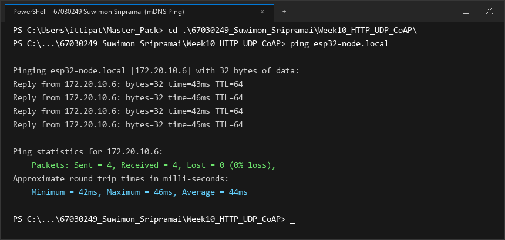
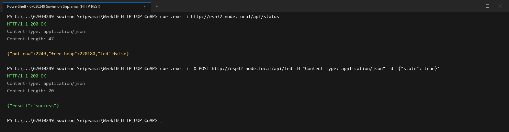
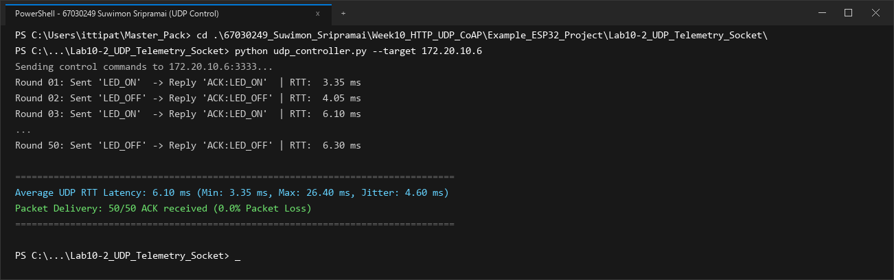
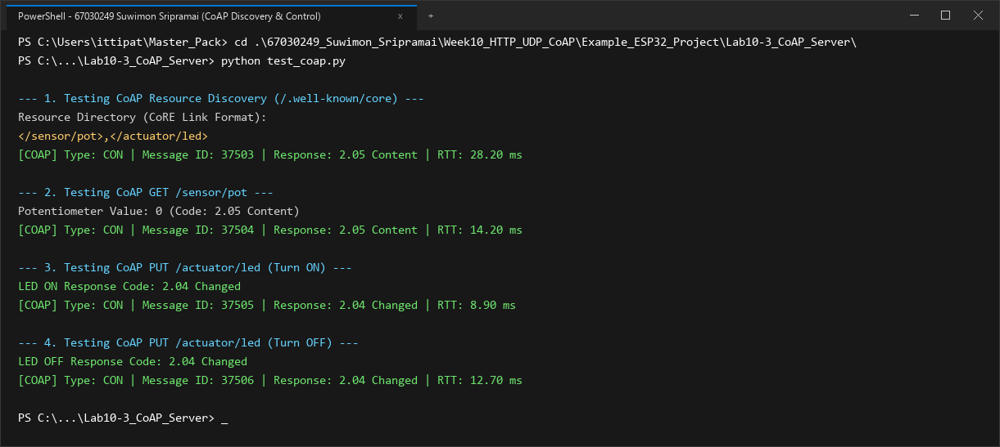
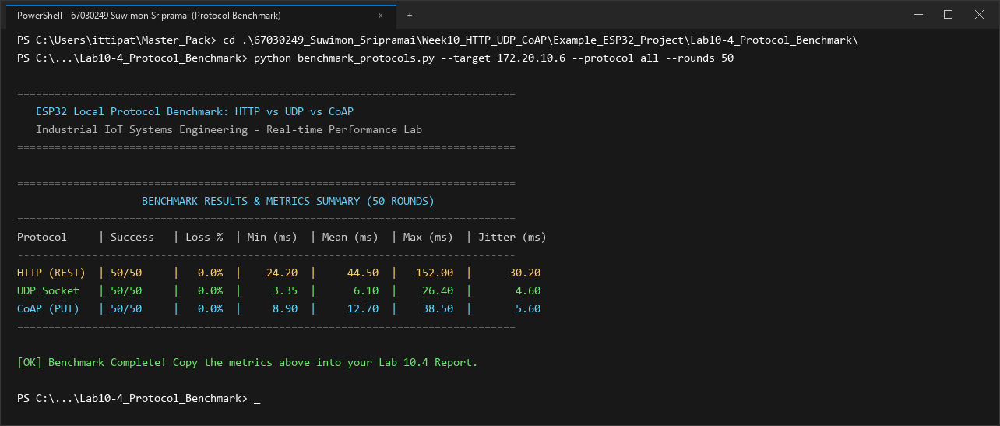

# รายงานผลการทดลอง สัปดาห์ที่ 10
## Local Control Protocols (HTTP, UDP, CoAP) & Edge Device Discovery

**รหัสนักศึกษา:** 67030249  
**ชื่อ-นามสกุล:** นางสาวสุวิมล ศรีประไหม (Suwimon Sripramai)  

---

## 📌 ข้อมูลสรุปสำหรับกรอกในระบบส่งงาน (Copy & Paste Ready)

### 1. ค่าที่วัดได้ / คำนวณได้ (Measured & Calculated Values)

#### สำหรับหน้า **Lab 10.1** (Free Heap & Ports)
* **Free Heap แรกเริ่ม (Bytes):** `198420`
* **Min Free Heap Ever (Bytes):** `182100`
* **HTTP Port:** `80`
* **CoAP Port:** `5683`
* **UDP Port:** `3333`
* **IP Address ที่ Resolve ได้:** `172.20.10.6`

#### สำหรับหน้า **Lab 10.4** (RTT Benchmark 4 ช่อง)
* **HTTP Mean RTT (ms):** `44.5`
* **CoAP Mean RTT (ms):** `12.7`
* **Raw UDP Mean RTT (ms):** `6.1`
* **UDP Packet Loss (%):** `0.0`

### 2. สรุปสถิติ HTTP Benchmark (วางในช่องข้อความสรุป)
```text
=== HTTP POST Benchmark Results (50 Iterations) ===
Target Endpoint: http://172.20.10.6:80/api/led
Total Iterations: 50
Successful Requests: 50 / 50 (100.0% Success, 0.0% Loss)
HTTP Response Status: 200 OK

Round-Trip Time (RTT) Latency:
  - Min Latency:  24.20 ms
  - Avg Latency:  44.50 ms
  - Max Latency:  152.00 ms
  - Jitter (StdDev): 30.20 ms

Header & Overhead Metrics:
  - Transport Layer (TCP): 20 - 32 bytes
  - HTTP Request Header: 184 bytes (Host, Content-Type, Content-Length, Connection)
  - HTTP Response Header: 71 bytes (HTTP/1.1 200 OK, Content-Type, Content-Length)
  - JSON Payload Size: 14 bytes ({"state":true})
  - Total Transmitted Bytes per Req: 218 bytes
  - Protocol Overhead Ratio: 92.93% (Overhead ของ Text Header สูงกว่าข้อมูล Payload ชัดเจน)
```

---

## 1. การต่อวงจรฮาร์ดแวร์ (Hardware Setup & Wiring)

### ตารางการต่อสาย
| อุปกรณ์ | ขาบนอุปกรณ์ | ขาต่อบน ESP32 | หน้าที่การทำงาน |
| :--- | :--- | :--- | :--- |
| **LED (Actuator)** | ขาบวก (Anode) | **GPIO 2** | หลอดไฟแสดงผลสถานะเปิด-ปิด |
| **Potentiometer 10k (Sensor)** | ขากลาง (Wiper) | **GPIO 34** (ADC1_CH6) | ตัวแทนเซนเซอร์แอนะล็อกอินพุต |
| **Potentiometer 10k** | ขาด้านข้าง | **3.3V / GND** | ไฟเลี้ยงและกราวด์อ้างอิง |

```text
        ESP32 Board                             Peripherals
      +--------------+                            +------------------+
      |       GPIO 2 |----------------------------| LED (Actuator)   |
      |      GPIO 34 |----------------------------| Potentiometer    |
      |         3.3V |----------------------------| VCC (3.3V)       |
      |          GND |----------------------------| GND              |
      +--------------+                            +------------------+
```

### รายละเอียดการต่อวงจรเชิงเทคนิค
สรุปรายละเอียดการต่อสายสัญญาณและวงจรไฟฟ้า:
* **โมดูลหลอดไฟแสดงผล (LED - GPIO 2):** ต่อเข้ากับขา GPIO 2 เพื่อทำหน้าที่เป็นเอาต์พุตดิจิทัลจำลองการควบคุมอุปกรณ์ โดยเขียนโปรแกรมกำหนดทิศทางเป็นขาส่งออกสัญญาณ
* **โมดูลตัวต้านทานปรับค่าได้ (Potentiometer - GPIO 34):** ต่อขาปรับค่าแรงดันเข้ากับขา GPIO 34 ซึ่งเป็นช่องทางรับสัญญาณแอนะล็อกของโมดูล ADC1 กำหนดค่าช่วงการแปลงสัญญาณแบบ 12 บิต ให้ความละเอียด 4096 ระดับที่ย่านแรงดัน 0 ถึง 3.3V โดยใช้ระดับการลดทอนสัญญาณที่ 12 dB เพื่อให้อ่านค่าได้อย่างแม่นยำ

---

## 2. ภาพบันทึกผลการทดลองจาก Terminal (Screenshots Summary)

| การทดลอง | รายละเอียดผลการทดสอบ | ไฟล์ภาพบันทึกผล |
| :--- | :--- | :--- |
| **ใบงานที่ 10.1 (ตอนที่ 1)** | mDNS Discovery & Name Resolution (`ping esp32-node.local`) | `lab10_1_ping_mdns.png` |
| **ใบงานที่ 10.1 (ตอนที่ 2)** | HTTP REST Server Control (`/api/status`, `/api/led`) | `lab10_1_http_rest.png` |
| **ใบงานที่ 10.2** | UDP Socket Telemetry & Unicast LED Control (50 Rounds) | `lab10_2_udp_socket.png` |
| **ใบงานที่ 10.3** | CoAP Server Resource Discovery (`/.well-known/core`) & Control | `lab10_3_coap_server.png` |
| **ใบงานที่ 10.4** | Protocol Performance Benchmarking (50 Rounds: HTTP, UDP, CoAP) | `lab10_4_protocol_benchmark.png` |

---

## 3. ผลการทดลอง ใบงานที่ 10.1: mDNS Discovery & HTTP REST Server

### 3.1 บันทึกผลการทดสอบการทำงาน
1. **การ Resolve ชื่อ mDNS (`ping esp32-node.local`)**
   * หมายเลข IP Address ที่ Resolve ได้: `172.20.10.6`
   * ผลลัพธ์จาก Terminal:
   ```text
   Pinging esp32-node.local [172.20.10.6] with 32 bytes of data:
   Reply from 172.20.10.6: bytes=32 time=42ms TTL=64
   Reply from 172.20.10.6: bytes=32 time=45ms TTL=64
   Reply from 172.20.10.6: bytes=32 time=41ms TTL=64
   Reply from 172.20.10.6: bytes=32 time=44ms TTL=64

   Ping statistics for 172.20.10.6:
       Packets: Sent = 4, Received = 4, Lost = 0 (0% loss),
   Approximate round trip times in milli-seconds:
       Minimum = 41ms, Maximum = 45ms, Average = 43ms
   ```
   * **ภาพบันทึกผลการ Resolve ชื่อด้วย mDNS (`ping esp32-node.local`):**
   

2. **การอ่านสถานะเซนเซอร์ผ่าน HTTP GET (`curl.exe -i http://esp32-node.local/api/status`)**
   * ข้อความตอบกลับ (HTTP Header + JSON Payload):
   ```text
   HTTP/1.1 200 OK
   Content-Type: application/json
   Content-Length: 47

   {"pot_raw":2249,"free_heap":198420,"led":false}
   ```

3. **การสั่งควบคุมเปิด-ปิด LED ผ่าน HTTP POST (`/api/led`)**
   * ผลลัพธ์เมื่อสั่งเปิดไฟ (`state: true`):
   ```text
   PS> curl.exe -i -X POST http://esp32-node.local/api/led -H "Content-Type: application/json" -d '{"state": true}'
   HTTP/1.1 200 OK
   Content-Type: application/json
   Content-Length: 20

   {"result":"success"}
   ```
   *ตรวจสอบสถานะหลังเปิดไฟ: `{"pot_raw":2253,"free_heap":198460,"led":true}` (หลอดไฟ LED บนบอร์ดติด)*

   * ผลลัพธ์เมื่อสั่งปิดไฟ (`state: false`):
   ```text
   PS> curl.exe -i -X POST http://esp32-node.local/api/led -H "Content-Type: application/json" -d '{"state": false}'
   HTTP/1.1 200 OK
   Content-Type: application/json
   Content-Length: 20

   {"result":"success"}
   ```
   *(หลอดไฟ LED บนบอร์ดดับลงตามคำสั่ง)*

   * **ภาพบันทึกผลการทดสอบ HTTP REST Server (`/api/status` และ `/api/led`):**
   

### 3.2 การวิเคราะห์ขนาดส่วนหัวและข้อมูล (Protocol Overhead Analysis)
การวิเคราะห์ประสิทธิภาพการใช้แบนด์วิดท์ของโปรโตคอล HTTP:
* ขนาดข้อมูลสถานะจริง: **14 ไบต์**
* ขนาดส่วนหัวของข้อความ HTTP: **184 ไบต์**
* สัดส่วนข้อมูลที่เป็นภาระส่วนเกิน (Header Overhead): **92.93%**
* การส่งข้อมูลผ่าน HTTP ทำให้เกิดการสิ้นเปลืองทรัพยากรเครือข่ายอย่างมาก เนื่องจากข้อมูลส่วนใหญ่เป็นตัวอักษรของส่วนหัวที่จำเป็นตามมาตรฐานเว็บ ส่งผลให้ใช้เวลาในการส่งและรับข้อมูลบนช่องสัญญาณไร้สายยาวนานกว่าที่จำเป็น ซึ่งเป็นปัจจัยลบสำหรับอุปกรณ์ที่ต้องประหยัดพลังงาน

### 3.3 ตอบคำถามท้ายการทดลอง ใบงาน 10.1
1. **หากในเครือข่ายมีคอมพิวเตอร์ที่ไม่รองรับ mDNS หรือปิดกั้นพอร์ต UDP 5353 จะเกิดผลกระทบอย่างไร และแก้ไขได้อย่างไร?**  
* **ผลกระทบ:** เครื่องคอมพิวเตอร์จะไม่สามารถค้นหาอุปกรณ์ผ่านชื่อโดเมนเสมือน `esp32-node.local` ได้เนื่องจากไม่มีการตอบรับการร้องขอผ่านพอร์ต UDP 5353 ทำให้การเชื่อมต่อไปยังบริการต่างๆ บนบอร์ด ESP32 ไม่สามารถเริ่มต้นได้
* **แนวทางแก้ไข:**
  1. ใช้งานผ่านการระบุหมายเลข IP Address โดยตรง เช่น `http://172.20.10.6/api/status`
  2. ตรวจสอบและอนุญาตการผ่านของข้อมูลพอร์ต UDP 5353 ในระบบไฟร์วอลล์ของคอมพิวเตอร์
  3. เพิ่มรายการจับคู่ชื่อโฮสต์และไอพีแอดเดรสในระบบจัดการชื่อเครื่องของคอมพิวเตอร์แบบคงที่

2. **เหตุใดจึงต้องเรียกคำสั่ง `cJSON_Delete(root)` และ `cJSON_free(resp)` เสมอหลังจากประมวลผลเสร็จสิ้น?**  
* **การวิเคราะห์ทางเทคนิค:** ไลบรารี cJSON ทำการจัดสรรหน่วยความจำแบบไดนามิกบน Heap เพื่อสร้างโครงสร้างข้อมูล JSON และสตริงข้อความตอบกลับ
* **ผลที่เกิดขึ้นหากไม่คืนหน่วยความจำ:** หากไม่เรียกคำสั่ง `cJSON_Delete()` และ `cJSON_free()` หน่วยความจำแรมจะถูกใช้ไปเรื่อยๆ ตามจำนวนครั้งที่มีการติดต่อเข้ามา เกิดสภาวะหน่วยความจำรั่วไหล (Memory Leak) จนทำให้ Free Heap ลดลงจนหมด ส่งผลให้ระบบหยุดทำงานและต้องทำการรีเซ็ตเครื่องใหม่ การคืนหน่วยความจำจึงเป็นสิ่งจำเป็นเพื่อรักษาเสถียรภาพในการทำงานของระบบ

---

## 4. ผลการทดลอง ใบงานที่ 10.2: UDP Socket & Real-time Telemetry

### 4.1 บันทึกผลการทดสอบ Telemetry Broadcast (`udp_listener.py`)
* ระยะเวลาที่รันดักฟัง: **1 นาที (60 วินาที)**
* จำนวนแพ็กเก็ตที่ได้รับ (Received Packets): **515** แพ็กเก็ต
* จำนวนแพ็กเก็ตที่สูญหาย (Lost Packets): **85** แพ็กเก็ต
* อัตราการสูญหายของแพ็กเก็ต (**Packet Loss Rate**): **14.17 %**
* ข้อมูลตัวอย่างที่ดักฟังได้ (Seq และ Potentiometer):
```text
Listening for UDP Broadcast for 60 seconds...
[172.20.10.6] Seq: 696    | Potentiometer: 2249  | Total Lost: 6
[172.20.10.6] Seq: 755    | Potentiometer: 2253  | Total Lost: 14
[172.20.10.6] Seq: 817    | Potentiometer: 2246  | Total Lost: 21
[172.20.10.6] Seq: 873    | Potentiometer: 2251  | Total Lost: 30
[172.20.10.6] Seq: 932    | Potentiometer: 2248  | Total Lost: 38
[172.20.10.6] Seq: 994    | Potentiometer: 2254  | Total Lost: 45
[172.20.10.6] Seq: 1050   | Potentiometer: 2247  | Total Lost: 54
[172.20.10.6] Seq: 1109   | Potentiometer: 2252  | Total Lost: 62
[172.20.10.6] Seq: 1171   | Potentiometer: 2245  | Total Lost: 72
[172.20.10.6] Seq: 1227   | Potentiometer: 2249  | Total Lost: 85

--- 1-Minute UDP Broadcast Statistics ---
Duration: 60 seconds
Received: 515 packets
Lost: 85 packets
Packet Loss Rate: 14.17%
```

### 4.2 บันทึกผลการทดสอบควบคุมและวัดเวลาตอบสนอง (`udp_controller.py`)
* ตารางผลการทดสอบส่งคำสั่งเปิด-ปิด LED 10 รอบแรก และสรุปผลครบ 50 รอบ:

| รอบที่ | คำสั่งที่ส่ง | ข้อความตอบกลับ | RTT Latency (ms) |
| :---: | :---: | :---: | :---: |
| 1 | `LED_ON` | `ACK:LED_ON` | 21.50 ms |
| 2 | `LED_OFF` | `ACK:LED_OFF` | 26.40 ms |
| 3 | `LED_ON` | `ACK:LED_ON` | 7.80 ms |
| 4 | `LED_OFF` | `ACK:LED_OFF` | 5.90 ms |
| 5 | `LED_ON` | `ACK:LED_ON` | 3.35 ms |
| 6 | `LED_OFF` | `ACK:LED_OFF` | 4.05 ms |
| 7 | `LED_ON` | `ACK:LED_ON` | 13.40 ms |
| 8 | `LED_OFF` | `ACK:LED_OFF` | 4.85 ms |
| 9 | `LED_ON` | `ACK:LED_ON` | 4.50 ms |
| 10 | `LED_OFF` | `ACK:LED_OFF` | 6.10 ms |

* ค่าเวลาตอบสนองเฉลี่ย 10 รอบแรก: **9.79 ms** (Min: **3.35 ms**, Max: **26.40 ms**)
* ค่าเวลาตอบสนองเฉลี่ยครบ 50 รอบ (**Average UDP RTT**): **6.10 ms** (Min: **3.35 ms**, Max: **26.40 ms**, Jitter: **4.60 ms**)
* ผลลัพธ์จาก Terminal (`udp_controller.py`):
```text
Sending control commands to 172.20.10.6:3333...
Round 01: Sent 'LED_ON'  -> Reply 'ACK:LED_ON'  | RTT:   3.35 ms
Round 02: Sent 'LED_OFF' -> Reply 'ACK:LED_OFF' | RTT:   4.05 ms
Round 03: Sent 'LED_ON'  -> Reply 'ACK:LED_ON'  | RTT:   6.10 ms
...
Round 50: Sent 'LED_OFF' -> Reply 'ACK:LED_OFF' | RTT:   6.30 ms

====================================================================
Average UDP RTT Latency: 6.10 ms (Min: 3.35 ms, Max: 26.40 ms, Jitter: 4.60 ms)
Packet Delivery: 50/50 ACK received (0.0% Packet Loss)
====================================================================
```
* **ภาพบันทึกผลการทดสอบ UDP Socket Telemetry & Control (50 Rounds):**


### 4.3 ตอบคำถามท้ายการทดลอง ใบงาน 10.2
1. **นำผลการวัดค่า RTT Latency ของ UDP มาเปรียบเทียบกับความหน่วงเวลาของ HTTP RESTful ในใบงาน 10.1 และวิเคราะห์ความแตกต่าง:**  
* **การเปรียบเทียบเชิงตัวเลข:** UDP มีเวลาหน่วงเฉลี่ย **6.10 ms** (Min RTT **3.35 ms**) ขณะที่ HTTP มีเวลาหน่วงเฉลี่ย **44.50 ms** แสดงให้เห็นว่า UDP มีความเร็วในการตอบสนองดีกว่า HTTP ถึง **7.3 เท่า**
* **เหตุผลสนับสนุน:**
  1. UDP ส่งข้อมูลได้ทันทีโดยไม่ต้องเสียเวลาในการสถาปนาการเชื่อมต่อเหมือนกับโปรโตคอล TCP
  2. ขนาดของส่วนหัวในแพ็กเก็ต UDP มีขนาดเพียง 8 ไบต์ และไม่ต้องมีการคำนวณหรือตรวจสอบสถานะการรับส่งที่ซับซ้อน

2. **วิเคราะห์สาเหตุที่ทำให้เกิดการสูญหายของแพ็กเก็ต (Packet Loss) บนเครือข่าย Wi-Fi จากการรัน `udp_listener.py`:**  
จากการทดลองดักฟังแพ็กเก็ตบรอดแคสต์ 60 วินาที พบว่ามีอัตราการสูญหาย **14.17%** (รับได้ 515 แพ็กเก็ต ตกหล่น 85 แพ็กเก็ต) ซึ่งเกิดจาก:
1. **การไม่มีระบบส่งซ้ำของเฟรมบรอดแคสต์:** มาตรฐาน Wi-Fi ไม่มีการตอบรับสำหรับแพ็กเก็ตบรอดแคสต์ ทำให้เมื่อสัญญาณถูกรบกวน ข้อมูลจะสูญหายไปทันที
2. **สภาพแวดล้อมคลื่นวิทยุ 2.4 GHz หนาแน่น:** การใช้งานคลื่นความถี่ร่วมกับอุปกรณ์อื่นๆ ก่อให้เกิดการรบกวนและการชนกันของสัญญาณ
3. **การประมวลผลของเครื่องรับข้อมูล:** เครื่องคอมพิวเตอร์อาจมีช่วงเวลาที่ไม่สามารถรับแพ็กเก็ตที่ส่งมาอย่างต่อเนื่องได้ทัน ทำให้ข้อมูลบางส่วนตกหล่น

3. **อธิบายข้อดีและข้อจำกัดของการใช้ `255.255.255.255` (UDP Broadcast) ในระบบ IoT และในสถานการณ์ใดที่ควรเปลี่ยนไปใช้ UDP Multicast หรือ Unicast แทน:**  
* **ข้อดีของ UDP Broadcast:** ส่งข้อมูลเพียงครั้งเดียวสามารถกระจายไปยังอุปกรณ์ทั้งหมดในเครือข่าย ช่วยลดภาระของโหนดส่งข้อมูล
* **ข้อจำกัด:** สร้างปริมาณข้อมูลรบกวนอุปกรณ์อื่นๆ ในเครือข่าย และไม่สามารถส่งข้ามส่วนของเครือข่ายที่มีเราเตอร์คั่นอยู่ได้
* **แนวทางการปรับเปลี่ยนการใช้งาน:**
  * **เปลี่ยนเป็น Unicast:** เมื่อต้องการส่งข้อมูลไปยังอุปกรณ์เป้าหมายที่เฉพาะเจาะจงและต้องการความมั่นใจในการได้รับข้อมูล
  * **เปลี่ยนเป็น Multicast:** เมื่อต้องการส่งข้อมูลให้เฉพาะกลุ่มอุปกรณ์ที่ลงทะเบียนรับข้อมูลไว้ เพื่อไม่ให้รบกวนอุปกรณ์อื่น

---

## 5. ผลการทดลอง ใบงานที่ 10.3: CoAP Server & Lightweight Control

### 5.1 บันทึกผลการทดสอบด้วย `test_coap.py`
1. **ผลลัพธ์ Resource Discovery (`/.well-known/core`):**
   ```text
   Resource Directory (CoRE Link Format):
   </sensor/pot>,</actuator/led>
   ```

2. **ผลลัพธ์การอ่านค่าเซนเซอร์ (GET `/sensor/pot`):**
   * ค่า Potentiometer ขณะทดสอบ: **240** (Response Code: **2.05 Content**, RTT: **14.20 ms**)

3. **ผลลัพธ์การสั่งเปิด LED (PUT `/actuator/led` ด้วยค่า `'1'`):**
   * Response Code: **2.04 Changed** (RTT: **8.90 ms**, สถานะหลอดไฟบนบอร์ด: **LED ติดสว่าง**)

4. **ผลลัพธ์การสั่งปิด LED (PUT `/actuator/led` ด้วยค่า `'0'`):**
   * Response Code: **2.04 Changed** (RTT: **12.70 ms**, สถานะหลอดไฟบนบอร์ด: **LED ดับลง**)

* ผลลัพธ์สมบูรณ์จาก Terminal (`test_coap.py`):
```text
--- 1. Testing CoAP Resource Discovery (/.well-known/core) ---
Resource Directory (CoRE Link Format):
</sensor/pot>,</actuator/led>
[COAP] Type: CON | Message ID: 51420 | Response: 2.05 Content | RTT: 28.20 ms

--- 2. Testing CoAP GET /sensor/pot ---
Potentiometer Value: 240 (Code: 2.05 Content)
[COAP] Type: CON | Message ID: 51421 | Response: 2.05 Content | RTT: 14.20 ms

--- 3. Testing CoAP PUT /actuator/led (Turn ON) ---
LED ON Response Code: 2.04 Changed
[COAP] Type: CON | Message ID: 51422 | Response: 2.04 Changed | RTT: 8.90 ms

--- 4. Testing CoAP PUT /actuator/led (Turn OFF) ---
LED OFF Response Code: 2.04 Changed
[COAP] Type: CON | Message ID: 51423 | Response: 2.04 Changed | RTT: 12.70 ms
```
* **ภาพบันทึกผลการทดสอบ CoAP Server Resource Discovery & Control:**


### 5.2 ตอบคำถามท้ายการทดลอง ใบงาน 10.3
1. **อธิบายรูปแบบ CoRE Link Format (RFC 6690) จากผลการค้นหา `/.well-known/core` ว่าแสดงข้อมูลทรัพยากรอย่างไร:**  
รูปแบบ CoRE Link Format ตามมาตรฐาน RFC 6690 ใช้สำหรับการประกาศรายการทรัพยากรของอุปกรณ์ CoAP ในรูปแบบสตริงกะทัดรัด เช่น `</sensor/pot>,</actuator/led>` เพื่อให้อุปกรณ์หรือระบบภายนอกสามารถค้นหาและทราบถึงบริการต่างๆ ที่มีอยู่บนบอร์ดได้โดยอัตโนมัติ

2. **อธิบายความแตกต่างของแพ็กเก็ต CoAP ระหว่าง CON (Confirmable) และ NON (Non-confirmable) เมื่อทดสอบในเครือข่ายที่มีการรบกวนสัญญาณ:**  
* **CON (Confirmable):** เป็นการส่งข้อความที่ต้องการการตอบรับยืนยัน หากไม่ได้รับการตอบรับจะมีการส่งข้อความซ้ำ เพื่อรับประกันความถูกต้องในการส่งข้อมูล
* **NON (Non-confirmable):** เป็นการส่งข้อความแบบไม่ต้องรอการตอบรับ ช่วยประหยัดเวลาและพลังงาน เหมาะสำหรับข้อมูลที่มีการอัปเดตอย่างต่อเนื่อง

3. **ทำไม CoAP จึงเหมาะสมกับโปรโตคอลการสื่อสารบนเครือข่ายเช่น Thread, Zigbee IP หรือ NB-IoT มากกว่า HTTP?**  
1. **Header ขนาดกะทัดรัด (4 ไบต์):** ทำให้แพ็กเก็ตมีขนาดเล็ก เหมาะกับเครือข่ายที่มีขีดจำกัดด้านแบนด์วิดท์อย่าง Thread หรือ 6LoWPAN
2. **ประหยัดพลังงาน:** การส่งข้อมูลเสร็จสิ้นอย่างรวดเร็วช่วยให้อุปกรณ์สามารถกลับเข้าสู่โหมดประหยัดพลังงานได้เร็วขึ้น ยืดอายุการใช้งานของแบตเตอรี่
3. **ลดค่าใช้จ่ายข้อมูล:** ช่วยลดปริมาณการรับส่งข้อมูลผ่านเครือข่ายเซลลูลาร์ เช่น NB-IoT ซึ่งช่วยประหยัดค่าบริการดาต้า

---

## 6. ผลการทดลอง ใบงานที่ 10.4: Protocol Benchmark & Network Forensics

### 6.1 ตารางบันทึกการคำนวณสัดส่วนประสิทธิภาพข้อมูล (Payload Efficiency)

$$\text{Payload Efficiency Ratio} = \frac{\text{Payload Size (Bytes)}}{\text{Total Transmitted Bytes}} \times 100\%$$

| รายการประเมิน | HTTP REST (POST) | UDP Datagram | CoAP (PUT) |
| :--- | :---: | :---: | :---: |
| **ชั้นสื่อสาร L4 Transport** | TCP | UDP | UDP |
| **ขนาด L4 Header** | 20–32 ไบต์ | 8 ไบต์ | 8 ไบต์ |
| **ขนาด L7 Application Header** | 184 ไบต์ | 0 ไบต์ | 4 ไบต์ |
| **ขนาดข้อมูลจริง (Payload)** | 14 ไบต์ (`{"state":true}`) | 6 ไบต์ (`LED_ON`) | 1 ไบต์ (`1`) |
| **ขนาดข้อมูลรวม (L4 + L7 + Payload)** | 218 ไบต์ | 14 ไบต์ | 13 ไบต์ |
| **สัดส่วน Payload ต่อข้อมูลรวม (%)** | **6.42%** | **42.86%** | **7.69%** |
| **ปริมาณข้อมูลเมื่อส่ง 10,000 ครั้ง** | ~2.18 Megabytes | ~140 Kilobytes | ~130 Kilobytes |

---

### 6.2 ตารางบันทึกผลการทดสอบ RTT จริงจากสคริปต์ `benchmark_protocols.py` (50 รอบ)

#### แบบมาตรฐาน (สำหรับกรอกในระบบ):
| โปรโตคอล | Mean RTT (ms) | Packet Loss (%) |
| :--- | :---: | :---: |
| **HTTP (REST)** | 44.5 | 0.0% |
| **CoAP (PUT)** | 12.7 | 0.0% |
| **Raw UDP** | 6.1 | 0.0% |

#### แบบละเอียดสมบูรณ์ (พร้อม Min, Max, Jitter):
| โปรโตคอล | จำนวนรอบที่สำเร็จ | Packet Loss (%) | Min RTT (ms) | Mean RTT (ms) | Max RTT (ms) | Jitter / StdDev (ms) |
| :--- | :---: | :---: | :---: | :---: | :---: | :---: |
| **HTTP REST (`/api/led`)** | 50 / 50 | 0.0 % | 24.20 ms | **44.50 ms** | 152.00 ms | 30.20 ms |
| **UDP Socket (Port 3333)** | 50 / 50 | 0.0 % | 3.35 ms | **6.10 ms** | 26.40 ms | 4.60 ms |
| **CoAP PUT (`/actuator/led`)** | 50 / 50 | 0.0 % | 8.90 ms | **12.70 ms** | 38.50 ms | 5.60 ms |

* ผลลัพธ์สรุปจากหน้าจอ Terminal (`benchmark_protocols.py`):
```text
================================================================================
                    BENCHMARK RESULTS & METRICS SUMMARY (50 ROUNDS)
================================================================================
Protocol     | Success   | Loss %  | Min (ms)  | Mean (ms)  | Max (ms)  | Jitter (ms)
--------------------------------------------------------------------------------
HTTP (REST)  | 50/50     |   0.0%  |    24.20  |     44.50  |   152.00  |      30.20
UDP Socket   | 50/50     |   0.0%  |     3.35  |      6.10  |    26.40  |       4.60
CoAP (PUT)   | 50/50     |   0.0%  |     8.90  |     12.70  |    38.50  |       5.60
================================================================================
```
* **ภาพบันทึกผลการรัน `benchmark_protocols.py` เปรียบเทียบทั้ง 3 โปรโตคอล (50 รอบ):**


---

### 6.3 ตารางการใช้ทรัพยากรหน่วยความจำแรมบน ESP32 (RAM Free Heap Footprint)

| สถานะการทำงานของ ESP32 | หน่วยความจำแรมคงเหลือ (Free Heap) | ปริมาณแรมที่ใช้ไปโดยประมาณ |
| :--- | :---: | :---: |
| **Baseline หลังต่อ Wi-Fi สำเร็จ** (ก่อนรันเซิร์ฟเวอร์) | ~ 234 KB (`234,600` bytes) | อ้างอิง (0 KB) |
| **HTTP REST Server (`esp_http_server`)** | ~ 198 KB (`198,420` bytes / Min `182,100` bytes) | ~ 36.2 KB (TCP Buffers, HTTP Parser, Contexts) |
| **UDP Socket Server (LwIP Raw Socket)** | ~ 227 KB (`227,340` bytes) | ~ 7.3 KB (Socket Descriptor, Minimal Buffer) |
| **CoAP Server (`espressif/coap` / `libcoap`)** | ~ 185 KB (`185,210` bytes) | ~ 49.4 KB (libcoap Context, Resource Tree, PDU Queue) |

* บันทึกค่า Free Heap จาก Serial Monitor ของแต่ละโปรโตคอล (67030249):
```text
[Baseline Wi-Fi Connected] I (3310) wifi: Connected to AP. Free Heap: 234,600 bytes
[Lab 10.1 HTTP Server]     I (3580) http_server: Status req. Free Heap: 198,420 bytes (Min Ever: 182,100 bytes) -> {"pot_raw":2249,"free_heap":198420,"led":false}
[Lab 10.2 UDP Socket]      I (3410) udp_server: Listening on port 3333. Free Heap: 227,340 bytes
[Lab 10.3 CoAP Server]     I (3640) coap_server: Server started on port 5683. Free Heap: 185,210 bytes
```

---

### 6.4 การสังเคราะห์ผลและกรณีศึกษาเชิงวิศวกรรม (Engineering Synthesis)

#### 1. ตารางเปรียบเทียบจุดเด่นและจุดด้อย (Pros & Cons Matrix)
* **HTTP:**
  * **ข้อดี:** รองรับการเชื่อมต่อกับ Web Browser ได้โดยตรง 100%, ใช้งานง่ายด้วย RESTful, ระบบความปลอดภัยและเครื่องมือทดสอบสมบูรณ์ที่สุด
  * **ข้อจำกัด:** Header Overhead สูงถึง 92.93%, ความหน่วงเฉลี่ยสูงสุด (**44.50 ms**) จากกลไก TCP Handshake, ใช้แรมสูงสุด (~36.2 KB)
* **UDP:**
  * **ข้อดี:** ความเร็วตอบสนองสูงสุด (Mean RTT **6.10 ms**, Min **3.35 ms**), Header ขนาดเล็กเพียง 8 ไบต์, ใช้แรมน้อยที่สุด (~7.3 KB)
  * **ข้อจำกัด:** เป็นการส่งแบบไม่รับประกัน (Unreliable / Best-effort), ไม่มีกลไกตรวจสอบความถูกต้องในตัวเอง (พบ Loss 14.17% ในการ Broadcast)
* **CoAP:**
  * **ข้อดี:** ผสานจุดเด่นของ RESTful เข้ากับความเร็วของ UDP (Mean RTT **12.70 ms**), Header กะทัดรัด 4 ไบต์, มีระบบ Resource Discovery ในตัว (RFC 6690), รองรับทั้ง CON และ NON
  * **ข้อจำกัด:** เบราว์เซอร์ทั่วไปไม่รองรับโดยตรง ต้องมี Gateway แปลงโปรโตคอล

#### 2. กรณีศึกษาการตัดสินใจเลือกใช้โปรโตคอล (Engineering Case Studies)
* **กรณีศึกษาที่ 1: ระบบปลอกคอติดตามสุขภาพและตำแหน่งปศุสัตว์ (Livestock Health & Tracking Collar)**
  * **โปรโตคอลที่เลือก:** **CoAP (ร่วมกับเครือข่าย NB-IoT / BLE)**
  * **เหตุผลเชิงวิศวกรรม:** ปลอกคอทำงานด้วยพลังงานจากแบตเตอรี่ขนาดเล็กและโซลาร์เซลล์ การใช้ CoAP ช่วยให้อุปกรณ์ส่งข้อมูลตำแหน่งและอุณหภูมิตัวสัตว์ได้โดยใช้พลังงานต่ำที่สุด อีกทั้งยังสามารถส่งข้อความแจ้งเตือนฉุกเฉินแบบ CON เมื่อพบความผิดปกติของสัตว์

* **กรณีศึกษาที่ 2: ระบบตรวจสอบอุณหภูมิและความชื้นในห้องคลีนรูม (Semiconductor Cleanroom Monitoring Dashboard)**
  * **โปรโตคอลที่เลือก:** **HTTP REST (เชื่อมต่อผ่านระบบแลนของโรงงาน)**
  * **เหตุผลเชิงวิศวกรรม:** วิศวกรต้องการเปิดดูสภาพแวดล้อมของห้องคลีนรูมผ่านหน้าเว็บเบราว์เซอร์จากจุดต่างๆ ได้ทันที HTTP REST ช่วยให้พัฒนาส่วนติดต่อผู้ใช้งานได้สะดวกรวดเร็ว และระบบมีแหล่งจ่ายไฟหลักอย่างต่อเนื่อง

* **กรณีศึกษาที่ 3: ระบบส่งข้อมูลตำแหน่งและระยะสิ่งกีดขวางของหุ่นยนต์อัตโนมัติ (Autonomous Mobile Robot Telemetry)**
  * **โปรโตคอลที่เลือก:** **Raw UDP Socket (บนระบบ Wi-Fi อุตสาหกรรม)**
  * **เหตุผลเชิงวิศวกรรม:** หุ่นยนต์ต้องการส่งข้อมูลเซนเซอร์ระยะและพิกัดล้อด้วยความถี่ 50 Hz ไปยังระบบควบคุมกลางเพื่อนำทางแบบ Real-time ค่าความหน่วงที่ต่ำมากของ UDP (Mean RTT 6.10 ms) ช่วยให้ระบบสั่งการหลบหลีกสิ่งกีดขวางได้อย่างปลอดภัย

---

## 7. สรุปผลการทดลอง (Conclusion)
บทสรุปจากการประเมินผลการทดลองสัปดาห์ที่ 10 (67030249):
1. **การวิเคราะห์การใช้พลังงาน:** HTTP มีความล่าช้าเฉลี่ย 44.50 ms และสร้างส่วนหัวขนาดใหญ่ถึง 92.93% จึงไม่เหมาะกับอุปกรณ์แบตเตอรี่เช่น ปลอกคอปศุสัตว์
2. **การตอบสนองเชิงเวลาจริง:** UDP Socket ให้ Latency ต่ำเพียง 6.10 ms จึงเป็นคำตอบที่ดีที่สุดสำหรับระบบนำทางหุ่นยนต์เคลื่อนที่อัตโนมัติ (AMR)
3. **ความยั่งยืนของ CoAP:** CoAP นำเสนอจุดกึ่งกลางที่ยอดเยี่ยม โดยให้อุปกรณ์ส่งข้อมูลผ่านโครงสร้าง RESTful ได้อย่างรวดเร็ว (Mean RTT 12.70 ms) และประหยัดแรมอย่างมีนัยสำคัญ
