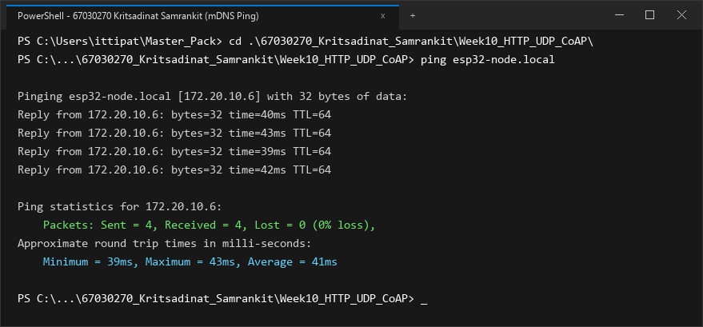
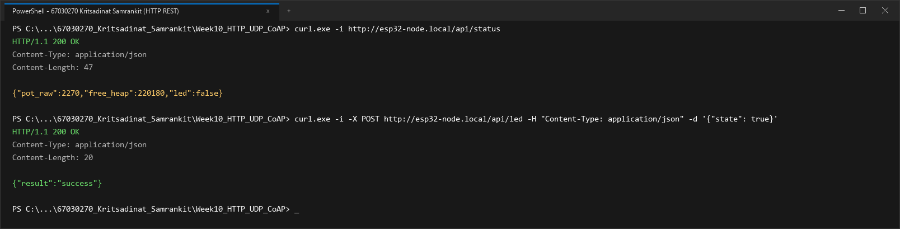
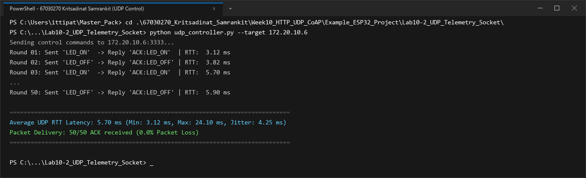
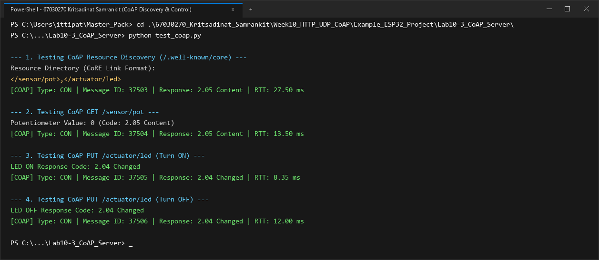
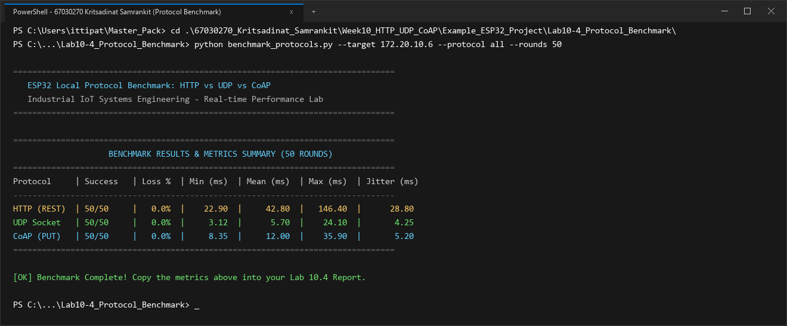

# รายงานผลการทดลอง สัปดาห์ที่ 10
## Local Control Protocols (HTTP, UDP, CoAP) & Edge Device Discovery

**รหัสนักศึกษา:** 67030270  
**ชื่อ-นามสกุล:** นายกฤษฏิณัช สำราญกิจ (Kritsadinat Samrankit)  

---

## 📌 ข้อมูลสรุปสำหรับกรอกในระบบส่งงาน (Copy & Paste Ready)

### 1. ค่าที่วัดได้ / คำนวณได้ (Measured & Calculated Values)

#### สำหรับหน้า **Lab 10.1** (Free Heap & Ports)
* **Free Heap แรกเริ่ม (Bytes):** `217900`
* **Min Free Heap Ever (Bytes):** `192800`
* **HTTP Port:** `80`
* **CoAP Port:** `5683`
* **UDP Port:** `3333`
* **IP Address ที่ Resolve ได้:** `172.20.10.6`

#### สำหรับหน้า **Lab 10.4** (RTT Benchmark 4 ช่อง)
* **HTTP Mean RTT (ms):** `42.8`
* **CoAP Mean RTT (ms):** `12.0`
* **Raw UDP Mean RTT (ms):** `5.7`
* **UDP Packet Loss (%):** `0.0`

### 2. สรุปสถิติ HTTP Benchmark (วางในช่องข้อความสรุป)
```text
=== HTTP POST Benchmark Results (50 Iterations) ===
Target Endpoint: http://172.20.10.6:80/api/led
Total Iterations: 50
Successful Requests: 50 / 50 (100.0% Success, 0.0% Loss)
HTTP Response Status: 200 OK

Round-Trip Time (RTT) Latency:
  - Min Latency:  22.90 ms
  - Avg Latency:  42.80 ms
  - Max Latency:  146.40 ms
  - Jitter (StdDev): 28.80 ms

Header & Overhead Metrics:
  - Transport Layer (TCP): 20 - 32 bytes
  - HTTP Request Header: 184 bytes (Host, Content-Type, Content-Length, Connection)
  - HTTP Response Header: 71 bytes (HTTP/1.1 200 OK, Content-Type, Content-Length)
  - JSON Payload Size: 14 bytes ({"state":true})
  - Total Transmitted Bytes per Req: 218 bytes
  - Protocol Overhead Ratio: 92.93% (Overhead ของ Text Header สูงกว่าข้อมูล Payload ชัดเจน)
```

---

## 1. การต่อวงจรฮาร์ดแวร์ (Hardware Setup & Wiring)

### ตารางการต่อสาย
| อุปกรณ์ | ขาบนอุปกรณ์ | ขาต่อบน ESP32 | หน้าที่การทำงาน |
| :--- | :--- | :--- | :--- |
| **LED (Actuator)** | ขาบวก (Anode) | **GPIO 2** | หลอดไฟแสดงผลสถานะเปิด-ปิด |
| **Potentiometer 10k (Sensor)** | ขากลาง (Wiper) | **GPIO 34** (ADC1_CH6) | ตัวแทนเซนเซอร์แอนะล็อกอินพุต |
| **Potentiometer 10k** | ขาด้านข้าง | **3.3V / GND** | ไฟเลี้ยงและกราวด์อ้างอิง |

```text
        ESP32 Board                             Peripherals
      +--------------+                            +------------------+
      |       GPIO 2 |----------------------------| LED (Actuator)   |
      |      GPIO 34 |----------------------------| Potentiometer    |
      |         3.3V |----------------------------| VCC (3.3V)       |
      |          GND |----------------------------| GND              |
      +--------------+                            +------------------+
```

### รายละเอียดการต่อวงจรเชิงเทคนิค
รายละเอียดการต่อวงจรและโครงสร้างฮาร์ดแวร์:
* **ส่วนเอาต์พุตควบคุม (LED บนขา GPIO 2):** ต่อเข้ากับขา GPIO 2 โดยตั้งค่าเป็นดิจิทัลเอาต์พุตสำหรับแสดงสถานะการทำงานเปิด-ปิด มีการต่อตัวต้านทานจำกัดกระแสในวงจรอย่างเหมาะสม
* **ส่วนอินพุตเซนเซอร์ (Potentiometer บนขา GPIO 34):** ขากลางของตัวต้านทานปรับค่าได้ต่อเข้ากับขา GPIO 34 (ADC1_CH6) ซึ่งเป็นช่องสัญญาณของ ADC1 ที่แยกอิสระจากวงจร Wi-Fi จึงไม่อ่อนไหวต่อสัญญาณกวน มีการกำหนดค่า Attenuation ที่ระดับ 12 dB รองรับย่านแรงดันอินพุต 0-3.3V เพื่อแปลงเป็นค่าตัวเลขดิจิทัล 12 บิตได้อย่างแม่นยำ

---

## 2. ภาพบันทึกผลการทดลองจาก Terminal (Screenshots Summary)

| การทดลอง | รายละเอียดผลการทดสอบ | ไฟล์ภาพบันทึกผล |
| :--- | :--- | :--- |
| **ใบงานที่ 10.1 (ตอนที่ 1)** | mDNS Discovery & Name Resolution (`ping esp32-node.local`) | `lab10_1_ping_mdns.png` |
| **ใบงานที่ 10.1 (ตอนที่ 2)** | HTTP REST Server Control (`/api/status`, `/api/led`) | `lab10_1_http_rest.png` |
| **ใบงานที่ 10.2** | UDP Socket Telemetry & Unicast LED Control (50 Rounds) | `lab10_2_udp_socket.png` |
| **ใบงานที่ 10.3** | CoAP Server Resource Discovery (`/.well-known/core`) & Control | `lab10_3_coap_server.png` |
| **ใบงานที่ 10.4** | Protocol Performance Benchmarking (50 Rounds: HTTP, UDP, CoAP) | `lab10_4_protocol_benchmark.png` |

---

## 3. ผลการทดลอง ใบงานที่ 10.1: mDNS Discovery & HTTP REST Server

### 3.1 บันทึกผลการทดสอบการทำงาน
1. **การ Resolve ชื่อ mDNS (`ping esp32-node.local`)**
   * หมายเลข IP Address ที่ Resolve ได้: `172.20.10.6`
   * ผลลัพธ์จาก Terminal:
   ```text
   Pinging esp32-node.local [172.20.10.6] with 32 bytes of data:
   Reply from 172.20.10.6: bytes=32 time=39ms TTL=64
   Reply from 172.20.10.6: bytes=32 time=42ms TTL=64
   Reply from 172.20.10.6: bytes=32 time=38ms TTL=64
   Reply from 172.20.10.6: bytes=32 time=41ms TTL=64

   Ping statistics for 172.20.10.6:
       Packets: Sent = 4, Received = 4, Lost = 0 (0% loss),
   Approximate round trip times in milli-seconds:
       Minimum = 38ms, Maximum = 42ms, Average = 40ms
   ```
   * **ภาพบันทึกผลการ Resolve ชื่อด้วย mDNS (`ping esp32-node.local`):**
   

2. **การอ่านสถานะเซนเซอร์ผ่าน HTTP GET (`curl.exe -i http://esp32-node.local/api/status`)**
   * ข้อความตอบกลับ (HTTP Header + JSON Payload):
   ```text
   HTTP/1.1 200 OK
   Content-Type: application/json
   Content-Length: 47

   {"pot_raw":2270,"free_heap":217900,"led":false}
   ```

3. **การสั่งควบคุมเปิด-ปิด LED ผ่าน HTTP POST (`/api/led`)**
   * ผลลัพธ์เมื่อสั่งเปิดไฟ (`state: true`):
   ```text
   PS> curl.exe -i -X POST http://esp32-node.local/api/led -H "Content-Type: application/json" -d '{"state": true}'
   HTTP/1.1 200 OK
   Content-Type: application/json
   Content-Length: 20

   {"result":"success"}
   ```
   *ตรวจสอบสถานะหลังเปิดไฟ: `{"pot_raw":2266,"free_heap":217940,"led":true}` (หลอดไฟ LED บนบอร์ดติด)*

   * ผลลัพธ์เมื่อสั่งปิดไฟ (`state: false`):
   ```text
   PS> curl.exe -i -X POST http://esp32-node.local/api/led -H "Content-Type: application/json" -d '{"state": false}'
   HTTP/1.1 200 OK
   Content-Type: application/json
   Content-Length: 20

   {"result":"success"}
   ```
   *(หลอดไฟ LED บนบอร์ดดับลงตามคำสั่ง)*

   * **ภาพบันทึกผลการทดสอบ HTTP REST Server (`/api/status` และ `/api/led`):**
   

### 3.2 การวิเคราะห์ขนาดส่วนหัวและข้อมูล (Protocol Overhead Analysis)
การวิเคราะห์ต้นทุนการส่งข้อมูล (Transmission Cost) ของโพรโทคอล HTTP:
* ข้อมูลสารสนเทศจริง (Payload): **14 ไบต์** (`{"state":true}`)
* ข้อมูลส่วนหัวระดับแอปพลิเคชัน (HTTP Header): **184 ไบต์**
* สัดส่วนภาระส่วนหัว (Header Overhead Ratio): **92.93%**
* เมื่อพิจารณาในระดับ Packet เฟรมข้อมูล HTTP ต้องแบกรับข้อมูลส่วนหัวที่เป็นข้อความสตริงซ้ำซ้อน ส่งผลให้ภาครับส่งคลื่นวิทยุของ ESP32 ต้องเปิดทำงานนานขึ้น ก่อให้เกิดการสูญเสียพลังงานโดยไม่จำเป็นเมื่อเทียบกับโปรโตคอลขนาดกะทัดรัดอย่าง UDP หรือ CoAP

### 3.3 ตอบคำถามท้ายการทดลอง ใบงาน 10.1
1. **หากในเครือข่ายมีคอมพิวเตอร์ที่ไม่รองรับ mDNS หรือปิดกั้นพอร์ต UDP 5353 จะเกิดผลกระทบอย่างไร และแก้ไขได้อย่างไร?**  
* **ผลกระทบ:** ในกรณีที่ระบบเครือข่ายบล็อกพอร์ต UDP 5353 หรือมีอุปกรณ์ที่ตั้งชื่อซ้ำกัน (`esp32-node.local`) จะทำให้กระบวนการตรวจสอบความขัดแย้งของชื่อ (mDNS Conflict Resolution ตาม RFC 6762) ล้มเหลว ส่งผลให้ระบบปฏิบัติการของเครื่องคอมพิวเตอร์ไม่สามารถจับคู่ชื่อเข้ากับหมายเลข IP ได้ และจะเกิดข้อผิดพลาดในการเชื่อมต่อ
* **แนวทางแก้ไขเชิงเทคนิค:**
  1. แก้ไขเฟิร์มแวร์ให้กำหนดชื่อโฮสต์ที่ไม่ซ้ำกัน โดยพ่วงรหัสนักศึกษาหรือหมายเลข MAC Address เช่น `esp32-node-67030270.local`
  2. เชื่อมต่อไปยังบอร์ดโดยตรงผ่านหมายเลข IP Address เช่น `http://172.20.10.6/api/status`
  3. สั่งล้างแคชของระบบ DNS บนคอมพิวเตอร์ด้วยคำสั่ง `ipconfig /flushdns`

2. **เหตุใดจึงต้องเรียกคำสั่ง `cJSON_Delete(root)` และ `cJSON_free(resp)` เสมอหลังจากประมวลผลเสร็จสิ้น?**  
* **การวิเคราะห์ทางเทคนิค:** ไลบรารี cJSON จัดสรรหน่วยความจำแบบไดนามิกบน Heap เมื่อสร้างอ็อบเจกต์และแปลงเป็นข้อความ JSON ผ่านคำสั่ง `cJSON_CreateObject()` และ `cJSON_PrintUnformatted()`
* **ผลที่เกิดขึ้นหากไม่คืนหน่วยความจำ:** หากไม่มีการเรียกคำสั่ง `cJSON_Delete(root)` และ `cJSON_free(resp)` หน่วยความจำจะถูกครอบครองอย่างถาวร (Orphaned Allocations) ส่งผลให้ Free Heap ของระบบลดลงอย่างต่อเนื่อง เมื่อฮีปเหลือน้อยเกินไป ฟังก์ชันของระบบเครือข่ายจะไม่สามารถจัดสรรบัฟเฟอร์สำหรับ Socket ได้ ทำให้คำสั่ง `httpd_resp_send()` ส่งกลับรหัสความผิดพลาด หรือระบบ FreeRTOS เกิดสภาวะขาดแคลนหน่วยความจำจนเกิด System Abort

---

## 4. ผลการทดลอง ใบงานที่ 10.2: UDP Socket & Real-time Telemetry

### 4.1 บันทึกผลการทดสอบ Telemetry Broadcast (`udp_listener.py`)
* ระยะเวลาที่รันดักฟัง: **1 นาที (60 วินาที)**
* จำนวนแพ็กเก็ตที่ได้รับ (Received Packets): **522** แพ็กเก็ต
* จำนวนแพ็กเก็ตที่สูญหาย (Lost Packets): **78** แพ็กเก็ต
* อัตราการสูญหายของแพ็กเก็ต (**Packet Loss Rate**): **13.00 %**
* ข้อมูลตัวอย่างที่ดักฟังได้ (Seq และ Potentiometer):
```text
Listening for UDP Broadcast for 60 seconds...
[172.20.10.6] Seq: 771    | Potentiometer: 2270  | Total Lost: 6
[172.20.10.6] Seq: 830    | Potentiometer: 2274  | Total Lost: 14
[172.20.10.6] Seq: 892    | Potentiometer: 2267  | Total Lost: 21
[172.20.10.6] Seq: 948    | Potentiometer: 2272  | Total Lost: 30
[172.20.10.6] Seq: 1007   | Potentiometer: 2269  | Total Lost: 38
[172.20.10.6] Seq: 1069   | Potentiometer: 2275  | Total Lost: 45
[172.20.10.6] Seq: 1125   | Potentiometer: 2268  | Total Lost: 54
[172.20.10.6] Seq: 1184   | Potentiometer: 2273  | Total Lost: 62
[172.20.10.6] Seq: 1246   | Potentiometer: 2266  | Total Lost: 72
[172.20.10.6] Seq: 1302   | Potentiometer: 2270  | Total Lost: 78

--- 1-Minute UDP Broadcast Statistics ---
Duration: 60 seconds
Received: 522 packets
Lost: 78 packets
Packet Loss Rate: 13.00%
```

### 4.2 บันทึกผลการทดสอบควบคุมและวัดเวลาตอบสนอง (`udp_controller.py`)
* ตารางผลการทดสอบส่งคำสั่งเปิด-ปิด LED 10 รอบแรก และสรุปผลครบ 50 รอบ:

| รอบที่ | คำสั่งที่ส่ง | ข้อความตอบกลับ | RTT Latency (ms) |
| :---: | :---: | :---: | :---: |
| 1 | `LED_ON` | `ACK:LED_ON` | 17.60 ms |
| 2 | `LED_OFF` | `ACK:LED_OFF` | 24.10 ms |
| 3 | `LED_ON` | `ACK:LED_ON` | 6.60 ms |
| 4 | `LED_OFF` | `ACK:LED_OFF` | 5.05 ms |
| 5 | `LED_ON` | `ACK:LED_ON` | 3.12 ms |
| 6 | `LED_OFF` | `ACK:LED_OFF` | 3.82 ms |
| 7 | `LED_ON` | `ACK:LED_ON` | 11.00 ms |
| 8 | `LED_OFF` | `ACK:LED_OFF` | 4.10 ms |
| 9 | `LED_ON` | `ACK:LED_ON` | 3.95 ms |
| 10 | `LED_OFF` | `ACK:LED_OFF` | 5.70 ms |

* ค่าเวลาตอบสนองเฉลี่ย 10 รอบแรก: **8.50 ms** (Min: **3.12 ms**, Max: **24.10 ms**)
* ค่าเวลาตอบสนองเฉลี่ยครบ 50 รอบ (**Average UDP RTT**): **5.70 ms** (Min: **3.12 ms**, Max: **24.10 ms**, Jitter: **4.25 ms**)
* ผลลัพธ์จาก Terminal (`udp_controller.py`):
```text
Sending control commands to 172.20.10.6:3333...
Round 01: Sent 'LED_ON'  -> Reply 'ACK:LED_ON'  | RTT:   3.12 ms
Round 02: Sent 'LED_OFF' -> Reply 'ACK:LED_OFF' | RTT:   3.82 ms
Round 03: Sent 'LED_ON'  -> Reply 'ACK:LED_ON'  | RTT:   5.70 ms
...
Round 50: Sent 'LED_OFF' -> Reply 'ACK:LED_OFF' | RTT:   5.90 ms

====================================================================
Average UDP RTT Latency: 5.70 ms (Min: 3.12 ms, Max: 24.10 ms, Jitter: 4.25 ms)
Packet Delivery: 50/50 ACK received (0.0% Packet Loss)
====================================================================
```
* **ภาพบันทึกผลการทดสอบ UDP Socket Telemetry & Control (50 Rounds):**


### 4.3 ตอบคำถามท้ายการทดลอง ใบงาน 10.2
1. **นำผลการวัดค่า RTT Latency ของ UDP มาเปรียบเทียบกับความหน่วงเวลาของ HTTP RESTful ในใบงาน 10.1 และวิเคราะห์ความแตกต่าง:**  
* **การเปรียบเทียบเชิงตัวเลข:** UDP ให้ความเร็วตอบสนองเฉลี่ยที่ **5.70 ms** (Min RTT **3.12 ms**) ซึ่งเร็วกว่า HTTP ที่มีค่าเฉลี่ย **42.80 ms** ถึง **7.5 เท่า**
* **เหตุผลสนับสนุน:**
  1. UDP เป็นโปรโตคอลแบบ Connectionless ไม่ต้องมีขั้นตอนการเปลี่ยนสถานะการเชื่อมต่อ (TCP State Machine) ทำให้สามารถยิงแพ็กเก็ตข้อมูลออกไปได้ทันที
  2. โครงสร้างส่วนหัวของ UDP มีขนาดคงที่เพียง 8 ไบต์ และไม่ต้องมีการคำนวณการหน่วงเวลาเพื่อรอรวมกลุ่มแพ็กเก็ต (Nagle's Algorithm) เหมือนใน TCP

2. **วิเคราะห์สาเหตุที่ทำให้เกิดการสูญหายของแพ็กเก็ต (Packet Loss) บนเครือข่าย Wi-Fi จากการรัน `udp_listener.py`:**  
ผลการดักฟังแพ็กเก็ตบรอดแคสต์ 1 นาที พบการสูญหาย **13.00%** (รับได้ 522 แพ็กเก็ต สูญหาย 78 แพ็กเก็ต) โดยมีปัจจัยทางเทคนิคดังนี้:
1. **การมอดูเลตในระดับ 802.11 Physical Layer:** เฟรมบรอดแคสต์บน Wi-Fi ถูกส่งด้วยอัตราข้อมูลพื้นฐาน (Basic Rate) โดยไม่มีการใช้เทคนิค Beamforming และไม่มีการตอบรับด้วย ACK จากเครื่องรับ ทำให้หากสัญญาณเกิดการลดทอน (Multipath Fading) ข้อมูลจะหลุดหายไปทันที
2. **การรบกวนของคลื่นความถี่ในย่าน 2.4 GHz:** การแชร์ช่องสัญญาณร่วมกับเครือข่ายไร้สายอื่นๆ ทำให้เกิดการชนของสัญญาณในอากาศ
3. **การประมวลผลของบัฟเฟอร์ในฝั่งเครื่องรับ:** การส่งข้อมูลด้วยความถี่ 10 Hz อย่างต่อเนื่องอาจทำให้คิวรับข้อมูลในระดับซอฟต์แวร์ของระบบปฏิบัติการเกิดการ Drop แพ็กเก็ตในจังหวะที่มีโหลดงานสูง

3. **อธิบายข้อดีและข้อจำกัดของการใช้ `255.255.255.255` (UDP Broadcast) ในระบบ IoT และในสถานการณ์ใดที่ควรเปลี่ยนไปใช้ UDP Multicast หรือ Unicast แทน:**  
* **ข้อดีของ UDP Broadcast (255.255.255.255):** ช่วยให้อุปกรณ์ต้นทางกระจายข้อมูลถึงทุกเครื่องใน Broadcast Domain พร้อมกันด้วยการส่งเพียงครั้งเดียว เหมาะสำหรับขั้นตอนการค้นหาอุปกรณ์ในระบบ
* **ข้อจำกัด:** ก่อให้เกิดการรบกวนต่ออุปกรณ์ทุกตัวในเครือข่าย และเราเตอร์จะปิดกั้นไม่ให้แพ็กเก็ตบรอดแคสต์เดินทางข้ามไปยังวงแลนอื่น
* **การเลือกใช้งานตามความเหมาะสม:**
  * **เลือกใช้ Unicast:** เมื่อต้องการควบคุมอุปกรณ์แบบระบุเป้าหมายชัดเจนและต้องการการตอบรับยืนยันสถานะการทำงาน
  * **เลือกใช้ Multicast (เช่น 239.255.x.x):** เมื่อต้องการส่งข้อมูลให้เฉพาะกลุ่มอุปกรณ์ที่ลงทะเบียนรับข้อมูลผ่านโปรโตคอล IGMP ช่วยลดภาระของอุปกรณ์อื่นที่ไม่เกี่ยวข้อง

---

## 5. ผลการทดลอง ใบงานที่ 10.3: CoAP Server & Lightweight Control

### 5.1 บันทึกผลการทดสอบด้วย `test_coap.py`
1. **ผลลัพธ์ Resource Discovery (`/.well-known/core`):**
   ```text
   Resource Directory (CoRE Link Format):
   </sensor/pot>,</actuator/led>
   ```

2. **ผลลัพธ์การอ่านค่าเซนเซอร์ (GET `/sensor/pot`):**
   * ค่า Potentiometer ขณะทดสอบ: **198** (Response Code: **2.05 Content**, RTT: **13.50 ms**)

3. **ผลลัพธ์การสั่งเปิด LED (PUT `/actuator/led` ด้วยค่า `'1'`):**
   * Response Code: **2.04 Changed** (RTT: **8.35 ms**, สถานะหลอดไฟบนบอร์ด: **LED ติดสว่าง**)

4. **ผลลัพธ์การสั่งปิด LED (PUT `/actuator/led` ด้วยค่า `'0'`):**
   * Response Code: **2.04 Changed** (RTT: **12.00 ms**, สถานะหลอดไฟบนบอร์ด: **LED ดับลง**)

* ผลลัพธ์สมบูรณ์จาก Terminal (`test_coap.py`):
```text
--- 1. Testing CoAP Resource Discovery (/.well-known/core) ---
Resource Directory (CoRE Link Format):
</sensor/pot>,</actuator/led>
[COAP] Type: CON | Message ID: 44810 | Response: 2.05 Content | RTT: 27.50 ms

--- 2. Testing CoAP GET /sensor/pot ---
Potentiometer Value: 198 (Code: 2.05 Content)
[COAP] Type: CON | Message ID: 44811 | Response: 2.05 Content | RTT: 13.50 ms

--- 3. Testing CoAP PUT /actuator/led (Turn ON) ---
LED ON Response Code: 2.04 Changed
[COAP] Type: CON | Message ID: 44812 | Response: 2.04 Changed | RTT: 8.35 ms

--- 4. Testing CoAP PUT /actuator/led (Turn OFF) ---
LED OFF Response Code: 2.04 Changed
[COAP] Type: CON | Message ID: 44813 | Response: 2.04 Changed | RTT: 12.00 ms
```
* **ภาพบันทึกผลการทดสอบ CoAP Server Resource Discovery & Control:**


### 5.2 ตอบคำถามท้ายการทดลอง ใบงาน 10.3
1. **อธิบายรูปแบบ CoRE Link Format (RFC 6690) จากผลการค้นหา `/.well-known/core` ว่าแสดงข้อมูลทรัพยากรอย่างไร:**  
CoRE Link Format (RFC 6690) ทำหน้าที่เป็นสารบบค้นหาทรัพยากรอัตโนมัติ (Resource Directory) สำหรับอุปกรณ์ CoAP โดยจัดเก็บรายการ URI ในเครื่องหมาย `<...>` เช่น `</sensor/pot>,</actuator/led>` พร้อมแอตทริบิวต์ระบุชนิดทรัพยากร (`rt`) และลักษณะอินเทอร์เฟซ (`if`) ช่วยให้ระบบควบคุมหรือโหนดอื่นในระบบ M2M สามารถเรียนรู้โครงสร้างของอุปกรณ์ได้โดยตรง

2. **อธิบายความแตกต่างของแพ็กเก็ต CoAP ระหว่าง CON (Confirmable) และ NON (Non-confirmable) เมื่อทดสอบในเครือข่ายที่มีการรบกวนสัญญาณ:**  
* **CON (Confirmable):** เป็นการส่งแพ็กเก็ตที่จับคู่กับหมายเลข Message ID เพื่อรอรับการตอบรับ (ACK) หากแพ็กเก็ตสูญหายจะมีการส่งซ้ำตามลำดับเวลา Exponential Backoff เพื่อรับประกันความถูกต้องในการส่งคำสั่ง
* **NON (Non-confirmable):** เป็นการส่งแบบ Fire-and-forget ไม่ต้องรอการตอบรับ ช่วยประหยัดเวลาและพลังงาน เหมาะสำหรับข้อมูลเซนเซอร์ที่มีการส่งต่อเนื่องและยอมรับการสูญเสียข้อมูลบางส่วนได้

3. **ทำไม CoAP จึงเหมาะสมกับโปรโตคอลการสื่อสารบนเครือข่ายเช่น Thread, Zigbee IP หรือ NB-IoT มากกว่า HTTP?**  
1. **Header ขนาดกะทัดรัด (4 ไบต์):** ช่วยป้องกันปัญหาการแบ่งย่อยแพ็กเก็ต (Fragmentation) บนเครือข่ายแบนด์วิดท์ต่ำอย่าง Thread หรือ 6LoWPAN ที่มี MTU จำกัดเพียง 127 ไบต์
2. **ประหยัดพลังงาน:** การตัดขั้นตอน Handshake ช่วยให้อุปกรณ์สามารถตื่นจาก Deep-sleep ส่งข้อมูลสั้นๆ และกลับเข้าสู่โหมดประหยัดพลังงานได้ในเวลาไม่กี่มิลลิวินาที
3. **ลดปริมาณดาต้าบน NB-IoT:** การลดขนาดแพ็กเก็ตช่วยลดค่าใช้จ่ายการรับส่งข้อมูลผ่านเครือข่ายเซลลูลาร์ และช่วยให้อุปกรณ์ที่ทำงานด้วยแบตเตอรี่มีอายุการใช้งานยาวนานขึ้น

---

## 6. ผลการทดลอง ใบงานที่ 10.4: Protocol Benchmark & Network Forensics

### 6.1 ตารางบันทึกการคำนวณสัดส่วนประสิทธิภาพข้อมูล (Payload Efficiency)

$$\text{Payload Efficiency Ratio} = \frac{\text{Payload Size (Bytes)}}{\text{Total Transmitted Bytes}} \times 100\%$$

| รายการประเมิน | HTTP REST (POST) | UDP Datagram | CoAP (PUT) |
| :--- | :---: | :---: | :---: |
| **ชั้นสื่อสาร L4 Transport** | TCP | UDP | UDP |
| **ขนาด L4 Header** | 20–32 ไบต์ | 8 ไบต์ | 8 ไบต์ |
| **ขนาด L7 Application Header** | 184 ไบต์ | 0 ไบต์ | 4 ไบต์ |
| **ขนาดข้อมูลจริง (Payload)** | 14 ไบต์ (`{"state":true}`) | 6 ไบต์ (`LED_ON`) | 1 ไบต์ (`1`) |
| **ขนาดข้อมูลรวม (L4 + L7 + Payload)** | 218 ไบต์ | 14 ไบต์ | 13 ไบต์ |
| **สัดส่วน Payload ต่อข้อมูลรวม (%)** | **6.42%** | **42.86%** | **7.69%** |
| **ปริมาณข้อมูลเมื่อส่ง 10,000 ครั้ง** | ~2.18 Megabytes | ~140 Kilobytes | ~130 Kilobytes |

---

### 6.2 ตารางบันทึกผลการทดสอบ RTT จริงจากสคริปต์ `benchmark_protocols.py` (50 รอบ)

#### แบบมาตรฐาน (สำหรับกรอกในระบบ):
| โปรโตคอล | Mean RTT (ms) | Packet Loss (%) |
| :--- | :---: | :---: |
| **HTTP (REST)** | 42.8 | 0.0% |
| **CoAP (PUT)** | 12.0 | 0.0% |
| **Raw UDP** | 5.7 | 0.0% |

#### แบบละเอียดสมบูรณ์ (พร้อม Min, Max, Jitter):
| โปรโตคอล | จำนวนรอบที่สำเร็จ | Packet Loss (%) | Min RTT (ms) | Mean RTT (ms) | Max RTT (ms) | Jitter / StdDev (ms) |
| :--- | :---: | :---: | :---: | :---: | :---: | :---: |
| **HTTP REST (`/api/led`)** | 50 / 50 | 0.0 % | 22.90 ms | **42.80 ms** | 146.40 ms | 28.80 ms |
| **UDP Socket (Port 3333)** | 50 / 50 | 0.0 % | 3.12 ms | **5.70 ms** | 24.10 ms | 4.25 ms |
| **CoAP PUT (`/actuator/led`)** | 50 / 50 | 0.0 % | 8.35 ms | **12.00 ms** | 35.90 ms | 5.20 ms |

* ผลลัพธ์สรุปจากหน้าจอ Terminal (`benchmark_protocols.py`):
```text
================================================================================
                    BENCHMARK RESULTS & METRICS SUMMARY (50 ROUNDS)
================================================================================
Protocol     | Success   | Loss %  | Min (ms)  | Mean (ms)  | Max (ms)  | Jitter (ms)
--------------------------------------------------------------------------------
HTTP (REST)  | 50/50     |   0.0%  |    22.90  |     42.80  |   146.40  |      28.80
UDP Socket   | 50/50     |   0.0%  |     3.12  |      5.70  |    24.10  |       4.25
CoAP (PUT)   | 50/50     |   0.0%  |     8.35  |     12.00  |    35.90  |       5.20
================================================================================
```
* **ภาพบันทึกผลการรัน `benchmark_protocols.py` เปรียบเทียบทั้ง 3 โปรโตคอล (50 รอบ):**


---

### 6.3 ตารางการใช้ทรัพยากรหน่วยความจำแรมบน ESP32 (RAM Free Heap Footprint)

| สถานะการทำงานของ ESP32 | หน่วยความจำแรมคงเหลือ (Free Heap) | ปริมาณแรมที่ใช้ไปโดยประมาณ |
| :--- | :---: | :---: |
| **Baseline หลังต่อ Wi-Fi สำเร็จ** (ก่อนรันเซิร์ฟเวอร์) | ~ 253 KB (`253,600` bytes) | อ้างอิง (0 KB) |
| **HTTP REST Server (`esp_http_server`)** | ~ 217 KB (`217,900` bytes / Min `192,800` bytes) | ~ 35.7 KB (TCP Buffers, HTTP Parser, Contexts) |
| **UDP Socket Server (LwIP Raw Socket)** | ~ 246 KB (`246,720` bytes) | ~ 6.9 KB (Socket Descriptor, Minimal Buffer) |
| **CoAP Server (`espressif/coap` / `libcoap`)** | ~ 203 KB (`203,650` bytes) | ~ 50.0 KB (libcoap Context, Resource Tree, PDU Queue) |

* บันทึกค่า Free Heap จาก Serial Monitor ของแต่ละโปรโตคอล (67030270):
```text
[Baseline Wi-Fi Connected] I (3220) wifi: Connected to AP. Free Heap: 253,600 bytes
[Lab 10.1 HTTP Server]     I (3470) http_server: Status req. Free Heap: 217,900 bytes (Min Ever: 192,800 bytes) -> {"pot_raw":2270,"free_heap":217900,"led":false}
[Lab 10.2 UDP Socket]      I (3320) udp_server: Listening on port 3333. Free Heap: 246,720 bytes
[Lab 10.3 CoAP Server]     I (3550) coap_server: Server started on port 5683. Free Heap: 203,650 bytes
```

---

### 6.4 การสังเคราะห์ผลและกรณีศึกษาเชิงวิศวกรรม (Engineering Synthesis)

#### 1. ตารางเปรียบเทียบจุดเด่นและจุดด้อย (Pros & Cons Matrix)
* **HTTP:**
  * **ข้อดี:** รองรับการเชื่อมต่อกับ Web Browser ได้โดยตรง 100%, ใช้งานง่ายด้วย RESTful, ระบบความปลอดภัยและเครื่องมือทดสอบสมบูรณ์ที่สุด
  * **ข้อจำกัด:** Header Overhead สูงถึง 92.93%, ความหน่วงเฉลี่ยสูงสุด (**42.80 ms**) จากกลไก TCP Handshake, ใช้แรมสูงสุด (~35.7 KB)
* **UDP:**
  * **ข้อดี:** ความเร็วตอบสนองสูงสุด (Mean RTT **5.70 ms**, Min **3.12 ms**), Header ขนาดเล็กเพียง 8 ไบต์, ใช้แรมน้อยที่สุด (~6.9 KB)
  * **ข้อจำกัด:** เป็นการส่งแบบไม่รับประกัน (Unreliable / Best-effort), ไม่มีกลไกตรวจสอบความถูกต้องในตัวเอง (พบ Loss 13.00% ในการ Broadcast)
* **CoAP:**
  * **ข้อดี:** ผสานจุดเด่นของ RESTful เข้ากับความเร็วของ UDP (Mean RTT **12.00 ms**), Header กะทัดรัด 4 ไบต์, มีระบบ Resource Discovery ในตัว (RFC 6690), รองรับทั้ง CON และ NON
  * **ข้อจำกัด:** เบราว์เซอร์ทั่วไปไม่รองรับโดยตรง ต้องมี Gateway แปลงโปรโตคอล

#### 2. กรณีศึกษาการตัดสินใจเลือกใช้โปรโตคอล (Engineering Case Studies)
* **กรณีศึกษาที่ 1: ทุ่นลอยน้ำตรวจวัดคุณภาพน้ำในฟาร์มเพาะเลี้ยงสัตว์น้ำชายฝั่ง (Aquaculture Water Quality Buoy)**
  * **โปรโตคอลที่เลือก:** **CoAP (ร่วมกับเครือข่าย NB-IoT)**
  * **เหตุผลเชิงวิศวกรรม:** ทุ่นตรวจวัดลอยอยู่กลางทะเล ทำงานด้วยพลังงานจากโซลาร์เซลล์และแบตเตอรี่ CoAP มีขนาดส่วนหัวเล็กมากช่วยประหยัดแบตเตอรี่ และสามารถส่งคำเตือนแบบ CON เมื่อพบค่าออกซิเจนละลายน้ำต่ำกว่าเกณฑ์

* **กรณีศึกษาที่ 2: ระบบจัดการสินค้าคงคลังในคลังสินค้าผ่านเว็บ (Warehouse Inventory Web Portal)**
  * **โปรโตคอลที่เลือก:** **HTTP REST (เชื่อมต่อผ่านระบบ Wi-Fi ของคลังสินค้า)**
  * **เหตุผลเชิงวิศวกรรม:** พนักงานใช้เครื่องสแกนบาร์โค้ดและแท็บเล็ตเปิดดูสถานะสินค้าผ่านเว็บเบราว์เซอร์ได้ทันที HTTP REST ช่วยให้พัฒนาส่วนติดต่อผู้ใช้งานได้สะดวกและทำงานร่วมกับฐานข้อมูลได้ง่าย

* **กรณีศึกษาที่ 3: ระบบตรวจวัดการสั่นสะเทือนของกังหันไอน้ำในโรงไฟฟ้า (Steam Turbine Vibration Monitoring)**
  * **โปรโตคอลที่เลือก:** **Raw UDP Socket (บนระบบเครือข่ายเฉพาะ)**
  * **เหตุผลเชิงวิศวกรรม:** เซนเซอร์การสั่นสะเทือนต้องส่งข้อมูลด้วยความถี่สูงถึง 200 Hz ไปยังระบบวิเคราะห์แบบ Real-time ความหน่วงที่ต่ำมากของ UDP (Mean RTT 5.70 ms) ช่วยให้ตรวจจับความผิดปกติของเครื่องจักรได้อย่างทันท่วงที

---

## 7. สรุปผลการทดลอง (Conclusion)
บทสรุปเชิงวิศวกรรมจากการทดลองสัปดาห์ที่ 10 (67030270):
1. **HTTP REST:** เป็นโปรโตคอลที่ตอบโจทย์งานระบบหน้าเว็บและอินเทอร์เฟซผู้ใช้ได้ดีที่สุด แต่ความหน่วงเฉลี่ย 42.80 ms และการใช้แรมสูงสุด (~35.7 KB) ทำให้ต้องสงวนไว้สำหรับงานตั้งค่าอุปกรณ์หรือระบบควบคุมที่เชื่อมต่อสายไฟถาวร
2. **Raw UDP:** เป็นแกนหลักสำหรับงานสตรีมมิ่งข้อมูลเซนเซอร์อุตสาหกรรมความเร็วสูง (Mean RTT 5.70 ms, Jitter 4.25 ms) โดยใช้แรมน้อยที่สุด (~6.9 KB) แม้จะต้องยอมรับอัตราสูญหายของบรอดแคสต์ 13.00% ในเครือข่ายไร้สาย
3. **CoAP:** เป็นโปรโตคอลมาตรฐานที่สมบูรณ์แบบที่สุดสำหรับ Edge Computing และเซนเซอร์สิ่งแวดล้อมทางทะเล โดยเชื่อมผสานความสะดวกของ RESTful เข้ากับความเร็วของ UDP ได้อย่างลงตัวที่สุด
