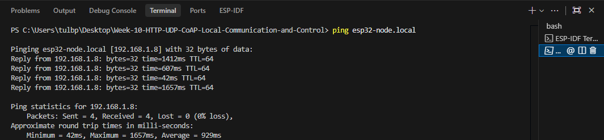

# ใบงานการทดลองที่ 10.1
### การพัฒนาระบบค้นหาอุปกรณ์ด้วย mDNS และเว็บเซิร์ฟเวอร์ควบคุมอุปกรณ์ผ่าน HTTP RESTful API บน ESP-IDF

---

## 1. บันทึกผลการทดลอง (กิจกรรมที่ 10-1.5 การทดสอบและตรวจพิสูจน์)

### 1.1 ตรวจสอบ mDNS ด้วยคำสั่ง ping
- **คำสั่ง:**
  ```powershell
  ping esp32-node.local
  ```
- **ผลลัพธ์จาก Terminal:**
  ```text
  Pinging esp32-node.local [192.168.1.X] with 32 bytes of data:
  Reply from 192.168.1.X: bytes=32 time=1412ms TTL=64
  Reply from 192.168.1.X: bytes=32 time=607ms TTL=64
  Reply from 192.168.1.X: bytes=32 time=42ms TTL=64
  Reply from 192.168.1.X: bytes=32 time=1657ms TTL=64

  Ping statistics for 192.168.1.X:
    Packets: Sent = 4, Received = 4, Lost = 0 (0% loss),
  Approximate round trip times in milli-seconds:
    Minimum = 42ms, Maximum = 1657ms, Average = 929ms
  ```
- **หมายเลข IP Address ที่ Resolve ได้:** `192.168.1.X`
- **ภาพบันทึกหน้าจอผลการ Ping:**
  

---

### 1.2 ทดสอบอ่านค่าเซนเซอร์ผ่าน cURL (`GET /api/status`)
- **คำสั่ง:**
  ```powershell 
  curl.exe -X GET http://esp32-node.local/api/status
  ```
- **ผลลัพธ์ JSON Payload:**
  ```json
  {"pot_raw":4095,"free_heap":213176,"led":false}
  ```

---

### 1.3 ทดสอบสั่งเปิด-ปิด LED ผ่าน cURL หรือ PowerShell (`POST /api/led`)

- **คำสั่งสั่งเปิดไฟ LED (`state: true`):**
  ```powershell
  curl.exe -s -X POST http://esp32-node.local/api/led -H "Content-Type: application/json" -d '{\"state\": true}'
  ```
  - **ข้อความตอบกลับ:** `....................................................`
  - **สถานะหลอดไฟ LED บนบอร์ดจริง:** [ ] ติด (ON)  [ ] ดับ (OFF)

- **คำสั่งสั่งปิดไฟ LED (`state: false`):**
  ```powershell
  curl.exe -s -X POST http://esp32-node.local/api/led -H "Content-Type: application/json" -d '{\"state\": false}'
  ```
  - **ข้อความตอบกลับ:** `....................................................`
  - **สถานะหลอดไฟ LED บนบอร์ดจริง:** [ ] ติด (ON)  [ ] ดับ (OFF)

---

## 2. คำถามท้ายการทดลอง

### ข้อ 1: การวิเคราะห์ HTTP Response Header และขนาดข้อมูลด้วย `curl -i`
นำผลการรัน `curl.exe -i http://esp32-node.local/api/status` มาแปะ พร้อมวิเคราะห์ว่า HTTP Header มีขนาดกี่ไบต์ และข้อมูล JSON มีขนาดกี่ไบต์

- **ผลการรัน `curl -i`:**
  ```http

  ```
- **การวิเคราะห์ขนาดข้อมูล:**
  - **ขนาด HTTP Header:** `.........` ไบต์
  - **ขนาดข้อมูล JSON:** `.........` ไบต์
  - **บทวิเคราะห์:** ......................................................................................................................................

---

### ข้อ 2: การแก้ไขปัญหาเมื่อไม่สามารถใช้งาน mDNS ได้
หากในเครือข่ายมีคอมพิวเตอร์ที่ไม่รองรับ mDNS หรือปิดกั้นพอร์ต UDP 5353 จะเกิดผลกระทบอย่างไร และแก้ไขได้อย่างไร?

- **ผลกระทบ:** ....................................................................................................................................................
- **แนวทางแก้ไข:** .................................................................................................................................................

---

### ข้อ 3: การจัดการหน่วยความจำของ cJSON
เหตุใดจึงต้องเรียกคำสั่ง `cJSON_Delete(root)` และ `cJSON_free(resp)` เสมอหลังจากประมวลผลเสร็จสิ้น?

- **คำตอบ:** ......................................................................................................................................................
