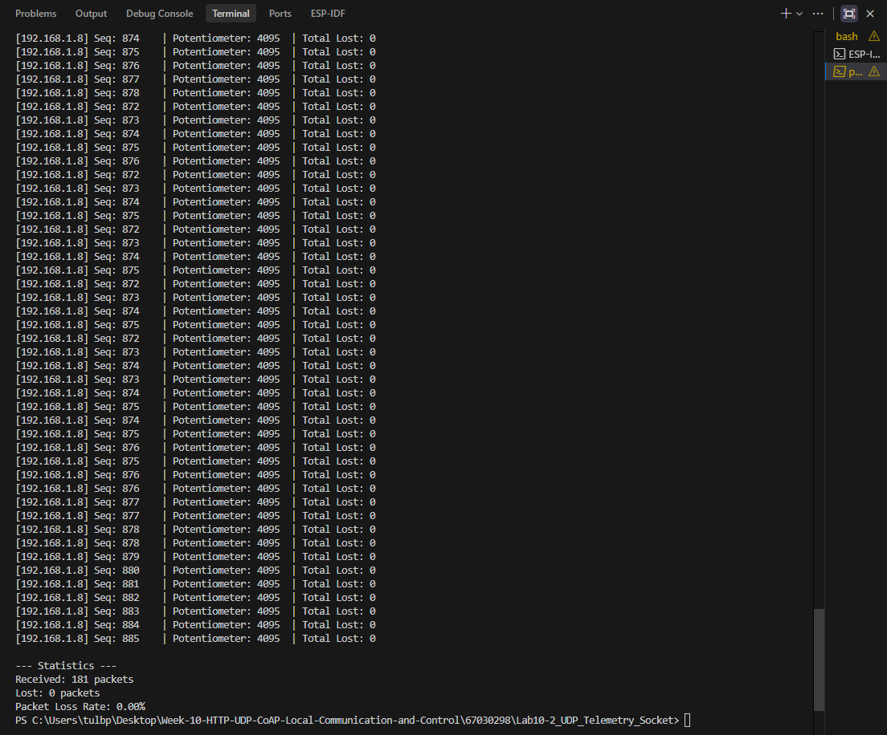

# ใบงานการทดลองที่ 10.2
### การสื่อสารความหน่วงต่ำด้วย UDP Socket และการถ่ายทอดข้อมูล Real-time Telemetry

---

## 1. บันทึกผลการทดลอง (กิจกรรมที่ 10-2.5 การทดสอบด้วยสคริปต์ Python บนคอมพิวเตอร์)

### 1.1 สคริปต์ดักฟังข้อมูล Telemetry Broadcast (`udp_listener.py` พอร์ต 3334)
- **คำสั่ง:**
  ```powershell
  python udp_listener.py
  ```
- **ตัวอย่างข้อความ Telemetry ที่ได้รับจาก ESP32:**
  ```text
  [192.168.1.8] Seq: 705    | Potentiometer: 4095  | Total Lost: 0
  [192.168.1.8] Seq: 706    | Potentiometer: 4095  | Total Lost: 0
  [192.168.1.8] Seq: 707    | Potentiometer: 4095  | Total Lost: 0
  [192.168.1.8] Seq: 708    | Potentiometer: 4095  | Total Lost: 0
  [192.168.1.8] Seq: 709    | Potentiometer: 4095  | Total Lost: 0
  ```
- **สถิติการรับแพ็กเก็ตเมื่อรันต่อเนื่อง 1 นาที:**
  - จำนวนแพ็กเก็ตที่ได้รับ (Received): `181` แพ็กเก็ต
  - จำนวนแพ็กเก็ตที่สูญหาย (Lost): `0` แพ็กเก็ต
  - อัตราการสูญหายของแพ็กเก็ต (Packet Loss Rate): `0.00` %
- **ภาพบันทึกหน้าจอผลการทำงาน:**



---

### 1.2 สคริปต์ทดสอบคำสั่งควบคุมและวัด RTT Latency (`udp_controller.py` พอร์ต 3333)
- **คำสั่ง:**
  ```powershell
  python udp_controller.py
  ```
- **ผลลัพธ์จาก Terminal (10 รอบ):**
  ```text
  PS C:\Users\tulbp\Desktop\Week-10-HTTP-UDP-CoAP-Local-Communication-and-Control\67030298\Lab10-2_UDP_Telemetry_Socket> python udp_controller.py
  Sending control commands to 192.168.1.8:3333...
  Round 01: Sent 'LED_ON' -> Reply 'ACK:LED_ON' | RTT: 48.83 ms
  Round 02: Request timed out!
  Round 03: Request timed out!
  Round 04: Request timed out!
  Round 05: Sent 'LED_ON' -> Reply 'ACK:LED_ON' | RTT: 0.07 ms
  Round 06: Sent 'LED_OFF' -> Reply 'ACK:LED_OFF' | RTT: 0.07 ms
  Round 07: Sent 'LED_ON' -> Reply 'ACK:LED_ON' | RTT: 0.08 ms
  Round 08: Sent 'LED_OFF' -> Reply 'ACK:LED_OFF' | RTT: 0.08 ms
  Round 09: Sent 'LED_ON' -> Reply 'ACK:LED_ON' | RTT: 0.09 ms
  Round 10: Sent 'LED_OFF' -> Reply 'ACK:LED_OFF' | RTT: 0.08 ms
  ```
- **สถิติค่า Round-Trip Time (RTT):**
  - **Minimum RTT:** `0.07` ms
  - **Maximum RTT:** `48.83` ms
  - **Average RTT:** `7.04` ms

---

## 2. คำถามท้ายการทดลอง

### ข้อ 1: เปรียบเทียบ RTT Latency ระหว่าง UDP และ HTTP RESTful
นำผลการวัดค่า RTT Latency ของ UDP ในกิจกรรมที่ 10-2.5 มาเปรียบเทียบกับความหน่วงเวลาของ HTTP RESTful ในใบงาน 10.1 และวิเคราะห์ความแตกต่าง

- **ตารางเปรียบเทียบ:**
  | โปรโตคอล | Average RTT Latency (ms) | ข้อสังเกตเชิงโครงสร้างและกลไก |
  | :--- | :---: | :--- |
  | **HTTP REST (TCP)** | 929 ms | มีการจับมือก่อนส่งและมีส่วนหัวข้อมูลขนาดใหญ่ ทำให้ตอบสนองช้ากว่า |
  | **UDP Socket** | 7.04 ms | ส่งข้อมูลออกไปทันทีโดยไม่ต้องเชื่อมต่อ ทำให้มีความเร็วสูงมาก |

- **บทวิเคราะห์ความแตกต่าง:**
  ยูดีพีเร็วกว่าเอชทีทีพีอย่างมาก เพราะไม่มีขั้นตอนการสร้างการเชื่อมต่อและไม่ต้องรอการตอบรับกลับมา ทำให้ความหน่วงเวลาต่ำมาก เหมาะกับงานที่ต้องการความเร็วแบบทันที

---

### ข้อ 2: การวิเคราะห์อัตราการสูญหายของแพ็กเก็ต (Packet Loss Rate) บนเครือข่าย Wi-Fi
รันสคริปต์ `udp_listener.py` เป็นเวลา 1 นาที จงบันทึกค่าและคำนวณอัตราการสูญหายของแพ็กเก็ต พร้อมวิเคราะห์สาเหตุที่ทำให้เกิดการสูญหายบนเครือข่าย Wi-Fi

- **ค่าที่บันทึกได้:**
  - Received Packets: 181
  - Lost Packets: 0
  - Packet Loss Rate: 0.00 %

- **วิเคราะห์สาเหตุที่ทำให้แพ็กเก็ตสูญหาย:**
  ในการทดสอบนี้สัญญาณไร้สายมีความเสถียรจึงไม่พบข้อมูลสูญหาย แต่หากเกิดการสูญหายมักเกิดจากคลื่นรบกวนในอากาศ สัญญาณอ่อนลง หรือช่องสัญญาณมีความหนาแน่นจนข้อมูลชนกัน

---

### ข้อ 3: ข้อดีและข้อจำกัดของ UDP Broadcast (`255.255.255.255`)
อธิบายข้อดีและข้อจำกัดของการใช้ `255.255.255.255` (UDP Broadcast) ในระบบ IoT และในสถานการณ์ใดที่ควรเปลี่ยนไปใช้ **UDP Multicast** หรือ **Unicast** แทน?

- **ข้อดี:** ส่งข้อมูลเพียงครั้งเดียวสามารถกระจายให้อุปกรณ์ทุกตัวในวงเครือข่ายได้รับพร้อมกันโดยไม่ต้องรู้หมายเลขไอพีปลายทาง
- **ข้อจำกัด:** เป็นการรบกวนอุปกรณ์อื่นที่ไม่เกี่ยวข้องในเครือข่าย และไม่สามารถส่งข้ามวงเครือข่ายอื่นได้
- **สถานการณ์ที่ควรเปลี่ยนไปใช้ UDP Multicast หรือ Unicast:**
  ควรเปลี่ยนมาใช้เมื่อต้องการส่งข้อมูลเฉพาะกลุ่มอุปกรณ์ที่สนใจ หรือต้องการส่งคำสั่งหาอุปกรณ์เป้าหมายเพียงตัวเดียวเพื่อลดภาระในระบบเครือข่าย

---
### Logs
```text
I (27) boot: ESP-IDF v6.1 2nd stage bootloader
I (27) boot: compile time Oct 24 2026 19:30:31
I (28) boot: Multicore bootloader
I (29) boot: chip revision: v3.1
I (31) boot.esp32: SPI Speed      : 40MHz
I (35) boot.esp32: SPI Mode       : DIO
I (39) boot.esp32: SPI Flash Size : 2MB
I (42) boot: Enabling RNG early entropy source...
I (47) boot: Partition Table:
I (49) boot: ## Label            Usage          Type ST Offset   Length
I (56) boot:  0 nvs              WiFi data        01 02 00009000 00006000
I (62) boot:  1 phy_init         RF data          01 01 0000f000 00001000
I (69) boot:  2 factory          factory app      00 00 00010000 00100000
I (75) boot: End of partition table
I (79) esp_image: segment 0: paddr=00010020 vaddr=3f400020 size=1b1ech (111084) map
I (126) esp_image: segment 1: paddr=0002b214 vaddr=3ffb0000 size=04618h ( 17944) load
I (133) esp_image: segment 2: paddr=0002f834 vaddr=40080000 size=007e4h (  2020) load
I (134) esp_image: segment 3: paddr=00030020 vaddr=400d0020 size=8c8e8h (575720) map
I (342) esp_image: segment 4: paddr=000bc910 vaddr=400807e4 size=14cbch ( 85180) load
I (377) esp_image: segment 5: paddr=000d15d4 vaddr=50000000 size=00028h (    40) load
I (388) boot: Loaded app from partition at offset 0x10000
I (388) boot: Disabling RNG early entropy source...
I (399) cpu_start: Multicore app
I (407) cpu_start: GPIO 3 and 1 are used as console UART I/O pins
I (407) cpu_start: Pro cpu start user code
I (407) cpu_start: cpu freq: 160000000 Hz
I (409) app_init: Application information:
I (413) app_init: Project name:     Lab10-2_UDP_Telemetry_Socket
I (419) app_init: App version:      161b518
I (423) app_init: Compile time:     Oct 24 2026 19:30:01
I (428) app_init: ELF file SHA256:  aeedd01db...
I (432) app_init: ESP-IDF:          v6.1
I (436) efuse_init: Min chip rev:     v0.0
I (440) efuse_init: Max chip rev:     v3.99
I (444) efuse_init: Chip rev:         v3.1
I (448) heap_init: Initializing. RAM available for dynamic allocation:
I (454) heap_init: At 3FFAE6E0 len 00001920 (6 KiB): DRAM
I (459) heap_init: At 3FFB9210 len 00026DF0 (155 KiB): DRAM
I (464) heap_init: At 3FFE0440 len 00003AE0 (14 KiB): D/IRAM
I (469) heap_init: At 3FFE4350 len 0001BCB0 (111 KiB): D/IRAM
I (475) heap_init: At 400954A0 len 0000AB60 (42 KiB): IRAM
I (481) spi_flash: detected chip: generic
I (484) spi_flash: flash io: dio
W (487) spi_flash: Detected size(4096k) larger than the size in the binary image header(2048k). Using the size in the binary image header.
I (501) main_task: Started on CPU0
I (501) main_task: Calling app_main()
I (531) UDP_LAB: ADC Initialized on GPIO 34
I (541) wifi:wifi driver task: 3ffc0d88, prio:23, stack:6656, core=0
I (551) wifi:wifi firmware version: e12a754
I (551) wifi:wifi certification version: v7.0
I (551) wifi:config NVS flash: enabled
I (551) wifi:config nano formatting: disabled
I (561) wifi:Init data frame dynamic rx buffer num: 32
I (561) wifi:Init static rx mgmt buffer num: 5
I (561) wifi:Init management short buffer num: 32
I (571) wifi:Init dynamic tx buffer num: 32
I (571) wifi:Init static rx buffer size: 1600
I (581) wifi:Init static rx buffer num: 10
I (581) wifi:Init dynamic rx buffer num: 32
I (591) wifi_init: rx ba win: 6
I (591) wifi_init: accept mbox: 6
I (591) wifi_init: tcpip mbox: 32
I (591) wifi_init: udp mbox: 6
I (601) wifi_init: tcp mbox: 6
I (601) wifi_init: tcp tx win: 5760
I (601) wifi_init: tcp rx win: 5760
I (611) wifi_init: tcp mss: 1440
I (611) wifi_init: WiFi IRAM OP enabled
I (611) wifi_init: WiFi RX IRAM OP enabled
I (641) phy_init: phy_version 4863,a3a4459,Oct 28 2025,14:30:06
I (731) phy_init: Saving new calibration data due to checksum failure or outdated calibration data, mode(0)
I (751) wifi:mode : sta (84:1f:e8:39:bd:64)
I (761) wifi:enable tsf
I (761) UDP_LAB: Connecting to AP: FBT4402_2.4...
I (851) wifi:new:<2,0>, old:<1,0>, ap:<255,255>, sta:<2,0>, prof:1, snd_ch_cfg:0x0
I (851) wifi:state: init -> auth (0xb0)
I (5161) wifi:state: auth -> init (0x200)
I (5171) UDP_LAB: Retrying Wi-Fi (1/5)...
I (7541) wifi:state: init -> auth (0xb0)
I (7861) wifi:state: auth -> init (0x600)
I (7881) UDP_LAB: Retrying Wi-Fi (2/5)...
I (10291) UDP_LAB: Retrying Wi-Fi (3/5)...
I (10371) wifi:state: init -> auth (0xb0)
I (11031) wifi:state: auth -> assoc (0x0)
I (11041) wifi:state: assoc -> run (0x10)
I (11161) wifi:connected with FBT4402_2.4, aid = 2, channel 2, BW20, bssid = 34:4a:c3:26:26:d6
I (11161) wifi:security: WPA3-SAE HUNT_AND_PECK, phy: bgn, rssi: -41, cipher(pairwise:0x3, group:0x3), pmf:1
I (11181) wifi:pm start, type: 1

I (11181) wifi:dp: 1, bi: 102400, li: 3, scale listen interval from 307200 us to 307200 us
I (11181) wifi:AP's beacon interval = 102400 us, DTIM period = 1
I (11531) wifi:<ba-add>idx:0 (ifx:0, 34:4a:c3:26:26:d6), tid:5, ssn:2, winSize:64
I (12841) esp_netif_handlers: sta ip: 192.168.1.8, mask: 255.255.255.0, gw: 192.168.1.1
I (12841) UDP_LAB: Connected! IP Address: 192.168.1.8
I (12841) UDP_LAB: Control Server listening on UDP Port 3333...
I (12841) UDP_LAB: Broadcasting Telemetry to Port 3334 (10 Hz)...
I (12851) UDP_LAB: All UDP Tasks started!
I (12851) main_task: Returned from app_main()
```