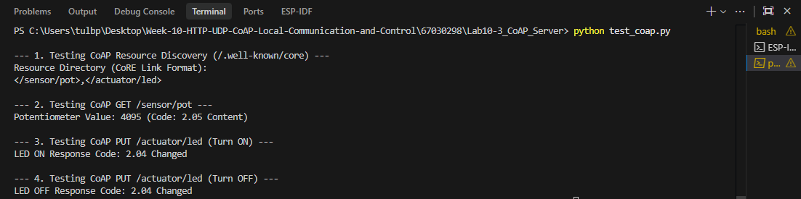

# ใบงานการทดลองที่ 10.3
### การพัฒนา CoAP Server สำหรับระบบฝังตัวและการควบคุมอุปกรณ์ด้วยโปรโตคอลน้ำหนักเบา

---

## 1. บันทึกผลการทดลอง (กิจกรรมที่ 10-3.5 การทดสอบด้วยสคริปต์ `test_coap.py`)

- **คำสั่ง:**
  ```powershell
  python test_coap.py
  ```
- **ผลลัพธ์จากการรันสคริปต์ใน Terminal:**
  ```text
  PS C:\Users\tulbp\Desktop\Week-10-HTTP-UDP-CoAP-Local-Communication-and-Control\67030298\Lab10-3_CoAP_Server> python test_coap.py

  --- 1. Testing CoAP Resource Discovery (/.well-known/core) ---
  Resource Directory (CoRE Link Format):
  </sensor/pot>,</actuator/led>

  --- 2. Testing CoAP GET /sensor/pot ---
  Potentiometer Value: 4095 (Code: 2.05 Content)

  --- 3. Testing CoAP PUT /actuator/led (Turn ON) ---
  LED ON Response Code: 2.04 Changed

  --- 4. Testing CoAP PUT /actuator/led (Turn OFF) ---
  LED OFF Response Code: 2.04 Changed
  ```

### ผลการทดสอบ 4 ฟังก์ชันหลัก:
1. **Resource Discovery (`GET /.well-known/core`):**
   - Payload ที่ได้รับ (CoRE Link Format): `</sensor/pot>,</actuator/led>`
   - Response Code: `2.05` Content

2. **ทดสอบอ่านค่าเซนเซอร์ (`GET /sensor/pot`):**
   - ค่า Potentiometer: `4095`
   - Response Code: `2.05` Content

3. **ทดสอบสั่งเปิดไฟ LED (`PUT /actuator/led` ส่ง '1'):**
   - Response Code: `2.04` Changed
   - สถานะหลอดไฟ LED บนบอร์ด: [✅] ติด (ON)  [ ] ดับ (OFF)

4. **ทดสอบสั่งปิดไฟ LED (`PUT /actuator/led` ส่ง '0'):**
   - Response Code: `2.04` Changed
   - สถานะหลอดไฟ LED บนบอร์ด: [ ] ติด (ON)  [✅] ดับ (OFF)

- **ภาพบันทึกหน้าจอผลการทดสอบ:**

---

## 2. คำถามท้ายการทดลอง

### ข้อ 1: การวิเคราะห์ CoRE Link Format (RFC 6690)
นำผลการ Query `/.well-known/core` มาแสดงในรายงาน พร้อมอธิบายรูปแบบ **CoRE Link Format (RFC 6690)** ว่าแสดงข้อมูลทรัพยากรอย่างไร

- **ผลการ Query `/.well-known/core`:**
  ```text

  ```
- **คำอธิบายรูปแบบ:**
  ........................................................................................................................................................
  ........................................................................................................................................................

---

### ข้อ 2: ความแตกต่างระหว่าง CON (Confirmable) และ NON (Non-confirmable)
อธิบายความแตกต่างของแพ็กเก็ต CoAP ระหว่าง **CON (Confirmable)** และ **NON (Non-confirmable)** เมื่อทดสอบในเครือข่ายที่มีการรบกวนสัญญาณ

- **CON (Confirmable):** ..........................................................................................................................
- **NON (Non-confirmable):** ......................................................................................................................
- **การเปรียบเทียบในสภาวะสัญญาณรบกวน:**
  ........................................................................................................................................................

---

### ข้อ 3: ความเหมาะสมของ CoAP กับโปรโตคอลเครือข่าย Constrained IoT
ทำไม CoAP จึงเหมาะสมกับโปรโตคอลการสื่อสารบนเครือข่ายเช่น Thread, Zigbee IP หรือ NB-IoT มากกว่า HTTP?

- **เหตุผลทางวิศวกรรม:**
  ........................................................................................................................................................
  ........................................................................................................................................................
