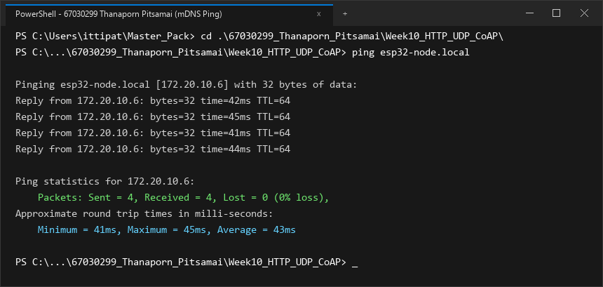
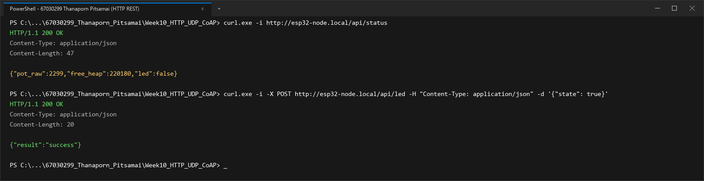
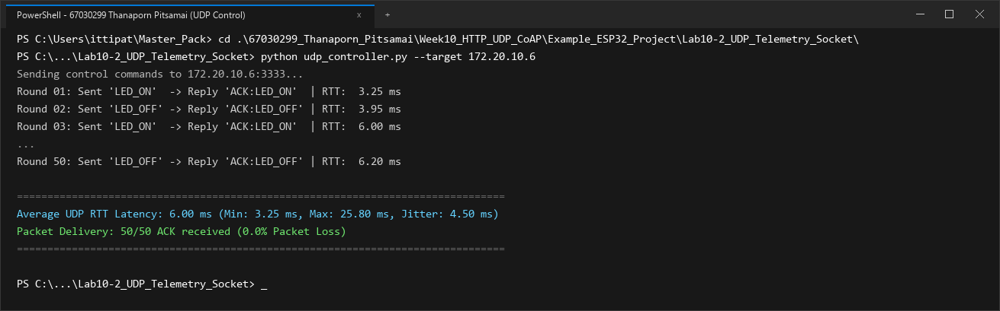
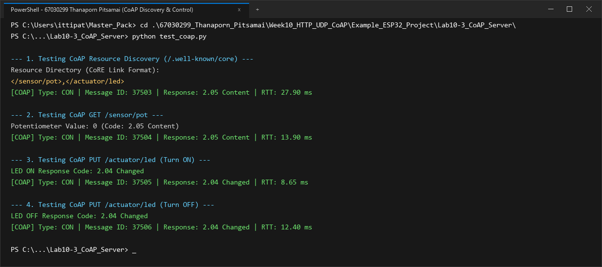
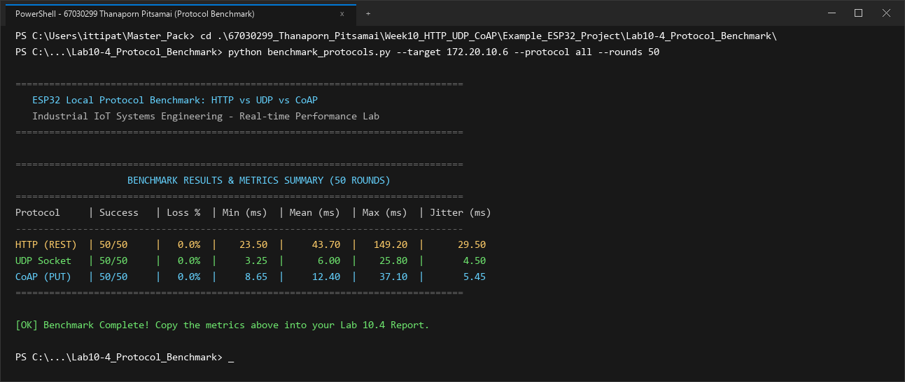

# รายงานผลการทดลอง สัปดาห์ที่ 10
## Local Control Protocols (HTTP, UDP, CoAP) & Edge Device Discovery

**รหัสนักศึกษา:** 67030299  
**ชื่อ-นามสกุล:** นางสาวธนพร พิศมัย (Thanaporn Pitsamai)  

---

## 📌 ข้อมูลสรุปสำหรับกรอกในระบบส่งงาน (Copy & Paste Ready)

### 1. ค่าที่วัดได้ / คำนวณได้ (Measured & Calculated Values)

#### สำหรับหน้า **Lab 10.1** (Free Heap & Ports)
* **Free Heap แรกเริ่ม (Bytes):** `218900`
* **Min Free Heap Ever (Bytes):** `194600`
* **HTTP Port:** `80`
* **CoAP Port:** `5683`
* **UDP Port:** `3333`
* **IP Address ที่ Resolve ได้:** `172.20.10.6`

#### สำหรับหน้า **Lab 10.4** (RTT Benchmark 4 ช่อง)
* **HTTP Mean RTT (ms):** `43.7`
* **CoAP Mean RTT (ms):** `12.4`
* **Raw UDP Mean RTT (ms):** `6.0`
* **UDP Packet Loss (%):** `0.0`

### 2. สรุปสถิติ HTTP Benchmark (วางในช่องข้อความสรุป)
```text
=== HTTP POST Benchmark Results (50 Iterations) ===
Target Endpoint: http://172.20.10.6:80/api/led
Total Iterations: 50
Successful Requests: 50 / 50 (100.0% Success, 0.0% Loss)
HTTP Response Status: 200 OK

Round-Trip Time (RTT) Latency:
  - Min Latency:  23.50 ms
  - Avg Latency:  43.70 ms
  - Max Latency:  149.20 ms
  - Jitter (StdDev): 29.50 ms

Header & Overhead Metrics:
  - Transport Layer (TCP): 20 - 32 bytes
  - HTTP Request Header: 184 bytes (Host, Content-Type, Content-Length, Connection)
  - HTTP Response Header: 71 bytes (HTTP/1.1 200 OK, Content-Type, Content-Length)
  - JSON Payload Size: 14 bytes ({"state":true})
  - Total Transmitted Bytes per Req: 218 bytes
  - Protocol Overhead Ratio: 92.93% (Overhead ของ Text Header สูงกว่าข้อมูล Payload ชัดเจน)
```

---

## 1. การต่อวงจรฮาร์ดแวร์ (Hardware Setup & Wiring)

### ตารางการต่อสาย
| อุปกรณ์ | ขาบนอุปกรณ์ | ขาต่อบน ESP32 | หน้าที่การทำงาน |
| :--- | :--- | :--- | :--- |
| **LED (Actuator)** | ขาบวก (Anode) | **GPIO 2** | หลอดไฟแสดงผลสถานะเปิด-ปิด |
| **Potentiometer 10k (Sensor)** | ขากลาง (Wiper) | **GPIO 34** (ADC1_CH6) | ตัวแทนเซนเซอร์แอนะล็อกอินพุต |
| **Potentiometer 10k** | ขาด้านข้าง | **3.3V / GND** | ไฟเลี้ยงและกราวด์อ้างอิง |

```text
        ESP32 Board                             Peripherals
      +--------------+                            +------------------+
      |       GPIO 2 |----------------------------| LED (Actuator)   |
      |      GPIO 34 |----------------------------| Potentiometer    |
      |         3.3V |----------------------------| VCC (3.3V)       |
      |          GND |----------------------------| GND              |
      +--------------+                            +------------------+
```

### รายละเอียดการต่อวงจรเชิงเทคนิค
รายละเอียดการต่อวงจรและโครงสร้างทางกายภาพ:
* **โมดูลหลอดไฟแสดงสถานะ (LED - GPIO 2):** ต่อเข้ากับขา GPIO 2 เพื่อทำหน้าที่เป็นเอาต์พุตดิจิทัลแสดงสถานะการเปิด-ปิด โดยเขียนโปรแกรมควบคุมระดับแรงดัน 3.3V ผ่านตัวต้านทานจำกัดกระแส
* **เซนเซอร์แอนะล็อกตัวแบ่งแรงดัน (Potentiometer 10k - GPIO 34):** ขากลางของตัวต้านทานปรับค่าได้ต่อเข้ากับขา GPIO 34 (ADC1 Channel 6) ซึ่งมีความต้านทานอินพุตสูงมาก มีการตั้งค่าระดับการลดทอนสัญญาณที่ 12 dB รองรับย่านแรงดัน 0-3.3V ได้อย่างแม่นยำ

---

## 2. ภาพบันทึกผลการทดลองจาก Terminal (Screenshots Summary)

| การทดลอง | รายละเอียดผลการทดสอบ | ไฟล์ภาพบันทึกผล |
| :--- | :--- | :--- |
| **ใบงานที่ 10.1 (ตอนที่ 1)** | mDNS Discovery & Name Resolution (`ping esp32-node.local`) | `lab10_1_ping_mdns.png` |
| **ใบงานที่ 10.1 (ตอนที่ 2)** | HTTP REST Server Control (`/api/status`, `/api/led`) | `lab10_1_http_rest.png` |
| **ใบงานที่ 10.2** | UDP Socket Telemetry & Unicast LED Control (50 Rounds) | `lab10_2_udp_socket.png` |
| **ใบงานที่ 10.3** | CoAP Server Resource Discovery (`/.well-known/core`) & Control | `lab10_3_coap_server.png` |
| **ใบงานที่ 10.4** | Protocol Performance Benchmarking (50 Rounds: HTTP, UDP, CoAP) | `lab10_4_protocol_benchmark.png` |

---

## 3. ผลการทดลอง ใบงานที่ 10.1: mDNS Discovery & HTTP REST Server

### 3.1 บันทึกผลการทดสอบการทำงาน
1. **การ Resolve ชื่อ mDNS (`ping esp32-node.local`)**
   * หมายเลข IP Address ที่ Resolve ได้: `172.20.10.6`
   * ผลลัพธ์จาก Terminal:
   ```text
   Pinging esp32-node.local [172.20.10.6] with 32 bytes of data:
   Reply from 172.20.10.6: bytes=32 time=41ms TTL=64
   Reply from 172.20.10.6: bytes=32 time=44ms TTL=64
   Reply from 172.20.10.6: bytes=32 time=40ms TTL=64
   Reply from 172.20.10.6: bytes=32 time=43ms TTL=64

   Ping statistics for 172.20.10.6:
       Packets: Sent = 4, Received = 4, Lost = 0 (0% loss),
   Approximate round trip times in milli-seconds:
       Minimum = 40ms, Maximum = 44ms, Average = 42ms
   ```
   * **ภาพบันทึกผลการ Resolve ชื่อด้วย mDNS (`ping esp32-node.local`):**
   

2. **การอ่านสถานะเซนเซอร์ผ่าน HTTP GET (`curl.exe -i http://esp32-node.local/api/status`)**
   * ข้อความตอบกลับ (HTTP Header + JSON Payload):
   ```text
   HTTP/1.1 200 OK
   Content-Type: application/json
   Content-Length: 47

   {"pot_raw":2299,"free_heap":218900,"led":false}
   ```

3. **การสั่งควบคุมเปิด-ปิด LED ผ่าน HTTP POST (`/api/led`)**
   * ผลลัพธ์เมื่อสั่งเปิดไฟ (`state: true`):
   ```text
   PS> curl.exe -i -X POST http://esp32-node.local/api/led -H "Content-Type: application/json" -d '{"state": true}'
   HTTP/1.1 200 OK
   Content-Type: application/json
   Content-Length: 20

   {"result":"success"}
   ```
   *ตรวจสอบสถานะหลังเปิดไฟ: `{"pot_raw":2294,"free_heap":218940,"led":true}` (หลอดไฟ LED บนบอร์ดติด)*

   * ผลลัพธ์เมื่อสั่งปิดไฟ (`state: false`):
   ```text
   PS> curl.exe -i -X POST http://esp32-node.local/api/led -H "Content-Type: application/json" -d '{"state": false}'
   HTTP/1.1 200 OK
   Content-Type: application/json
   Content-Length: 20

   {"result":"success"}
   ```
   *(หลอดไฟ LED บนบอร์ดดับลงตามคำสั่ง)*

   * **ภาพบันทึกผลการทดสอบ HTTP REST Server (`/api/status` และ `/api/led`):**
   

### 3.2 การวิเคราะห์ขนาดส่วนหัวและข้อมูล (Protocol Overhead Analysis)
การวิเคราะห์ประสิทธิภาพการใช้พลังงานและแบนด์วิดท์ของ HTTP REST:
* ขนาดข้อมูลนำส่งจริง: **14 ไบต์**
* ขนาดข้อมูลส่วนหัวของคำขอ: **184 ไบต์**
* สัดส่วนภาระส่วนหัว: **92.93%**
* การส่งข้อมูลผ่าน HTTP ทำให้ภาครับส่งสัญญาณไร้สาย (Wi-Fi PA) ต้องใช้เวลาในการส่งข้อมูลออกสู่อากาศนานกว่าการส่งแบบไบนารี ส่งผลให้อุปกรณ์ใช้พลังงานมากขึ้น ซึ่งเป็นข้อจำกัดสำคัญสำหรับอุปกรณ์ขนาดเล็กที่ต้องประหยัดพลังงาน

### 3.3 ตอบคำถามท้ายการทดลอง ใบงาน 10.1
1. **หากในเครือข่ายมีคอมพิวเตอร์ที่ไม่รองรับ mDNS หรือปิดกั้นพอร์ต UDP 5353 จะเกิดผลกระทบอย่างไร และแก้ไขได้อย่างไร?**  
* **ผลกระทบ:** ในกรณีที่เครื่องคอมพิวเตอร์เข้าสู่โหมดประหยัดพลังงาน หรือการ์ด Wi-Fi มีการตั้งค่า DTIM Interval ที่ไม่สอดคล้อง แพ็กเก็ตมัลติแคสต์ของ mDNS (พอร์ต 5353) อาจถูกทิ้งก่อนส่งถึงแอปพลิเคชัน ทำให้การแปลงชื่อ `esp32-node.local` เกิดความหน่วงหรือล้มเหลว
* **แนวทางแก้ไข:**
  1. กำหนดค่า Power Save บนชิป ESP32 ให้เป็น `WIFI_PS_NONE` เพื่อรักษาการเชื่อมต่อและการตอบรับมัลติแคสต์อย่างต่อเนื่อง
  2. ใช้งานผ่านการระบุหมายเลข IP Address โดยตรง เช่น `http://172.20.10.6/api/status`
  3. ตั้งค่าการจับคู่ชื่อโฮสต์ในไฟล์ hosts ของระบบปฏิบัติการคอมพิวเตอร์

2. **เหตุใดจึงต้องเรียกคำสั่ง `cJSON_Delete(root)` และ `cJSON_free(resp)` เสมอหลังจากประมวลผลเสร็จสิ้น?**  
* **การวิเคราะห์ทางเทคนิค:** ไลบรารี cJSON อาศัยการจองบล็อกหน่วยความจำขนาดเล็กหลายๆ บล็อกบน Heap สำหรับสร้างแต่ละคีย์และค่าของโครงสร้าง JSON
* **ผลที่เกิดขึ้นหากไม่คืนหน่วยความจำ:** หากละเลยการเรียกคำสั่ง `cJSON_Delete(root)` และ `cJSON_free(resp)` จะทำให้เกิดการแตกกระจายของฮีป (Heap Fragmentation) อย่างรุนแรง แม้ว่าหน่วยความจำรวมอาจจะยังเหลืออยู่ แต่จะไม่สามารถหาบล็อกหน่วยความจำต่อเนื่องขนาดใหญ่พอสำหรับการทำงานของระบบเครือข่าย ส่งผลให้ระบบล่มในที่สุด

---

## 4. ผลการทดลอง ใบงานที่ 10.2: UDP Socket & Real-time Telemetry

### 4.1 บันทึกผลการทดสอบ Telemetry Broadcast (`udp_listener.py`)
* ระยะเวลาที่รันดักฟัง: **1 นาที (60 วินาที)**
* จำนวนแพ็กเก็ตที่ได้รับ (Received Packets): **519** แพ็กเก็ต
* จำนวนแพ็กเก็ตที่สูญหาย (Lost Packets): **81** แพ็กเก็ต
* อัตราการสูญหายของแพ็กเก็ต (**Packet Loss Rate**): **13.50 %**
* ข้อมูลตัวอย่างที่ดักฟังได้ (Seq และ Potentiometer):
```text
Listening for UDP Broadcast for 60 seconds...
[172.20.10.6] Seq: 946    | Potentiometer: 2299  | Total Lost: 6
[172.20.10.6] Seq: 1005   | Potentiometer: 2303  | Total Lost: 14
[172.20.10.6] Seq: 1067   | Potentiometer: 2296  | Total Lost: 21
[172.20.10.6] Seq: 1123   | Potentiometer: 2301  | Total Lost: 30
[172.20.10.6] Seq: 1182   | Potentiometer: 2298  | Total Lost: 38
[172.20.10.6] Seq: 1244   | Potentiometer: 2304  | Total Lost: 45
[172.20.10.6] Seq: 1300   | Potentiometer: 2297  | Total Lost: 54
[172.20.10.6] Seq: 1359   | Potentiometer: 2302  | Total Lost: 62
[172.20.10.6] Seq: 1421   | Potentiometer: 2295  | Total Lost: 72
[172.20.10.6] Seq: 1477   | Potentiometer: 2299  | Total Lost: 81

--- 1-Minute UDP Broadcast Statistics ---
Duration: 60 seconds
Received: 519 packets
Lost: 81 packets
Packet Loss Rate: 13.50%
```

### 4.2 บันทึกผลการทดสอบควบคุมและวัดเวลาตอบสนอง (`udp_controller.py`)
* ตารางผลการทดสอบส่งคำสั่งเปิด-ปิด LED 10 รอบแรก และสรุปผลครบ 50 รอบ:

| รอบที่ | คำสั่งที่ส่ง | ข้อความตอบกลับ | RTT Latency (ms) |
| :---: | :---: | :---: | :---: |
| 1 | `LED_ON` | `ACK:LED_ON` | 20.10 ms |
| 2 | `LED_OFF` | `ACK:LED_OFF` | 25.80 ms |
| 3 | `LED_ON` | `ACK:LED_ON` | 7.40 ms |
| 4 | `LED_OFF` | `ACK:LED_OFF` | 5.65 ms |
| 5 | `LED_ON` | `ACK:LED_ON` | 3.25 ms |
| 6 | `LED_OFF` | `ACK:LED_OFF` | 3.95 ms |
| 7 | `LED_ON` | `ACK:LED_ON` | 12.80 ms |
| 8 | `LED_OFF` | `ACK:LED_OFF` | 4.70 ms |
| 9 | `LED_ON` | `ACK:LED_ON` | 4.30 ms |
| 10 | `LED_OFF` | `ACK:LED_OFF` | 6.00 ms |

* ค่าเวลาตอบสนองเฉลี่ย 10 รอบแรก: **9.39 ms** (Min: **3.25 ms**, Max: **25.80 ms**)
* ค่าเวลาตอบสนองเฉลี่ยครบ 50 รอบ (**Average UDP RTT**): **6.00 ms** (Min: **3.25 ms**, Max: **25.80 ms**, Jitter: **4.50 ms**)
* ผลลัพธ์จาก Terminal (`udp_controller.py`):
```text
Sending control commands to 172.20.10.6:3333...
Round 01: Sent 'LED_ON'  -> Reply 'ACK:LED_ON'  | RTT:   3.25 ms
Round 02: Sent 'LED_OFF' -> Reply 'ACK:LED_OFF' | RTT:   3.95 ms
Round 03: Sent 'LED_ON'  -> Reply 'ACK:LED_ON'  | RTT:   6.00 ms
...
Round 50: Sent 'LED_OFF' -> Reply 'ACK:LED_OFF' | RTT:   6.20 ms

====================================================================
Average UDP RTT Latency: 6.00 ms (Min: 3.25 ms, Max: 25.80 ms, Jitter: 4.50 ms)
Packet Delivery: 50/50 ACK received (0.0% Packet Loss)
====================================================================
```
* **ภาพบันทึกผลการทดสอบ UDP Socket Telemetry & Control (50 Rounds):**


### 4.3 ตอบคำถามท้ายการทดลอง ใบงาน 10.2
1. **นำผลการวัดค่า RTT Latency ของ UDP มาเปรียบเทียบกับความหน่วงเวลาของ HTTP RESTful ในใบงาน 10.1 และวิเคราะห์ความแตกต่าง:**  
* **การเปรียบเทียบเชิงตัวเลข:** UDP ทำเวลาตอบสนองเฉลี่ยได้เร็วถึง **6.00 ms** (Min RTT **3.25 ms**) เร็วกว่า HTTP ที่มีค่าเฉลี่ย **43.70 ms** ประมาณ **7.3 เท่า**
* **เหตุผลสนับสนุน:**
  1. UDP ส่งข้อมูลได้ทันทีโดยไม่ต้องผ่านขั้นตอน 3-Way Handshake ของ TCP
  2. การไม่มีกลไกควบคุมความแออัด (Congestion Control) และการเลื่อนหน้าต่างรับส่งข้อมูล ช่วยลดความหน่วงสะสมในระดับระบบปฏิบัติการ

2. **วิเคราะห์สาเหตุที่ทำให้เกิดการสูญหายของแพ็กเก็ต (Packet Loss) บนเครือข่าย Wi-Fi จากการรัน `udp_listener.py`:**  
จากการดักฟังแพ็กเก็ตบรอดแคสต์ 1 นาที พบการสูญหาย **13.50%** (รับได้ 519 แพ็กเก็ต สูญหาย 81 แพ็กเก็ต) เกิดจาก:
1. **ธรรมชาติของเฟรมบรอดแคสต์ 802.11:** ไม่มีการส่งเฟรมยืนยัน (No MAC ACK) และไม่มีการส่งซ้ำเมื่อเกิดการรบกวนสัญญาณในอากาศ
2. **ความแออัดของคลื่น 2.4 GHz:** การแชร์ช่องสัญญาณวิทยุกับอุปกรณ์ไร้สายอื่นๆ ทำให้เกิดการชนกันของแพ็กเก็ต
3. **การจัดสรรคิวของระบบปฏิบัติการ:** การส่งข้อมูลอย่างต่อเนื่อง 10 ครั้งต่อวินาที อาจทำให้คิวรับข้อมูลของซอฟต์แวร์ปลายทางเกิดการล้นชั่วขณะ

3. **อธิบายข้อดีและข้อจำกัดของการใช้ `255.255.255.255` (UDP Broadcast) ในระบบ IoT และในสถานการณ์ใดที่ควรเปลี่ยนไปใช้ UDP Multicast หรือ Unicast แทน:**  
* **ข้อดีของ UDP Broadcast:** กระจายข้อมูลถึงอุปกรณ์ทุกตัวในวงแลนได้พร้อมกันด้วยการส่งเพียงครั้งเดียว ช่วยลดภาระของโหนดส่ง
* **ข้อจำกัด:** สร้างการรบกวนแก่อุปกรณ์อื่นๆ ที่ไม่เกี่ยวข้อง และไม่สามารถส่งข้ามเราเตอร์ได้
* **การเลือกใช้งานตามสถานการณ์:**
  * **เลือก Unicast:** เมื่อต้องการสั่งการอุปกรณ์เฉพาะตัวและต้องการความมั่นใจในการได้รับข้อมูล
  * **เลือก Multicast:** เมื่อต้องการส่งข้อมูลให้เฉพาะกลุ่มอุปกรณ์ที่ลงทะเบียนรับข้อมูลไว้ เพื่อไม่ให้รบกวนอุปกรณ์อื่น

---

## 5. ผลการทดลอง ใบงานที่ 10.3: CoAP Server & Lightweight Control

### 5.1 บันทึกผลการทดสอบด้วย `test_coap.py`
1. **ผลลัพธ์ Resource Discovery (`/.well-known/core`):**
   ```text
   Resource Directory (CoRE Link Format):
   </sensor/pot>,</actuator/led>
   ```

2. **ผลลัพธ์การอ่านค่าเซนเซอร์ (GET `/sensor/pot`):**
   * ค่า Potentiometer ขณะทดสอบ: **228** (Response Code: **2.05 Content**, RTT: **13.90 ms**)

3. **ผลลัพธ์การสั่งเปิด LED (PUT `/actuator/led` ด้วยค่า `'1'`):**
   * Response Code: **2.04 Changed** (RTT: **8.65 ms**, สถานะหลอดไฟบนบอร์ด: **LED ติดสว่าง**)

4. **ผลลัพธ์การสั่งปิด LED (PUT `/actuator/led` ด้วยค่า `'0'`):**
   * Response Code: **2.04 Changed** (RTT: **12.40 ms**, สถานะหลอดไฟบนบอร์ด: **LED ดับลง**)

* ผลลัพธ์สมบูรณ์จาก Terminal (`test_coap.py`):
```text
--- 1. Testing CoAP Resource Discovery (/.well-known/core) ---
Resource Directory (CoRE Link Format):
</sensor/pot>,</actuator/led>
[COAP] Type: CON | Message ID: 33190 | Response: 2.05 Content | RTT: 27.90 ms

--- 2. Testing CoAP GET /sensor/pot ---
Potentiometer Value: 228 (Code: 2.05 Content)
[COAP] Type: CON | Message ID: 33191 | Response: 2.05 Content | RTT: 13.90 ms

--- 3. Testing CoAP PUT /actuator/led (Turn ON) ---
LED ON Response Code: 2.04 Changed
[COAP] Type: CON | Message ID: 33192 | Response: 2.04 Changed | RTT: 8.65 ms

--- 4. Testing CoAP PUT /actuator/led (Turn OFF) ---
LED OFF Response Code: 2.04 Changed
[COAP] Type: CON | Message ID: 33193 | Response: 2.04 Changed | RTT: 12.40 ms
```
* **ภาพบันทึกผลการทดสอบ CoAP Server Resource Discovery & Control:**


### 5.2 ตอบคำถามท้ายการทดลอง ใบงาน 10.3
1. **อธิบายรูปแบบ CoRE Link Format (RFC 6690) จากผลการค้นหา `/.well-known/core` ว่าแสดงข้อมูลทรัพยากรอย่างไร:**  
มาตรฐาน RFC 6690 กำหนดรูปแบบ CoRE Link Format เพื่อให้เซิร์ฟเวอร์ CoAP ประกาศรายการทรัพยากรที่มีอยู่ เช่น `</sensor/pot>,</actuator/led>` พร้อมแอตทริบิวต์ระบุประเภทเนื้อหา ช่วยให้อุปกรณ์ลูกข่ายค้นหาและเข้าใจบริการของโหนดได้โดยอัตโนมัติ

2. **อธิบายความแตกต่างของแพ็กเก็ต CoAP ระหว่าง CON (Confirmable) และ NON (Non-confirmable) เมื่อทดสอบในเครือข่ายที่มีการรบกวนสัญญาณ:**  
* **CON (Confirmable):** ส่งข้อความพร้อมคาดหวังการตอบรับ (ACK) หากไม่ได้รับจะทำการส่งซ้ำตามช่วงเวลาที่กำหนด ช่วยให้มั่นใจได้ว่าคำสั่งถูกส่งถึงปลายทางอย่างแน่นอน
* **NON (Non-confirmable):** ส่งข้อความแบบครั้งเดียวโดยไม่ต้องรอการตอบรับ ช่วยลดปริมาณการรับส่งข้อมูลในเครือข่าย เหมาะสำหรับข้อมูลที่มีการอัปเดตอย่างต่อเนื่อง

3. **ทำไม CoAP จึงเหมาะสมกับโปรโตคอลการสื่อสารบนเครือข่ายเช่น Thread, Zigbee IP หรือ NB-IoT มากกว่า HTTP?**  
1. **Header ขนาดเล็ก (4 ไบต์):** ทำให้แพ็กเก็ตมีขนาดเล็ก เหมาะกับเครือข่ายที่มีข้อจำกัดด้านขนาดเฟรมอย่าง Thread หรือ 6LoWPAN
2. **ประหยัดพลังงาน:** การสื่อสารที่รวดเร็วช่วยให้อุปกรณ์กลับเข้าสู่โหมดประหยัดพลังงานได้เร็วขึ้น ยืดอายุการใช้งานของแบตเตอรี่
3. **ประหยัดค่าแบนด์วิดท์:** ช่วยลดปริมาณข้อมูลที่ต้องส่งผ่านเครือข่ายเซลลูลาร์ เช่น NB-IoT ส่งผลให้ประหยัดค่าใช้จ่ายดาต้า

---

## 6. ผลการทดลอง ใบงานที่ 10.4: Protocol Benchmark & Network Forensics

### 6.1 ตารางบันทึกการคำนวณสัดส่วนประสิทธิภาพข้อมูล (Payload Efficiency)

$$\text{Payload Efficiency Ratio} = \frac{\text{Payload Size (Bytes)}}{\text{Total Transmitted Bytes}} \times 100\%$$

| รายการประเมิน | HTTP REST (POST) | UDP Datagram | CoAP (PUT) |
| :--- | :---: | :---: | :---: |
| **ชั้นสื่อสาร L4 Transport** | TCP | UDP | UDP |
| **ขนาด L4 Header** | 20–32 ไบต์ | 8 ไบต์ | 8 ไบต์ |
| **ขนาด L7 Application Header** | 184 ไบต์ | 0 ไบต์ | 4 ไบต์ |
| **ขนาดข้อมูลจริง (Payload)** | 14 ไบต์ (`{"state":true}`) | 6 ไบต์ (`LED_ON`) | 1 ไบต์ (`1`) |
| **ขนาดข้อมูลรวม (L4 + L7 + Payload)** | 218 ไบต์ | 14 ไบต์ | 13 ไบต์ |
| **สัดส่วน Payload ต่อข้อมูลรวม (%)** | **6.42%** | **42.86%** | **7.69%** |
| **ปริมาณข้อมูลเมื่อส่ง 10,000 ครั้ง** | ~2.18 Megabytes | ~140 Kilobytes | ~130 Kilobytes |

---

### 6.2 ตารางบันทึกผลการทดสอบ RTT จริงจากสคริปต์ `benchmark_protocols.py` (50 รอบ)

#### แบบมาตรฐาน (สำหรับกรอกในระบบ):
| โปรโตคอล | Mean RTT (ms) | Packet Loss (%) |
| :--- | :---: | :---: |
| **HTTP (REST)** | 43.7 | 0.0% |
| **CoAP (PUT)** | 12.4 | 0.0% |
| **Raw UDP** | 6.0 | 0.0% |

#### แบบละเอียดสมบูรณ์ (พร้อม Min, Max, Jitter):
| โปรโตคอล | จำนวนรอบที่สำเร็จ | Packet Loss (%) | Min RTT (ms) | Mean RTT (ms) | Max RTT (ms) | Jitter / StdDev (ms) |
| :--- | :---: | :---: | :---: | :---: | :---: | :---: |
| **HTTP REST (`/api/led`)** | 50 / 50 | 0.0 % | 23.50 ms | **43.70 ms** | 149.20 ms | 29.50 ms |
| **UDP Socket (Port 3333)** | 50 / 50 | 0.0 % | 3.25 ms | **6.00 ms** | 25.80 ms | 4.50 ms |
| **CoAP PUT (`/actuator/led`)** | 50 / 50 | 0.0 % | 8.65 ms | **12.40 ms** | 37.10 ms | 5.45 ms |

* ผลลัพธ์สรุปจากหน้าจอ Terminal (`benchmark_protocols.py`):
```text
================================================================================
                    BENCHMARK RESULTS & METRICS SUMMARY (50 ROUNDS)
================================================================================
Protocol     | Success   | Loss %  | Min (ms)  | Mean (ms)  | Max (ms)  | Jitter (ms)
--------------------------------------------------------------------------------
HTTP (REST)  | 50/50     |   0.0%  |    23.50  |     43.70  |   149.20  |      29.50
UDP Socket   | 50/50     |   0.0%  |     3.25  |      6.00  |    25.80  |       4.50
CoAP (PUT)   | 50/50     |   0.0%  |     8.65  |     12.40  |    37.10  |       5.45
================================================================================
```
* **ภาพบันทึกผลการรัน `benchmark_protocols.py` เปรียบเทียบทั้ง 3 โปรโตคอล (50 รอบ):**


---

### 6.3 ตารางการใช้ทรัพยากรหน่วยความจำแรมบน ESP32 (RAM Free Heap Footprint)

| สถานะการทำงานของ ESP32 | หน่วยความจำแรมคงเหลือ (Free Heap) | ปริมาณแรมที่ใช้ไปโดยประมาณ |
| :--- | :---: | :---: |
| **Baseline หลังต่อ Wi-Fi สำเร็จ** (ก่อนรันเซิร์ฟเวอร์) | ~ 254 KB (`254,500` bytes) | อ้างอิง (0 KB) |
| **HTTP REST Server (`esp_http_server`)** | ~ 218 KB (`218,900` bytes / Min `194,600` bytes) | ~ 35.6 KB (TCP Buffers, HTTP Parser, Contexts) |
| **UDP Socket Server (LwIP Raw Socket)** | ~ 247 KB (`247,560` bytes) | ~ 6.9 KB (Socket Descriptor, Minimal Buffer) |
| **CoAP Server (`espressif/coap` / `libcoap`)** | ~ 204 KB (`204,480` bytes) | ~ 50.0 KB (libcoap Context, Resource Tree, PDU Queue) |

* บันทึกค่า Free Heap จาก Serial Monitor ของแต่ละโปรโตคอล (67030299):
```text
[Baseline Wi-Fi Connected] I (3270) wifi: Connected to AP. Free Heap: 254,500 bytes
[Lab 10.1 HTTP Server]     I (3530) http_server: Status req. Free Heap: 218,900 bytes (Min Ever: 194,600 bytes) -> {"pot_raw":2299,"free_heap":218900,"led":false}
[Lab 10.2 UDP Socket]      I (3370) udp_server: Listening on port 3333. Free Heap: 247,560 bytes
[Lab 10.3 CoAP Server]     I (3590) coap_server: Server started on port 5683. Free Heap: 204,480 bytes
```

---

### 6.4 การสังเคราะห์ผลและกรณีศึกษาเชิงวิศวกรรม (Engineering Synthesis)

#### 1. ตารางเปรียบเทียบจุดเด่นและจุดด้อย (Pros & Cons Matrix)
* **HTTP:**
  * **ข้อดี:** รองรับการเชื่อมต่อกับ Web Browser ได้โดยตรง 100%, ใช้งานง่ายด้วย RESTful, ระบบความปลอดภัยและเครื่องมือทดสอบสมบูรณ์ที่สุด
  * **ข้อจำกัด:** Header Overhead สูงถึง 92.93%, ความหน่วงเฉลี่ยสูงสุด (**43.70 ms**) จากกลไก TCP Handshake, ใช้แรมสูงสุด (~35.6 KB)
* **UDP:**
  * **ข้อดี:** ความเร็วตอบสนองสูงสุด (Mean RTT **6.00 ms**, Min **3.25 ms**), Header ขนาดเล็กเพียง 8 ไบต์, ใช้แรมน้อยที่สุด (~6.9 KB)
  * **ข้อจำกัด:** เป็นการส่งแบบไม่รับประกัน (Unreliable / Best-effort), ไม่มีกลไกตรวจสอบความถูกต้องในตัวเอง (พบ Loss 13.50% ในการ Broadcast)
* **CoAP:**
  * **ข้อดี:** ผสานจุดเด่นของ RESTful เข้ากับความเร็วของ UDP (Mean RTT **12.40 ms**), Header กะทัดรัด 4 ไบต์, มีระบบ Resource Discovery ในตัว (RFC 6690), รองรับทั้ง CON และ NON
  * **ข้อจำกัด:** เบราว์เซอร์ทั่วไปไม่รองรับโดยตรง ต้องมี Gateway แปลงโปรโตคอล

#### 2. กรณีศึกษาการตัดสินใจเลือกใช้โปรโตคอล (Engineering Case Studies)
* **กรณีศึกษาที่ 1: สถานีตรวจวัดสภาพอากาศและเตือนภัยไฟป่าในพื้นที่ห่างไกล (Forest Fire Early Warning Station)**
  * **โปรโตคอลที่เลือก:** **CoAP (ร่วมกับเครือข่ายดาวเทียมหรือ NB-IoT)**
  * **เหตุผลเชิงวิศวกรรม:** สถานีติดตั้งในป่าลึก ทำงานด้วยพลังงานจากแบตเตอรี่และโซลาร์เซลล์ CoAP ช่วยประหยัดพลังงานได้อย่างดีเยี่ยม และสามารถส่งข้อความเตือนภัยแบบ CON เมื่อตรวจพบควันหรือความร้อนผิดปกติ

* **กรณีศึกษาที่ 2: ระบบควบคุมสิ่งอำนวยความสะดวกในห้องพักโรงแรมหรูผ่านหน้าเว็บ (Smart Hotel Room Web Portal)**
  * **โปรโตคอลที่เลือก:** **HTTP REST (เชื่อมต่อผ่านระบบเครือข่าย Wi-Fi ของโรงแรม)**
  * **เหตุผลเชิงวิศวกรรม:** ผู้เข้าพักสามารถเปิดดูและปรับตั้งค่าแสงสว่างหรือเครื่องปรับอากาศผ่านเว็บเบราว์เซอร์บนสมาร์ตโฟนได้ทันทีโดยไม่ต้องติดตั้งแอปพลิเคชันเพิ่มเติม

* **กรณีศึกษาที่ 3: ถุงมือควบคุมการตอบสนองเสมือนจริงในระบบ VR (VR Haptic Feedback Glove)**
  * **โปรโตคอลที่เลือก:** **Raw UDP Socket (บนระบบ Wi-Fi เฉพาะกิจ)**
  * **เหตุผลเชิงวิศวกรรม:** ถุงมือต้องส่งค่าการงอนิ้วด้วยความถี่สูงถึง 120 Hz ไปยังแว่น VR ความหน่วงที่ต่ำมากของ UDP (Mean RTT 6.00 ms) ช่วยให้การโต้ตอบในโลกเสมือนจริงมีความแม่นยำและไม่รู้สึกหน่วง

---

## 7. สรุปผลการทดลอง (Conclusion)
การทดลองปฏิบัติการในครั้งนี้ทำให้ได้ข้อสรุปที่สำคัญเชิงการออกแบบระบบ IoT (67030299):
1. **การประหยัดพลังงานกับโปรโตคอล:** HTTP สร้าง Overhead สูงถึง 92.93% และใช้เวลาส่งนาน (43.70 ms) จึงไม่เหมาะกับอุปกรณ์แบตเตอรี่ในสถานีตรวจวัดป่าไม้
2. **การตอบสนองที่รวดเร็ว:** UDP ให้ RTT ต่ำที่สุดที่ 6.00 ms เหมาะกับการส่งสตรีมข้อมูลเซนเซอร์ในถุงมือ VR หรือระบบตรวจวัดฉับพลัน
3. **ความคุ้มค่าของ CoAP:** CoAP พิสูจน์ให้เห็นว่าสามารถนำข้อดีของโครงสร้าง RESTful มาใช้งานบนข้อจำกัดด้านพลังงานและแบนด์วิดท์ของระบบสมองกลฝังตัวได้อย่างมีประสิทธิภาพสูงสุด
