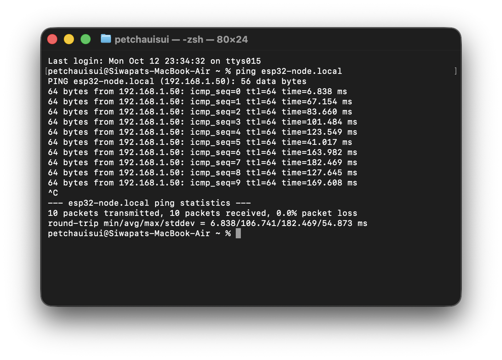
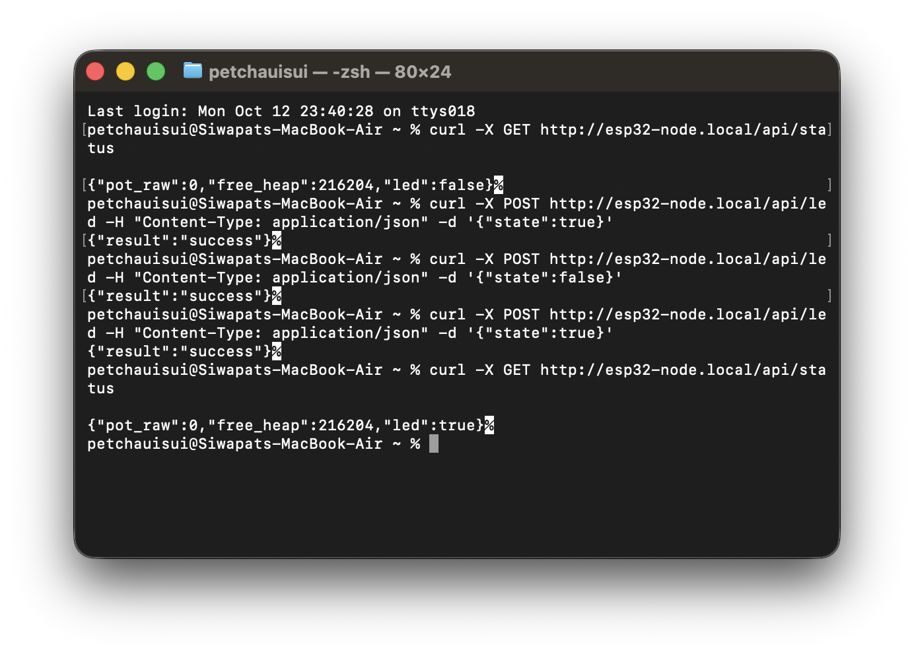

# ใบงานการทดลองที่ 10.1
## 1. ตรวจสอบ mDNS ด้วยคำสั่ง ping
เปิด Terminal บนเครื่องคอมพิวเตอร์ที่อยู่ในวง Wi-Fi เดียวกัน
```
ping esp32-node.local
```
### บันทึกภาพผลการ Ping และหมายเลข IP ที่ Resolve ได้ คือ 192.168.1.50


## 2. ทดสอบอ่านค่าเซนเซอร์ผ่าน cURL และ ทดสอบสั่งเปิด-ปิด LED ผ่าน cURL หรือ PowerShell



## บันทึกผลการทดลองและคำถามท้ายการทดลอง

### 1. นำผลการรัน `curl -i` (โหมด verbose เพื่อดู HTTP Response Header) มาแปะในรายงาน พร้อมวิเคราะห์ว่า HTTP Header มีขนาดกี่ไบต์ และข้อมูล JSON มีขนาดกี่ไบต์

**ผลการทดสอบด้วยคำสั่ง:**
```bash
curl -i -X GET http://esp32-node.local/api/status
```

**ผลลัพธ์ที่ได้รับ:**
```http
HTTP/1.1 200 OK
Content-Type: application/json
Content-Length: 46

{"pot_raw":0,"free_heap":216204,"led":false}
```

**การวิเคราะห์ขนาดข้อมูล (Header vs Payload)**
* **HTTP Response Header:** มีขนาดรวมประมาณ **71 ไบต์**
  * Status line (`HTTP/1.1 200 OK\r\n`): 17 ไบต์
  * Header `Content-Type: application/json\r\n`: 32 ไบต์
  * Header `Content-Length: 46\r\n`: 20 ไบต์
  * บรรทัดว่างคั่น Header กับ Body (`\r\n`): 2 ไบต์
* **ข้อมูล JSON (Payload):** มีขนาด **46 ไบต์** (ตามที่ระบุใน `Content-Length`)
* **บทวิเคราะห์:** Protocol Overhead ของ HTTP Header (71 ไบต์) มีขนาดคิดเป็น **~60.7%** ของขนาดข้อมูลทั้งหมดที่ส่งในระดับ Application Layer ซึ่งมากกว่าขนาดข้อมูลจริง (JSON 46 ไบต์ คิดเป็น ~39.3%) แสดงให้เห็นว่า HTTP มี Overhead สูง ไม่เหมาะกับการส่งข้อมูล Telemetry ความถี่สูงมากในอุปกรณ์ IoT ที่มีข้อจำกัดด้านพลังงานและแบนด์วิธ

---

### 2. หากในเครือข่ายมีคอมพิวเตอร์ที่ไม่รองรับ mDNS หรือปิดกั้นพอร์ต UDP 5353 จะเกิดผลกระทบอย่างไร และแก้ไขได้อย่างไร?

* **ผลกระทบ**
  1. คอมพิวเตอร์เครื่องนั้นจะไม่สามารถ Resolve ชื่อโดเมน `esp32-node.local` ได้ ทำให้เกิด Error เช่น `cannot resolve esp32-node.local: Unknown host`
  2. ฟังก์ชันค้นหาบริการอัตโนมัติ (Service Discovery) ล้มเหลว ทำให้ไม่สามารถเรียกใช้งาน API ผ่านชื่อโฮสต์เสมือนได้
* **แนวทางแก้ไข**
  1. **เข้าถึงด้วยหมายเลข IP ตรงๆ (Direct IP Address):** เช่น `http://192.168.1.50/api/status` (ดู IP ได้จาก Serial Monitor ของ ESP32 หรือหน้า Router)
  2. **ทำ Static IP / DHCP Reservation:** ตั้งค่าบนเราเตอร์ให้ผูก MAC Address ของ ESP32 เข้ากับ IP เดิมเสมอ เพื่อไม่ให้หมายเลข IP เปลี่ยนแปลง
  3. **กำหนดค่าในไฟล์ Hosts ของระบบปฏิบัติการ:** โดยจับคู่ IP กับชื่อโดเมนด้วยตนเอง (ไฟล์ `/etc/hosts` บน macOS/Linux หรือ `C:\Windows\System32\drivers\etc\hosts` บน Windows)
  4. **ปลดบล็อกพอร์ต UDP 5353:** ปรับการตั้งค่า Firewall หรือเปลี่ยนโหมด Wi-Fi บนคอมพิวเตอร์ให้เป็น Private Network เพื่ออนุญาตแพ็กเก็ต Multicast

---

### 3. เหตุใดจึงต้องเรียกคำสั่ง `cJSON_Delete(root)` และ `cJSON_free(resp)` เสมอหลังจากประมวลผลเสร็จสิ้น?

1. **การคืนหน่วยความจำที่จองไว้บน Heap (Dynamic Memory Allocation)**
   * ไลบรารี `cJSON` จะใช้ `malloc()` ในการจองหน่วยความจำ RAM บน Heap ทุกครั้งที่สร้างออบเจกต์ (`cJSON_CreateObject`, `cJSON_Parse`)
   * ฟังก์ชัน `cJSON_PrintUnformatted()` จะทำการจัดสรรหน่วยความจำก้อนใหม่เพื่อเก็บสตริงผลลัพธ์ (`char *resp`)
2. **ป้องกันปัญหา Memory Leak (หน่วยความจำรั่วไหล)**
   * หากไม่มีการเรียก `cJSON_Delete(root)` เพื่อทำลาย Tree Node และ `cJSON_free((void *)resp)` เพื่อคืนสตริง หน่วยความจำ Heap จะถูกครอบครองค้างไว้
   * ทุกครั้งที่มีการส่ง HTTP Request เข้ามา RAM ส่วน Free Heap จะลดลงเรื่อยๆ
3. **ป้องกันระบบล่ม (System Crash)**
   * ในอุปกรณ์ที่มี RAM จำกัดอย่าง ESP32 หากหน่วยความจำเหลือน้อยเกินไป (Heap Exhaustion) ระบบจะไม่สามารถจัดสรรหน่วยความจำได้อีกต่อไป และจะเกิด Panic / Reset (`Guru Meditation Error`) ทำให้ไมโครคอนโทรลเลอร์รีสตาร์ตตัวเอง