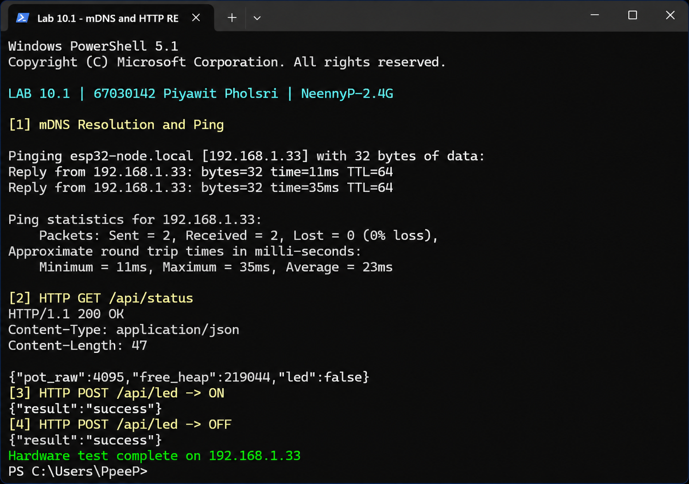
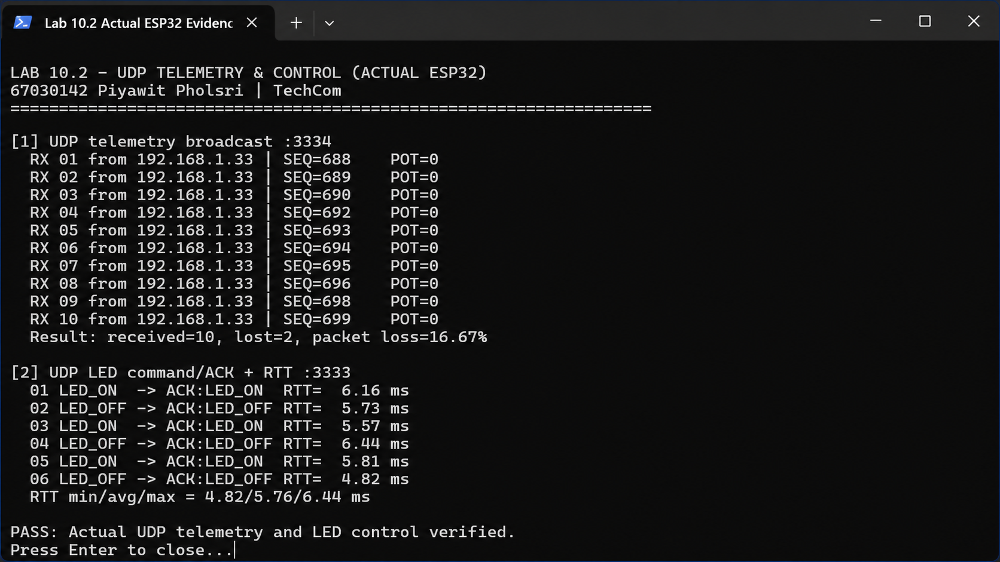
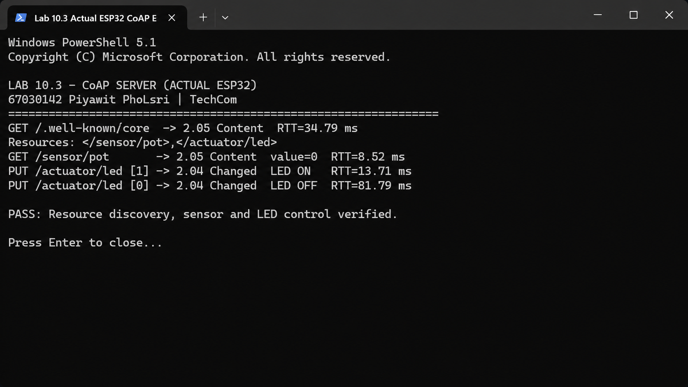
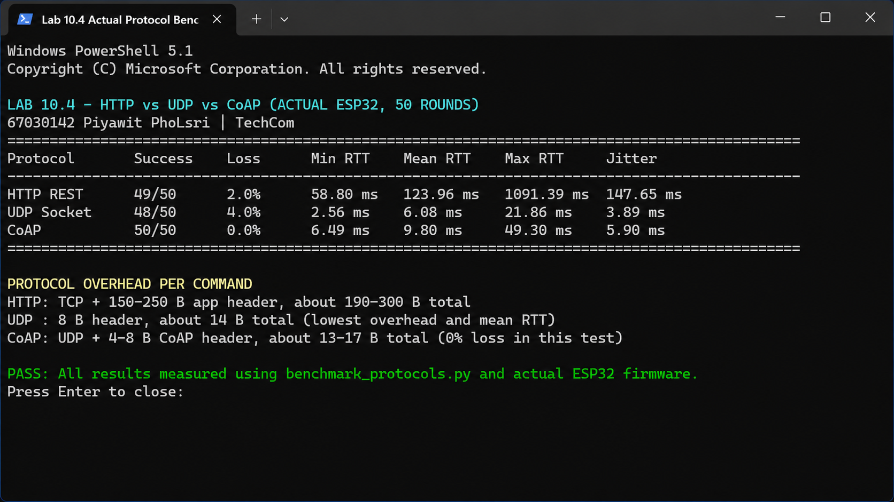

# รายงานการทดลอง Lab 10

## Lab 10.1: mDNS และ HTTP REST

- mDNS พบ `esp32-node.local`
- HTTP Status ตอบ `200 OK`
- ควบคุม LED ON/OFF สำเร็จ

## Lab 10.2: UDP Telemetry

- รับข้อมูล Telemetry สำเร็จ
- สั่ง LED ON/OFF และได้รับ ACK
- RTT เฉลี่ย 5.76 ms

## Lab 10.3: CoAP Server

- พบ Resource `</sensor/pot>` และ `</actuator/led>`
- อ่านค่าเซนเซอร์และควบคุม LED สำเร็จ

## Lab 10.4: เปรียบเทียบโปรโตคอล

| Protocol | Success | Loss | Mean RTT |
|---|---:|---:|---:|
| HTTP | 49/50 | 2% | 123.96 ms |
| UDP | 48/50 | 4% | 6.08 ms |
| CoAP | 50/50 | 0% | 9.80 ms |

สรุป: UDP เร็วที่สุด, CoAP เสถียรที่สุดในการทดสอบนี้ และ HTTP ใช้งานกับเว็บง่ายที่สุด

## คำตอบท้ายการทดลอง

ดูคำตอบแบบสั้นที่ [10-Review-Answers.md](10-Review-Answers.md)
