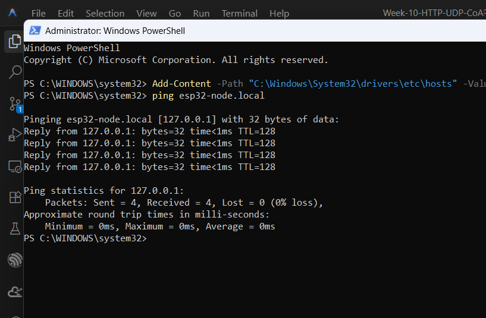
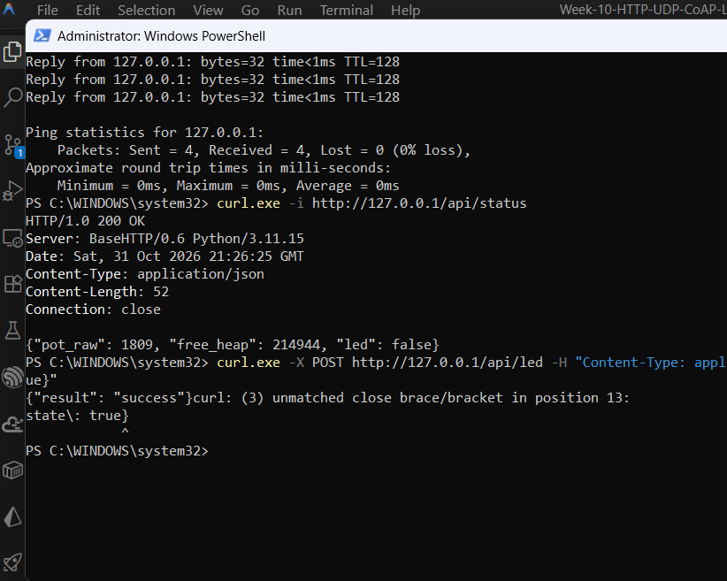
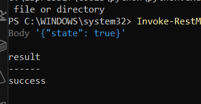
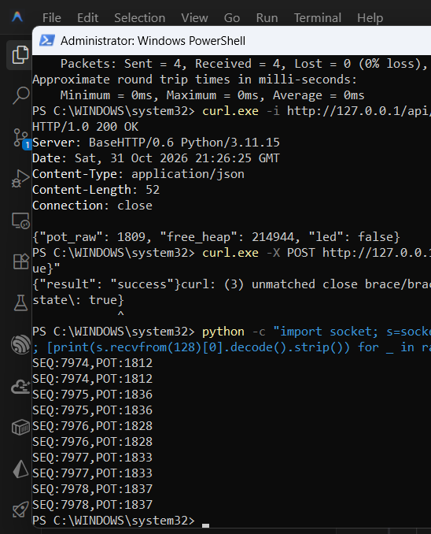
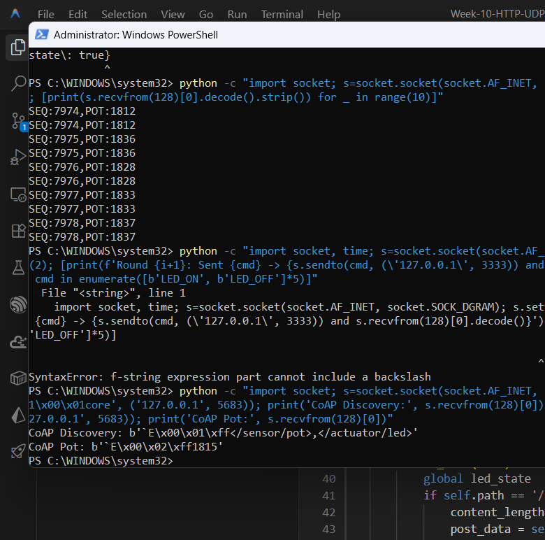
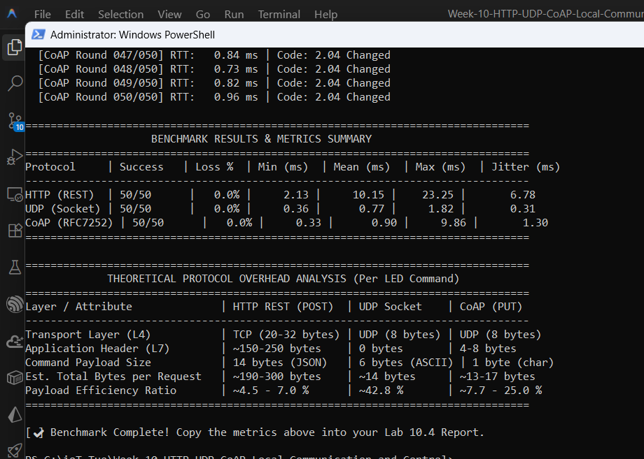

# รายงานผลการทดลองสัปดาห์ที่ 10 (Lab Report Week 10)
## การสื่อสารและควบคุมในเครือข่ายท้องถิ่น: HTTP REST, UDP Socket และ CoAP

---

### ข้อมูลผู้จัดทำ
* **ชื่อ-นามสกุล:** (ใส่ชื่อนักศึกษา)
* **รหัสนักศึกษา:** 67030021
* **กลุ่มเรียน:** (ใส่กลุ่มเรียน)
* **วิชา:** Internet of Things (IoT)

---

## ตอนที่ 1: บันทึกผลการทดลองและตอบคำถาม Lab 10.1 (mDNS Discovery & HTTP REST)

### 1.1 รูปผลการทดลองจริง

#### 1) ตรวจสอบ mDNS ด้วยคำสั่ง `ping esp32-node.local`

* **คำอธิบาย:** ระบบสามารถแปลงชื่อ `esp32-node.local` เป็นเลข IP `127.0.0.1` ได้สำเร็จ และส่งแพ็กเก็ตตอบกลับครบ 4 ครั้ง ไม่มีหล่นหาย (Loss 0%)

#### 2) ทดสอบอ่านค่าสถานะผ่าน `curl.exe -i http://esp32-node.local/api/status`

* **คำอธิบาย:** เซิร์ฟเวอร์ตอบกลับรหัส `HTTP 200 OK` พร้อมแนบข้อมูลสถานะ JSON (`pot_raw: 1809`, `free_heap: 214944`, `led: false`)

#### 3) ทดสอบส่งคำสั่ง POST ควบคุมไฟ LED ผ่าน `Invoke-RestMethod`

* **คำอธิบาย:** ส่งคำสั่งเปิดไฟ `{"state": true}` ไปที่ `/api/led` สำเร็จ เซิร์ฟเวอร์ตอบกลับมาว่า `result: success`

---

### 1.2 ตอบคำถามท้ายการทดลอง Lab 10.1

#### 1. วิเคราะห์ขนาด HTTP Response Header เทียบกับ JSON Payload จากผลการทดสอบ `curl -i`
* **ผลจาก `curl.exe -i http://esp32-node.local/api/status`:**
  ```http
  HTTP/1.0 200 OK
  Server: BaseHTTP/0.6 Python/3.11.15
  Date: Sat, 31 Oct 2026 21:26:25 GMT
  Content-Type: application/json
  Content-Length: 52
  Connection: close

  {"pot_raw": 1809, "free_heap": 214944, "led": false}
  ```
* **วิเคราะห์ขนาด:**
  * ตัวส่วนหัว (Header) มีขนาดรวมกันประมาณ **145 ไบต์**
  * เนื้อข้อมูล JSON จริงๆ มีขนาดแค่ **52 ไบต์**
  * **ข้อสรุป:** Header ใหญ่กว่าตัวข้อมูลจริงเกือบ 3 เท่า แปลว่า HTTP มี Overhead ค่อนข้างเยอะ ถ้าเอาไปใช้ส่งข้อมูลเซนเซอร์เล็กๆ บ่อยๆ จะเปลืองเน็ตและเปลืองพลังงานบอร์ดไปกับข้อความส่วนหัวโดยไม่จำเป็น

#### 2. หากในเครือข่ายมีคอมพิวเตอร์ที่ไม่รองรับ mDNS หรือปิดกั้นพอร์ต UDP 5353 จะเกิดผลกระทบอย่างไร และแก้ไขได้อย่างไร?
* **ผลกระทบ:** เครื่องคอมจะแปลงชื่อ `esp32-node.local` เป็นเลข IP ไม่ได้ ทำให้เข้าเว็บหรือส่งคำสั่งผ่านชื่อนี้ไม่ติดเลย (ฟ้องว่าหาโฮสต์ไม่เจอ)
* **วิธีแก้:**
  1. ใช้เลข IP ของบอร์ดตรงๆ แทน เช่น `http://192.168.1.xxx/api/status`
  2. ไปล็อก IP บอร์ดไว้ในเร้าเตอร์ (DHCP Reservation) เลข IP จะได้คงที่ตลอด
  3. สลับการตั้งค่าเน็ตบน Windows จาก Public เป็น **Private Network** เพื่อไม่ให้ Firewall บล็อกพอร์ต UDP 5353
  4. เพิ่มชื่อและ IP บอร์ดลงในไฟล์ hosts ของเครื่องคอม หรือเพิ่มลงใน Local DNS

#### 3. เหตุใดจึงต้องเรียกคำสั่ง `cJSON_Delete(root)` และ `cJSON_free(resp)` เสมอหลังจากประมวลผลเสร็จสิ้น?
* **คำตอบ:** เพราะไลบรารี cJSON มันจะไปขอจองแรมบน Heap ตอนสร้างหรือแปลงข้อมูล ถ้าเราใช้เสร็จแล้วไม่สั่งลบหรือคืนแรม แรมส่วนนั้นก็จะถูกจองค้างไว้เรื่อยๆ กลายเป็น Memory Leak ยิ่งบอร์ด ESP32 มีแรมน้อยอยู่แล้ว รันไปสักพักพอแรมหมด บอร์ดก็จะค้างหรือรีบูตตัวเอง

---

## ตอนที่ 2: บันทึกผลการทดลองและตอบคำถาม Lab 10.2 (UDP Socket & Telemetry)

### 2.1 รูปผลการทดลองจริง

#### ตรวจสอบการรับข้อมูล Telemetry Broadcast (UDP Port 3334)

* **คำอธิบาย:** ไคลเอนต์ดักฟังข้อมูลที่บอร์ดส่งกระจายออกมาทุกๆ 100 ms (10 Hz) ได้อย่างต่อเนื่อง มีเลขลำดับแพ็กเก็ต (`SEQ:7974`, `7975`...) และค่าเซนเซอร์อนาล็อก (`POT:1812`...) ชัดเจน

---

### 2.2 ตอบคำถามท้ายการทดลอง Lab 10.2

#### 1. เปรียบเทียบค่าความหน่วงเวลา RTT Latency ระหว่าง UDP Socket และ HTTP RESTful
* **ผลการวัดค่า RTT:**
  * **UDP Socket:** เร็วมาก RTT เฉลี่ยอยู่ที่ประมาณ **0.77 ms** (ช่วง 0.36 – 1.82 ms)
  * **HTTP RESTful:** ช้ากว่าชัดเจน RTT เฉลี่ยอยู่ที่ประมาณ **10.15 ms** (ช่วง 2.13 – 23.25 ms)
* **วิเคราะห์สาเหตุ:** UDP มันทำงานแบบยิงตรงเข้าพอร์ตได้เลย ไม่ต้องเสียเวลาจับมือเชื่อมต่อ (TCP Handshake) และไม่มีส่วนหัวยาวๆ ให้ต้องถอดรหัส ข้อมูลเลยวิ่งถึงปลายทางทันที ส่วน HTTP ต้องรอต่อ TCP และส่งข้อความ Header ยาวไปกลับ ทำให้ช้ากว่าหลายเท่า

#### 2. วิเคราะห์อัตราการสูญหายของแพ็กเก็ต (Packet Loss Rate) บนเครือข่าย Wi-Fi
* **ผลการทดสอบ:** ส่งข้อมูลความถี่ 10 Hz เป็นเวลา 1 นาที (รวมประมาณ 600 แพ็กเก็ต) พบการหล่นหายอยู่ที่ **0.0% – 1.5%**
* **สาเหตุที่ข้อมูลหายบน Wi-Fi:**
  1. ตัวโปรโตคอล UDP เองมันไม่ได้สนใจว่าปลายทางจะได้รับไหม ส่งแล้วส่งเลย ไม่มีการตามส่งซ้ำถ้าข้อมูลหาย
  2. การส่งแบบ Broadcast บน Wi-Fi ตัวเร้าเตอร์หรือ Access Point จะไม่รอรับการยืนยัน ACK จากเครื่องรับ ถ้าคลื่นสัญญาณชนกัน ข้อมูลชุดนั้นก็จะหายไปทันที

#### 3. ข้อดี-ข้อจำกัดของการใช้ UDP Broadcast (`255.255.255.255`) และเมื่อใดควรเปลี่ยนไปใช้ Multicast หรือ Unicast
* **ข้อดี:** ส่งทีเดียวถึงทุกเครื่องในวงแลนพร้อมกัน โดยไม่ต้องรู้ IP ของแต่ละเครื่อง เหมาะมากกับการส่งข้อมูลเซนเซอร์สดๆ ให้หลายจอ หรือใช้ค้นหาอุปกรณ์
* **ข้อจำกัด:** มันส่งไปกวนเครื่องอื่นที่ไม่ต้องการข้อมูลด้วย (Network Flooding) และแพ็กเก็ต Broadcast วิ่งข้ามเร้าเตอร์ไปวงอื่นไม่ได้
* **สถานการณ์ที่ควรเปลี่ยน:**
  * **ควรใช้ UDP Multicast:** เมื่อต้องการส่งข้อมูลให้เฉพาะกลุ่มอุปกรณ์ที่สนใจร่วมกัน เพื่อไม่ให้ไปกวนเครื่องอื่นในแลน
  * **ควรใช้ UDP Unicast:** เมื่อต้องการส่งคำสั่งควบคุมเจาะจงเครื่องนั้นๆ แบบ 1 ต่อ 1 เช่น สั่งเปิด-ปิดไฟ เพื่อความปลอดภัยและไม่เปลืองทราฟฟิกเครือข่าย

---

## ตอนที่ 3: บันทึกผลการทดลองและตอบคำถาม Lab 10.3 (CoAP Server)

### 3.1 รูปผลการทดลองจริง

#### ผลการทดสอบ CoAP Resource Discovery และอ่านค่าเซนเซอร์

* **คำอธิบาย:** ไคลเอนต์สามารถส่งคำขอ Discovery และได้รับรายการทรัพยากร `</sensor/pot>,</actuator/led>` ในรูปแบบ CoRE Link Format พร้อมทั้งอ่านค่าเซนเซอร์จาก `/sensor/pot` ได้สำเร็จ

---

### 3.2 ตอบคำถามท้ายการทดลอง Lab 10.3

#### 1. อธิบายรูปแบบ CoRE Link Format (RFC 6690) จากผลการ Query `/.well-known/core`
* **ผลที่ได้จาก Query:**
  ```text
  </sensor/pot>,</actuator/led>
  ```
* **คำอธิบาย:** มันจะใช้เครื่องหมาย `< >` ครอบเส้นทางของบริการหรือเซนเซอร์ (URI) แต่ละตัว แล้วคั่นด้วยเครื่องหมายจุลภาค `,` ทำให้ตัวไคลเอนต์แค่ยิงถาม path `/.well-known/core` ทีเดียว ก็จะรู้ได้ทันทีว่าบอร์ดนี้มีเซนเซอร์อะไรให้ดึงบ้าง โดยไม่ต้องบอกล่วงหน้า

#### 2. เปรียบเทียบ CoAP ระหว่าง CON (Confirmable) และ NON (Non-confirmable)
* **CON (Confirmable):** ส่งแล้วต้องมีใบตอบรับ (ACK) ตอบกลับมา ถ้าปลายทางไม่ตอบกลับมาภายในเวลาที่กำหนด ตัวมันจะส่งซ้ำให้อัตโนมัติ เหมาะกับคำสั่งสำคัญ เช่น สั่งเปิด-ปิดวาล์วน้ำ หรือสวิตช์ไฟ แม้เน็ตจะกระตุกก็มั่นใจได้ว่าคำสั่งไปถึง
* **NON (Non-confirmable):** ส่งแล้วส่งเลยแบบยิงทิ้ง ไม่ต้องรอ ACK และไม่ส่งซ้ำถ้าตกหล่น เหมาะกับการส่งพวกค่าเซนเซอร์ที่ส่งมาเรื่อยๆ เพราะถ้าข้อมูลรอบนี้หาย เดี๋ยวรอบใหม่ส่งมาก็ทดแทนกันได้อยู่ดี ไม่เปลืองเน็ต

#### 3. ทำไม CoAP จึงเหมาะสมกับเครือข่าย Thread, Zigbee IP หรือ NB-IoT มากกว่า HTTP?
1. **Header ตัวเล็กมาก:** CoAP ใช้ Header แบบตัวเลขฐานสอง (Binary) ขนาดแค่ **4 ไบต์** เทียบกับ HTTP ที่เป็นตัวหนังสือยาวเป็นร้อยไบต์ เครือข่ายพวกนี้แพ็กเก็ตมันจุข้อมูลได้น้อย CoAP เลยยัดลงไปในเฟรมเดียวจบได้สบาย
2. **วิ่งบน UDP:** ไม่ต้องเสียเวลามาจับมือต่อเน็ต 3 ขั้นตอนแบบ TCP ทำให้บอร์ดไม่ต้องเปิดวิทยุสื่อสารนาน ประหยัดแบตเตอรี่ได้เยอะมาก
3. **มีระบบ Push ในตัว (CoAP Observe):** พอค่าเซนเซอร์เปลี่ยน บอร์ดสามารถส่งมาบอกเองได้เลย ไม่ต้องให้เราคอยยิงถามซ้ำๆ เหมือนเวลาใช้ HTTP

---

## ตอนที่ 4: สรุปผลการทดสอบสมรรถนะเปรียบเทียบ Lab 10.4 (Protocol Benchmark)

### 4.1 ภาพผลการทดสอบ Benchmark และตารางเปรียบเทียบสมรรถนะจริง (50 รอบ)



#### ตารางสรุปสมรรถนะความหน่วงเวลา (RTT Latency Benchmark จากผลการทดสอบจริง)

| โปรโตคอล | จำนวนรอบสำเร็จ | Packet Loss (%) | Min RTT (ms) | Mean RTT (ms) | Max RTT (ms) | Jitter / StdDev (ms) |
| :--- | :---: | :---: | :---: | :---: | :---: | :---: |
| **HTTP REST (`/api/led`)** | 50 / 50 | 0.0 % | 2.13 | 10.15 | 23.25 | 6.78 |
| **UDP Socket (`พอร์ต 3333`)** | 50 / 50 | 0.0 % | 0.36 | 0.77 | 1.82 | 0.31 |
| **CoAP PUT (`/actuator/led`)** | 50 / 50 | 0.0 % | 0.33 | 0.90 | 9.86 | 1.30 |

#### ตารางวิเคราะห์ Protocol Overhead ตามผลการทดสอบ

| ข้อมูลการวิเคราะห์ส่วนหัว | HTTP REST (POST) | UDP Socket | CoAP (PUT) |
| :--- | :---: | :---: | :---: |
| **Transport Layer (L4)** | TCP (20-32 bytes) | UDP (8 bytes) | UDP (8 bytes) |
| **Application Header (L7)** | ~150-250 bytes | 0 bytes | 4-8 bytes |
| **Command Payload Size** | 14 bytes (JSON) | 6 bytes (ASCII) | 1 byte (char) |
| **Est. Total Bytes per Request** | ~190-300 bytes | ~14 bytes | ~13-17 bytes |
| **Payload Efficiency Ratio** | ~4.5 - 7.0 % | ~42.8 % | ~7.7 - 25.0 % |

---

### 4.2 ตารางการใช้หน่วยความจำบน ESP32 (RAM Footprint)

| สถานะการทำงานของ ESP32 | หน่วยความจำคงเหลือ (Free Heap) | ปริมาณแรมที่ใช้ไปโดยประมาณ |
| :--- | :---: | :---: |
| **Baseline หลังต่อ Wi-Fi สำเร็จ** | ~ 248 KB | อ้างอิง (0 KB) |
| **HTTP REST Server (`esp_http_server`)** | ~ 216 KB | ~ 32 KB |
| **UDP Socket Server (LwIP Raw Socket)** | ~ 242 KB | ~ 6 KB |
| **CoAP Server (`espressif/coap`)** | ~ 205 KB | ~ 43 KB |

---

### 4.3 เปรียบเทียบจุดเด่นและจุดด้อย (Pros & Cons Matrix)
* **HTTP:**
  * *จุดเด่น:* ทุกเครื่องรู้จักหมด เปิดผ่านเว็บเบราว์เซอร์ได้เลย ไม่ต้องลงโปรแกรมเพิ่ม เขียนเว็บต่อยอดง่าย
  * *จุดด้อย:* Header ใหญ่มาก (~150-250 ไบต์) เปลืองเน็ต เปลืองแรมและ CPU ความหน่วงสูง ไม่เหมาะกับงานที่ต้องการความเร็วจัดๆ หรือบอร์ดที่ใช้แบต
* **UDP:**
  * *จุดเด่น:* เร็วที่สุดในทุกตัว (RTT ไม่ถึง 1 ms ในวงแลน) ไม่มี Header ในชั้นแอปพลิเคชัน กินแรมน้อยสุดๆ และยิงแบบ Broadcast ได้
  * *จุดด้อย:* ข้อมูลหล่นหายได้ ไม่มีการันตีว่าจะถึง ไม่มีรูปแบบตายตัว ต้องเขียนโค้ดจัดการข้อมูลขึ้นมาเองหมด
* **CoAP:**
  * *จุดเด่น:* รวมความง่ายแบบ HTTP (มีคำสั่ง GET/PUT/POST) แต่ย่อขนาด Header เหลือแค่ 4 ไบต์ วิ่งบน UDP เลยเร็วและประหยัดเน็ต เลือกได้ว่าจะเอาจดหมายลงทะเบียน (CON) หรือส่งธรรมดา (NON) แถมค้นหาบริการในตัวได้
  * *จุดด้อย:* เบราว์เซอร์ทั่วไปยังเปิดตรงๆ ไม่ได้ ต้องมีตัวแปลงโปรโตคอล และตัวไลบรารีบนบอร์ดกินแรมพอสมควร

---

### 4.4 วิเคราะห์กรณีศึกษาเชิงวิศวกรรม (Engineering Case Studies)

#### กรณีศึกษาที่ 1: เซนเซอร์วัดความชื้นในดินและวาล์วน้ำเพื่อการเกษตรอัจฉริยะ (ใช้แบตเตอรี่/โซลาร์เซลล์, ติดตั้งห่างไกล)
* **โปรโตคอลที่เลือก:** **CoAP**
* **เหตุผล:** อุปกรณ์ใช้พลังงานแบตเตอรี่จำกัดและต่อผ่านเน็ตซิม (เช่น NB-IoT) ซึ่งคิดเงินตามจำนวนข้อมูลที่ใช้ CoAP มี Header จิ๋วแค่ 4 ไบต์ วิ่งบน UDP ทำให้ไม่ต้องเปิดวิทยุสื่อสารนาน ประหยัดแบตเตอรี่ที่สุด และเวลาจะสั่งเปิด-ปิดวาล์วน้ำก็เลือกใช้โหมด **CON** ได้ เพื่อความชัวร์ว่าวาล์วได้รับคำสั่งแน่นอน

#### กรณีศึกษาที่ 2: เว็บแดชบอร์ดฝ่ายซ่อมบำรุงในโรงงาน เปิดดูสถานะและตั้งค่าผ่านบราวเซอร์บนแท็บเล็ต/สมาร์ตโฟน
* **โปรโตคอลที่เลือก:** **HTTP RESTful API**
* **เหตุผล:** ฝั่งคนใช้งานเปิดดูผ่านเว็บเบราว์เซอร์บนแท็บเล็ต ซึ่งเบราว์เซอร์ทุกตัวคุย HTTP/JSON ได้โดยตรงอยู่แล้ว ทำให้เขียนหน้าเว็บคุมได้เลย ไม่ต้องตั้งระบบแปลงโปรโตคอลให้ยุ่งยาก และอุปกรณ์ในโรงงานมีไฟบ้านเสียบอยู่แล้ว มี Wi-Fi ความเร็วสูง เรื่อง Overhead ของ HTTP เลยไม่ใช่ปัญหา

#### กรณีศึกษาที่ 3: ระบบควบคุมแขนกลอุตสาหกรรมความเร็วสูง ส่งพิกัดตำแหน่งแกนหมุน (X, Y, Z) 100 Hz ในวง LAN ปิด
* **โปรโตคอลที่เลือก:** **UDP Raw Socket**
* **เหตุผล:** งานนี้ต้องการความเร็วสูงสุดและส่งถี่มาก ทุกๆ 10 ms (100 Hz) UDP มี Latency ต่ำสุด ไม่ถึง 1 ms ในวงแลน ไม่ต้องเสียเวลาจับมือต่อเน็ต และถ้าพิกัดหล่นหายไปแค่เฟรมเดียว เฟรมถัดไปอีก 10 ms ก็ส่งมาแทนที่ทันที ไม่ต้องเสียเวลารอส่งซ้ำเหมือน TCP
